# Capitulo I: Introducción

## 1.1. Startup Profile

### 1.1.1. Descripción de la Startup

Somos WeTech, interesados en el desarrollo de soluciones de micromovilidad eléctrica compartida, integrando tecnología de vanguardia en transporte urbano. 

Buscamos transformar la movilidad urbana en Lima  ofreciendo un transporte rápido, económico, sostenible y adaptado a la realidad peruana.

<div style="display:flex; justify-content:center; margin-top:18px;">
  <table style="width:95%; max-width:900px; border-collapse:collapse; font-family:Arial, sans-serif; font-size:14px;">
    <caption style="caption-side:top; text-align:left; font-weight:bold; margin-bottom:8px;">Misión, Visión y Valores — WeTech</caption>
    <thead>
      <tr>
        <th style="background:#222; color:#fff; padding:12px; border:1px solid #ccc; text-align:left;">Misión</th>
        <th style="background:#222; color:#fff; padding:12px; border:1px solid #ccc; text-align:left;">Visión</th>
        <th style="background:#222; color:#fff; padding:12px; border:1px solid #ccc; text-align:left;">Valores</th>
      </tr>
    </thead>
    <tbody>
      <tr>
        <td style="padding:12px; border:1px solid #ddd; vertical-align:top;">
          <ul style="margin:0; padding-left:18px;">
            <li>Impulsar la transición hacia una movilidad urbana sostenible en el Perú.</li>
            <li>Ofrecer alternativas de transporte compartido que reduzcan el tráfico y las emisiones.</li>
            <li>Mejorar la calidad de vida de nuestros usuarios mediante servicios accesibles y seguros.</li>
          </ul>
        </td>
        <td style="padding:12px; border:1px solid #ddd; vertical-align:top;">
          <ul style="margin:0; padding-left:18px;">
            <li>Ser la opción principal en micromovilidad eléctrica en Lima y otras ciudades del Perú.</li>
            <li>Ser reconocidos por la innovación, el impacto social y por contribuir a ciudades más limpias y conectadas.</li>
          </ul>
        </td>
        <td style="padding:12px; border:1px solid #ddd; vertical-align:top;">
          <ul style="margin:0; padding-left:18px;">
            <li><strong>Confidencialidad:</strong> Protección de vehículos y datos de clientes.</li>
            <li><strong>Innovación:</strong> Mejora continua del servicio y la plataforma.</li>
            <li><strong>Sostenibilidad:</strong> Compromiso con soluciones que reduzcan el impacto ambiental.</li>
            <li><strong>Accesibilidad:</strong> Servicios diseñados para ser económicos y fáciles de usar.</li>
          </ul>
        </td>
      </tr>
    </tbody>
  </table>
</div>

# Perfiles de los miembros del equipo

<table style="width:100%; border-collapse: collapse; font-family: Arial, sans-serif; font-size: 12px; table-layout: fixed;">
  <thead>
    <tr>
      <th style="padding: 10px; border: 1px solid #aaa; background:#f2f2f2; width: 28%;">Integrantes</th>
      <th style="padding: 10px; border: 1px solid #aaa; background:#f2f2f2; width: 18%;">Foto</th>
      <th style="padding: 10px; border: 1px solid #aaa; background:#f2f2f2;">Descripción del perfil</th>
    </tr>
  </thead>

  <tbody>
    <tr>
      <td style="padding: 10px; border: 1px solid #aaa;">
        Alessandro Franco Sarmiento Mendoza<br>
        <span style="font-size:11px; color:#555;">U202215537</span>
      </td>
      <td style="padding: 10px; border: 1px solid #aaa; text-align:center;">
        
      </td>
      <td style="padding: 10px; border: 1px solid #aaa; text-align: justify;">
         Soy un joven de 22 años interesado en desarrollarme profesionalmente en el área de desarrollo Full Stack. Me apasiona aprender sobre nuevas tecnologías y explorar diferentes formas de aplicarlas en proyectos, buscando constantemente mejorar mis conocimientos y habilidades.
      </td>
    </tr>
    <tr>
      <td style="padding: 10px; border: 1px solid #aaa;">
        Giordano Sebastian Trejo Espejo<br>
        <span style="font-size:11px; color:#555;">U202316162</span>
      </td>
      <td style="padding: 10px; border: 1px solid #aaa; text-align:center;">
        
      </td>
      <td style="padding: 10px; border: 1px solid #aaa; text-align: justify;">
        Soy un estudiante de Ingeniería de software interesado en aprender más sobre bases de datos SQL y NoSQL, tengo experiencia en desarrollo de software con C++ y Python, actualmente tengo 21 años y espero aprender y mejorar mis habilidades.
      </td>
    </tr>
    <tr>
      <td style="padding: 10px; border: 1px solid #aaa;">
        Romero Meza, Jhimy Pool<br>
        <span style="font-size:11px; color:#555;">(U202321510)</span>
      </td>
      <td style="padding: 10px; border: 1px solid #aaa; text-align:center;">
        
      </td>
      <td style="padding: 10px; border: 1px solid #aaa; text-align: justify;">
        Estudiante de Ingeniería de Software (5to ciclo). Se destaca por su responsabilidad, compromiso y disposición constante para colaborar. Cuenta con conocimientos previos en tecnología y en el desarrollo de proyectos, demostrando iniciativa y capacidad de aprendizaje autónomo.
      </td>
    </tr>
    <tr>
      <td style="padding: 10px; border: 1px solid #aaa;">
        Franco Sebastian Laymito Delgado<br>
        <span style="font-size:11px; color:#555;">(U202311959)</span>
      </td>
      <td style="padding: 10px; border: 1px solid #aaa; text-align:center;">
        
      </td>
      <td style="padding: 10px; border: 1px solid #aaa; text-align: justify;">
        Estudiante de Ingeniería de Software en la Universidad Peruana de Ciencias Aplicadas (UPC). Destaca por sus sólidos conocimientos en el desarrollo con Python, tecnologías de desarrollo web (HTML, CSS y JavaScript), gestión de bases de datos como MongoDB y análisis con Power BI. Posee habilidades analíticas para la resolución de problemas de complejidad algorítmica y estructuras de datos, aportando compromiso, capacidad técnica y trabajo en equipo.
      </td>
    </tr>
    <tr>
      <td style="padding: 10px; border: 1px solid #aaa;">
        Silva Hualpa, Rosangela<br>
        <span style="font-size:11px; color:#555;">(U20241B885)</span>
      </td>
      <td style="padding: 10px; border: 1px solid #aaa; text-align:center;">
        
      </td>
      <td style="padding: 10px; border: 1px solid #aaa; text-align: justify;">
        Mi nombre es Rosangela Silva y estoy cursando la carrera de Ingeniería de Software en la Universidad Peruana de Ciencias Aplicadas. Tengo interés en seguir desarrollándome en el área de tecnología y adquirir experiencia a través de la participación en diferentes proyectos. Me gustaría enfocarme en el desarrollo y la creación de soluciones de software, aportando mis conocimientos, aprendiendo junto a mi equipo y asumiendo responsabilidades que contribuyan al cumplimiento de los objetivos del proyecto.
      </td>
    </tr>
  </tbody>
</table>


## 1.2. Solution Profile
### 1.2.1 Antecedentes y problemática
# Antecedentes

En los últimos años, la ciudad de Lima ha experimentado un incremento significativo en el tráfico vehicular, la congestión urbana y los niveles de contaminación ambiental. Paralelamente, la tendencia global hacia la micromovilidad eléctrica ha demostrado ser una alternativa eficiente, sostenible y económica para los desplazamientos de corta distancia en entornos urbanos densos.

En este contexto surge **WeTech**, una startup enfocada en desarrollar soluciones de **micromovilidad eléctrica compartida** mediante bicicletas y scooters inteligentes equipados con tecnología **IoT**. Esta tecnología permite el monitoreo en tiempo real, la geolocalización, la detección de incidentes, el control operativo y la seguridad del sistema.

La propuesta combina **hardware IoT**, una **plataforma backend escalable** y **aplicaciones web/móviles**, con el objetivo de ofrecer un servicio accesible, confiable y sostenible que contribuya a **reducir el tráfico y mejorar la calidad de vida en Lima**.

---

# Problemática — Análisis 5W2H

## Who — ¿Quiénes están involucrados?
- Usuarios urbanos que buscan movilizarse rápida y económicamente.
- Estudiantes, trabajadores y turistas que realizan trayectos cortos diarios.
- La ciudad de Lima, afectada por congestión, contaminación y falta de alternativas eficientes.
- **WeTech**, responsable de la operación, mantenimiento y gestión IoT de la flota.

---

## What — ¿Qué problema se busca resolver?

Lima carece de un sistema de micromovilidad eléctrica compartida que integre accesibilidad, sostenibilidad, seguridad y monitoreo en tiempo real. Esto genera:

- Escasez de opciones eficientes para distancias cortas.
- Tiempos de viaje elevados y congestión persistente.
- Baja adopción de soluciones de transporte basadas en IoT.
- Gestión ineficiente de flotas por falta de datos actualizados.

---

## Where — ¿Dónde ocurre?

El problema se presenta en **Lima Metropolitana**, especialmente en zonas con:

- Congestión vehicular recurrente.
- Alta afluencia peatonal.
- Necesidad de alternativas de movilidad de “última milla”.

---

## When — ¿Cuándo ocurre?

- Actualmente, debido al crecimiento poblacional y la dependencia del vehículo particular.
- Se intensifica en **horas punta**, donde existe mayor demanda de alternativas sostenibles.

---

## Why — ¿Por qué ocurre?

- Infraestructura insuficiente para transporte urbano sostenible.
- Alta dependencia de autos particulares y taxis.
- Ausencia de soluciones IoT que optimicen monitoreo y gestión operativa.
- Brecha tecnológica en el sistema de transporte peruano.

---

## How — ¿Cómo se manifiesta el problema?

- Mayor tiempo de desplazamiento y pérdida de productividad.
- Incremento de emisiones contaminantes.
- Dificultad para localizar vehículos, prevenir robos o detectar fallas sin IoT.
- Operaciones manuales costosas y lentas para gestionar la flota.

---

## How Much — ¿Cuánto impacta?

- Pérdidas económicas significativas por horas-hombre perdidas en tráfico.
- El transporte genera **más del 30% de las emisiones urbanas**.
- Los usuarios pagan entre **30% y 40% más** por trayectos cortos al no existir alternativas.
- La falta de monitoreo IoT incrementa los costos operativos entre **25% y 50%**.

---

La ausencia de un sistema de micromovilidad eléctrica inteligente afecta directamente la eficiencia del transporte urbano en Lima, generando impactos económicos, ambientales y sociales. **WeTech** plantea una solución integral basada en vehículos eléctricos compartidos, tecnología IoT y una plataforma robusta que responde a una necesidad **urgente y creciente** en la ciudad.

# 1.2.2 Lean UX Process

En esta sección aplicamos el **Lean UX Process** (Gothelf & Seiden, 3rd Edition).  
Se presenta: **Problem Statement**, **Assumptions**, **Hypothesis Statements** y el **Lean UX Canvas**, adaptados al proyecto **WeTech** (micromovilidad eléctrica compartida + IoT).

---

## 1.2.2.1 Lean UX — Problem Statement

**Context (Contexto)**  
En Lima existe alta congestión urbana, emisiones elevadas y carencia de alternativas de transporte económico y sostenible para recorridos de corta distancia. La operación de flotas (bicicletas y scooters eléctricos) requiere herramientas de monitoreo en tiempo real y gestión eficiente para reducir pérdidas, mejorar disponibilidad y aumentar seguridad.

**Problem (Problema)**  
No hay una solución integrada que combine micromovilidad compartida + IoT + plataforma digital que ofrezca: geolocalización fiable, estado de batería y vehículo en tiempo real, reservas y desbloqueo sencillos, y métricas operativas que permitan una operación escalable y segura en Lima.

**Impact (Impacto esperado)**  
Sin una solución integrada: pérdidas operativas por robos/fallas, baja tasa de uso por falta de confianza/visibilidad, y altos costos de mantenimiento. Con la solución (WeTech) se espera aumentar la utilización de la flota, reducir tiempos de búsqueda/disponibilidad y disminuir costos operativos.

**Measure of success (Criterios de éxito)**  
- Disponibilidad media de la flota ≥ 85% en zonas objetivo.  
- Incremento de la utilización por vehículo ≥ 20% en 12 semanas.  
- Reducción de incidentes operativos (robos/fallas) ≥ 30% tras despliegue de IoT y procesos.  
- Satisfacción de usuarios (NPS o encuesta) ≥ 60.

---

## 1.2.2.2 Lean UX — Assumptions

> Las assumptions se agrupan en: Business, User, Value, Feature.

**a) Business Assumptions**  
- Existe demanda suficiente en Lima para un servicio de micromovilidad eléctrica compartida rentable.  
- Un modelo de ingreso mixto (tarifa por uso + suscripción para usuarios frecuentes + acuerdos B2B con empresas/municipalidades) es viable.  
- Reducción de costos operativos mediante telemetría IoT permitirá escalabilidad del negocio.

**b) User Assumptions**  
- Usuarios urbanos (estudiantes, trabajadores, turistas) adoptarán el servicio si es más rápido y económico que sus opciones actuales.  
- Los usuarios valoran la visibilidad en tiempo real (ubicación y estado del vehículo) y procesos de desbloqueo sencillos.  
- La percepción de seguridad influye decisivamente en la intención de uso.

**c) Value Assumptions**  
- Proveer datos en tiempo real (batería, ubicación, disponibilidad) aumentará la confianza del usuario y la retención.  
- La optimización de rutas y redistribución basada en datos reducirá costos operativos y mejorará la experiencia.  
- Integración de IoT permitirá diagnósticos preventivos y reducción de fallas.

**d) Feature Assumptions**  
- Un mapa con disponibilidad en tiempo real y reserva rápida aumentará conversiones de uso.  
- Alertas de batería y mantenimiento automático reducirán tiempos de inactividad.  
- Simulación de backend (JSON Server) es suficiente en fases tempranas para validar flujos UX del frontend.

---

## 1.2.2.3 Lean UX — Hypothesis Statements

> Cada hipótesis sigue el patrón: *We believe... / We will know this is true when...*

**a) Business Hypothesis**  
We believe that WeTech will achieve a sustainable unit economics if IoT-driven operations reduce downtime and maintenance costs by ≥25%.  
**We will know this is true when:** acuerdos piloto con al menos 1 operador/empresa, costo operativo por vehículo disminuye ≥25% en 3 meses y el ingreso promedio por vehículo aumenta ≥15%.

**b) User Hypothesis**  
We believe that urban users (initial segment: commuters 18–45 años) will choose WeTech if they can reliably find and unlock vehicles in <60s and see battery/estado en tiempo real.  
**We will know this is true when:** tasa de conversión de vista→reserva ≥10%, tiempo medio de desbloqueo <60s y retención semanal positiva tras 4 semanas.

**c) Value Hypothesis**  
We believe that combinar IoT con notificaciones y un UX simple disminuirá la fricción de uso y aumentará la utilización por vehículo.  
**We will know this is true when:** utilización por vehículo aumenta ≥20% en 8–12 semanas y encuestas de satisfacción muestran mejora significativa.

**d) Feature Hypothesis**  
We believe that implementar: (1) mapa en tiempo real, (2) reservas rápidas y (3) alertas de estado, incrementará logs de uso y reducirá incidencias operativas.  
**We will know this is true when:** número de sesiones activas aumenta semanalmente, tickets/averías por vehículo disminuyen ≥30% y el uso del mapa/reserva representa ≥50% de sesiones.

---

## 1.2.2.4 Lean UX Canvas


**Resumen:**  
El Lean UX Canvas integra la visión de negocio, las necesidades del usuario, las hipótesis clave y los experimentos necesarios para validar el modelo de micromovilidad inteligente de **WeTech**. Este enfoque prioriza aprendizaje rápido con usuarios reales, minimiza riesgos y utiliza IoT y datos operativos para diferenciarse frente a competidores tradicionales en el contexto urbano de Lima.

---

## 1. Business Problem
Lima enfrenta congestión vehicular, largos tiempos de traslado y aumento de la contaminación. Las operaciones de micromovilidad existentes son ineficientes por falta de telemetría, baja disponibilidad de flota y escasa adaptación a la realidad local. No existe una solución de micromovilidad eléctrica, económica y confiable, optimizada con IoT para las necesidades de la ciudad.

---

## 2. Users / Customers (Initial Segment)
- **Usuarios finales (B2C):** Personas de 18–45 años (estudiantes, profesionales, trabajadores) que realizan desplazamientos cortos diarios en Lima.  
- **Clientes institucionales (B2B/B2G):** Universidades, empresas, parques industriales y municipalidades que requieren movilidad interna o gestión de flota.  
- Ambos segmentos priorizan disponibilidad, seguridad y costos accesibles.

---

## 3. User Needs / Pain Points
- Dificultad para encontrar vehículos cercanos y operativos.  
- Incertidumbre sobre nivel de batería y estado técnico.  
- Procesos de desbloqueo lentos o poco fiables.  
- Falta de transparencia en costos y tiempos de viaje.  
- Riesgo de robos y vandalismo en zonas inseguras.  
- Escasez de opciones ecológicas y económicas para trayectos cortos.

---

## 4. Value Proposition / Solution Ideas
- **Flota inteligente con IoT** (GPS, telemetría, bloqueo remoto, alertas).  
- **Aplicación móvil**: registro ágil, mapa en tiempo real, reserva y desbloqueo.  
- **Backend de operaciones** con algoritmos para optimización de rutas y mantenimiento predictivo.  
- **Dashboard administrativo** para monitoreo, gestión de zonas y KPIs.  
- Modelos de tarifa: pago por uso, suscripciones y alianzas corporativas.

---

## 5. Assumptions (Negocio, Usuario, Tecnología)
- Los usuarios adoptarán micromovilidad si la experiencia es simple, económica y confiable.  
- Existe demanda suficiente en distritos con alta congestión.  
- Telemetría IoT reducirá costos operativos (downtime, pérdidas, mantenimiento).  
- Clientes B2B valorarán soporte local y personalización.  
- La infraestructura urbana permite operar rutas de última milla.

---

## 6. Hypothesis Statements
- **Usuario:** Si ofrecemos vehículos visibles en un mapa y reservas rápidas, los usuarios usarán la app para viajes cortos.  
- **Valor:** Si implementamos telemetría IoT, la disponibilidad aumentará y las fallas disminuirán, mejorando la confiabilidad percibida.  
- **Negocio:** Si validamos demanda en zonas piloto, el modelo freemium/suscripción será sostenible.  
- **Feature:** Si mostramos batería y estado del vehículo, reduciremos cancelaciones y fricción.

---

## 7. Experiments / MVP Plan
- Construir un **MVP**: Landing page + App mínima (mapa básico, registro, reserva, simulación IoT) + Dashboard inicial.  
- Simular IoT con **JSON Server / MQTT mock / simuladores** para validar flujos sin hardware físico.  
- Ejecutar un **piloto cerrado** (campus, empresa o zona acotada) para recopilar datos reales.  
- Medir con analytics propio y métricas clave; realizar entrevistas y tests de usabilidad.  
- Iterar priorizando features que reduzcan fricción y mejoren conversión.

---

## 8. Success Metrics (Métricas de Éxito)
- **Disponibilidad de flota ≥ 85%**.  
- **Tasa de utilización (trips/vehículo/día) +20%** durante semanas iniciales.  
- **Reducción de incidentes/fallas ≥ 30%** por uso de IoT.  
- **Retención semanal** y usuarios activos recurrentes.  
- **Tiempo de desbloqueo ≤ 5 segundos**.  
- **NPS ≥ 40** en fase piloto.

---

## 9. Risks & Mitigations
- **Riesgo:** Vandalismo o robos.  
  **Mitigación:** Geofencing, alarmas, bloqueo remoto, sensores de movimiento y zonas seguras.  
- **Riesgo:** Baja adopción inicial.  
  **Mitigación:** Promociones, acuerdos B2B, hubs en hotspots y UX simplificada.  
- **Riesgo:** Fallas técnicas de IoT.  
  **Mitigación:** Tests progresivos, redundancia de datos y actualizaciones de firmware seguras.  
- **Riesgo:** Fricciones regulatorias.  
  **Mitigación:** Coordinación con municipalidades, cumplimiento normativo y pilotos conjuntos.

---

<table style="border-collapse:collapse; width:100%; max-width:1200px; margin:24px auto; font-family:Arial, Helvetica, sans-serif; font-size:13px;">
  <thead>
    <tr>
      <th style="border:1px solid #ddd; padding:12px; background:#f6f6f6; text-align:center; width:28%;">Bloque del Lean UX Canvas</th>
      <th style="border:1px solid #ddd; padding:12px; background:#f6f6f6; text-align:center; width:72%;">Contenido Mejorado (WeTech)</th>
    </tr>
  </thead>
  <tbody>
    <tr>
      <td style="border:1px solid #ddd; padding:12px; vertical-align:top;"><strong>1. Business Problem</strong></td>
      <td style="border:1px solid #ddd; padding:12px; vertical-align:top;">
        Lima enfrenta congestión, altos tiempos de traslado y mayor contaminación. Las empresas actuales de micromovilidad operan sin telemetría, con baja disponibilidad y adaptación local. No existe una solución eléctrica, accesible y optimizada por IoT para la realidad peruana.
      </td>
    </tr>
    <tr>
      <td style="border:1px solid #ddd; padding:12px; vertical-align:top;"><strong>2. Users / Customers (Initial Segment)</strong></td>
      <td style="border:1px solid #ddd; padding:12px; vertical-align:top;">
        <ul style="margin:0; padding-left:16px;">
          <li><strong>B2C:</strong> Personas 18–45 años (estudiantes, profesionales) con trayectos cortos.</li>
          <li><strong>B2B/B2G:</strong> Universidades, empresas y municipalidades que requieren movilidad y gestión de flota.</li>
        </ul>
      </td>
    </tr>
    <tr>
      <td style="border:1px solid #ddd; padding:12px; vertical-align:top;"><strong>3. User Needs / Pain Points</strong></td>
      <td style="border:1px solid #ddd; padding:12px; vertical-align:top;">
        Dificultad para ubicar vehículos, incertidumbre sobre batería/estado, desbloqueos lentos, falta de transparencia en costos, inseguridad y escasez de alternativas ecológicas.
      </td>
    </tr>
    <tr>
      <td style="border:1px solid #ddd; padding:12px; vertical-align:top;"><strong>4. Value Proposition / Solution Ideas</strong></td>
      <td style="border:1px solid #ddd; padding:12px; vertical-align:top;">
        Flota IoT (GPS, telemetría, bloqueo remoto), app móvil con mapa y reserva, backend con optimización y mantenimiento predictivo, dashboard administrativo y modelos de tarifa flexibles.
      </td>
    </tr>
    <tr>
      <td style="border:1px solid #ddd; padding:12px; vertical-align:top;"><strong>5. Assumptions</strong></td>
      <td style="border:1px solid #ddd; padding:12px; vertical-align:top;">
        Adopción si la experiencia es simple y económica; demanda en distritos congestionados; IoT reduce costos; B2B valora soporte local; infraestructura permite rutas de última milla.
      </td>
    </tr>
    <tr>
      <td style="border:1px solid #ddd; padding:12px; vertical-align:top;"><strong>6. Hypothesis Statements</strong></td>
      <td style="border:1px solid #ddd; padding:12px; vertical-align:top;">
        Hipótesis sobre uso si hay visibilidad en mapa y reservas rápidas; telemetría mejora disponibilidad; pilotos validan modelo freemium; mostrar batería reduce cancelaciones.
      </td>
    </tr>
    <tr>
      <td style="border:1px solid #ddd; padding:12px; vertical-align:top;"><strong>7. Experiments / MVP Plan</strong></td>
      <td style="border:1px solid #ddd; padding:12px; vertical-align:top;">
        MVP (landing, app mínima, dashboard). Simulación IoT (JSON Server / MQTT mock). Piloto cerrado en zona controlada. Analytics y tests de usabilidad para iterar.
      </td>
    </tr>
    <tr>
      <td style="border:1px solid #ddd; padding:12px; vertical-align:top;"><strong>8. Success Metrics</strong></td>
      <td style="border:1px solid #ddd; padding:12px; vertical-align:top;">
        Disponibilidad ≥85%, utilización +20%, reducción de fallas ≥30%, retención semanal, desbloqueo ≤5s, NPS ≥40 en piloto.
      </td>
    </tr>
    <tr>
      <td style="border:1px solid #ddd; padding:12px; vertical-align:top;"><strong>9. Risks & Mitigations</strong></td>
      <td style="border:1px solid #ddd; padding:12px; vertical-align:top;">
        <strong>Vandalismo:</strong> geofencing, alarmas y bloqueo remoto.<br>
        <strong>Baja adopción:</strong> promociones, alianzas B2B y hubs en hotspots.<br>
        <strong>Fallos IoT:</strong> pruebas progresivas y redundancia.<br>
        <strong>Regulación:</strong> coordinación con autoridades y pilotos conjuntos.
      </td>
    </tr>
  </tbody>
</table>

## 1.3. Segmentos objetivo.

### Segmentación de Usuarios — WeTech 

El sistema integral de micromovilidad eléctrica compartida propuesto por **WeTech** se enfocará inicialmente en dos segmentos estratégicos, seleccionados según criterios demográficos, comportamentales, tecnológicos y de adopción potencial. Estos segmentos representan los grupos con mayor probabilidad de uso recurrente y sostenible del servicio, permitiendo validar el modelo operativo y escalar posteriormente hacia otros mercados.

---

### 1. Jóvenes Universitarios

Este segmento está conformado por estudiantes de educación superior —universidades, institutos y centros tecnológicos— cuyas edades oscilan entre **17 y 27 años**. Se concentran principalmente en zonas urbanas con alta congestión vehicular, como **Lima Metropolitana, Arequipa, Trujillo y Cusco**, ciudades donde los tiempos de traslado representan un problema creciente.

### **Características demográficas y tecnológicas**
- Edad: **17–27 años**, con predominancia de jóvenes que combinan transporte público con tramos cortos.
- Alta familiaridad con **aplicaciones móviles**, pagos digitales y soluciones bajo demanda.
- Acceso constante a **smartphones y conectividad móvil**.
- Alta **sensibilidad al costo** y al tiempo de transporte.

### **Necesidades y comportamientos**
- Necesitan cubrir trayectos cortos y medios (1–5 km) entre vivienda, campus, paraderos y centros de recreación.
- Buscan alternativas más económicas que taxis y más rápidas que transporte público saturado.
- Valoran opciones sostenibles, accesibles y con disponibilidad inmediata.
- Su adopción tecnológica es alta: pagos rápidos (Yape / Plin), geolocalización y desbloqueo simple.

### **Sustento**
- Más del **45% de los viajes diarios en Lima** corresponden a distancias cortas, ideales para micromovilidad.  
- Los jóvenes entre **18 y 29 años** son el grupo con mayor adopción de apps de movilidad y pagos digitales.  
- La congestión en horas punta eleva los tiempos de viaje hasta **70–90 minutos**, incentivando alternativas eficientes.

Este segmento representa la base ideal para validar el producto por su uso intensivo, su capacidad de viralización y su apertura natural a nuevas tecnologías.

---

### 2. Empresas y Organizaciones (Segmento B2B)

El segundo segmento está compuesto por **empresas privadas, instituciones educativas, entidades administrativas y parques empresariales** que buscan soluciones de movilidad sostenible para optimizar el desplazamiento interno de sus trabajadores, estudiantes o colaboradores.

### **Características institucionales**
- Organizaciones medianas y grandes con más de **200 trabajadores** o comunidades estudiantiles extensas.
- Entornos con trayectos internos frecuentes (campus, parques industriales, oficinas corporativas).
- Interés creciente en iniciativas **ESG y sostenibilidad**.

### **Necesidades y comportamientos**
- Requieren alternativas rápidas para movimientos internos o cercanos (campus y sedes conectadas).
- Necesitan **seguridad, trazabilidad y control** de flota.
- Buscan reducir costos de transporte interno y tiempos muertos.
- Demandan **planes de suscripción**, panel administrativo, métricas de uso y vehículos con telemetría IoT.

### **Sustento**
- El **35% de empresas peruanas** reporta proyectos activos relacionados con sostenibilidad.  
- Las instituciones educativas gestionan campus con **10,000–30,000 usuarios diarios**, generando alta demanda de movilidad interna.  
- Los modelos corporativos de suscripción brindan **ingresos recurrentes** y menor rotación estacional.

Este segmento es clave para establecer relaciones comerciales estables, mejorar la predictibilidad financiera y posicionar a WeTech como un aliado estratégico en movilidad sostenible.

---


## 2.1. Competidores.
### 2.1.1. Análisis competitivo.
<table>
    <tr>
      <th colspan="22">Competitive Analysis Landscape</th>
    </tr>
    <tr>
      <td colspan="1">¿Por qué llevar a cabo el análisis?</td>
      <td colspan="17">El análisis competitivo es esencial para entender el mercado, identificar oportunidades que nos diferencien y anticipar amenazas. Permite ajustar la estrategia para ganar ventaja sobre la competencia y asegurar el éxito del producto.</td>
    </tr>
    <tr>
      <td colspan="2"></td>
      <td>WeRide<br></td>
      <td>Lime<br></td>
      <td>CityBikeLima<br></td>
      <td>Whoosh<br></td>
  </tr>
    <tr>
      <td rowspan="2">Perfil</td>
      <td>Overview</td>
      <td>Plataforma diseñada para optimizar la  micromovilidad eléctrica enfocada en motos, scooters y bicis inteligentes con IoT, mejorando la experiencia de usuarios y solucionando problemas como la alta tasa de tránsito vehícular.</td>
      <td>Multinacional líder en scooters y bicicletas eléctricas compartidas, presente en múltiples ciudades globales.</td>
      <td>Programa público de bicicletas compartidas en Lima, operado con soporte municipa</td>
      <td>Plataforma internacional de scooters eléctricos compartidos con foco en Europa y Latinoamérica</td>
  </tr>
    <tr>
    <td>Ventaja competitiva ¿Qué valor ofrece a los clientes?</td>
      <td>Enfoque local: integra pagos peruanos (Yape/Plin), tarifas accesibles y flotas adaptadas al contexto nacional.</td>
      <td>Amplia cobertura internacional, marca reconocida y gran inversión en tecnología.</td>
      <td>Accesibilidad y precios bajos, integración con transporte público.</td>
      <td>Experiencia de usuario optimizada, flota moderna y rápida expansión.</td>
      </tr>
  <tr>
      <td rowspan="2">Perfil de Marketing</td>
      <td>Mercado Objetivo</td>
      <td>Jóvenes, estudiantes, profesionales urbanos, turistas en Lima y otras ciudades peruanas.</td>
      <td>Usuarios urbanos globales que buscan movilidad rápida y sostenible.</td>
      <td>Ciudadanos limeños que necesitan transporte económico y ecológico en zonas céntricas.</td>
      <td>Usuarios de centros urbanos en expansión que buscan transporte práctico.</td>
    </tr>
    <tr>
    <td>Estrategias de Marketing</td>
      <td>Campañas digitales locales, alianzas con universidades y municipalidades, enfoque en sostenibilidad.</td>
      <td>Publicidad global, branding fuerte, promociones en apps y eventos verdes.</td>
      <td>Marketing institucional con apoyo municipal, señalética en estaciones.</td>
      <td>Marketing digital, descuentos por uso recurrente, gamificación en la app.</td>
      </tr>
  <tr>
      <td rowspan="3">Perfil de Producto</td>
      <td>Productos y Servicios</td>
      <td>Scooters, motos eléctricas y bicicletas compartidas con IoT, app para reserva y pago.</td>
      <td>Scooters y bicicletas eléctricas compartidas con geolocalización.</td>
      <td>Bicicletas mecánicas y eléctricas en estaciones físicas.</td>
      <td>Scooters eléctricos con desbloqueo vía app.</td>
    </tr>
    <tr>
    <td>Precios y Costos</td>
      <td>Planes de suscripción escalonados según el número de usuarios y servicios adicionales.</td>
      <td>Tarifas más altas, variables según ciudad; paquetes promocionales.</td>
      <td>Bajos costos de alquiler por tiempo (subvencionados)</td>
      <td>Planes semanales con opciones de servicios premium.</td>
      </tr>
  <td>Canales de distribución (Web y/o Móvil)</td>
      <td>Sitio Web</td>
      <td>Sitio Web</td>
      <td>Sitio Web</td>
      <td>Sitio Web y móvil.</td>
  <tr>
      <td rowspan="4">Análisis SWOT</td>
      <td>Fortalezas</td>
      <td>Conocimiento local, integración con pagos peruanos, tarifas accesibles.</td>
      <td>Escala internacional, financiamiento robusto, marca reconocida.</td>
      <td>Respaldo municipal, precios muy bajos, simpleza.</td>
      <td>Flota moderna, app fácil de usar, expansión ágil.</td>
    </tr>
    <tr>
    <td>Debilidades</td>
      <td>Escala inicial limitada, menor financiamiento comparado a multinacionales.</td>
      <td>Altos precios en algunos mercados, críticas por sostenibilidad real.</td>
      <td>Limitada cobertura, infraestructura básica, tecnología rezagada.</td>
      <td>Menor reconocimiento global que Lime, cobertura desigual.</td>
      </tr>
    <tr>
  <td>Oportunidades</td>
      <td>Expandir a más ciudades peruanas, integrar con transporte público y turismo.</td>
      <td>Crecer en mercados emergentes, integrar más tipos de vehículos.</td>
      <td>Modernizar flota con bicicletas eléctricas, mejorar app.</td>
      <td>Expandirse en LATAM con asociaciones estratégicas.</td>
  </tr>
    <tr>
  <td>Amenazas</td>
      <td>Competencia internacional (Lime, Whoosh), trabas regulatorias locales.</td>
      <td>Regulaciones urbanas, vandalismo y saturación de mercado.
  </td>
      <td>Dependencia de apoyo municipal y presupuesto público.</td>
      <td>Competencia fuerte (Lime, WeRide), regulaciones urbanas.</td>
  </tr>
  </table>

  ---
### 2.1.2. Estrategias y tácticas frente a competidores.

Para fortalecer nuestra posición en el mercado peruano de micromovilidad eléctrica, WeRide priorizará una estrategia basada en el aprovechamiento de sus principales ventajas competitivas. Nuestra propuesta se centra en la integración de pagos locales (Yape y Plin), tarifas accesibles y un ecosistema integral de micromovilidad compuesto por scooters, bicicletas y motos eléctricas con tecnología IoT. Estas capacidades nos permiten diferenciarnos de competidores globales como Lime o Whoosh, cuya oferta no está adaptada al comportamiento, necesidades y hábitos de movilidad del usuario urbano peruano. Al ofrecer una experiencia más local, flexible y alineada a la realidad nacional, WeRide se posicionará como la alternativa más conveniente, cercana y sostenible.

En relación con nuestras debilidades, como la disponibilidad inicial limitada de flota y recursos, implementaremos una estrategia gradual de despliegue. Comenzaremos con pilotos focalizados en zonas de alto flujo, como áreas universitarias y polos empresariales, lo que permitirá validar hipótesis de uso, optimizar la operación y construir confianza en el servicio. Esta fase inicial reducirá riesgos, facilitará una asignación eficiente del capital y generará tracción para escalamiento posterior.

Para mitigar amenazas como la competencia emergente en el ámbito nacional, el ingreso potencial de actores internacionales y las barreras regulatorias de los gobiernos locales, adoptaremos un enfoque proactivo mediante alianzas estratégicas con municipalidades y empresas privadas. Estas alianzas no solo facilitarán la operación y el acceso al espacio público, sino que reforzarán la percepción de WeRide como un aliado en la movilidad urbana sostenible. Asimismo, complementaremos esta línea de acción con campañas educativas enfocadas en el uso responsable de vehículos eléctricos y en los beneficios medioambientales, fortaleciendo nuestro posicionamiento y diferenciación frente a alternativas ya existentes.

### 2.2. Entrevistas.

### 2.2.1. Diseño de entrevistas.

# Guía de Entrevistas – WeRide (Micromovilidad Eléctrica e IoT)

## Objetivo
Obtener información cualitativa que permita validar supuestos, mapear necesidades reales, priorizar funcionalidades y construir arquetipos (personas) para WeRide.

---

## Buenas prácticas para entrevistas
- Realizar entrevistas semiestructuradas (guía de preguntas flexible).
- Duración recomendada: 30 a 45 minutos (máximo 1 hora).
- Iniciar con consentimiento informado: explicar propósito, uso de datos y pedir permiso para grabar.
- Evitar preguntas cerradas al inicio; priorizar preguntas abiertas.
- Utilizar preguntas de seguimiento (*probes*):  
  - “¿Puedes contarme más?”  
  - “¿Qué pasó luego?”  
  - “¿Por qué fue importante?”
- No inducir respuestas ni sugerir soluciones.
- Tomar notas durante la entrevista y, de ser posible, grabar y transcribir.
- Seleccionar entrevistados diversos (edad, distrito, uso de tecnología).
- Validar hipótesis al final mediante preguntas cerradas.

---

## Estructura de cada entrevista
1. **Introducción (3–5 minutos):** presentación, objetivo, consentimiento.  
2. **Contexto del usuario (5–8 minutos):** rutina, desplazamientos, dispositivos.  
3. **Experiencia actual con movilidad (10–15 minutos):** rutas, problemas y soluciones actuales.  
4. **Reacción a la propuesta (10–12 minutos):** interés en WeRide, disposición a pagar y condiciones.  
5. **Cierre (3–5 minutos):** resumen, agradecimiento y preguntas finales.

---

## Campos a registrar por entrevista (plantilla mínima)
- ID de la entrevista / Fecha / Entrevistador  
- Segmento (B2C o B2B)  
- Nombre (opcional) o alias  
- Edad / Género  
- Distrito de residencia, trabajo o estudio  
- Ocupación / Institución / Rol dentro de la empresa (para B2B)  
- Teléfono o correo electrónico (opcional)  
- Uso de smartphone (sí/no) y modelo  
- Aplicaciones utilizadas (transporte, pagos)  
- Notas principales / Insights / Comentarios textuales relevantes  
- Enlace o archivo de la grabación  
- Nivel de interés (escala 1–5)  
- Comentarios finales  

---

# Segmento 1: Universitarios y Jóvenes Profesionales (B2C)

## Propósito
Entender la movilidad diaria, los puntos de fricción, el uso de aplicaciones y la disposición a utilizar WeRide, incluyendo precio, desbloqueo y métodos de pago.

---

## Guía de preguntas principales

### 1. Transporte actual
- ¿Cómo te movilizas actualmente en tu día a día?  
  *Probe:* combinación de transporte público y otros medios; proporciones.

### 2. Rutas y tiempos
- ¿Qué rutas realizas con frecuencia y cuánto tiempo pierdes en el tráfico?  
  *Probe:* ejemplos concretos (casa a universidad/oficina).

### 3. Problemas en la movilidad
- ¿Qué problemas enfrentas habitualmente? (costo, inseguridad, congestión, cobertura).  
  *Probe:* experiencias en horas punta o situaciones de riesgo.

### 4. Uso de aplicaciones
- ¿Qué aplicaciones utilizas para moverte o pagar transporte?  
  *Probe:* frecuencia de uso, aspectos que te agradan o desagradan.

### 5. Pagos digitales
- ¿Usas Yape, Plin u otros? ¿Cómo ha sido tu experiencia con estas aplicaciones?

### 6. Experiencia con micromovilidad eléctrica
- ¿Has utilizado scooters, bicicletas o motos eléctricas? Describe tu experiencia.  
  *Probe:* elementos positivos y negativos.

### 7. Motivadores y frenos
- ¿Qué te motivaría o impediría usarlas regularmente?  
  *Probe:* precio, seguridad, batería, cobertura, comodidad.

### 8. Planes de suscripción
- ¿Pagarías un plan mensual? ¿Por qué?  
  *Probe:* monto estimado, beneficios esperados.

### 9. Funcionalidades de la aplicación
- ¿Qué funcionalidades debería tener la aplicación para que la utilices?  
  *Probe:* mapa en tiempo real, estado de batería, reserva, soporte.

### 10. Factores de decisión
- ¿Qué consideras más importante: precio, conveniencia o sostenibilidad? ¿Por qué?

### 11. Descubrimiento de nuevos servicios
- ¿Cómo te enteras de nuevas aplicaciones o servicios?  
- ¿Qué te motiva a probar una nueva aplicación?

---

## Preguntas complementarias (demográficas)
- Edad, ciclo académico o año profesional  
- Distrito de residencia  
- Distancia aproximada hacia el campus o el trabajo  
- Frecuencia de desplazamientos semanales  
- Uso de tarjetas y aplicaciones bancarias  
- Participación en grupos sociales que puedan viralizar el servicio  

---

# Segmento 2: Empresas y Planes Corporativos (B2B)

## Propósito
Explorar necesidades operativas, casos de uso, disposición de pago por suscripción y requisitos de control e integración para una flota de micromovilidad eléctrica compartida.

---

## Guía de preguntas principales

### 1. Movilidad actual
- ¿Cómo gestionan actualmente la movilidad de sus colaboradores o procesos internos?  
  *Probe:* transporte corporativo, reembolsos por taxi, vehículos propios.

### 2. Problemas actuales
- ¿Qué dificultades presentan? (costos, tiempos, coordinación, mantenimiento).

### 3. Interés en micromovilidad eléctrica
- ¿Considerarían el uso de vehículos eléctricos compartidos? ¿Por qué?  
  *Probe:* traslados dentro del campus, entre sedes, entregas rápidas.

### 4. Casos de uso
- ¿Para qué situaciones específicas consideran útil la solución?

### 5. Integraciones
- ¿Requerirían integrarse con sistemas internos (RRHH, control de accesos, reservas)?  
  *Probe:* tipo de datos esperados (CSV, API), frecuencia de reportes.

### 6. Seguridad y control
- ¿Qué medidas consideran necesarias? (seguimiento, bloqueo remoto, geocercas).

### 7. Modelos de pago
- ¿Prefieren alquiler de flota, planes corporativos o pago por uso? ¿Por qué?  
  *Probe:* aceptación de un uso mínimo mensual garantizado.

### 8. Información necesaria para aprobar un piloto
- ¿Qué necesitan conocer? (costos, métricas clave, SLA, mantenimiento).

### 9. Métricas de evaluación
- ¿Cómo miden el retorno de inversión en movilidad?  
  (tiempos reducidos, costos por traslado, satisfacción del personal)

### 10. Iniciativas previas
- ¿Han implementado soluciones verdes o de movilidad anteriormente? ¿Cuáles fueron los resultados?

---

## Preguntas institucionales
- Tamaño de la organización (número de empleados)  
- Número de sedes  
- Responsable de movilidad (cargo y contacto)  
- Políticas internas de sostenibilidad  
- Horarios pico o patrones de desplazamiento  
- Restricciones internas o normativas (zonas, horarios)  

### 2.2.2. Registro de entrevistas.

**Segmento 1: Universitarios y Jóvenes Profesionales (B2C)**

<div style="border:1px solid #111; padding:12px; border-radius:4px; max-width:820px; font-family:Arial, Helvetica, sans-serif; font-size:15px;">
  <div style="padding:8px 4px 20px 4px; font-size:17px;">
    <strong>Entrevista N°1</strong>
  </div>
  <div style="border-top:1px solid #111; padding-top:10px; margin-bottom:14px;">
    <div style="font-style:italic; margin-bottom:8px;">
      <strong>Vista Previa:</strong><br/>
      <br>
      Entrevista con el Sr.	Patrick Correa (Entrevistado) y Morales Sosa, Arnold Gabriel (Entrevistador).
    </div>
  </div>
  <table style="width:100%; border-collapse:collapse; margin-bottom:14px; font-size:14px;">
    <tr>
      <td style="border:1px solid #111; padding:10px; vertical-align:top; width:50%;">
        <strong>Entrevistado/a:</strong><br>Luis Gutierrez (Estudiante)
      </td>
      <td style="border:1px solid #111; padding:10px; vertical-align:top; width:50%;">
        <strong>Entrevistador:</strong><br>Morales Sosa, Arnold Gabriel 
      </td>
    </tr>
    <tr>
      <td colspan="2" style="border:1px solid #111; padding:10px; vertical-align:top;">
        <strong>Información del entrevistado:</strong><br>
        Sexo: Masculino &nbsp;/&nbsp; Edad: 18 &nbsp;/&nbsp; Residencia: San Martin de porres
      </td>
    </tr>
    <tr>
      <td colspan="2" style="border:1px solid #111; padding:10px; vertical-align:top;">
        <strong>Enlace Entrevista:</strong><br>
        <a href="" target="_blank" rel="noopener">
          https://drive.google.com/drive/u/0/folders/1XgBIMeQNKaud0Rkuwpz37M8oWlCvsBls
        </a>
      </td>
    </tr>
    <tr>
      <td style="border:1px solid #111; padding:10px; vertical-align:top;">
        <strong>Inicio:</strong> 0:00
      </td>
      <td style="border:1px solid #111; padding:10px; vertical-align:top;">
        <strong>Duración:</strong> 13:25
      </td>
    </tr>
    <tr>
      <td colspan="2" style="border:1px solid #111; padding:14px; vertical-align:top; min-height:120px;">
        <strong>Resumen de Entrevista:</strong>
        <div style="margin-top:8px; line-height:1.45; white-space:pre-wrap;">
          Se moviliza diariamente desde SMP. Problemas de congestión y transporte costoso.
        </div>
      </td>
    </tr>
  </table>
</div>

<div style="border:1px solid #111; padding:12px; border-radius:4px; max-width:820px; font-family:Arial, Helvetica, sans-serif; font-size:15px;">
  <div style="padding:8px 4px 20px 4px; font-size:17px;">
    <strong>Entrevista N°2</strong>
  </div>
  <div style="border-top:1px solid #111; padding-top:10px; margin-bottom:14px;">
    <div style="font-style:italic; margin-bottom:8px;">
      <strong>Vista Previa:</strong><br/>
      <br>
      Entrevista con el Sr. Nelson Gutierrez (Entrevistado) y Jefferson Castro (Entrevistador).
    </div>
  </div>
  <table style="width:100%; border-collapse:collapse; margin-bottom:14px; font-size:14px;">
    <tr>
      <td style="border:1px solid #111; padding:10px; vertical-align:top; width:50%;">
        <strong>Entrevistado/a:</strong><br>Nelson Gutierrez
      </td>
      <td style="border:1px solid #111; padding:10px; vertical-align:top; width:50%;">
        <strong>Entrevistador:</strong><br>Castro Pariona, Jefferson
      </td>
    </tr>
    <tr>
      <td colspan="2" style="border:1px solid #111; padding:10px; vertical-align:top;">
        <strong>Información del entrevistado:</strong><br>
        Sexo: Masculino &nbsp;/&nbsp; Edad: 25 &nbsp;/&nbsp; Residencia: Lima
      </td>
    </tr>
    <tr>
      <td colspan="2" style="border:1px solid #111; padding:10px; vertical-align:top;">
        <strong>Enlace Entrevista:</strong><br>
        <a href="" target="_blank" rel="noopener">
          https://drive.google.com/drive/folders/1IhoIIoGrqAko63d2aeLAtHhRbXSkmOFy
        </a>
      </td>
    </tr>
    <tr>
      <td style="border:1px solid #111; padding:10px; vertical-align:top;">
        <strong>Inicio:</strong> 0:00
      </td>
      <td style="border:1px solid #111; padding:10px; vertical-align:top;">
        <strong>Duración:</strong> 07:37
      </td>
    </tr>
    <tr>
      <td colspan="2" style="border:1px solid #111; padding:14px; vertical-align:top; min-height:120px;">
        <strong>Resumen de Entrevista:</strong>
        <div style="margin-top:8px; line-height:1.45; white-space:pre-wrap;">
          El estudiante universitario promedio depende en un 80% del transporte público para            sus traslados diarios, enfrentando como principales problemas la pérdida de hasta             tres horas por el tráfico, la inseguridad en los paraderos y la incomodidad de                viajar aglomerado. Es un usuario nativo digital que depende de aplicaciones como              Yape y Google Maps, por lo que le frustra el uso de efectivo en los buses y valora            la micromovilidad eléctrica como una solución rápida y divertida, aunque su                   adopción regular se ve frenada por la percepción de peligro vial y, sobre todo, por           el costo. Su decisión final siempre prioriza el precio sobre la sostenibilidad,               mostrando disposición a pagar una suscripción mensual accesible (aprox. 60-70                 soles) y descubriendo nuevos servicios casi exclusivamente a través de TikTok y               códigos promocionales.
        </div>
      </td>
    </tr>
  </table>
</div>

---

<div style="border:1px solid #111; padding:12px; border-radius:4px; max-width:820px; font-family:Arial, Helvetica, sans-serif; font-size:15px;">
  <div style="padding:8px 4px 20px 4px; font-size:17px;">
    <strong>Entrevista N°3</strong>
  </div>
  <div style="border-top:1px solid #111; padding-top:10px; margin-bottom:14px;">
    <div style="font-style:italic; margin-bottom:8px;">
      <strong>Vista Previa:</strong><br/>
      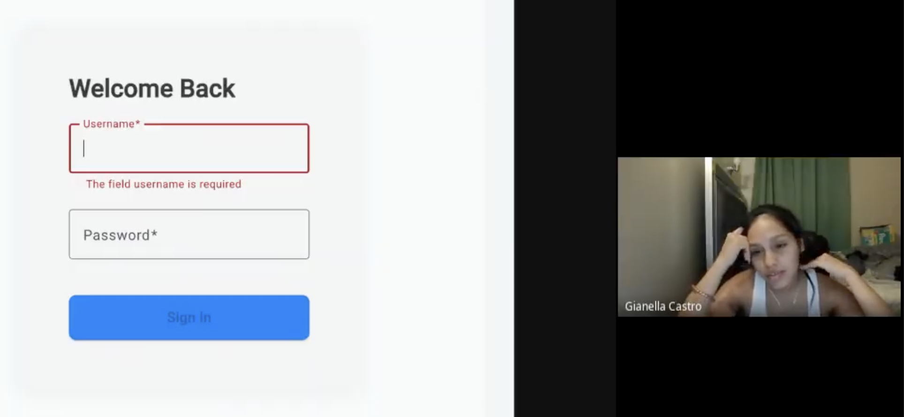<br>
      Entrevista con Gianella Castro (Entrevistada) y Jefferson Castro (Entrevistador).
    </div>
  </div>
  <table style="width:100%; border-collapse:collapse; margin-bottom:14px; font-size:14px;">
    <tr>
      <td style="border:1px solid #111; padding:10px; vertical-align:top; width:50%;">
        <strong>Entrevistado/a:</strong><br>Castro Tello, Gianella
      </td>
      <td style="border:1px solid #111; padding:10px; vertical-align:top; width:50%;">
        <strong>Entrevistador:</strong><br>Castro Pariona, Jefferson
      </td>
    </tr>
    <tr>
      <td colspan="2" style="border:1px solid #111; padding:10px; vertical-align:top;">
        <strong>Información del entrevistado:</strong><br>
        Sexo: Femenino &nbsp;/&nbsp; Edad: 29 &nbsp;/&nbsp; Residencia: Miraflores
      </td>
    </tr>
    <tr>
      <td colspan="2" style="border:1px solid #111; padding:10px; vertical-align:top;">
        <strong>Enlace Entrevista:</strong><br>
        <a href="" target="_blank" rel="noopener">
          https://drive.google.com/file/d/1mHCqNOhn-29ejmFIuWm-jjzBFYX-SWkX/view?usp=sharing
        </a>
      </td>
    </tr>
    <tr>
      <td style="border:1px solid #111; padding:10px; vertical-align:top;">
        <strong>Inicio:</strong> 0:00
      </td>
      <td style="border:1px solid #111; padding:10px; vertical-align:top;">
        <strong>Duración:</strong> 09:41
      </td>
    </tr>
    <tr>
      <td colspan="2" style="border:1px solid #111; padding:14px; vertical-align:top; min-height:120px;">
        <strong>Resumen de Entrevista:</strong>
        <div style="margin-top:8px; line-height:1.45; white-space:pre-wrap;">
          Gianella valida el potencial de WeRide para sus viajes cortos por el bajo costo, pero su experiencia de uso actual es frustrante. En la prueba, criticó severamente la interfaz: se sintió perdida por botones inactivos y llamadas a la acción (CTAs) que no se veían. Su desconfianza aumentó al no encontrar información clara sobre cancelaciones ni precios visibles de inmediato. Su conclusión fue tajante: para que ella adopte la app, la "conveniencia" debe ser real, lo que implica integrar pagos inmediatos con Yape/Plin y simplificar todo el proceso de registro y reserva.
        </div>
      </td>
    </tr>
  </table>
</div>

---

**Segmento 2: Empresas y Planes Corporativos (B2B)**

<div style="border:1px solid #111; padding:12px; border-radius:4px; max-width:820px; font-family:Arial, Helvetica, sans-serif; font-size:15px;">
  <div style="padding:8px 4px 20px 4px; font-size:17px;">
    <strong>Entrevista N°1</strong>
  </div>
  <div style="border-top:1px solid #111; padding-top:10px; margin-bottom:14px;">
    <div style="font-style:italic; margin-bottom:8px;">
      <strong>Vista Previa:</strong><br/>
      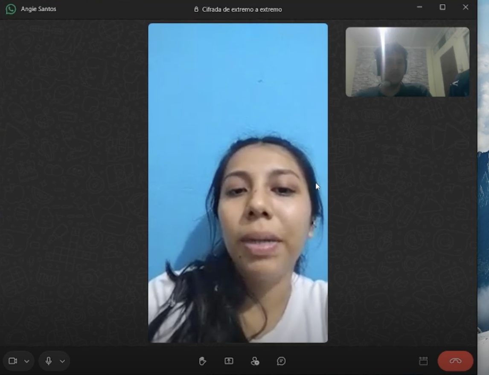<br>
      Entrevista con el Sr. Angie Santos (Entrevistado) y Jefferson Castro (Entrevistador).
    </div>
  </div>
  <table style="width:100%; border-collapse:collapse; margin-bottom:14px; font-size:14px;">
    <tr>
      <td style="border:1px solid #111; padding:10px; vertical-align:top; width:50%;">
        <strong>Entrevistado/a:</strong><br>Angie Santos (Jefe de TI)
      </td>
      <td style="border:1px solid #111; padding:10px; vertical-align:top; width:50%;">
        <strong>Entrevistador:</strong><br>Castro Pariona, Jefferson
      </td>
    </tr>
    <tr>
      <td colspan="2" style="border:1px solid #111; padding:10px; vertical-align:top;">
        <strong>Información del entrevistado:</strong><br>
        Sexo: Masculino &nbsp;/&nbsp; Edad: 46 años &nbsp;/&nbsp; Residencia: Lima - San Isidro
      </td>
    </tr>
    <tr>
      <td colspan="2" style="border:1px solid #111; padding:10px; vertical-align:top;">
        <strong>Enlace Entrevista:</strong><br>
        <a href="" target="_blank" rel="noopener">
          https://upcedupe-my.sharepoint.com/personal/u201822516_upc_edu_pe/_layouts/15/stream.aspx?id=%2Fpersonal%2Fu201822516%5Fupc%5Fedu%5Fpe%2FDocuments%2FEntrevistas%2FEntrevista%5FAngieSantos%5FSegmento2%2Emp4
        </a>
      </td>
    </tr>
    <tr>
      <td style="border:1px solid #111; padding:10px; vertical-align:top;">
        <strong>Inicio:</strong> 0:00
      </td>
      <td style="border:1px solid #111; padding:10px; vertical-align:top;">
        <strong>Duración:</strong> 5:22
      </td>
    </tr>
    <tr>
      <td colspan="2" style="border:1px solid #111; padding:14px; vertical-align:top; min-height:120px;">
        <strong>Resumen de Entrevista:</strong>
        <div style="margin-top:8px; line-height:1.45; white-space:pre-wrap;">
          Consultora 150+ empleados. Impuntualidad y alto gasto en subsidios. Viable: scooters y motos eléctricas.
        </div>
      </td>
    </tr>
  </table>
</div>

<div style="border:1px solid #111; padding:12px; border-radius:4px; max-width:820px; font-family:Arial, Helvetica, sans-serif; font-size:15px;">
  <div style="padding:8px 4px 20px 4px; font-size:17px;">
    <strong>Entrevista N°2</strong>
  </div>
  <div style="border-top:1px solid #111; padding-top:10px; margin-bottom:14px;">
    <div style="font-style:italic; margin-bottom:8px;">
      <strong>Vista Previa:</strong><br/>
      <br>
      Entrevista con el Sr. Bedith Lozano (Entrevistado) y Jefferson Castro (Entrevistador).
    </div>
  </div>
  <table style="width:100%; border-collapse:collapse; margin-bottom:14px; font-size:14px;">
    <tr>
      <td style="border:1px solid #111; padding:10px; vertical-align:top; width:50%;">
        <strong>Entrevistado/a:</strong><br>Bedith Lozano (Gerente Op.)
      </td>
      <td style="border:1px solid #111; padding:10px; vertical-align:top; width:50%;">
        <strong>Entrevistador:</strong><br>Jhimy pool romero meza
      </td>
    </tr>
    <tr>
      <td colspan="2" style="border:1px solid #111; padding:10px; vertical-align:top;">
        <strong>Información del entrevistado:</strong><br>
        Sexo: Femenino &nbsp;/&nbsp; Edad: 35 &nbsp;/&nbsp; Residencia: Lima
      </td>
    </tr>
    <tr>
      <td colspan="2" style="border:1px solid #111; padding:10px; vertical-align:top;">
        <strong>Enlace Entrevista:</strong><br>
        <a href="" target="_blank" rel="noopener">
          https://drive.google.com/drive/folders/1l6s8kK4PLq3Z56Flyd6ds6cXaVTdkyk4?usp=sharing
        </a>
      </td>
    </tr>
    <tr>
      <td style="border:1px solid #111; padding:10px; vertical-align:top;">
        <strong>Inicio:</strong> 0:00
      </td>
      <td style="border:1px solid #111; padding:10px; vertical-align:top;">
        <strong>Duración:</strong> 6:20
      </td>
    </tr>
    <tr>
      <td colspan="2" style="border:1px solid #111; padding:14px; vertical-align:top; min-height:120px;">
        <strong>Resumen de Entrevista:</strong>
        <div style="margin-top:8px; line-height:1.45; white-space:pre-wrap;">
          Mensajería 25 motos gasolina. Costos, mantenimiento, retrasos. Abierta a eléctrica con GPS.
        </div>
      </td>
    </tr>
  </table>
</div>

<!-- Falta-->
<div style="border:1px solid #111; padding:12px; border-radius:4px; max-width:820px; font-family:Arial, Helvetica, sans-serif; font-size:15px;">
  <div style="padding:8px 4px 20px 4px; font-size:17px;">
    <strong>Entrevista N°3</strong>
  </div>
  <div style="border-top:1px solid #111; padding-top:10px; margin-bottom:14px;">
    <div style="font-style:italic; margin-bottom:8px;">
      <strong>Vista Previa:</strong><br/>
      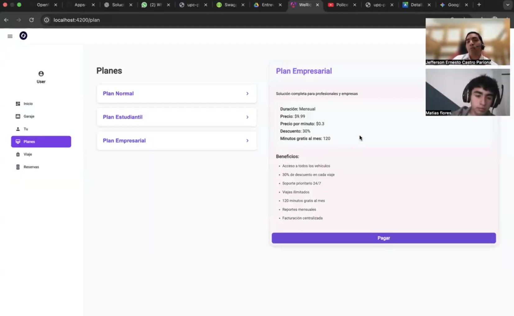<br>
      Entrevista con el Sr. Matias Flores Flores (Entrevistado) y Jefferson Castro (Entrevistador).
    </div>
  </div>
  <table style="width:100%; border-collapse:collapse; margin-bottom:14px; font-size:14px;">
    <tr>
      <td style="border:1px solid #111; padding:10px; vertical-align:top; width:50%;">
        <strong>Entrevistado/a:</strong><br>Flores Flores, Matias
      </td>
      <td style="border:1px solid #111; padding:10px; vertical-align:top; width:50%;">
        <strong>Entrevistador:</strong><br>Castro Pariona, Jefferson
      </td>
    </tr>
    <tr>
      <td colspan="2" style="border:1px solid #111; padding:10px; vertical-align:top;">
        <strong>Información del entrevistado:</strong><br>
        Sexo: Masculino &nbsp;/&nbsp; Edad: 25 &nbsp;/&nbsp; Residencia: Lima
      </td>
    </tr>
    <tr>
      <td colspan="2" style="border:1px solid #111; padding:10px; vertical-align:top;">
        <strong>Enlace Entrevista:</strong><br>
        <a href="" target="_blank" rel="noopener">
          https://drive.google.com/drive/folders/1UKbCq7bH5Y9_RQoZWcmjvXqT5jydmitV
        </a>
      </td>
    </tr>
    <tr>
      <td style="border:1px solid #111; padding:10px; vertical-align:top;">
        <strong>Inicio:</strong> 0:00
      </td>
      <td style="border:1px solid #111; padding:10px; vertical-align:top;">
        <strong>Duración:</strong> 09:41
      </td>
    </tr>
    <tr>
      <td colspan="2" style="border:1px solid #111; padding:14px; vertical-align:top; min-height:120px;">
        <strong>Resumen de Entrevista:</strong>
        <div style="margin-top:8px; line-height:1.45; white-space:pre-wrap;">
          Matias valora la conveniencia, bajo costo y rapidez. Percibe WeRide como una opción práctica para desplazamientos cortos si la propuesta es clara y el proceso de
          registro/pago es sencillo. Confían más si ven precios visibles, testimonios y
          métodos de pago locales (Yape/Plin). Reportaron dudas por falta de información
          (políticas de uso, cancelaciones) y encontraron áreas de la interfaz poco
          intuitivas (CTA poco visibles, botones inactivos).
        </div>
      </td>
    </tr>
  </table>
</div>

### 2.2.3. Análisis de entrevistas.
## 2.3. Needfinding.
### 2.3.1. User Personas.

  


  **2do segmento:  Empresas y Planes Corporativos (B2B)**

  

  ---

### 2.3.2. User Task Matrix.

  **Camila Torres (Joven universitaria)**

  | **Tareas / Tasks**                             | **Frecuencia** | **Importancia** |
  |-------------------------------------------------|---------------|----------------|
  | Buscar información para trabajos                | Alta          | Alta           |
  | Coordinar con compañeros de grupo               | Alta          | Alta           |
  | Acceder a material de estudio (libros, PDFs, videos) | Alta      | Alta           |
  | Planificar tiempo para estudiar                 | Alta          | Alta           |
  | Asistir a clases / capacitaciones               | Alta          | Alta           |
  | Comunicar avances de proyecto                   | Media         | Alta           |
  | Resolver dudas con expertos                     | Media         | Alta           |
  | Evaluar proveedores de herramientas/servicios   | Baja          | Media          |
  | Preparar reportes de resultados                 | Baja          | Media          |

  ---

  **Luis Salazar (Gerente de Operaciones)**

  | **Tareas / Tasks**                              | **Frecuencia** | **Importancia** |
  |-------------------------------------------------|---------------|----------------|
  | Buscar información para proyectos               | Media         | Media          |
  | Planificar tiempo de trabajo                    | Media         | Alta           |
  | Asistir a reuniones/capacitaciones              | Media         | Alta           |
  | Comunicar avances de proyecto                   | Alta          | Alta           |
  | Resolver dudas con expertos                     | Alta          | Alta           |
  | Evaluar proveedores de herramientas/servicios   | Alta          | Alta           |
  | Supervisar cumplimiento de estándares o KPIs    | Alta          | Alta           |
  | Preparar reportes de resultados                 | Alta          | Alta           |  
### 2.3.3. User Journey Mapping.

El User Journey Mapping se desarrolló para comprender la experiencia de los usuarios al interactuar con nuestra plataforma. Este mapeo detalla cada paso que el usuario realiza, los obstáculos que puede encontrar, y las emociones que surgen en el proceso. Así, nos ayuda a identificar oportunidades para mejorar la usabilidad y satisfacción del usuario.

  ### Segmento 1: Jovenes Universitarios. 
  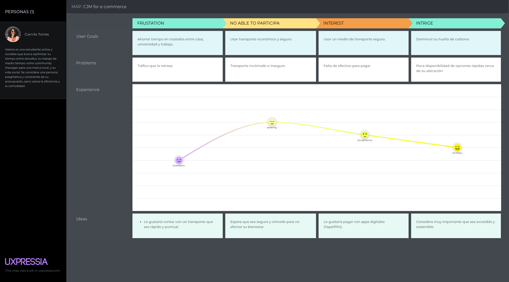

  ### Segmento 2: Empresas y Planes Corporativos (B2B)

  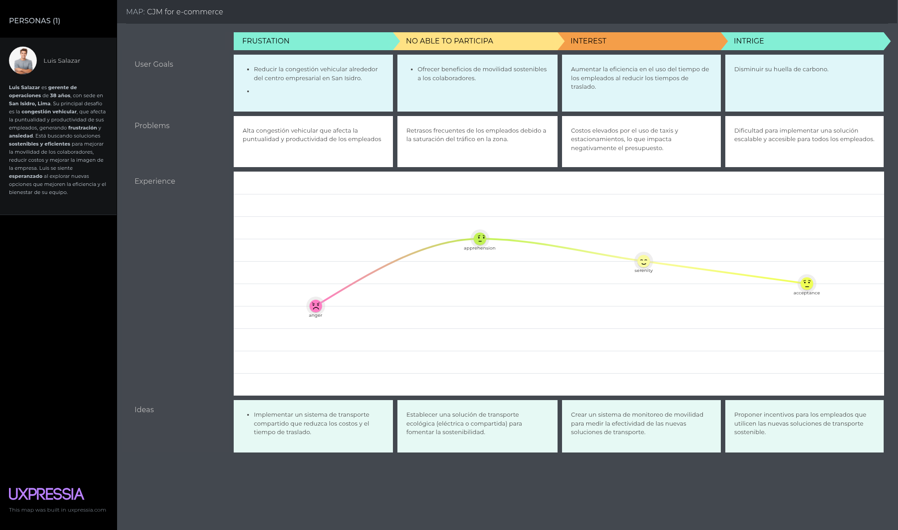 

### 2.3.4. Empathy Mapping.

- Camila Torres:  

  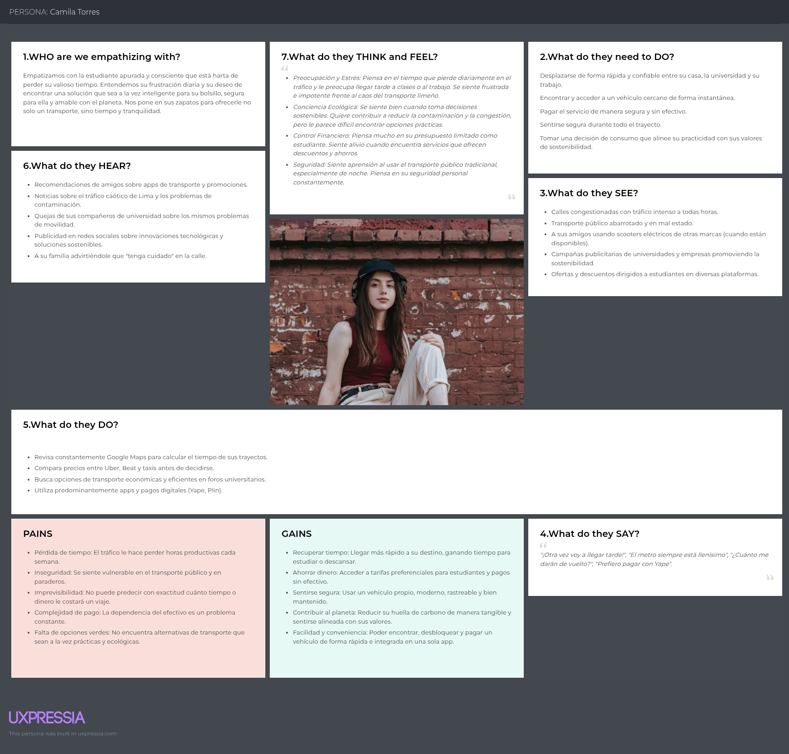  

  - Luis Salazar:  

  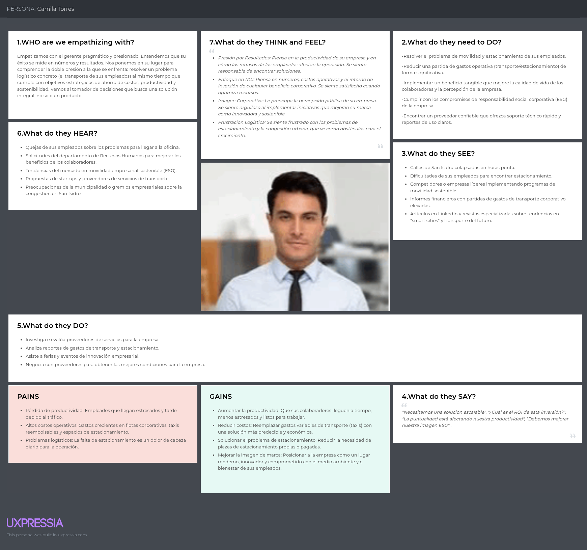  

### 2.3.5. As-Is Scenario Mapping.

El As-Is Scenario Mapping representa el recorrido actual del usuario (sin WeRide), construido a partir del User Journey Mapping y el Empathy Mapping ya elaborados para cada segmento.

**Segmento 1: Camila Torres (Joven Universitaria)**

<table style="width:100%; border-collapse:collapse; text-align:left; font-size:13px;">
  <thead>
    <tr style="background:#f2f2f2;">
      <th style="border:1px solid #999; padding:8px;">Fase</th>
      <th style="border:1px solid #999; padding:8px;">Frustración</th>
      <th style="border:1px solid #999; padding:8px;">No puede participar</th>
      <th style="border:1px solid #999; padding:8px;">Interés</th>
      <th style="border:1px solid #999; padding:8px;">Intriga</th>
    </tr>
  </thead>
  <tbody>
    <tr>
      <td style="border:1px solid #999; padding:8px; font-weight:bold;">Thinking (meta)</td>
      <td style="border:1px solid #999; padding:8px;">Ahorrar tiempo en traslados entre casa, universidad y trabajo.</td>
      <td style="border:1px solid #999; padding:8px;">Usar transporte económico y seguro.</td>
      <td style="border:1px solid #999; padding:8px;">Usar un medio de transporte seguro.</td>
      <td style="border:1px solid #999; padding:8px;">Disminuir su huella de carbono.</td>
    </tr>
    <tr>
      <td style="border:1px solid #999; padding:8px; font-weight:bold;">Doing (problema)</td>
      <td style="border:1px solid #999; padding:8px;">Tráfico que la retrasa.</td>
      <td style="border:1px solid #999; padding:8px;">Transporte incómodo e inseguro.</td>
      <td style="border:1px solid #999; padding:8px;">Falta de efectivo para pagar.</td>
      <td style="border:1px solid #999; padding:8px;">Poca disponibilidad de opciones rápidas cerca de su ubicación.</td>
    </tr>
    <tr>
      <td style="border:1px solid #999; padding:8px; font-weight:bold;">Feeling (emoción)</td>
      <td style="border:1px solid #999; padding:8px;">Aburrimiento (boredom)</td>
      <td style="border:1px solid #999; padding:8px;">Serenidad (serenity)</td>
      <td style="border:1px solid #999; padding:8px;">Aceptación (acceptance)</td>
      <td style="border:1px solid #999; padding:8px;">Éxtasis (ecstasy)</td>
    </tr>
  </tbody>
</table>

**Segmento 2: Luis Salazar (Empresas / B2B)**

<table style="width:100%; border-collapse:collapse; text-align:left; font-size:13px;">
  <thead>
    <tr style="background:#f2f2f2;">
      <th style="border:1px solid #999; padding:8px;">Fase</th>
      <th style="border:1px solid #999; padding:8px;">Frustración</th>
      <th style="border:1px solid #999; padding:8px;">No puede participar</th>
      <th style="border:1px solid #999; padding:8px;">Interés</th>
      <th style="border:1px solid #999; padding:8px;">Intriga</th>
    </tr>
  </thead>
  <tbody>
    <tr>
      <td style="border:1px solid #999; padding:8px; font-weight:bold;">Thinking (meta)</td>
      <td style="border:1px solid #999; padding:8px;">Reducir la congestión vehicular alrededor del centro empresarial en San Isidro.</td>
      <td style="border:1px solid #999; padding:8px;">Ofrecer beneficios de movilidad sostenible a los colaboradores.</td>
      <td style="border:1px solid #999; padding:8px;">Aumentar la eficiencia en el uso del tiempo de los empleados al reducir traslados.</td>
      <td style="border:1px solid #999; padding:8px;">Disminuir su huella de carbono.</td>
    </tr>
    <tr>
      <td style="border:1px solid #999; padding:8px; font-weight:bold;">Doing (problema)</td>
      <td style="border:1px solid #999; padding:8px;">Alta congestión vehicular que afecta la puntualidad y productividad de los empleados.</td>
      <td style="border:1px solid #999; padding:8px;">Retrasos frecuentes de los empleados debido a la saturación del tráfico.</td>
      <td style="border:1px solid #999; padding:8px;">Costos elevados por uso de taxis y estacionamientos.</td>
      <td style="border:1px solid #999; padding:8px;">Dificultad para implementar una solución escalable y accesible para todos los empleados.</td>
    </tr>
    <tr>
      <td style="border:1px solid #999; padding:8px; font-weight:bold;">Feeling (emoción)</td>
      <td style="border:1px solid #999; padding:8px;">Ira (anger)</td>
      <td style="border:1px solid #999; padding:8px;">Aprensión (apprehension)</td>
      <td style="border:1px solid #999; padding:8px;">Serenidad (serenity)</td>
      <td style="border:1px solid #999; padding:8px;">Aceptación (acceptance)</td>
    </tr>
  </tbody>
</table>

## 2.4. Big Picture Event Storming.
El **Event Storming** modela de forma secuencial el ciclo completo de uso de la plataforma de micromovilidad eléctrica. Se identifican las interacciones entre usuarios, administradores, sistemas externos ***(IoT, GPS, pasarela de pagos)*** y el sistema de negocio.
  Se muestra cómo la plataforma conecta en un mismo flujo las necesidades de movilidad del usuario, los procesos de pago y seguridad, asegurando un ecosistema completo de micromovilidad urbana.

  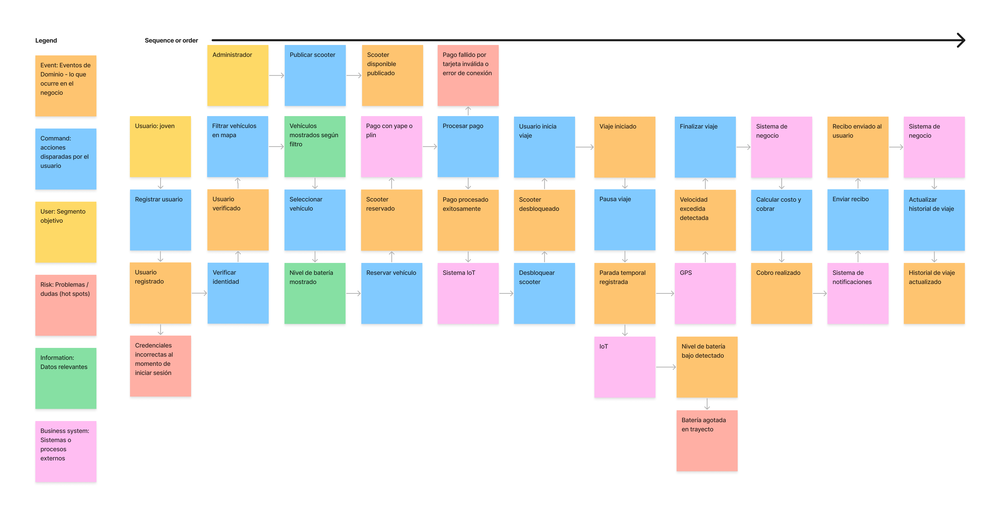

## 2.5. Ubiquitous Language.
| Término                 | Tipo               | Definición                                                                 |
  |--------------------------|--------------------|-----------------------------------------------------------------------------|
  | Usuario                 | Actor              | Persona registrada que utiliza la app para alquilar scooters.              |
  | Administrador           | Actor              | Responsable de gestionar flota, usuarios y soporte desde el sistema.       |
  | Scooter                 | Entidad            | Vehículo eléctrico disponible para alquiler dentro de la plataforma.       |
  | Estación Virtual        | Entidad            | Punto geográfico donde los scooters pueden ser recogidos o dejados.        |
  | Reserva                 | Evento/Entidad     | Acción de apartar un scooter disponible antes de iniciar el alquiler.      |
  | Alquiler                | Evento/Entidad     | Proceso activo en el que el usuario usa un scooter y se mide en tiempo/distancia. |
  | Pago                    | Evento             | Transacción realizada por el usuario para completar un alquiler.           |
  | Tarifa                  | Entidad            | Costo asociado al alquiler, calculado según tiempo y distancia.            |
  | Desbloqueo              | Comando/Evento     | Acción de habilitar el scooter tras confirmar la reserva y el pago inicial. |
  | Devolución              | Evento             | Acción de finalizar el uso y dejar el scooter en una estación virtual.     |
  | Mantenimiento           | Proceso            | Revisión y reparación de scooters por parte del personal técnico.          |
  | Penalización            | Evento/Entidad     | Cargo adicional aplicado por mal uso, retraso o devolución fuera de zona.  |
  | Historial de Viajes     | Vista              | Registro de reservas, alquileres y pagos asociados a cada usuario.         |
  | Soporte                 | Servicio           | Canal de ayuda en la app para resolver incidencias de los usuarios.        |
  | Flota                   | Entidad/Conjunto   | Conjunto de scooters activos disponibles en la ciudad.                     |
  | Ubicación en Tiempo Real| Información        | Datos GPS que muestran dónde se encuentra cada scooter.                     |
  | Sesión de Usuario       | Entidad            | Periodo en que el usuario está logueado y utilizando la app.               |

---


# Capítulo III: Requirements Specification

## 3.1. To-Be Scenario Mapping

### Introducción

A partir del As-Is Scenario Mapping elaborado en el Capítulo II, el equipo construye la versión To-Be para cada User Persona, representando cómo cambiará su experiencia una vez implementada la solución WeRide. El proceso siguió las etapas de preparación, lluvia de ideas individual, revisión grupal, identificación de fases como columnas, y comparación directa con el mapa As-Is para identificar los cambios que ofrece la nueva experiencia.

### To-Be Scenario Map — Camila Torres (Joven Universitaria)

<table style="width:100%; border-collapse:collapse; text-align:left; font-size:13px;">
  <thead>
    <tr style="background:#f2f2f2;">
      <th style="border:1px solid #999; padding:8px;">Fase</th>
      <th style="border:1px solid #999; padding:8px;">Descubrimiento</th>
      <th style="border:1px solid #999; padding:8px;">Búsqueda y reserva</th>
      <th style="border:1px solid #999; padding:8px;">Uso del vehículo</th>
      <th style="border:1px solid #999; padding:8px;">Pago y cierre</th>
    </tr>
  </thead>
  <tbody>
    <tr>
      <td style="border:1px solid #999; padding:8px; font-weight:bold;">Thinking</td>
      <td style="border:1px solid #999; padding:8px;">"¿Hay una forma más rápida y económica de llegar a la universidad?"</td>
      <td style="border:1px solid #999; padding:8px;">"Puedo ver en el mapa qué vehículos están disponibles cerca de mí."</td>
      <td style="border:1px solid #999; padding:8px;">"Me siento segura porque sé el estado de la batería y la ruta."</td>
      <td style="border:1px solid #999; padding:8px;">"Pagué con Yape/Plin sin necesitar efectivo."</td>
    </tr>
    <tr>
      <td style="border:1px solid #999; padding:8px; font-weight:bold;">Doing</td>
      <td style="border:1px solid #999; padding:8px;">Descarga la app WeRide y revisa el mapa en tiempo real.</td>
      <td style="border:1px solid #999; padding:8px;">Reserva un scooter/bicicleta cercano y lo desbloquea desde la app.</td>
      <td style="border:1px solid #999; padding:8px;">Viaja usando el vehículo, con monitoreo IoT activo.</td>
      <td style="border:1px solid #999; padding:8px;">Finaliza el viaje y paga automáticamente por la app.</td>
    </tr>
    <tr>
      <td style="border:1px solid #999; padding:8px; font-weight:bold;">Feeling</td>
      <td style="border:1px solid #999; padding:8px;">Curiosidad / Interés</td>
      <td style="border:1px solid #999; padding:8px;">Confianza</td>
      <td style="border:1px solid #999; padding:8px;">Tranquilidad</td>
      <td style="border:1px solid #999; padding:8px;">Satisfacción</td>
    </tr>
  </tbody>
</table>

Principales cambios respecto al As-Is: tiempos de búsqueda de vehículo reducidos gracias a geolocalización en tiempo real; proceso de desbloqueo simplificado; mayor sensación de seguridad por visibilidad del estado de batería/vehículo; eliminación de incertidumbre sobre disponibilidad y de la dependencia de efectivo.

### To-Be Scenario Map — Luis Salazar (Empresas / B2B)

<table style="width:100%; border-collapse:collapse; text-align:left; font-size:13px;">
  <thead>
    <tr style="background:#f2f2f2;">
      <th style="border:1px solid #999; padding:8px;">Fase</th>
      <th style="border:1px solid #999; padding:8px;">Evaluación</th>
      <th style="border:1px solid #999; padding:8px;">Implementación</th>
      <th style="border:1px solid #999; padding:8px;">Operación diaria</th>
      <th style="border:1px solid #999; padding:8px;">Seguimiento</th>
    </tr>
  </thead>
  <tbody>
    <tr>
      <td style="border:1px solid #999; padding:8px; font-weight:bold;">Thinking</td>
      <td style="border:1px solid #999; padding:8px;">"WeRide puede reducir nuestros costos de transporte interno."</td>
      <td style="border:1px solid #999; padding:8px;">"El plan corporativo es flexible y escalable para todos los colaboradores."</td>
      <td style="border:1px solid #999; padding:8px;">"Puedo ver en el dashboard cuánto se está usando el servicio."</td>
      <td style="border:1px solid #999; padding:8px;">"Los reportes de uso justifican la inversión ante gerencia."</td>
    </tr>
    <tr>
      <td style="border:1px solid #999; padding:8px; font-weight:bold;">Doing</td>
      <td style="border:1px solid #999; padding:8px;">Contacta a WeTech y revisa el plan de suscripción corporativa.</td>
      <td style="border:1px solid #999; padding:8px;">Registra a los colaboradores en la plataforma empresarial.</td>
      <td style="border:1px solid #999; padding:8px;">Monitorea el uso de la flota desde el dashboard administrativo.</td>
      <td style="border:1px solid #999; padding:8px;">Analiza métricas de ahorro de tiempo y costos con el equipo directivo.</td>
    </tr>
    <tr>
      <td style="border:1px solid #999; padding:8px; font-weight:bold;">Feeling</td>
      <td style="border:1px solid #999; padding:8px;">Expectativa</td>
      <td style="border:1px solid #999; padding:8px;">Confianza</td>
      <td style="border:1px solid #999; padding:8px;">Control</td>
      <td style="border:1px solid #999; padding:8px;">Satisfacción</td>
    </tr>
  </tbody>
</table>

Principales cambios respecto al As-Is: visibilidad centralizada de uso de flota mediante dashboard administrativo; reducción de tiempos muertos de gestión y de costos por taxis/estacionamiento; trazabilidad completa de vehículos asignados a colaboradores; reemplazo de la frustración inicial por control y confianza en la solución.

---

## 3.2. User Stories.
En esta sección se presentan las épicas e historias de usuario identificadas para WeRide, incluyendo sus roles, prioridades, descripciones y criterios de aceptación. Los escenarios de aceptación se expresan mediante la estructura Dado–Cuando–Entonces.
### EP01 — Acceso a la aplicación

| Story ID | User | Priority | Epic |
|---|---|---|---|
| US-01 | Usuario | Alta | EP01 |
| **Title** | Inicio de sesión y registro | | |
| **Description** | Como usuario quiero poder iniciar sesión o registrarme en la app para usarla diariamente. | | |
| **Acceptance Criteria** | **Escenario 1:** Dado que una persona no tiene cuenta, cuando proporciona datos válidos de registro, entonces el sistema crea su cuenta y permite su autenticación. | | |
| | **Escenario 2:** Dado que las credenciales son incorrectas, cuando se intenta completar la operación correspondiente, entonces el sistema rechaza el acceso sin iniciar sesión. | | |

| Story ID | User | Priority | Epic |
|---|---|---|---|
| US-02 | Usuario | Alta | EP01 |
| **Title** | Introducir Número de Celular | | |
| **Description** | Como usuario, quiero introducir mi número de celular para validar mi identidad y recibir notificaciones importantes. | | |
| **Acceptance Criteria** | **Escenario 1:** Dado que un usuario debe verificar su identidad, cuando registra un número telefónico válido, entonces el sistema acepta el número para iniciar la verificación. | | |
| | **Escenario 2:** Dado que el número no cumple el formato esperado, cuando se intenta completar la operación correspondiente, entonces el sistema informa que no puede utilizarse. | | |

| Story ID | User | Priority | Epic |
|---|---|---|---|
| US-03 | Usuario | Alta | EP01 |
| **Title** | Introducir código de verificación | | |
| **Description** | Como usuario, quiero introducir un código de verificación para validar mi identidad en la aplicación. | | |
| **Acceptance Criteria** | **Escenario 1:** Dado que existe un código de verificación vigente, cuando el usuario proporciona el código correcto, entonces el sistema confirma la verificación. | | |
| | **Escenario 2:** Dado que el código es inválido o venció, cuando se intenta completar la operación correspondiente, entonces el sistema no valida la identidad. | | |

| Story ID | User | Priority | Epic |
|---|---|---|---|
| US-04 | Usuario nuevo | Alta | EP01 |
| **Title** | Datos de usuario | | |
| **Description** | Como usuario nuevo, quiero crear mi perfil con mis datos para que la app personalice mi experiencia. | | |
| **Acceptance Criteria** | **Escenario 1:** Dado que un usuario acaba de registrarse, cuando completa los datos obligatorios de su perfil, entonces el sistema guarda la información asociada a su cuenta. | | |
| | **Escenario 2:** Dado que faltan datos obligatorios, cuando se intenta completar la operación correspondiente, entonces el sistema impide completar el registro. | | |

| Story ID | User | Priority | Epic |
|---|---|---|---|
| US-06 | Usuario | Media | EP01 |
| **Title** | Gestión y personalización de perfil | | |
| **Description** | Como usuario, quiero administrar mi cuenta y mi perfil para mantener mis datos actualizados. | | |
| **Acceptance Criteria** | **Escenario 1:** Dado que un usuario autenticado tiene un perfil, cuando modifica datos permitidos, entonces el sistema conserva los cambios. | | |
| | **Escenario 2:** Dado que los datos nuevos no son válidos, cuando se intenta completar la operación correspondiente, entonces el sistema rechaza la actualización. | | |

| Story ID | User | Priority | Epic |
|---|---|---|---|
| US-36 | Usuario registrado | Media | EP01 |
| **Title** | Recuperar contraseña | | |
| **Description** | Como usuario registrado, quiero recuperar mi contraseña para volver a entrar si la olvido. | | |
| **Acceptance Criteria** | **Escenario 1:** Dado que un usuario registrado olvidó su contraseña, cuando solicita recuperar el acceso y verifica su identidad, entonces el sistema permite establecer nuevas credenciales. | | |
| | **Escenario 2:** Dado que la verificación no es válida, cuando se intenta completar la operación correspondiente, entonces el sistema impide modificar la contraseña. | | |

### EP02 — Funcionalidades de la app

| Story ID | User | Priority | Epic |
|---|---|---|---|
| US-05 | Usuario | Alta | EP02 |
| **Title** | Página Principal | | |
| **Description** | Como usuario, quiero ver una pantalla principal clara con accesos rápidos para llegar rápido a reservar un vehículo. | | |
| **Acceptance Criteria** | **Escenario 1:** Dado que un usuario ha iniciado sesión, cuando consulta las funciones principales, entonces el sistema ofrece acceso a búsqueda, reservas y viajes. | | |
| | **Escenario 2:** Dado que no hay reservas activas, cuando se intenta completar la operación correspondiente, entonces el sistema presenta el estado sin inventar viajes. | | |

| Story ID | User | Priority | Epic |
|---|---|---|---|
| US-07 | Usuario | Alta | EP02 |
| **Title** | Gestión y visualización de vehículos en Garaje | | |
| **Description** | Como usuario, quiero ver los vehículos del Garaje para elegir el que mejor se ajuste a mi viaje. | | |
| **Acceptance Criteria** | **Escenario 1:** Dado que existen vehículos registrados, cuando el usuario consulta el catálogo de vehículos, entonces el sistema devuelve sus características y disponibilidad. | | |
| | **Escenario 2:** Dado que no existen vehículos disponibles, cuando se intenta completar la operación correspondiente, entonces el sistema devuelve un resultado vacío. | | |

| Story ID | User | Priority | Epic |
|---|---|---|---|
| US-08 | Usuario | Alta | EP02 |
| **Title** | Filtrado de vehículos en Garaje | | |
| **Description** | Como usuario, quiero filtrar los vehículos por tipo, precio, disponibilidad o marca para encontrar rápidamente el adecuado. | | |
| **Acceptance Criteria** | **Escenario 1:** Dado que hay vehículos con diferentes características, cuando el usuario aplica filtros de tipo, precio o disponibilidad, entonces el sistema devuelve solo los vehículos que cumplen las condiciones. | | |
| | **Escenario 2:** Dado que ningún vehículo cumple los filtros, cuando se intenta completar la operación correspondiente, entonces el sistema devuelve un resultado vacío. | | |

### EP03 — Gestión de pagos y suscripciones

| Story ID | User | Priority | Epic |
|---|---|---|---|
| US-09 | Usuario | Alta | EP03 |
| **Title** | Selección y pago de planes | | |
| **Description** | Como usuario, quiero comparar los planes disponibles para elegir el que más me conviene. | | |
| **Acceptance Criteria** | **Escenario 1:** Dado que existen planes activos, cuando el usuario consulta y selecciona un plan, entonces el sistema informa las condiciones y el precio del plan. | | |
| | **Escenario 2:** Dado que el plan deja de estar disponible, cuando se intenta completar la operación correspondiente, entonces el sistema impide seleccionarlo. | | |

| Story ID | User | Priority | Epic |
|---|---|---|---|
| US-10 | Usuario | Alta | EP03 |
| **Title** | Proceso de pago de planes | | |
| **Description** | Como usuario quiero ingresar los datos de mi tarjeta para activar el plan seleccionado. | | |
| **Acceptance Criteria** | **Escenario 1:** Dado que un usuario seleccionó un plan vigente, cuando envía datos de pago válidos en el entorno habilitado, entonces el sistema procesa la solicitud y registra el resultado. | | |
| | **Escenario 2:** Dado que la operación de pago es rechazada, cuando se intenta completar la operación correspondiente, entonces el sistema no activa el plan. | | |

| Story ID | User | Priority | Epic |
|---|---|---|---|
| US-24 | Usuario | Alta | EP03 |
| **Title** | Pago en línea (sandbox) | | |
| **Description** | Como usuario, quiero pagar mi viaje o plan con Yape/Plin (modo sandbox) para completar el cobro sin usar efectivo. | | |
| **Acceptance Criteria** | **Escenario 1:** Dado que existe un importe pendiente en el entorno sandbox, cuando el usuario confirma el pago con el medio simulado, entonces el sistema registra el resultado de la transacción. | | |
| | **Escenario 2:** Dado que el proveedor simulado rechaza la operación, cuando se intenta completar la operación correspondiente, entonces el sistema mantiene el pago pendiente. | | |

### EP04 — Uso del mapa

| Story ID | User | Priority | Epic |
|---|---|---|---|
| US-11 | Usuario | Alta | EP04 |
| **Title** | Seleccionar ubicación para ver vehículos cercanos disponibles | | |
| **Description** | Como usuario, quiero ver los vehículos cercanos a la ubicación que elijo en el mapa para reservar el más cercano. | | |
| **Acceptance Criteria** | **Escenario 1:** Dado que el usuario indica una ubicación válida, cuando solicita vehículos próximos, entonces el sistema devuelve vehículos disponibles cercanos a esa ubicación. | | |
| | **Escenario 2:** Dado que no hay unidades cercanas, cuando se intenta completar la operación correspondiente, entonces el sistema informa que no hay disponibilidad. | | |

### EP05 — Gestión de viajes

| Story ID | User | Priority | Epic |
|---|---|---|---|
| US-12 | Usuario en viaje | Alta | EP05 |
| **Title** | Visualización de viaje en mapa | | |
| **Description** | Como usuario en viaje, quiero ver mi trayecto y los datos del vehículo para controlar la batería y el tiempo restante. | | |
| **Acceptance Criteria** | **Escenario 1:** Dado que hay un viaje en curso, cuando el usuario consulta su trayecto, entonces el sistema entrega la ruta y el estado actualizado del vehículo. | | |
| | **Escenario 2:** Dado que no existe un viaje activo, cuando se intenta completar la operación correspondiente, entonces el sistema no devuelve datos de un viaje ajeno. | | |

| Story ID | User | Priority | Epic |
|---|---|---|---|
| US-13 | Usuario | Media | EP05 |
| **Title** | Historial de viajes | | |
| **Description** | Como usuario, quiero ver el historial de mis viajes para trackear gastos y rutas. | | |
| **Acceptance Criteria** | **Escenario 1:** Dado que un usuario tiene viajes finalizados, cuando consulta su historial, entonces el sistema devuelve fechas, trayectos y costos asociados. | | |
| | **Escenario 2:** Dado que no existen viajes anteriores, cuando se intenta completar la operación correspondiente, entonces el sistema devuelve un historial vacío. | | |

| Story ID | User | Priority | Epic |
|---|---|---|---|
| US-14 | Usuario | Media | EP05 |
| **Title** | Calificación de viaje | | |
| **Description** | Como usuario, quiero calificar mi experiencia después del viaje para feedback y mejora del servicio. | | |
| **Acceptance Criteria** | **Escenario 1:** Dado que un usuario finalizó un viaje, cuando envía una calificación válida, entonces el sistema registra la valoración vinculada al viaje. | | |
| | **Escenario 2:** Dado que intenta calificar un viaje ajeno, cuando se intenta completar la operación correspondiente, entonces el sistema rechaza la calificación. | | |

| Story ID | User | Priority | Epic |
|---|---|---|---|
| US-15 | Usuario | Media | EP05 |
| **Title** | Reportar problema con vehículo | | |
| **Description** | Como usuario, quiero reportar un problema con el vehículo para alertar a soporte y obtener ayuda rápida. | | |
| **Acceptance Criteria** | **Escenario 1:** Dado que un usuario identifica una incidencia en un vehículo, cuando registra un reporte con los datos necesarios, entonces el sistema crea la incidencia para soporte. | | |
| | **Escenario 2:** Dado que faltan datos esenciales, cuando se intenta completar la operación correspondiente, entonces el sistema solicita completar el reporte. | | |

| Story ID | User | Priority | Epic |
|---|---|---|---|
| US-23 | Usuario en viaje | Alta | EP05 |
| **Title** | Finalizar viaje | | |
| **Description** | Como usuario en viaje, quiero finalizar mi viaje desde la app para dejar el vehículo bloqueado y cerrar el cobro. | | |
| **Acceptance Criteria** | **Escenario 1:** Dado que un usuario tiene un viaje activo, cuando solicita finalizarlo en condiciones permitidas, entonces el sistema cierra el viaje y calcula el importe. | | |
| | **Escenario 2:** Dado que no se confirma el bloqueo del vehículo, cuando se intenta completar la operación correspondiente, entonces el sistema informa que el cierre está pendiente. | | |

### EP06 — Gestión de reservas

| Story ID | User | Priority | Epic |
|---|---|---|---|
| US-16 | Usuario | Alta | EP06 |
| **Title** | Notificación de fin de reserva | | |
| **Description** | Como usuario, quiero recibir una notificación antes de que finalice mi reserva. | | |
| **Acceptance Criteria** | **Escenario 1:** Dado que una reserva está próxima a finalizar, cuando se alcanza el momento configurado de aviso, entonces el sistema genera la notificación de finalización próxima. | | |
| | **Escenario 2:** Dado que la reserva fue cancelada, cuando se intenta completar la operación correspondiente, entonces el sistema no envía un aviso de fin para esa reserva. | | |

| Story ID | User | Priority | Epic |
|---|---|---|---|
| US-17 | Usuario | Alta | EP06 |
| **Title** | Crear una reserva | | |
| **Description** | Como usuario, quiero reservar un vehículo desde la app para asegurar su disponibilidad. | | |
| **Acceptance Criteria** | **Escenario 1:** Dado que un vehículo se encuentra disponible, cuando el usuario solicita reservarlo, entonces el sistema registra la reserva y actualiza la disponibilidad. | | |
| | **Escenario 2:** Dado que el vehículo ya está reservado, cuando se intenta completar la operación correspondiente, entonces el sistema rechaza la reserva duplicada. | | |

| Story ID | User | Priority | Epic |
|---|---|---|---|
| US-18 | Usuario con reserva | Alta | EP06 |
| **Title** | Notificación de inicio y vencimiento | | |
| **Description** | Como usuario con reserva, quiero recibir notificaciones cuando mi reserva esté activa y por expirar para no perderla. | | |
| **Acceptance Criteria** | **Escenario 1:** Dado que una reserva cambia a activa o se aproxima a su vencimiento, cuando ocurre el evento correspondiente, entonces el sistema genera el aviso asociado al estado. | | |
| | **Escenario 2:** Dado que la reserva ya no está vigente, cuando se intenta completar la operación correspondiente, entonces el sistema evita generar avisos de vigencia incorrectos. | | |

| Story ID | User | Priority | Epic |
|---|---|---|---|
| US-37 | Usuario con una reserva activa | Alta | EP06 |
| **Title** | Cancelar reserva | | |
| **Description** | Como usuario con una reserva activa, quiero cancelarla para liberar el vehículo si cambio de planes. | | |
| **Acceptance Criteria** | **Escenario 1:** Dado que un usuario tiene una reserva cancelable, cuando solicita cancelarla, entonces el sistema actualiza su estado y libera el vehículo. | | |
| | **Escenario 2:** Dado que la reserva ya inició su viaje, cuando se intenta completar la operación correspondiente, entonces el sistema aplica las restricciones de cancelación. | | |

### EP07 — Desbloqueo y acceso rápido a vehículos

| Story ID | User | Priority | Epic |
|---|---|---|---|
| US-19 | Usuario con reserva activa | Alta | EP07 |
| **Title** | Desbloqueo de vehículo con QR | | |
| **Description** | Como usuario con reserva activa, quiero desbloquear el vehículo escaneando un QR para iniciar mi viaje sin pasos adicionales. | | |
| **Acceptance Criteria** | **Escenario 1:** Dado que el usuario tiene una reserva válida, cuando se valida el código QR del vehículo reservado, entonces el sistema autoriza el desbloqueo del vehículo correcto. | | |
| | **Escenario 2:** Dado que el código pertenece a otro vehículo, cuando se intenta completar la operación correspondiente, entonces el sistema deniega el desbloqueo. | | |

| Story ID | User | Priority | Epic |
|---|---|---|---|
| US-20 | Usuario con reserva activa | Alta | EP07 |
| **Title** | Desbloqueo de vehículo desde la app | | |
| **Description** | Como usuario con reserva activa, quiero desbloquear el vehículo desde la app para iniciar mi viaje cuando no puedo escanear el QR. | | |
| **Acceptance Criteria** | **Escenario 1:** Dado que el usuario tiene una reserva activa, cuando solicita desbloquear el vehículo reservado, entonces el sistema envía la orden de desbloqueo autorizada. | | |
| | **Escenario 2:** Dado que la reserva no corresponde al usuario, cuando se intenta completar la operación correspondiente, entonces el sistema rechaza la solicitud. | | |

| Story ID | User | Priority | Epic |
|---|---|---|---|
| US-21 | Usuario | Alta | EP07 |
| **Title** | Ver estado de desbloqueo | | |
| **Description** | Como usuario, quiero ver el estado del desbloqueo en tiempo real para saber cuándo puedo empezar a conducir. | | |
| **Acceptance Criteria** | **Escenario 1:** Dado que se solicitó un desbloqueo, cuando cambia el estado del dispositivo, entonces el sistema comunica el estado confirmado. | | |
| | **Escenario 2:** Dado que el dispositivo no confirma la operación, cuando se intenta completar la operación correspondiente, entonces el sistema informa que el desbloqueo no se completó. | | |

| Story ID | User | Priority | Epic |
|---|---|---|---|
| US-22 | Usuario | Baja | EP07 |
| **Title** | Desbloqueo programado | | |
| **Description** | Como usuario, quiero programar el desbloqueo de un vehículo para una hora específica y asegurar su disponibilidad. | | |
| **Acceptance Criteria** | **Escenario 1:** Dado que un vehículo admite programación y está disponible, cuando el usuario solicita un horario futuro válido, entonces el sistema registra la programación. | | |
| | **Escenario 2:** Dado que existe conflicto con otra reserva, cuando se intenta completar la operación correspondiente, entonces el sistema rechaza el horario. | | |

### EP08 — Landing page y soporte

| Story ID | User | Priority | Epic |
|---|---|---|---|
| US-27 | Visitante | Alta | EP08 |
| **Title** | Landing page informativa | | |
| **Description** | Como visitante, quiero conocer la propuesta de valor de WeRide desde la página de inicio para comprender qué servicio ofrece. | | |
| **Acceptance Criteria** | **Escenario 1:** Dado que un visitante abre la página de inicio, cuando termina de cargar, entonces visualiza el nombre de WeRide, un mensaje introductorio y una acción principal. | | |
| | **Escenario 2:** Dado que el contenido principal no está disponible, cuando se abre la página, entonces se presenta un mensaje comprensible sin mostrar contenido incompleto. | | |

| Story ID | User | Priority | Epic |
|---|---|---|---|
| US-28 | Usuario | Media | EP08 |
| **Title** | Contactar con soporte | | |
| **Description** | Como usuario, quiero acceder a un canal de soporte desde la landing page o la aplicación para resolver mis dudas. | | |
| **Acceptance Criteria** | **Escenario 1:** Dado que un usuario necesita asistencia, cuando selecciona la opción de contacto, entonces encuentra un canal de soporte identificable. | | |
| | **Escenario 2:** Dado que el canal de contacto no está disponible, cuando intenta utilizarlo, entonces recibe una indicación alternativa o un mensaje informativo. | | |

| Story ID | User | Priority | Epic |
|---|---|---|---|
| US-43 | Visitante | Alta | EP08 |
| **Title** | Navegación entre secciones | | |
| **Description** | Como visitante, quiero desplazarme a las secciones de la landing page desde el menú para encontrar rápidamente la información que busco. | | |
| **Acceptance Criteria** | **Escenario 1:** Dado que el visitante está en la landing page, cuando selecciona una sección del menú, entonces la página lo dirige a la sección correspondiente. | | |
| | **Escenario 2:** Dado que el visitante navega por distintas secciones, cuando utiliza el menú, entonces los enlaces conservan su destino correcto. | | |

| Story ID | User | Priority | Epic |
|---|---|---|---|
| US-44 | Visitante | Alta | EP08 |
| **Title** | Visualización del catálogo de vehículos | | |
| **Description** | Como visitante, quiero conocer los tipos de vehículos eléctricos ofrecidos para identificar alternativas adecuadas a mis necesidades. | | |
| **Acceptance Criteria** | **Escenario 1:** Dado que existen categorías de vehículos publicadas, cuando el visitante abre la sección Vehicles, entonces visualiza sus imágenes y nombres. | | |
| | **Escenario 2:** Dado que no se puede cargar una imagen del catálogo, cuando se muestra su tarjeta, entonces el nombre del vehículo continúa siendo legible. | | |

| Story ID | User | Priority | Epic |
|---|---|---|---|
| US-45 | Visitante | Alta | EP08 |
| **Title** | Comparación de vehículos eléctricos | | |
| **Description** | Como visitante, quiero consultar las especificaciones de cada tipo de vehículo para comparar sus características antes de elegir. | | |
| **Acceptance Criteria** | **Escenario 1:** Dado que el visitante abre Compare Vehicles, cuando selecciona una categoría, entonces visualiza la velocidad máxima, autonomía, peso y tiempo de carga correspondientes. | | |
| | **Escenario 2:** Dado que el visitante cambia de categoría, cuando selecciona otro vehículo, entonces las especificaciones mostradas se actualizan de forma coherente. | | |

| Story ID | User | Priority | Epic |
|---|---|---|---|
| US-46 | Visitante | Alta | EP08 |
| **Title** | Visualización de ubicaciones del servicio | | |
| **Description** | Como visitante, quiero consultar las zonas y puntos de referencia donde opera WeRide para evaluar si el servicio me resulta accesible. | | |
| **Acceptance Criteria** | **Escenario 1:** Dado que existen ubicaciones publicadas, cuando el visitante abre Locations, entonces visualiza el nombre y la dirección de cada punto. | | |
| | **Escenario 2:** Dado que una ubicación no tiene imagen disponible, cuando se muestra su información, entonces su nombre y dirección permanecen visibles. | | |

| Story ID | User | Priority | Epic |
|---|---|---|---|
| US-47 | Visitante | Alta | EP08 |
| **Title** | Información sobre el funcionamiento del servicio | | |
| **Description** | Como visitante, quiero conocer los pasos para registrarme, utilizar y devolver un vehículo para comprender el proceso de uso de WeRide. | | |
| **Acceptance Criteria** | **Escenario 1:** Dado que el visitante abre How it works, cuando revisa la sección, entonces encuentra los pasos del servicio en un orden comprensible. | | |
| | **Escenario 2:** Dado que el visitante consulta un paso, cuando lee su descripción, entonces identifica la acción que debe realizar. | | |

| Story ID | User | Priority | Epic |
|---|---|---|---|
| US-48 | Visitante | Alta | EP08 |
| **Title** | Visualización de planes y tarifas | | |
| **Description** | Como visitante, quiero comparar los planes, precios y beneficios disponibles para evaluar cuál se adapta a mis necesidades. | | |
| **Acceptance Criteria** | **Escenario 1:** Dado que existen planes publicados, cuando el visitante abre Choose Your Plan, entonces visualiza el nombre, precio y beneficios de cada plan. | | |
| | **Escenario 2:** Dado que el visitante revisa un plan, cuando consulta sus condiciones, entonces puede distinguir duración, tarifa por minuto y beneficios indicados. | | |

| Story ID | User | Priority | Epic |
|---|---|---|---|
| US-49 | Visitante | Alta | EP08 |
| **Title** | Acceso a la aplicación desde la landing page | | |
| **Description** | Como visitante, quiero abrir la aplicación mediante Go to App para comenzar a utilizar el servicio. | | |
| **Acceptance Criteria** | **Escenario 1:** Dado que el visitante está en la landing page, cuando selecciona Go to App, entonces se abre la ruta configurada de la aplicación. | | |
| | **Escenario 2:** Dado que el botón aparece en el encabezado o la portada, cuando el visitante lo utiliza, entonces ambos accesos conducen al mismo destino válido. | | |

| Story ID | User | Priority | Epic |
|---|---|---|---|
| US-50 | Visitante | Media | EP08 |
| **Title** | Información sobre beneficios del servicio | | |
| **Description** | Como visitante, quiero conocer las ventajas de la movilidad eléctrica que propone WeRide para evaluar su utilidad. | | |
| **Acceptance Criteria** | **Escenario 1:** Dado que el visitante consulta los beneficios del servicio, cuando abre la sección informativa correspondiente, entonces encuentra ventajas explicadas en lenguaje claro. | | |
| | **Escenario 2:** Dado que se presentan afirmaciones sobre beneficios, cuando el visitante las lee, entonces se distinguen de las cifras de desempeño verificadas. | | |

| Story ID | User | Priority | Epic |
|---|---|---|---|
| US-51 | Visitante | Media | EP08 |
| **Title** | Visualización de indicadores de impacto | | |
| **Description** | Como visitante, quiero consultar indicadores de alcance de WeRide para conocer la dimensión del servicio. | | |
| **Acceptance Criteria** | **Escenario 1:** Dado que existen indicadores respaldados por datos, cuando el visitante abre Our Impact, entonces visualiza sus cifras y unidades o etiquetas correspondientes. | | |
| | **Escenario 2:** Dado que los indicadores son demostrativos, cuando se presentan en la página, entonces se identifican claramente como datos de ejemplo. | | |

| Story ID | User | Priority | Epic |
|---|---|---|---|
| US-52 | Visitante | Media | EP08 |
| **Title** | Visualización de testimonios | | |
| **Description** | Como visitante, quiero leer experiencias de usuarios para conocer opiniones sobre el servicio antes de utilizarlo. | | |
| **Acceptance Criteria** | **Escenario 1:** Dado que existen testimonios autorizados, cuando el visitante abre Testimonials, entonces visualiza el contenido y la atribución permitida de cada testimonio. | | |
| | **Escenario 2:** Dado que se utilizan testimonios ficticios para una demostración, cuando se muestran, entonces se identifican como ejemplos. | | |

| Story ID | User | Priority | Epic |
|---|---|---|---|
| US-53 | Visitante | Media | EP08 |
| **Title** | Acceso a información de contacto | | |
| **Description** | Como visitante, quiero encontrar los datos de contacto de WeRide para realizar consultas generales sobre el servicio. | | |
| **Acceptance Criteria** | **Escenario 1:** Dado que el visitante selecciona Contact Us, cuando accede a esa sección, entonces encuentra los medios de contacto publicados. | | |
| | **Escenario 2:** Dado que existe un enlace de contacto, cuando el visitante lo selecciona, entonces se abre el destino configurado correctamente. | | |

| Story ID | User | Priority | Epic |
|---|---|---|---|
| US-54 | Visitante | Alta | EP08 |
| **Title** | Acceso a descarga de la aplicación | | |
| **Description** | Como visitante, quiero encontrar opciones para descargar WeRide para instalar la aplicación en un dispositivo compatible. | | |
| **Acceptance Criteria** | **Escenario 1:** Dado que existe una versión descargable publicada, cuando el visitante selecciona Download App, entonces accede al enlace de descarga correspondiente. | | |
| | **Escenario 2:** Dado que todavía no existe una descarga pública, cuando el visitante abre esa sección, entonces encuentra un aviso de disponibilidad sin enlaces engañosos. | | |

| Story ID | User | Priority | Epic |
|---|---|---|---|
| US-55 | Visitante corporativo | Alta | EP08 |
| **Title** | Visualización del plan corporativo B2B | | |
| **Description** | Como representante de una empresa, quiero consultar las condiciones del Business Plan para evaluar su utilidad para mis colaboradores. | | |
| **Acceptance Criteria** | **Escenario 1:** Dado que el visitante consulta Choose Your Plan, cuando revisa Business Plan, entonces visualiza su precio, condiciones y beneficios corporativos publicados. | | |
| | **Escenario 2:** Dado que el visitante necesita más información empresarial, cuando selecciona un canal de consulta disponible, entonces puede acceder a los datos de contacto correspondientes. | | |

| Story ID | User | Priority | Epic |
|---|---|---|---|
| US-56 | Visitante | Alta | EP08 |
| **Title** | Adaptación de la landing page a dispositivos móviles | | |
| **Description** | Como visitante, quiero navegar por la landing page desde mi celular para consultar sus secciones sin dificultades. | | |
| **Acceptance Criteria** | **Escenario 1:** Dado que el visitante utiliza una pantalla móvil, cuando abre la landing page, entonces el contenido se adapta al ancho disponible sin desplazamiento horizontal innecesario. | | |
| | **Escenario 2:** Dado que el visitante utiliza una pantalla móvil, cuando interactúa con el menú, las tarjetas y los botones, entonces puede leerlos y seleccionarlos correctamente. | | |

### EP09 — Administración de la plataforma

| Story ID | User | Priority | Epic |
|---|---|---|---|
| US-29 | Administrador de flota | Alta | EP09 |
| **Title** | Administrar flota de vehículos | | |
| **Description** | Como administrador de flota, quiero registrar, editar y dar de baja vehículos para mantener actualizado el catálogo disponible. | | |
| **Acceptance Criteria** | **Escenario 1:** Dado que un administrador está autorizado, cuando registra o modifica datos válidos de un vehículo, entonces el catálogo refleja la actualización. | | |
| | **Escenario 2:** Dado que intenta registrar datos inconsistentes, cuando se intenta completar la operación correspondiente, entonces el sistema rechaza el cambio. | | |

| Story ID | User | Priority | Epic |
|---|---|---|---|
| US-30 | Administrador de flota | Media | EP09 |
| **Title** | Monitorear estado de vehículos | | |
| **Description** | Como administrador de flota, quiero ver batería, ubicación y estado de cada vehículo para planificar recargas y mantenimiento. | | |
| **Acceptance Criteria** | **Escenario 1:** Dado que hay vehículos vinculados a la flota, cuando el administrador consulta su estado, entonces el sistema devuelve ubicación, batería y disponibilidad registradas. | | |
| | **Escenario 2:** Dado que un vehículo deja de reportar datos, cuando se intenta completar la operación correspondiente, entonces el sistema distingue el último estado conocido de uno actualizado. | | |

| Story ID | User | Priority | Epic |
|---|---|---|---|
| US-31 | Agente de soporte | Media | EP09 |
| **Title** | Gestionar reportes de problemas | | |
| **Description** | Como agente de soporte, quiero ver y atender los reportes de problemas de vehículos para resolver incidencias y retirar unidades dañadas. | | |
| **Acceptance Criteria** | **Escenario 1:** Dado que existen incidencias registradas, cuando el agente de soporte actualiza su atención, entonces el sistema registra el nuevo estado y responsable. | | |
| | **Escenario 2:** Dado que el reporte no existe, cuando se intenta completar la operación correspondiente, entonces el sistema rechaza la actualización. | | |

| Story ID | User | Priority | Epic |
|---|---|---|---|
| US-38 | Administrador | Alta | EP09 |
| **Title** | Administrar planes de suscripción | | |
| **Description** | Como administrador, quiero crear, actualizar y eliminar planes de suscripción para mantener actualizada la oferta de WeRide. | | |
| **Acceptance Criteria** | **Escenario 1:** Dado que un administrador autorizado gestiona planes, cuando registra o actualiza condiciones válidas, entonces el sistema refleja el plan vigente. | | |
| | **Escenario 2:** Dado que los datos del plan son inválidos, cuando se intenta completar la operación correspondiente, entonces el sistema rechaza su publicación. | | |

### EP10 — Calidad, pruebas y automatización

| Story ID | User | Priority | Epic |
|---|---|---|---|
| US-25 | Desarrollador | Alta | EP10 |
| **Title** | Archivo db.json para pruebas locales | | |
| **Description** | Como desarrollador, quiero un archivo db.json con usuarios, vehículos y reservas para probar el frontend sin depender del backend. | | |
| **Acceptance Criteria** | **Escenario 1:** Dado que el frontend requiere datos de prueba, cuando el desarrollador inicia el entorno local con db.json, entonces se dispone de datos coherentes de usuarios, vehículos y reservas. | | |
| | **Escenario 2:** Dado que se solicita un identificador inexistente, cuando se intenta completar la operación correspondiente, entonces el entorno de prueba devuelve una respuesta de recurso no encontrado. | | |

| Story ID | User | Priority | Epic |
|---|---|---|---|
| US-26 | Developer | Baja | EP10 |
| **Title** | Pruebas de integración del flujo completo | | |
| **Description** | Como equipo de desarrollo, queremos verificar el flujo registro, login, reserva y viaje para detectar fallos de integración antes del despliegue. | | |
| **Acceptance Criteria** | **Escenario 1:** Dado que están disponibles los componentes de registro, acceso y reserva, cuando el desarrollador ejecuta el flujo de integración, entonces se verifica el intercambio de datos entre componentes. | | |
| | **Escenario 2:** Dado que una integración falla, cuando se intenta completar la operación correspondiente, entonces la prueba identifica el punto de fallo. | | |

| Story ID | User | Priority | Epic |
|---|---|---|---|
| US-32 | Desarrollador frontend | Baja | EP10 |
| **Title** | Documentación Swagger de la API | | |
| **Description** | Como desarrollador frontend, quiero documentación OpenAPI/Swagger de la API para integrar los endpoints sin ambigüedades. | | |
| **Acceptance Criteria** | **Escenario 1:** Dado que la API tiene operaciones definidas, cuando el desarrollador consulta la especificación OpenAPI, entonces encuentra rutas, parámetros y respuestas documentadas. | | |
| | **Escenario 2:** Dado que se define una respuesta de error, cuando se intenta completar la operación correspondiente, entonces la especificación describe su código y estructura. | | |

| Story ID | User | Priority | Epic |
|---|---|---|---|
| US-33 | Developer | Baja | EP10 |
| **Title** | Pruebas unitarias de servicios | | |
| **Description** | Como equipo de desarrollo, queremos pruebas unitarias de los servicios de aplicación para detectar errores en las reglas de negocio de forma temprana. | | |
| **Acceptance Criteria** | **Escenario 1:** Dado que existen reglas de negocio implementadas, cuando el desarrollador ejecuta pruebas unitarias, entonces se comprueban resultados esperados en casos válidos. | | |
| | **Escenario 2:** Dado que se prueba una entrada inválida, cuando se intenta completar la operación correspondiente, entonces la prueba verifica el manejo previsto del error. | | |

| Story ID | User | Priority | Epic |
|---|---|---|---|
| US-34 | Developer | Baja | EP10 |
| **Title** | Pruebas BDD de la API con Karate | | |
| **Description** | Como equipo de QA, queremos escenarios BDD con Karate sobre la API para validar los criterios de aceptación de las historias de forma automática. | | |
| **Acceptance Criteria** | **Escenario 1:** Dado que existen escenarios BDD para la API, cuando el equipo ejecuta las pruebas Karate, entonces se validan solicitudes y respuestas contra criterios definidos. | | |
| | **Escenario 2:** Dado que una respuesta no coincide con el escenario, cuando se intenta completar la operación correspondiente, entonces la ejecución reporta el escenario fallido. | | |

| Story ID | User | Priority | Epic |
|---|---|---|---|
| US-35 | Developer | Baja | EP10 |
| **Title** | Pipeline de integración continua con Jenkins | | |
| **Description** | Como equipo DevOps, queremos un pipeline de integración continua en Jenkins para compilar y probar el backend en cada cambio. | | |
| **Acceptance Criteria** | **Escenario 1:** Dado que se integra un cambio al repositorio, cuando el pipeline Jenkins ejecuta la compilación y las pruebas, entonces el pipeline informa el resultado de la verificación. | | |
| | **Escenario 2:** Dado que una prueba falla, cuando se intenta completar la operación correspondiente, entonces el pipeline registra el fallo y no marca la ejecución como satisfactoria. | | |

### EP11 — Gestión corporativa B2B

| Story ID | User | Priority | Epic |
|---|---|---|---|
| US-39 | Administrador corporativo | Media | EP11 |
| **Title** | Registrar colaboradores corporativos | | |
| **Description** | Como administrador corporativo, quiero registrar y administrar colaboradores autorizados para que puedan acceder al servicio WeRide de mi empresa. | | |
| **Acceptance Criteria** | **Escenario 1:** Dado que una empresa tiene un plan corporativo habilitado, cuando el administrador corporativo registra un colaborador autorizado, entonces el sistema lo vincula a la organización. | | |
| | **Escenario 2:** Dado que el colaborador ya está vinculado, cuando se intenta completar la operación correspondiente, entonces el sistema evita duplicar el registro. | | |

| Story ID | User | Priority | Epic |
|---|---|---|---|
| US-40 | Administrador corporativo | Media | EP11 |
| **Title** | Consultar dashboard corporativo | | |
| **Description** | Como administrador corporativo, quiero visualizar el uso de vehículos y viajes de mis colaboradores para supervisar la movilidad empresarial. | | |
| **Acceptance Criteria** | **Escenario 1:** Dado que una empresa tiene viajes registrados, cuando el administrador corporativo consulta indicadores, entonces el sistema presenta métricas correspondientes a su organización. | | |
| | **Escenario 2:** Dado que no hay actividad en el periodo, cuando se intenta completar la operación correspondiente, entonces el sistema presenta indicadores sin actividad. | | |

| Story ID | User | Priority | Epic |
|---|---|---|---|
| US-41 | Administrador corporativo | Media | EP11 |
| **Title** | Gestionar suscripción corporativa | | |
| **Description** | Como administrador corporativo, quiero consultar y gestionar el plan de suscripción de mi empresa para controlar los servicios contratados. | | |
| **Acceptance Criteria** | **Escenario 1:** Dado que una empresa cuenta con una suscripción, cuando el administrador corporativo consulta sus condiciones, entonces el sistema informa estado y vigencia del plan. | | |
| | **Escenario 2:** Dado que el plan está vencido, cuando se intenta completar la operación correspondiente, entonces el sistema identifica la suscripción como no vigente. | | |

| Story ID | User | Priority | Epic |
|---|---|---|---|
| US-42 | Administrador corporativo | Media | EP11 |
| **Title** | Generar reportes de movilidad corporativa | | |
| **Description** | Como administrador corporativo, quiero consultar y exportar reportes de viajes, tiempo y costos para evaluar el servicio ante la gerencia. | | |
| **Acceptance Criteria** | **Escenario 1:** Dado que una empresa tiene registros de movilidad, cuando el administrador corporativo solicita un reporte de un periodo, entonces el sistema genera los datos de viajes, tiempo y costos de su organización. | | |
| | **Escenario 2:** Dado que el periodo no tiene registros, cuando se intenta completar la operación correspondiente, entonces el sistema entrega un reporte sin movimientos. | | |


### Spike Stories — Investigación técnica

#### SP-01

| Story ID | User | Priority | Epic |
|---|---|---|---|
| SP-01                   | Developer                                                                                                                                                                                        | Media    | EP07 |
| **Title**               | Investigar viabilidad del desbloqueo de vehículos mediante QR                                                                                                                                    |          |      |
| **Description**         | Como desarrollador, quiero investigar mecanismos de validación de códigos QR y comunicación con vehículos para determinar una alternativa viable y segura de desbloqueo en WeRide.               |          |      |
| **Acceptance Criteria** | **Escenario 1:** Dado que se investigan las alternativas de desbloqueo, cuando se comparan requisitos técnicos, seguridad y compatibilidad, entonces se documenta una recomendación justificada. |          |      |
|                         | **Escenario 2:** Dado que se selecciona una alternativa, cuando se realiza una prueba de concepto, entonces se documentan resultados, limitaciones y conclusiones de viabilidad.                 |          |      |

#### SP-02

| Story ID | User | Priority | Epic |
|---|---|---|---|
| SP-02                   | Developer                                                                                                                                                                                                                    | Media    | EP03 |
| **Title**               | Investigar integración de pagos de prueba con Yape y Plin                                                                                                                                                                    |          |      |
| **Description**         | Como desarrollador, quiero investigar las opciones disponibles para simular pagos asociados a Yape y Plin para definir un flujo de prueba viable sin efectuar cobros reales.                                                 |          |      |
| **Acceptance Criteria** | **Escenario 1:** Dado que se analizan las opciones de integración, cuando se evalúan documentación, restricciones y disponibilidad de entornos de prueba, entonces se presenta una matriz comparativa con una recomendación. |          |      |
|                         | **Escenario 2:** Dado que se define una alternativa de simulación, cuando se prueba un pago aprobado y uno rechazado, entonces se documentan los resultados y las limitaciones de la prueba de concepto.                     |          |      |

## 3.3. Product Backlog

El Product Backlog de WeRide reúne las 56 User Stories definidas en la sección 3.2. Su orden se establece según el valor que aportan a la propuesta de movilidad B2C y B2B. Se prioriza inicialmente la landing page como canal de presentación, captación y consulta del servicio; luego, el acceso a la aplicación y el flujo principal de disponibilidad, reserva, desbloqueo, viaje y pago. Después se consideran las funcionalidades corporativas, el soporte y las mejoras complementarias.

| # Orden | User Story Id | Título | Descripción | Story Points |
|---:|---|---|---|---:|
| 1 | US-27 | Landing page informativa | Como visitante, quiero conocer la propuesta de valor de WeRide desde la página de inicio para comprender qué servicio ofrece. | 3 |
| 2 | US-43 | Navegación entre secciones | Como visitante, quiero desplazarme a las secciones de la landing page desde el menú para encontrar rápidamente la información que busco. | 2 |
| 3 | US-56 | Adaptación de la landing page a dispositivos móviles | Como visitante, quiero navegar por la landing page desde mi celular para consultar sus secciones sin dificultades. | 5 |
| 4 | US-44 | Visualización del catálogo de vehículos | Como visitante, quiero conocer los tipos de vehículos eléctricos ofrecidos para identificar alternativas adecuadas a mis necesidades. | 3 |
| 5 | US-45 | Comparación de vehículos eléctricos | Como visitante, quiero consultar las especificaciones de cada tipo de vehículo para comparar sus características antes de elegir. | 5 |
| 6 | US-46 | Visualización de ubicaciones del servicio | Como visitante, quiero consultar las zonas y puntos de referencia donde opera WeRide para evaluar si el servicio me resulta accesible. | 3 |
| 7 | US-47 | Información sobre el funcionamiento del servicio | Como visitante, quiero conocer los pasos para registrarme, utilizar y devolver un vehículo para comprender el proceso de uso de WeRide. | 3 |
| 8 | US-48 | Visualización de planes y tarifas | Como visitante, quiero comparar los planes, precios y beneficios disponibles para evaluar cuál se adapta a mis necesidades. | 3 |
| 9 | US-55 | Visualización del plan corporativo B2B | Como representante de una empresa, quiero consultar las condiciones del Business Plan para evaluar su utilidad para mis colaboradores. | 3 |
| 10 | US-49 | Acceso a la aplicación desde la landing page | Como visitante, quiero abrir la aplicación mediante Go to App para comenzar a utilizar el servicio. | 2 |
| 11 | US-54 | Acceso a descarga de la aplicación | Como visitante, quiero encontrar opciones para descargar WeRide para instalar la aplicación en un dispositivo compatible. | 2 |
| 12 | US-53 | Acceso a información de contacto | Como visitante, quiero encontrar los datos de contacto de WeRide para realizar consultas generales sobre el servicio. | 2 |
| 13 | US-50 | Información sobre beneficios del servicio | Como visitante, quiero conocer las ventajas de la movilidad eléctrica que propone WeRide para evaluar su utilidad. | 2 |
| 14 | US-51 | Visualización de indicadores de impacto | Como visitante, quiero consultar indicadores de alcance de WeRide para conocer la dimensión del servicio. | 2 |
| 15 | US-52 | Visualización de testimonios | Como visitante, quiero leer experiencias de usuarios para conocer opiniones sobre el servicio antes de utilizarlo. | 2 |
| 16 | US-28 | Contactar con soporte | Como usuario, quiero acceder a un canal de soporte desde la landing page o la aplicación para resolver mis dudas. | 2 |
| 17 | US-25 | Archivo db.json para pruebas locales | Como desarrollador, quiero un archivo db.json con usuarios, vehículos y reservas para probar el frontend sin depender del backend. | 2 |
| 18 | US-01 | Inicio de sesión y registro | Como usuario quiero poder iniciar sesión o registrarme en la app para usarla diariamente. | 5 |
| 19 | US-02 | Introducir Número de Celular | Como usuario, quiero introducir mi número de celular para validar mi identidad y recibir notificaciones importantes. | 2 |
| 20 | US-03 | Introducir código de verificación | Como usuario, quiero introducir un código de verificación para validar mi identidad en la aplicación. | 2 |
| 21 | US-04 | Datos de usuario | Como usuario nuevo, quiero crear mi perfil con mis datos para que la app personalice mi experiencia. | 3 |
| 22 | US-05 | Página Principal | Como usuario, quiero ver una pantalla principal clara con accesos rápidos para llegar rápido a reservar un vehículo. | 3 |
| 23 | US-29 | Administrar flota de vehículos | Como administrador de flota, quiero registrar, editar y dar de baja vehículos para mantener actualizado el catálogo disponible. | 5 |
| 24 | US-07 | Gestión y visualización de vehículos en Garaje | Como usuario, quiero ver los vehículos del Garaje para elegir el que mejor se ajuste a mi viaje. | 5 |
| 25 | US-11 | Seleccionar ubicación para ver vehículos cercanos disponibles | Como usuario, quiero ver los vehículos cercanos a la ubicación que elijo en el mapa para reservar el más cercano. | 5 |
| 26 | US-08 | Filtrado de vehículos en Garaje | Como usuario, quiero filtrar los vehículos por tipo, precio, disponibilidad o marca para encontrar rápidamente el adecuado. | 3 |
| 27 | US-17 | Crear una reserva | Como usuario, quiero reservar un vehículo desde la app para asegurar su disponibilidad. | 5 |
| 28 | US-19 | Desbloqueo de vehículo con QR | Como usuario con reserva activa, quiero desbloquear el vehículo escaneando un QR para iniciar mi viaje sin pasos adicionales. | 3 |
| 29 | US-21 | Ver estado de desbloqueo | Como usuario, quiero ver el estado del desbloqueo en tiempo real para saber cuándo puedo empezar a conducir. | 2 |
| 30 | US-20 | Desbloqueo de vehículo desde la app | Como usuario con reserva activa, quiero desbloquear el vehículo desde la app para iniciar mi viaje cuando no puedo escanear el QR. | 3 |
| 31 | US-12 | Visualización de viaje en mapa | Como usuario en viaje, quiero ver mi trayecto y los datos del vehículo para controlar la batería y el tiempo restante. | 5 |
| 32 | US-23 | Finalizar viaje | Como usuario en viaje, quiero finalizar mi viaje desde la app para dejar el vehículo bloqueado y cerrar el cobro. | 3 |
| 33 | US-24 | Pago en línea (sandbox) | Como usuario, quiero pagar mi viaje o plan con Yape/Plin (modo sandbox) para completar el cobro sin usar efectivo. | 8 |
| 34 | US-09 | Selección y pago de planes | Como usuario, quiero comparar los planes disponibles para elegir el que más me conviene. | 5 |
| 35 | US-10 | Proceso de pago de planes | Como usuario quiero ingresar los datos de mi tarjeta para activar el plan seleccionado. | 5 |
| 36 | US-38 | Administrar planes de suscripción | Como administrador, quiero crear, actualizar y eliminar planes de suscripción para mantener actualizada la oferta de WeRide. | 5 |
| 37 | US-37 | Cancelar reserva | Como usuario con una reserva activa, quiero cancelarla para liberar el vehículo si cambio de planes. | 3 |
| 38 | US-18 | Notificación de inicio y vencimiento | Como usuario con reserva, quiero recibir notificaciones cuando mi reserva esté activa y por expirar para no perderla. | 3 |
| 39 | US-16 | Notificación de fin de reserva | Como usuario, quiero recibir una notificación antes de que finalice mi reserva. | 3 |
| 40 | US-39 | Registrar colaboradores corporativos | Como administrador corporativo, quiero registrar y administrar colaboradores autorizados para que puedan acceder al servicio WeRide de mi empresa. | 5 |
| 41 | US-41 | Gestionar suscripción corporativa | Como administrador corporativo, quiero consultar y gestionar el plan de suscripción de mi empresa para controlar los servicios contratados. | 5 |
| 42 | US-40 | Consultar dashboard corporativo | Como administrador corporativo, quiero visualizar el uso de vehículos y viajes de mis colaboradores para supervisar la movilidad empresarial. | 5 |
| 43 | US-42 | Generar reportes de movilidad corporativa | Como administrador corporativo, quiero consultar y exportar reportes de viajes, tiempo y costos para evaluar el servicio ante la gerencia. | 5 |
| 44 | US-30 | Monitorear estado de vehículos | Como administrador de flota, quiero ver batería, ubicación y estado de cada vehículo para planificar recargas y mantenimiento. | 3 |
| 45 | US-15 | Reportar problema con vehículo | Como usuario, quiero reportar un problema con el vehículo para alertar a soporte y obtener ayuda rápida. | 3 |
| 46 | US-31 | Gestionar reportes de problemas | Como agente de soporte, quiero ver y atender los reportes de problemas de vehículos para resolver incidencias y retirar unidades dañadas. | 3 |
| 47 | US-13 | Historial de viajes | Como usuario, quiero ver el historial de mis viajes para trackear gastos y rutas. | 3 |
| 48 | US-36 | Recuperar contraseña | Como usuario registrado, quiero recuperar mi contraseña para volver a entrar si la olvido. | 3 |
| 49 | US-06 | Gestión y personalización de perfil | Como usuario, quiero administrar mi cuenta y mi perfil para mantener mis datos actualizados. | 5 |
| 50 | US-14 | Calificación de viaje | Como usuario, quiero calificar mi experiencia después del viaje para feedback y mejora del servicio. | 2 |
| 51 | US-22 | Desbloqueo programado | Como usuario, quiero programar el desbloqueo de un vehículo para una hora específica y asegurar su disponibilidad. | 5 |
| 52 | US-32 | Documentación Swagger de la API | Como desarrollador frontend, quiero documentación OpenAPI/Swagger de la API para integrar los endpoints sin ambigüedades. | 2 |
| 53 | US-33 | Pruebas unitarias de servicios | Como equipo de desarrollo, queremos pruebas unitarias de los servicios de aplicación para detectar errores en las reglas de negocio de forma temprana. | 3 |
| 54 | US-26 | Pruebas de integración del flujo completo | Como equipo de desarrollo, queremos verificar el flujo registro, login, reserva y viaje para detectar fallos de integración antes del despliegue. | 2 |
| 55 | US-34 | Pruebas BDD de la API con Karate | Como equipo de QA, queremos escenarios BDD con Karate sobre la API para validar los criterios de aceptación de las historias de forma automática. | 5 |
| 56 | US-35 | Pipeline de integración continua con Jenkins | Como equipo DevOps, queremos un pipeline de integración continua en Jenkins para compilar y probar el backend en cada cambio. | 5 |


## 3.4. Impact Mapping.

Un mapa de impacto es una técnica colaborativa y visual de planificación estratégica que alinea los objetivos de un proyecto con las acciones necesarias para alcanzarlos. En esta sección , el equipo presenta los mapas de impacto realizados.


.png)

---


# Capítulo IV: Product Design

## 4.1. Style Guidelines

### 4.1.1.General Style Guidelines.

<h3>Branding</h3>

El logo de WR sintetiza de manera elegante y minimalista la propuesta de valor de la marca en el mundo de la micromovilidad eléctrica. El diseño en tipografía negra sobre fondo blanco comunica sobriedad, confianza y profesionalismo, asegurando legibilidad en cualquier soporte digital o físico.

En la parte superior, el scooter eléctrico estilizado simboliza movimiento, innovación y sostenibilidad, elementos centrales de la experiencia que WR ofrece. Su posición por encima de las iniciales representa la prioridad de la movilidad sobre cualquier otra función, transmitiendo dinamismo y acción inmediata.

La composición general mantiene un equilibrio entre modernidad y simplicidad, ideal para una plataforma tecnológica que busca conectar a las personas con alternativas de transporte accesibles, rápidas y ecológicas. La elección de una paleta monocromática resalta la seriedad de la propuesta, mientras que el ícono del scooter añade cercanía y un toque aspiracional.

Con este logo, WR se presenta como una marca confiable, eficiente y enfocada en transformar el desplazamiento urbano, adaptándose a las necesidades de estudiantes, profesionales y empresas.

***Variantes de logo***

***Logo original***


***Logo con iniciales light color***


***Colores invertidos***


<h3>Typography</h3>

La tipografía de nuestra app de micromovilidad eléctrica refleja dinamismo, innovación y accesibilidad, alineándose con los valores de sostenibilidad y movilidad inteligente que representamos. Hemos elegido una fuente sans-serif moderna, limpia y ligera, que transmite agilidad y simplicidad, elementos esenciales de nuestro servicio.

La fuente principal será "Kay Pho Du", que por su diseño esbelto y geométrico comunica tecnología y orden sin perder cercanía. Su alta legibilidad permite que los usuarios puedan consultar información rápida mientras se desplazan.

Para lograr una jerarquía visual clara, los títulos y subtítulos tendrán un tamaño más prominente que el cuerpo del texto. Los títulos (H1, H2) enfatizan energía y movimiento, mientras que los textos secundarios mantienen un tono amigable y sencillo.

El cuerpo del texto usará un tamaño base adaptable, que garantice lectura sin esfuerzo tanto en pantallas pequeñas (smartphones) como en tablets. Se mantendrá un interlineado aireado y márgenes equilibrados para no saturar la interfaz.

El lenguaje será directo y motivador, usando un tono casual que inspire confianza y fomente la adopción de alternativas de transporte sostenible.

<h3>Colors</h3>

La paleta de colores de nuestra app de micromovilidad eléctrica fue diseñada para reforzar el impacto visual del logo y proyectar dinamismo, sostenibilidad y confianza. El blanco se mantiene como base, representando simplicidad, limpieza y espacios abiertos, facilitando que los elementos clave destaquen sin saturar la vista.

El negro profundo del logo se utiliza en tipografía principal y elementos estructurales, comunicando seriedad y profesionalismo. Para transmitir energía y movimiento, incorporamos un verde lima brillante (#18FA3A) como color de acento, ideal para botones de acción (reservar, iniciar viaje) y mensajes de confirmación. Este tono evoca sostenibilidad y vitalidad, conectando con la misión de promover transporte limpio.

Un gris color (#EEEEEE) complementa la paleta y refuerza la percepción tecnológica de la plataforma, utilizado en íconos interactivos y estados activos. Además, tonos gris claro (#EAEAEA) y gris oscuro (#4F4F4F) equilibran la interfaz, mejorando la legibilidad y jerarquizando la información.

En conjunto, esta paleta crea una identidad moderna, ágil y ecológica, que motiva a los usuarios a adoptar la movilidad eléctrica como su primera opción dentro y fuera del campus.

---

#### Paleta de colores - WeRide

| **Color**        | **Uso**                                                                 | **Código Hex** |
|------------------|-------------------------------------------------------------------------|---------------|
| Blanco           | Fondo principal de la interfaz, espacios vacíos, sensación de limpieza y orden. | `#FFFFFF`     |
| Negro profundo   | Logo, textos principales, íconos y elementos estructurales.              | `#000000`     |
| Verde energía    | Botones de acción (reservar, iniciar viaje), confirmaciones y mensajes de éxito. | `#18FA3A`     |
| Gris claro       | Fondos secundarios, separadores, tarjetas de información.                | `#D9D9D9`     |
| Gris medio       | Texto secundario, íconos inactivos, descripciones y estados deshabilitados. | `#A6A6A6`     |

### 4.1.2. Web Style Guidelines.
Las guías de estilo web para WeRide garantizan una experiencia coherente y responsive en todos los dispositivos. La web está diseñada bajo los principios del Mobile-First y Responsive Design, asegurando que la interfaz se adapte fluidamente desde smartphones hasta pantallas de escritorio.
Layout:
Se utiliza un sistema de cuadrícula flexible (Grid System) de 12 columnas para organizar el contenido de manera estructurada y visualmente equilibrada. Los espaciados siguen una escala base de 8px para mantener la consistencia.
Navegación:
El menú de navegación principal es fijo en la parte superior (sticky header), con enlaces claros y accesibles. Se emplea el color verde energía (#18FA3A) para los estados activos y hover, reforzando la identidad de marca.
Componentes principales:
Botones:
Primarios: Fondo verde energía (#18FA3A), texto en negro (#000000).
Secundarios: Borde gris medio (#A6A6A6), texto gris oscuro (#4F4F4F).
Tarjetas:
Fondos gris claro (#D9D9D9) con sombras sutiles para profundidad, bordes redondeados de 8px.
Formularios:
Campos con borde gris medio (#A6A6A6) y focus en verde energía (#18FA3A).
Animaciones:
Transiciones suaves (300ms) en hover y cambios de estado para una experiencia fluida y moderna.

## 4.2. Information Architecture.

### 4.2.1. Organization Systems.

Para la **landing page** de WeRide, se ha optado por una estructura jerárquica para ambos segmentos de usuarios, ya que se cuenta con una barra de navegación superior que dirige a diferentes secciones, cada una encapsulando información relevante y relacionada.

Para el proceso de inicio de sesión o creación de cuenta, se utiliza una organización lineal, permitiendo que el usuario avance paso a paso a medida que completa los datos requeridos hasta finalizar el registro o acceso.

Dentro de la aplicación principal, se mantiene una organización jerárquica para separar y encapsular las distintas funcionalidades, independientemente del tipo de usuario. Esto asegura que, aunque los usuarios tengan diferentes necesidades y accesos, ****la estructura de la aplicación sea coherente y fácil de navegar.****

##### Usuario individual:
Para los **usuarios individuales** de WeRide, la funcionalidad principal es la gestión y uso de vehículos de micromovilidad (scooters, bicicletas y motos eléctricas). Por ello, la organización jerárquica permite agrupar subfuncionalidades como ***la reserva de vehículos, visualización del mapa, filtrado por tipo de vehículo, consulta de historial de viajes y notificaciones***, todas relacionadas con la experiencia de movilidad personal.

#### Empresa o Administrador:
En el caso de **empresas o administradores**, también se emplea una organización jerárquica para gestionar múltiples usuarios, vehículos y reportes. Además, se puede acceder a funcionalidades específicas como ***la supervisión del estado de la flota, generación de informes de uso, administración de usuarios corporativos y gestión de promociones***.


### 4.2.2. Labeling Systems.
Las etiquetas emplean un lenguaje claro y conciso, alineado con el tono casual y motivador de la marca:
**Inicio:** Vista principal con mapa y scooters disponibles.
**Reservar:** Flujo de reserva paso a paso.
**Mis Viajes:** Historial de viajes y reservas activas.
**Perfil:** Gestión de cuenta, método de pago y preferencias.
**Ayuda:** Centro de soporte con preguntas frecuentes y contacto.

---

### 4.2.3. SEO Tags and Meta Tags

**Titulo:**
```html
<title>WeRide</title>
```

**Codificación de carácteres:**
```html
<meta charset="utf-8">
```

**Descripción:**
```html
<meta name="description" content="WeRide is a web application focused on providing sustainable and smart urban mobility through electric scooters, bikes, and motorcycles.">
```

**Autor y Derechos de Autor:**
```html
<meta name="author" content="CultiConection">
<meta name="copyright" content="Copyright WeTech team" />
```

---

### 4.2.4.Searching Systems.

El sistema integral de micromovilidad eléctrica compartida incorporará un **módulo de búsqueda y localización en tiempo real**, que permitirá a los usuarios identificar la ubicación disponible de los vehículos más cercanos (scooters, bicicletas y motos eléctricas). Este sistema se sustenta en las siguientes características:  
Geolocalización en tiempo real:  
 Cada vehículo estará equipado con dispositivos GPS e IoT que transmitirán su ubicación de manera constante hacia la plataforma central.


**Mapa interactivo en la aplicación móvil**:  
 La app mostrará en un mapa la ubicación exacta de los vehículos disponibles, diferenciados por tipo (scooter, bicicleta o moto eléctrica).


**Filtros de búsqueda avanzada**
 Los usuarios podrán buscar vehículos según:


- Tipo de unidad preferida.


- Nivel de batería disponible.


- Distancia a pie desde su ubicación actual.


**Reserva inmediata**:
 Una vez identificado el vehículo, el usuario podrá seleccionarlo en la aplicación, reservarlo y dirigirse a recogerlo.


**Optimización para empresas**:
 En el caso de suscripciones corporativas, los sistemas de búsqueda también permitirán a los empleados visualizar vehículos disponibles en zonas cercanas a sus oficinas o campus, garantizando disponibilidad en horas de mayor demanda.


Con este enfoque, el sistema de búsqueda se convierte en un **componente esencial para la experiencia del usuario**, asegurando eficiencia en la localización y optimizando el uso de la flota.  

### 4.2.5.Navigation Systems.  

El sistema integral de micromovilidad eléctrica compartida contará con un módulo de navegación inteligente que facilitará al usuario el uso de los vehículos y la planificación de sus desplazamientos. Dicho módulo se estructura en las siguientes funciones:  
Guía hacia el vehículo seleccionado:  
 Una vez realizada la reserva, la aplicación mostrará la ruta a pie más rápida desde la ubicación del usuario hasta el vehículo disponible, mediante mapas integrados en tiempo real.  


**Navegación durante el viaje:**   
 El sistema proporcionará indicaciones de ruta para que el usuario se desplace de manera eficiente hacia su destino, evitando zonas de alto tráfico cuando sea posible. Para ello, se integrarán APIs de mapas inteligentes como Google Maps o Mapbox, adaptadas a la movilidad ligera.  


**Seguridad en la navegación:**  


- Alertas en la aplicación respecto a calles restringidas o zonas con tráfico intenso.  


- Recomendación de rutas seguras y sostenibles para bicicletas, scooters y motos eléctricas.  


- Opciones de personalización (ruta más rápida, más segura o más ecológica).  


**Gestión de estaciones y puntos de aparcamiento:**  
 La navegación también incluirá la localización de zonas de parqueo autorizadas, estaciones de carga o puntos estratégicos de la empresa asociados a la suscripción corporativa.  


**Soporte para empresas:**  
 En el caso de planes empresariales, el sistema de navegación permitirá sugerir rutas entre las sedes de trabajo, facilitando la movilidad de los colaboradores.  


En conjunto, este módulo no solo ofrece orientación geográfica en tiempo real, sino que también optimiza la experiencia de uso, mejorando la seguridad del viaje y reduciendo la incertidumbre del usuario en entornos urbanos congestionados.  

## 4.3. Landing Page UI Desing.  
### 4.3.1. Landing Page Wireframe.  
  
- Navbar  
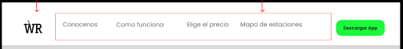
- Hero  
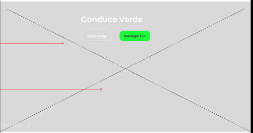
- Disposable Vehicles Section.  
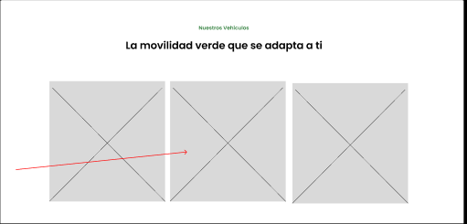
- Application user manual section.  
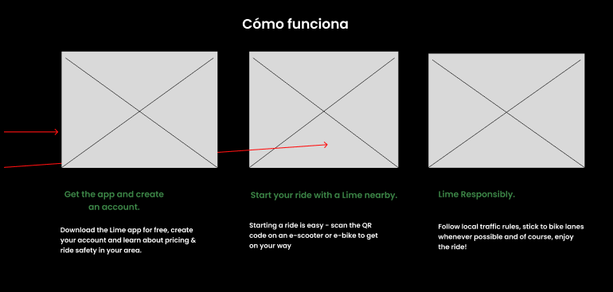
- Rates Section.  
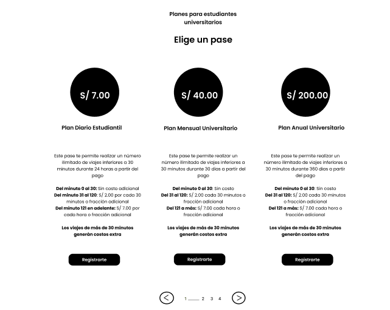
- Locations section.  
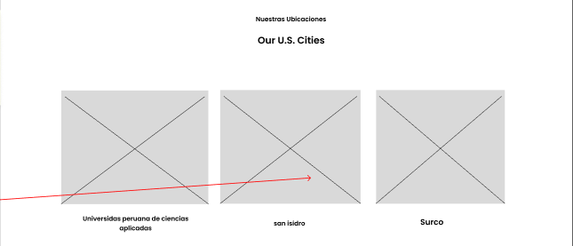
- Who we are section.  
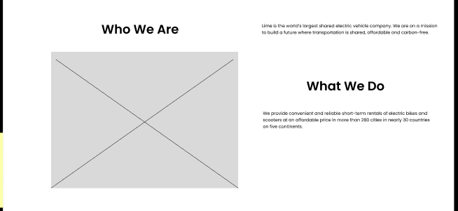
- About section.  
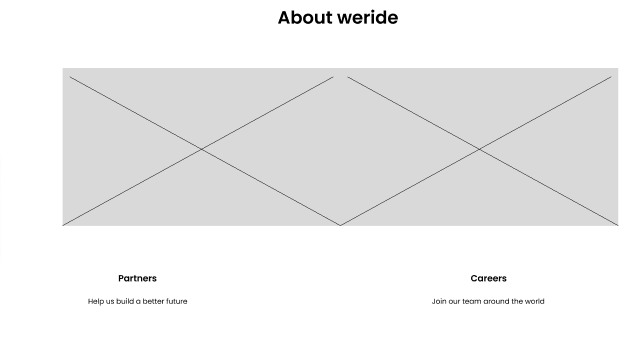
- Application download section.  
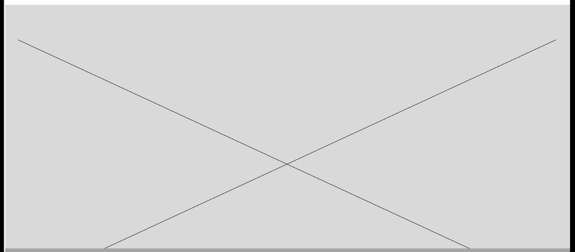
- Footer Section.  
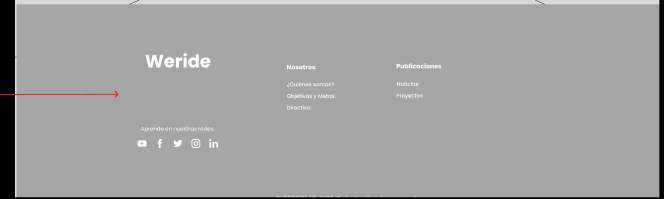
  
### 4.3.2. Landing Page Mock-up. 
   
- Navbar  

- Hero  
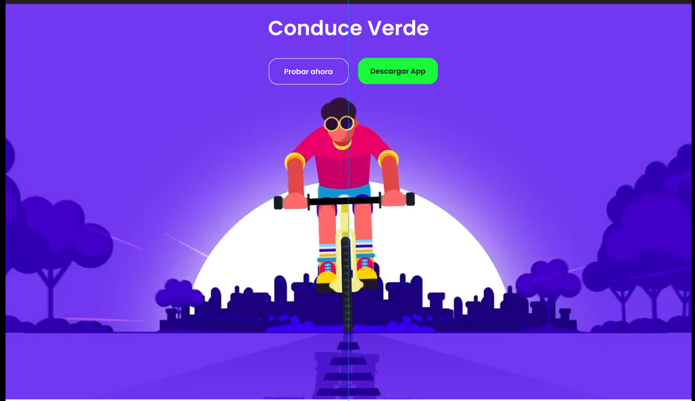
- Disposable Vehicles Section.  
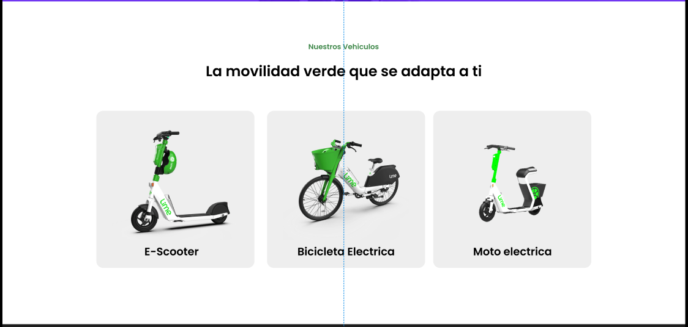
- Application user manual section.  
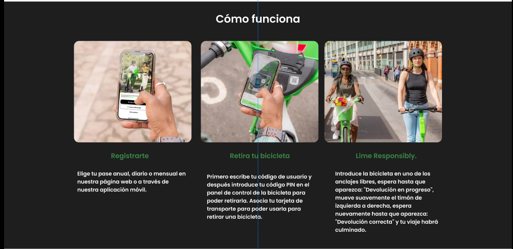
- Rates Section.  
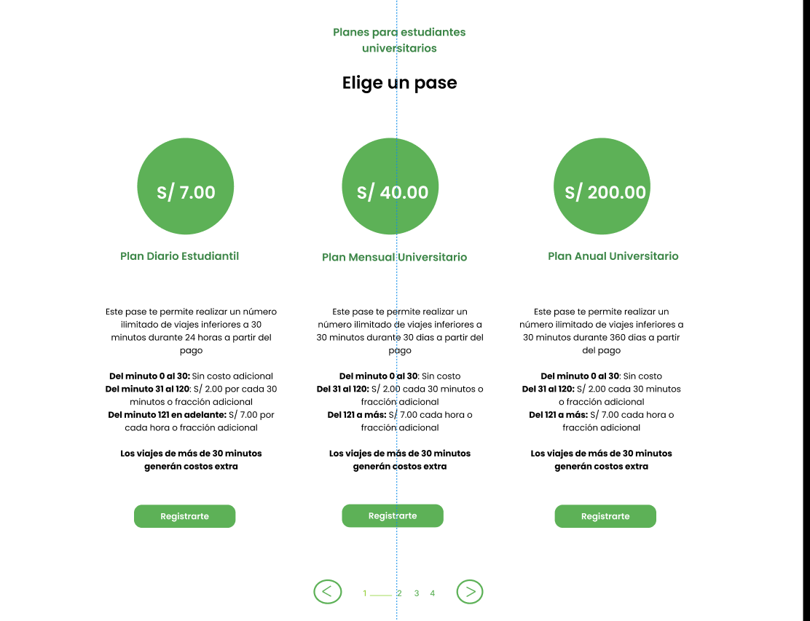
- Locations section.  
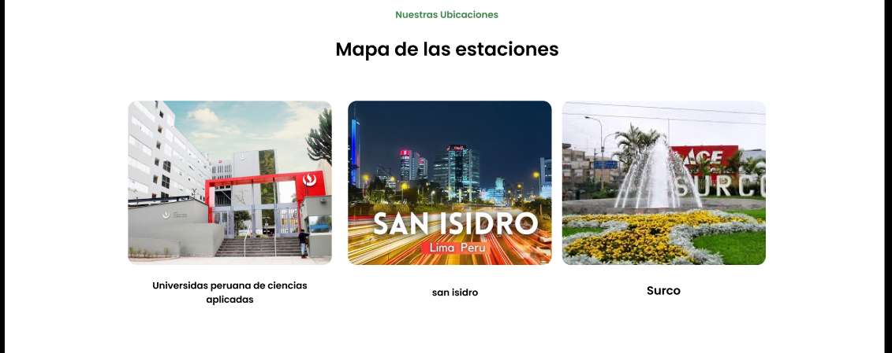
- Who we are section.  
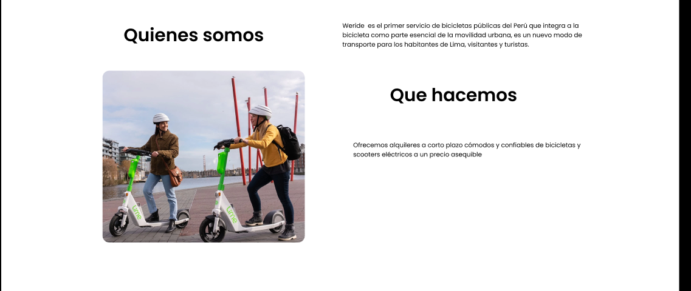
- About section.  
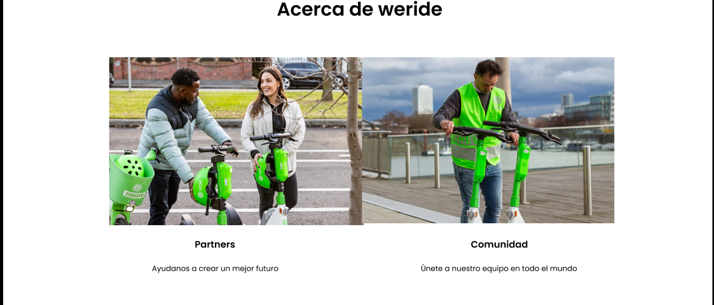
- Application download section.  
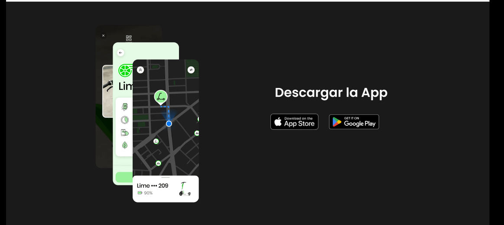
- Footer Section.  
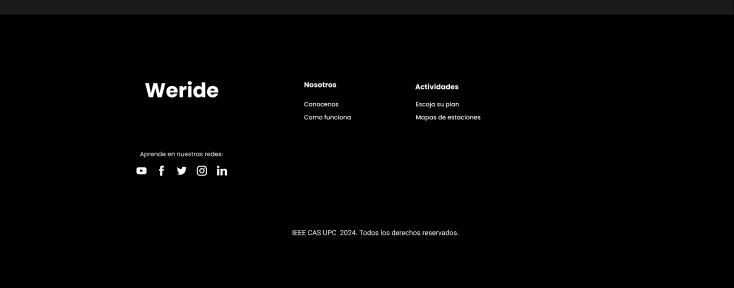

## 4.4.Web Applications UX/UI Design.

### 4.4.1.Web Applications Wireframes. 

Wireframes are simplified, low-fidelity visual guides that outline the structure, layout, and key elements of a web application’s interface. They focus on placement of content, navigation, and functionality rather than visual design details like colors or images. Wireframes help designers and developers plan page layouts, organize information, and ensure usability before moving on to higher-fidelity mock-ups or prototypes.

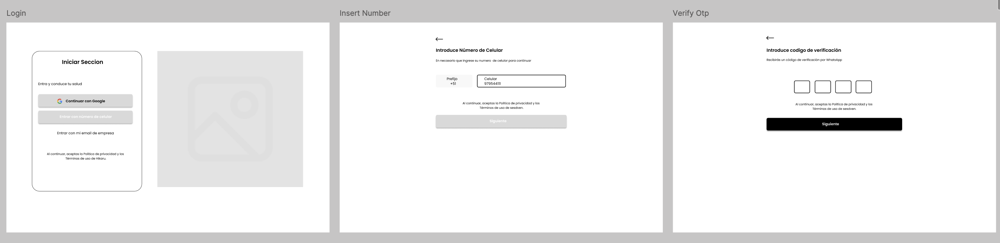

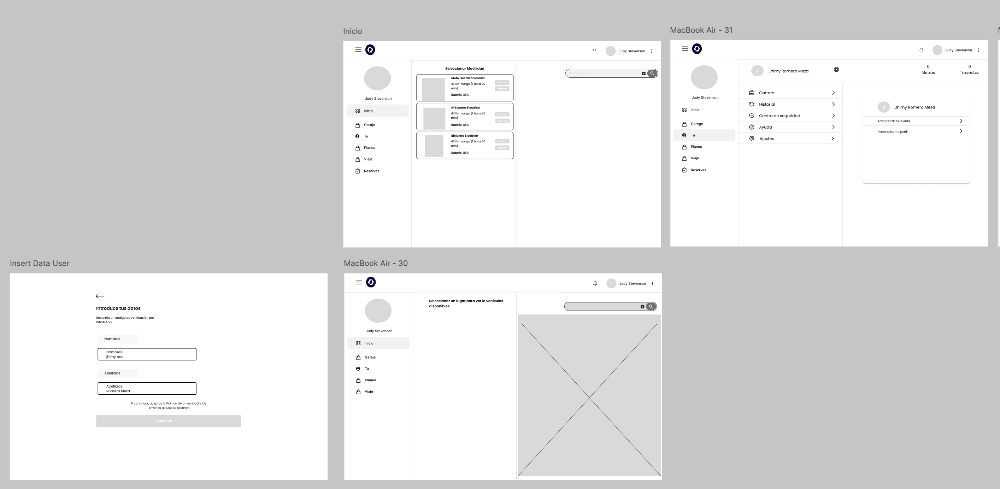

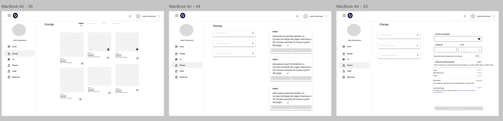

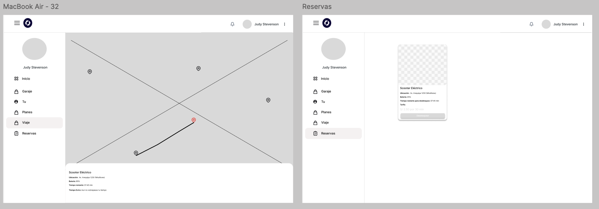

### 4.4.2.Web Applications Wireflow Diagrams.

Wireflow diagrams combine wireframes and user flow concepts to show both the layout of web pages and the paths users take through an application. They illustrate screen designs along with navigation steps, interactions, and decision points, providing a comprehensive view of how users move between pages and perform tasks. Wireflows help designers and developers plan user experience, identify potential issues, and communicate both the interface and workflow in a single visual representation.

#### Elementos clave del diseño
**Arquitectura de la información**
El contenido y las funciones están organizadas para facilitar el acceso a herramientas como el historial de servicios, monitoreo de consumo energético, o gestión de citas.
Los wireframes incluyen pantallas clave como:
Panel de control del propietario.
Dashboard del proveedor técnico.
Formulario para solicitar mantenimientos preventivos.
Historial de dispositivos y consumo energético.
Se ha priorizado una navegación simple y accesible, permitiendo que usuarios con diversas habilidades puedan moverse con facilidad por la plataforma.
Estructura de la interfaz
Los elementos interactivos (botones, menús, tarjetas de información) están ubicados estratégicamente para que el usuario pueda realizar tareas con pocos clics.
Las pantallas permiten acceso directo a secciones importantes como:
Subir o editar dispositivos eléctricos.
Contactar proveedores certificados.
Visualizar métricas de rendimiento o consumo.
Se incluye también una sección de perfil adaptable y configurable, especialmente útil para personas que requieren adaptaciones visuales, físicas o cognitivas.


### 4.4.3. Web Applications Mock-ups.  

Mock-ups are static or semi-interactive visual representations of a web application’s interface. They show the layout, design elements, content placement, and functionality of pages without fully implementing the system. Mock-ups help stakeholders, designers, and developers visualize the look and feel of the application, gather feedback, and validate design decisions before actual development begins. They are an essential step in the UI/UX design process to ensure usability, consistency, and alignment with user needs.

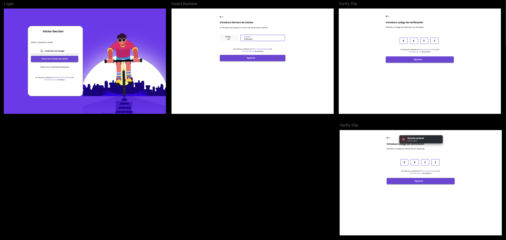

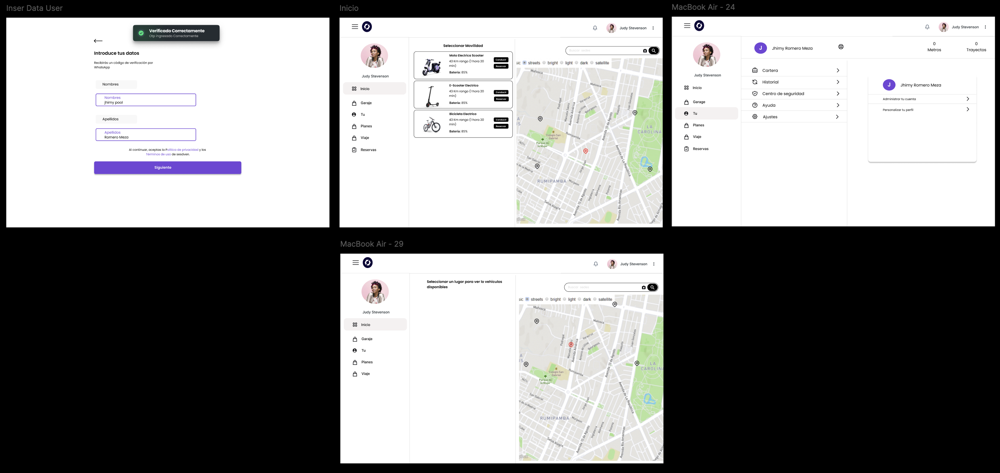

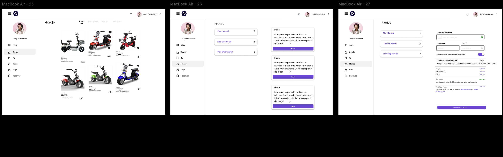

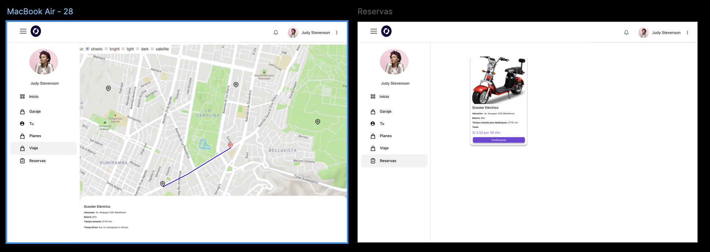

### 4.4.4. Web Applications User Flow Diagrams. 

User Flow Diagrams are visual representations that show the steps a user takes to complete specific tasks within a web application. They map the navigation paths between screens or pages, highlighting decision points, actions, and outcomes. These diagrams help designers and developers understand how users interact with the system, identify potential usability issues, and ensure smooth navigation and task completion. They are essential for planning intuitive interfaces, improving user experience, and guiding development teams in implementing consistent workflows.


.png)

## 4.5. Web Applications Prototyping.

Web Applications Prototyping es una metodología esencial en el desarrollo de aplicaciones web, que implica la creación de bocetos visuales o modelos preliminares de una aplicación antes de su implementación completa. 

### 4.6. Domain-Driven Software Architecture
 
La arquitectura de WeRide se describe con el modelo C4 en tres niveles: contexto, contenedores y componentes. Los diagramas se elaboraron con Structurizr (Structurizr DSL) y reflejan la solución implementada.
 
#### Decisiones y estilos arquitectónicos
 
- **Cliente-servidor y Single Page Application:** la Web Application, desarrollada con Angular y TypeScript, se ejecuta en el navegador y consume la API por HTTP.
- **RESTful API:** el backend, desarrollado con Java 24 y Spring Boot, expone sus recursos mediante servicios REST documentados con OpenAPI (Swagger UI) y protegidos con autenticación basada en JWT.
- **Domain-Driven Design:** el backend se organiza en bounded contexts (IAM, Profile, Booking, Garage, TravelHistory, Location, Notifications, Plan, Trip y UnlockRequest) y un contexto Shared con la clase base de auditoría. La Web Application organiza sus componentes con el mismo criterio.
- **Arquitectura en capas por contexto:** cada bounded context separa las capas de interfaces (controladores REST), application (servicios), domain (aggregates, entities y value objects) e infrastructure (repositorios).
- **CQRS:** los servicios de la capa application se separan en servicios de comandos (que modifican el estado) y servicios de consultas (que lo leen).
- **Monolito modular:** el backend se despliega como una única aplicación, cuyos módulos son los bounded contexts. Estos se comunican entre sí solo por identificadores, sin referencias directas entre objetos.
- **Persistencia relacional:** MySQL, accedida mediante Spring Data JPA.
- **Despliegue:** el backend se ejecuta en una máquina virtual de Microsoft Azure, como servicio de systemd detrás de un reverse proxy nginx; el backend cuenta además con Dockerfile y docker-compose.

### 4.6.1 Design-Level Event Storming.

#### Bounded Contexts

| Bounded Context | Responsabilidad | Aggregate principal |
|---|---|---|
| IAM | Cuentas, roles, registro e inicio de sesión con JWT | Account |
| Profile | Datos personales del usuario | Profile |
| Booking | Reservas, costos, pago e incidencias | Booking |
| Garage | Catálogo de vehículos y sus características | Vehicle |
| TravelHistory | Historial resumido de viajes | TravelHistory |
| Location | Estaciones de alquiler, horarios y servicios | Location |
| Notifications | Avisos dirigidos al usuario | Notification |
| Plan | Planes de suscripción y sus beneficios | Plan |
| Trip | Viajes con ruta, métricas e incidentes | Trip |
| UnlockRequest | Solicitudes de desbloqueo de vehículos | UnlockRequest |
| Shared | Clase base de auditoría y configuración común | AuditableAbstractAggregateRoot |

---


#### 4.6.2. Software Architecture Context Diagram
 
El diagrama de contexto muestra WeRide como un único sistema, junto con las personas que lo usan y los sistemas externos con los que se comunica. Los usuarios corresponden a los dos segmentos objetivo: usuarios finales (universitarios y jóvenes profesionales, B2C) y clientes corporativos (B2B). Los sistemas externos son la pasarela de pago y el servicio de verificación por SMS, ambos en entorno sandbox.
 
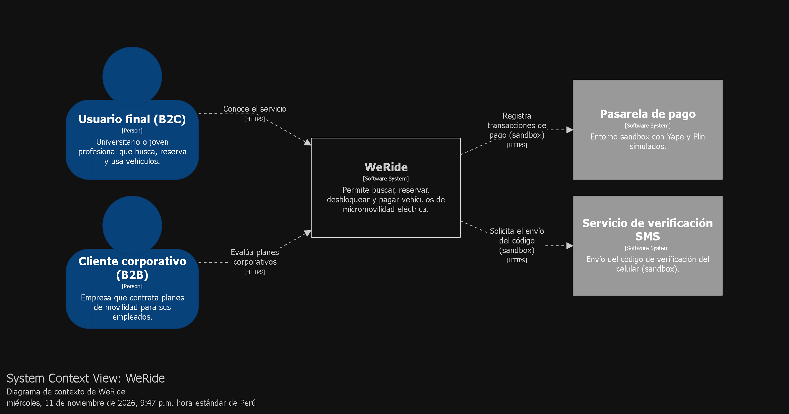
 
*Figura 1. Diagrama de contexto de WeRide, elaborado en Structurizr.*
 
#### 4.6.3. Software Architecture Container Diagrams
 
El diagrama de contenedores muestra las unidades ejecutables y de almacenamiento de WeRide: la Landing Page (HTML, CSS y JavaScript), la Web Application (Angular), el reverse proxy (nginx), la RESTful API (Spring Boot) y la base de datos (MySQL). Las personas acceden a la Landing Page y a la Web Application desde el navegador; la Web Application consume la API a través del reverse proxy, y la API persiste en MySQL.
 
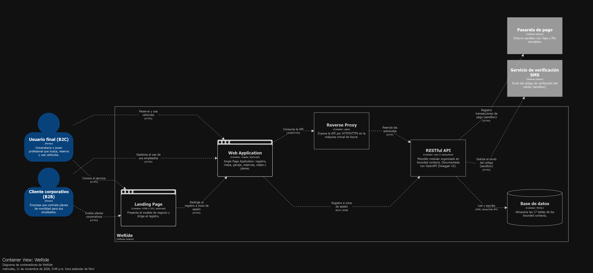
 
*Figura 2. Diagrama de contenedores de WeRide, elaborado en Structurizr.*
 
#### 4.6.4. Software Architecture Components Diagrams
 
El diagrama de componentes detalla la RESTful API. Cada componente corresponde a un bounded context. Las flechas entre componentes representan referencias por identificador (por ejemplo, una reserva referencia al vehículo por su id) y todos los componentes persisten en la base de datos mediante Spring Data JPA. Los demás contextos referencian al usuario por el id de su cuenta (IAM).
 
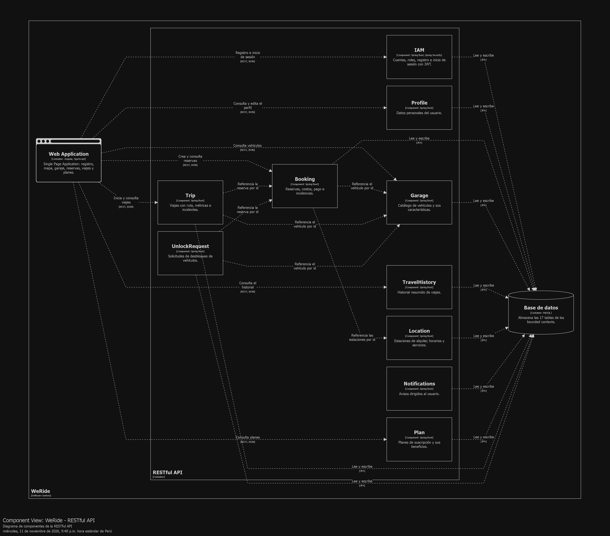
 
*Figura 3. Diagrama de componentes de la RESTful API, elaborado en Structurizr.*


## 4.7.Software Object-Oriented Design.

El diagrama de clases nos ayuda a definir la funcionalidad de el producto de **WeRide** mediante los atributos y funcionalidades de las clases de nuestras entidades relacionadas al funcionamiento del producto, desde interfaces, clases y atributos.

### 4.7.1.Class Diagram.

El Class Diagram representa el modelo de dominio del backend de WeRide, organizado en los bounded contexts IAM, Profile, Booking, Garage, TravelHistory, Location, Notifications, Plan, Trip y UnlockRequest, además del contexto Shared que contiene la clase base de auditoría. Cada clase se identifica con su estereotipo de Domain-Driven Design (Aggregate Root, Entity o Value Object). Por legibilidad, el diagrama se presenta en tres partes.
 
Las composiciones (rombo relleno) indican entidades y value objects que pertenecen a un aggregate. Las flechas punteadas indican referencias entre aggregates por id, sin referencia directa entre objetos. Las clases sin atributos y con una nota son referencias a aggregates definidos en otra parte.
 
#### Parte 1: núcleo del negocio
 
Incluye la gestión de cuentas y perfiles (IAM y Profile), las reservas (Booking), los vehículos (Garage) y la clase base de auditoría (Shared).
 
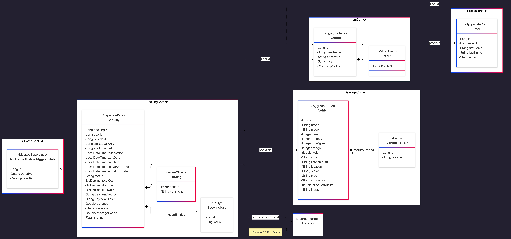
 
*Figura 1. Class Diagram de WeRide, parte 1.*
 
#### Parte 2: operación
 
Incluye los viajes realizados (Trip), su resumen histórico (TravelHistory) y las ubicaciones o estaciones de alquiler (Location).
 

 
*Figura 2. Class Diagram de WeRide, parte 2.*
 
#### Parte 3: soporte
 
Incluye las notificaciones (Notifications), los planes de suscripción (Plan) y las solicitudes de desbloqueo de vehículos (UnlockRequest).
 
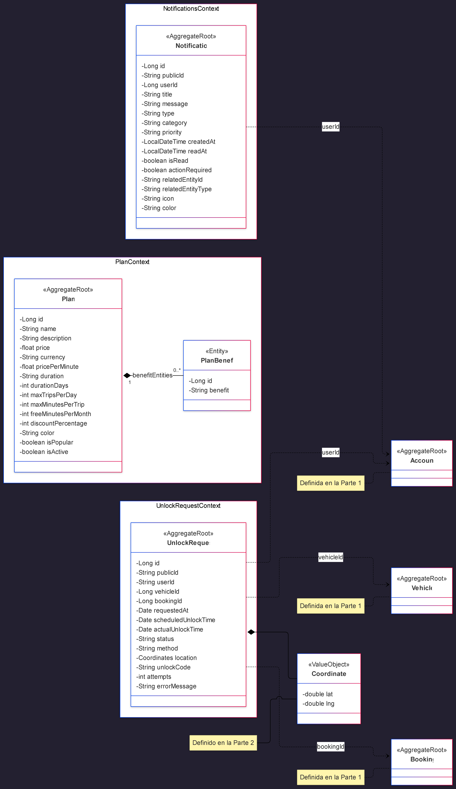
 
*Figura 3. Class Diagram de WeRide, parte 3.*

 
### 4.7.2. Class Dictionary
 
| Class | Bounded Context | Type | Description |
|---|---|---|---|
| AuditableAbstractAggregateRoot | Shared | Mapped Superclass | Clase base con `id`, `createdAt` y `updatedAt`; hereda de ella `Booking` |
| Account | IAM | Aggregate Root | Cuenta de acceso con usuario, contraseña y rol (`ROLE_CLIENT` por defecto) |
| ProfileId | IAM | Value Object | Identificador del perfil asociado a la cuenta |
| Profile | Profile | Aggregate Root | Datos personales: nombre, apellido y correo |
| Booking | Booking | Aggregate Root | Reserva de un vehículo, con costos, pago y métricas del recorrido |
| BookingIssue | Booking | Entity | Incidencia reportada en una reserva |
| Rating | Booking | Value Object | Puntaje y comentario del usuario sobre el viaje |
| Vehicle | Garage | Aggregate Root | Bicicleta o scooter eléctrico con especificaciones y precio por minuto |
| VehicleFeature | Garage | Entity | Característica de un vehículo |
| TravelHistory | TravelHistory | Aggregate Root | Registro resumido de un viaje realizado por un usuario |
| Location | Location | Aggregate Root | Estación o punto de alquiler con ubicación, capacidad y horario |
| LocationAmenity | Location | Entity | Servicio disponible en una ubicación |
| Coordinates | Location | Value Object | Latitud y longitud |
| OperatingHours | Location | Value Object | Hora de apertura y de cierre de una ubicación |
| RouteCoordinates | Trip | Value Object | Latitud y longitud de un punto de la ruta, devuelto por `Trip.getRouteCoordinates()` |
| Notification | Notifications | Aggregate Root | Aviso dirigido a un usuario, con prioridad y acción asociada |
| Plan | Plan | Aggregate Root | Plan de suscripción con precio, límites de uso y descuento |
| PlanBenefit | Plan | Entity | Beneficio incluido en un plan |
| Trip | Trip | Aggregate Root | Viaje realizado, con ruta, métricas, clima y costo |
| TripRouteCoordinate | Trip | Entity | Punto de la ruta de un viaje |
| TripIncidentReport | Trip | Entity | Incidente reportado durante un viaje |
| TripPhoto | Trip | Entity | Foto asociada a un viaje |
| UnlockRequest | UnlockRequest | Aggregate Root | Solicitud de desbloqueo de un vehículo, con método, código e intentos |


## 4.8.Database Design.

El diagrama de base de datos nos ayudara a la correcta definicion de entidades dentro de la base de datos funcional de **WeRide**, definiendo que entidades se vinculan mediante las id's principales para la correcta organizacion y manejo de informacion.

### 4.8.1. Relational/Non-Relational Database Diagram

La persistencia de WeRide utiliza MySQL como base de datos relacional, gestionada mediante Spring Data JPA e Hibernate. El esquema se deriva de las entidades JPA de los bounded contexts del backend (IAM, Profile, Booking, Garage, TravelHistory, Location, Notifications, Plan, Trip y UnlockRequest) y está compuesto por 17 tablas.

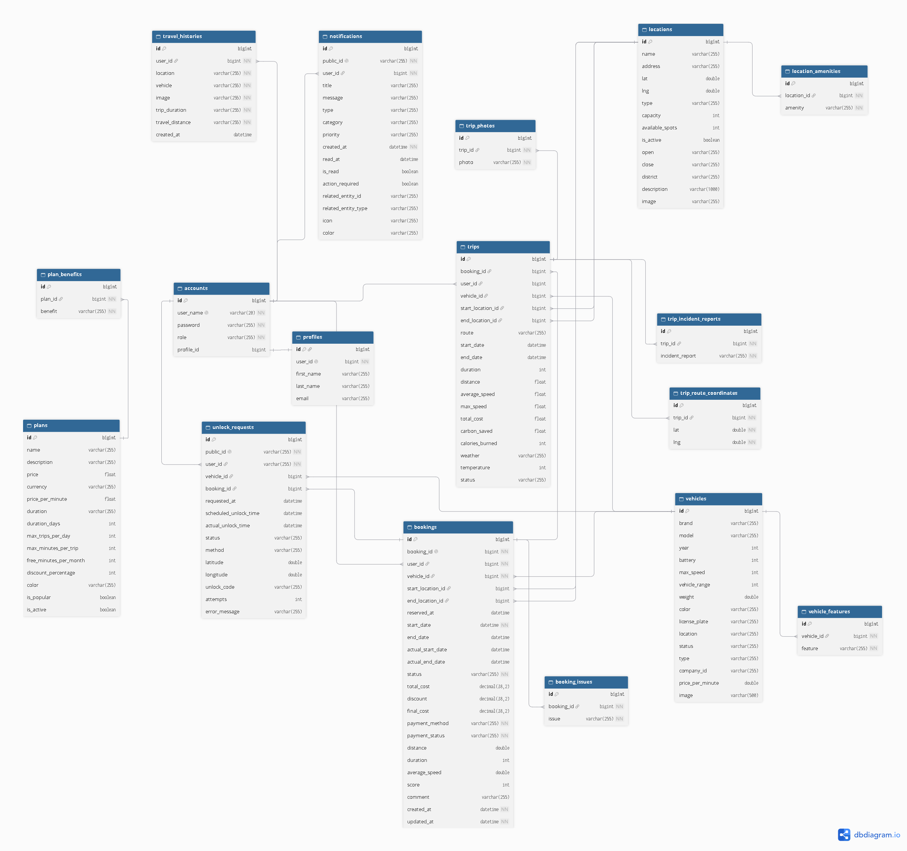

*Database Diagram de WeRide, elaborado en dbdiagram.io.*

**Tablas por bounded context**

| Bounded Context | Tablas |
|---|---|
| IAM | `accounts` |
| Profile | `profiles` |
| Booking | `bookings`, `booking_issues` |
| Garage | `vehicles`, `vehicle_features` |
| TravelHistory | `travel_histories` |
| Location | `locations`, `location_amenities` |
| Notifications | `notifications` |
| Plan | `plans`, `plan_benefits` |
| Trip | `trips`, `trip_route_coordinates`, `trip_incident_reports`, `trip_photos` |
| UnlockRequest | `unlock_requests` |

**Cómo leer el diagrama**

- Las líneas negras son foreign keys reales. Solo existen entre un aggregate y sus entidades hijas (por ejemplo, `booking_issues.booking_id` hacia `bookings.id`).
- Las líneas grises son referencias lógicas entre bounded contexts (por ejemplo, `bookings.user_id` hacia `accounts.id`). No tienen constraint en la base de datos: cada aggregate referencia a los demás solo por id, lo que mantiene los contextos desacoplados según los principios de Domain-Driven Design.
- Los value objects `Rating`, `Coordinates` y `OperatingHours` se guardan como columnas dentro de la tabla de su aggregate (`bookings`, `locations` y `unlock_requests`).
- Los nombres de tablas y columnas siguen la convención en inglés, en snake_case, que Spring Data JPA genera a partir de las entidades.

**Decisiones de diseño y limitaciones**

- Las tablas `plans` y `plan_benefits` no se relacionan con otras tablas, porque el modelo actual no incluye la suscripción de una cuenta a un plan. Se considera trabajo futuro.
- `travel_histories` guarda el nombre del vehículo como texto y no su id, por lo que no puede enlazarse con `vehicles`.
- Las referencias lógicas no garantizan integridad referencial en la base de datos; esa responsabilidad recae en la capa de aplicación.

---


# Capítulo V: Product Implementation, Validation & Deployment.
## 5.1. Software Configuration Management.
 
Esta sección define las decisiones y acuerdos fundamentales para el desarrollo, mantenimiento y despliegue de **WeRide**, plataforma de alquiler de bicicletas y scooters eléctricos. Su objetivo es asegurar coherencia, trazabilidad y calidad a lo largo del ciclo de vida del producto.
 
### 5.1.1. Software Development Environment Configuration.
 
| Actividad | Producto | Propósito en el proyecto | Referencia |
|---|---|---|---|
| Project Management | GitHub | Almacenar el código fuente y el informe en repositorios, con control de versiones, Pull Requests e insights de colaboración. | https://github.com |
| | Trello | Organizar y asignar las tareas de cada Sprint. | https://trello.com |
| | WhatsApp | Coordinar acuerdos y recordatorios de reuniones. | https://www.whatsapp.com |
| | Discord y Google Meet | Realizar las reuniones virtuales de planificación, seguimiento y retrospectiva. | https://discord.com · https://meet.google.com |
| Requirements Management | Miro | Organizar visualmente requisitos, mapas y lluvia de ideas del equipo. | https://miro.com |
| Product UX/UI Design | Figma | Diseñar wireframes, mock-ups y prototipos interactivos. | https://www.figma.com |
| Software Development | Git | Control de versiones distribuido. | https://git-scm.com |
| | Node.js | Entorno de ejecución para construir y servir la Web Application. | https://nodejs.org |
| | HTML5, CSS3 y JavaScript | Estructura, estilo e interactividad de la Landing Page. | https://developer.mozilla.org |
| | TypeScript y Angular | Desarrollo de la Web Application como Single Page Application. | https://angular.dev |
| | Java 24 y Spring Boot | Desarrollo del backend con RESTful API. | https://spring.io/projects/spring-boot |
| | Maven | Gestión de dependencias y construcción del backend. | https://maven.apache.org |
| | MySQL y MySQL Workbench | Base de datos relacional y su administración visual. | https://www.mysql.com/products/workbench |
| | json-server | Simular una API con `db.json` durante el desarrollo inicial de la Web Application. | https://github.com/typicode/json-server |
| | Visual Studio Code y WebStorm | Entornos de desarrollo para la Landing Page y la Web Application. | https://code.visualstudio.com · https://www.jetbrains.com/webstorm |
| | IntelliJ IDEA | Entorno de desarrollo para el backend en Java. | https://www.jetbrains.com/idea |
| | Docker | Entorno reproducible: el backend incluye `Dockerfile` y `docker-compose.yml`. **[CONFIRMAR si se usa en el flujo de trabajo]** | https://www.docker.com |
| Software Documentation | Swagger (OpenAPI) | Documentar y probar los endpoints de la RESTful API. | https://swagger.io |
| | Markdown y Mermaid | Redacción del informe y diagramas de clases en el repositorio. | https://www.markdownguide.org · https://mermaid.js.org |
| | dbdiagram.io | Diagrama de la base de datos. | https://dbdiagram.io |
| | Structurizr | Diagramas de arquitectura con el modelo C4 (Structurizr DSL). | https://structurizr.com |
| Software Deployment | GitHub Pages | Publicar la Landing Page. | https://pages.github.com |
| | Vercel | Publicar la Web Application. | https://vercel.com |
| | Microsoft Azure (máquina virtual con Ubuntu 22.04) | Alojar el backend en un entorno real. | https://azure.microsoft.com |
| | nginx y systemd | Reverse proxy y ejecución del backend como servicio en la máquina virtual. | https://nginx.org |
| Software Testing | JUnit 5 y Mockito | Pruebas unitarias y de integración del backend (incluidas en `spring-boot-starter-test`). | https://junit.org |
| | H2 Database | Base de datos en memoria para las pruebas de integración. | https://www.h2database.com |
| | Karate | Pruebas de comportamiento (BDD) de la API REST con archivos `.feature`. | https://github.com/karatelabs/karate |
| | Selenium | Pruebas end-to-end de la Web Application. | https://www.selenium.dev |
| Continuous Integration | Jenkins | Automatizar compilación, pruebas y despliegue. | https://www.jenkins.io |
| | SonarQube | Análisis estático de calidad y seguridad del código. | https://www.sonarsource.com/products/sonarqube |

 
### 5.1.2. Source Code Management.
 
Se utiliza **GitHub** como plataforma de control de versiones, con un repositorio por producto:
 
| Producto | Repositorio |
|---|---|
| Informe del proyecto (Report) | https://github.com/DEIS-Grupo-4/Report_Project |
| Landing Page | https://github.com/DEIS-Grupo-4/Landing-Page.git |
| Web Application (Frontend) | https://github.com/DEIS-Grupo-4/Fronted-Weride-DEIS.git |
| Web Services (Backend) | https://github.com/DEIS-Grupo-4/Backend-Weride-DEIS |
 
#### Flujo de trabajo: GitFlow
 
El equipo aplica GitFlow como flujo de trabajo de ramas y colaboración:
 
| Rama | Origen | Destino | Propósito |
|---|---|---|---|
| `main` (`master` en el backend) | - | - | Código estable y desplegado. Solo recibe fusiones desde `release/*` y `hotfix/*`. |
| `develop` | `main` | - | Rama de integración donde se unen las funcionalidades terminadas. |
| `feature/<contexto>-<descripcion>` | `develop` | `develop` | Una rama por funcionalidad o historia de usuario. Ejemplo: `feature/booking-draft`. |
| `release/<x.y.z>` | `develop` | `main` y `develop` | Estabilización de una entrega antes de publicarla. |
| `hotfix/<x.y.z>` | `main` | `main` y `develop` | Corrección urgente de un error en producción. |
| `docs/<descripcion>` y `refactor/<descripcion>` | `develop` | `develop` | Ramas de trabajo para documentación y refactorización, con el mismo ciclo que una `feature`. |
 
Los nombres de rama usan inglés, minúsculas y guiones. Los cambios se integran a `develop` mediante **Pull Request** revisado por al menos un compañero del equipo.
 
#### Semantic Versioning
 
Las versiones se nombran con el formato `MAJOR.MINOR.PATCH` (Semantic Versioning 2.0.0): `MAJOR` para cambios incompatibles, `MINOR` para nuevas funcionalidades compatibles y `PATCH` para correcciones. Cada release se marca con un tag, por ejemplo `v1.0.0`.
 
#### Conventional Commits
 
Los mensajes de commit siguen la especificación Conventional Commits: `<tipo>(<contexto opcional>): <descripción>`. Los tipos usados son `feat`, `fix`, `docs`, `refactor`, `style`, `test` y `chore`. Ejemplos:
 
- `feat(booking): implement aggregate and command and query services`
- `refactor: use Long for userId in notifications and trips`
- `docs: add class diagram in three parts`

### 5.1.3. Source Code Style Guide & Conventions
 
El código y los artefactos se redactan con nomenclatura en inglés. Para cada lenguaje se adopta una guía de estilo de referencia:
 
| Lenguaje | Uso en el proyecto | Guía adoptada |
|---|---|---|
| HTML y CSS | Landing Page | Google HTML/CSS Style Guide (https://google.github.io/styleguide/htmlcssguide.html) |
| JavaScript | Landing Page | Google JavaScript Style Guide (https://google.github.io/styleguide/jsguide.html) |
| TypeScript | Web Application en Angular | Google TypeScript Style Guide (https://google.github.io/styleguide/tsguide.html) y Angular Coding Style Guide (https://angular.io/guide/styleguide) |
| Java | Backend con Spring Boot | Google Java Style Guide (https://google.github.io/styleguide/javaguide.html) |
| Gherkin | Archivos `.feature` | Gherkin Conventions for Readable Specifications (https://specflow.org/gherkin/gherkin-conventions-for-readable-specifications/) |
 
Convenciones propias del proyecto:
 
- **Backend:** clases en `PascalCase`, métodos y atributos en `camelCase`, y tablas en `snake_case` y plural (por ejemplo `trip_photos`). Cada bounded context se organiza en las capas `interfaces`, `application`, `domain` e `infrastructure`.
- **Web Application:** los componentes se organizan por bounded context (`auth`, `booking`, `garage`, `plans` y `trip`), cada uno con su archivo HTML, CSS y TypeScript.

### 5.1.4. Software Deployment Configuration.
 
#### Landing Page
 
Se publica con GitHub Pages: los archivos HTML, CSS y JavaScript del repositorio se sirven desde la rama configurada para Pages, y la página queda disponible en https://deis-grupo-4.github.io/Landing-Page/
 
#### Web Application
 
Se publica en Vercel: el proyecto se conecta al repositorio de GitHub y Vercel construye y despliega la aplicación automáticamente con cada push a la rama principal.
 
#### Web Services (Backend)
 
El backend se aloja en una máquina virtual de Microsoft Azure con Ubuntu 22.04. El despliegue se realiza manualmente mediante acceso SSH:
 
1. Instalar JDK 24, Maven, Git, MySQL y nginx en la máquina virtual.
2. Clonar el repositorio y construir la aplicación con `mvn clean package`.
3. Registrar la aplicación como servicio de systemd, para que se ejecute en segundo plano y se reinicie ante fallos.
4. Configurar nginx como reverse proxy, que expone la API en los puertos 80 y 443 y reenvía las solicitudes a la aplicación en el puerto 8080.
5. Verificar el servicio con los logs de systemd y con solicitudes a los endpoints.
 
**Nota de decisión técnica:** el enunciado del curso sugiere ASP.NET Core y C# para el backend. El equipo decidió continuar con Java 24, Spring Boot y MySQL, porque corresponde a la arquitectura DDD y CQRS implementada y validada en el ciclo anterior. Migrar a ASP.NET Core implicaría reescribir los bounded contexts, los controladores REST y la capa de persistencia ya desplegada, lo cual representa un riesgo alto para los plazos del curso sin un beneficio funcional adicional.

## 5.2. Landing Page, Services & Applications Implementation.

Los Sprints 1 a 4 documentan el desarrollo inicial de WeRide realizado por el equipo WeTech en el ciclo anterior. El equipo actual continúa el producto a partir de ese trabajo y documenta sus propias contribuciones desde el Sprint 4 para adelante.

### 5.2.1. Sprint 1

#### 5.2.1.1. Sprint Planning 1.

<table>
  <tr>
    <th>Elemento</th>
    <th>Detalle</th>
  </tr>

  <tr>
    <td><strong>Sprint</strong></td>
    <td>Sprint 1 — Implementación inicial de la landing page de WeRide</td>
  </tr>
  <tr>
    <td><strong>Sprint Planning Background</strong></td>
    <td>Durante este primer sprint, el equipo WeTech se enfocará en desarrollar la landing page de WeRide como primer punto de contacto con los usuarios. Se priorizará presentar la propuesta de valor, facilitar la navegación entre secciones, adaptar la interfaz a dispositivos móviles, mostrar el catálogo y las características de los vehículos eléctricos, y habilitar el acceso a la aplicación.</td>
  </tr>

  <tr>
    <td><strong>Fecha</strong></td>
    <td>2025-09-19</td>
  </tr>
  <tr>
    <td><strong>Hora</strong></td>
    <td>22:00 (GMT-5)</td>
  </tr>
  <tr>
    <td><strong>Lugar</strong></td>
    <td>Reunión virtual — Discord</td>
  </tr>
  <tr>
    <td><strong>Preparado por</strong></td>
    <td>WeTech</td>
  </tr>
  <tr>
    <td><strong>Asistentes</strong></td>
    <td>Samuel Bonifacio, Jefferson Castro, Diego Seminario, Jhimy Romero, Arnold Morales</td>
  </tr>
  <tr>
    <td><strong>Sprint n-1 Review</strong></td>
    <td>Se creó la organización WeTech en GitHub, se definieron ramas, convenciones de commits y se asignaron tareas iniciales en investigación de usuarios, wireframes y mockups.</td>
  </tr>
  <tr>
    <td><strong>Sprint n-1 Retrospective</strong></td>
    <td>Se completó la estructura base de la landing page (HTML/CSS/JS). Lecciones aprendidas: mejorar granularidad en tareas y definir criterios de aceptación más claros.</td>
  </tr>

<tr>
  <td><strong>Sprint Goal (Statement)</strong></td>
  <td>
    <strong>Our focus is on</strong> implementar una landing page funcional, intuitiva y adaptable a dispositivos móviles, que permita a los visitantes conocer WeRide, explorar los vehículos eléctricos y acceder a la aplicación.<br>
    <strong>We believe it delivers</strong> una experiencia inicial clara y accesible, facilitando que los usuarios comprendan la propuesta de valor de WeRide y conozcan las alternativas de movilidad disponibles.<br>
    <strong>This will be confirmed when</strong> las seis User Stories seleccionadas cumplan sus criterios de aceptación y se verifique el funcionamiento de la navegación, la visualización del catálogo, la comparación de vehículos, el diseño responsive y el acceso a la aplicación.
  </td>
</tr>

<tr>
  <td><strong>User Stories (SP)</strong></td>
  <td>
    - <strong>US-27 (3 SP)</strong><br>
    - <strong>US-43 (2 SP)</strong><br>
    - <strong>US-56 (5 SP)</strong><br>
    - <strong>US-44 (3 SP)</strong><br>
    - <strong>US-45 (5 SP)</strong><br>
    - <strong>US-49 (2 SP)</strong><br>
  </td>
</tr>
<tr>
  <td><strong>Sprint 1 Velocity (forecast)</strong></td>
  <td>20 puntos</td>
</tr>
<tr>
  <td><strong>Sum of Story Points (commit)</strong></td>
  <td>20 puntos</td>
</tr>

</table>


#### User Stories seleccionadas para el Sprint 1

| ID | User Story | Puntos |
|---|---|---:|
| US-27 | Como visitante, quiero conocer la propuesta de valor de WeRide desde la página de inicio para comprender qué servicio ofrece. | 3 |
| US-43 | Como visitante, quiero desplazarme a las secciones de la landing page desde el menú para encontrar rápidamente la información que busco. | 2 |
| US-56 | Como visitante, quiero navegar por la landing page desde mi celular para consultar sus secciones sin dificultades. | 5 |
| US-44 | Como visitante, quiero conocer los tipos de vehículos eléctricos ofrecidos para identificar alternativas adecuadas a mis necesidades. | 3 |
| US-45 | Como visitante, quiero consultar las especificaciones de cada tipo de vehículo para comparar sus características antes de elegir. | 5 |
| US-49 | Como visitante, quiero abrir la aplicación mediante Go to App para comenzar a utilizar el servicio. | 2 |

**Total de puntos:** 20

---


---

#### 5.2.1.2. Aspect Leaders and Collaborators

En esta sección se presenta la matriz de liderazgo y colaboración (Leadership-and-Collaboration Matrix, LACX) para el Sprint 1 de WeRide. Esta matriz identifica, para cada aspecto clave del Sprint, quién es el líder responsable y quiénes son los colaboradores, facilitando así la comunicación y la asignación de tareas dentro del equipo. 

Los aspectos considerados en este Sprint incluyen: diseño de la landing page, desarrollo de funcionalidades de registro e inicio de sesión, implementación de la barra de navegación, y configuración del footer con enlaces de contacto y redes sociales.


| Team Member (Apellido, Nombre) | GitHub Username | Landing Page Design | Navegación | Catálogo y Comparación de Vehículos | Diseño Responsive | Acceso a la App |
|---|---|---|---|---|---|---|
| Bonifacio, Samuel | samuelbonifacio015 | L | L | C | L | C |
| Castro, Jefferson | JeffersonCastroPariona | C | C | L | C | L |
| Seminario, Diego | DiegoSeminario | C | L | C | C | C |
| Romero, Jhimy | jhimyromeromeza | L | L | C | C | C |
| Morales, Arnold | Arnold-TI | C | C | L | L | C |


**L:** Leader (Líder)  
**C:** Collaborator (Colaborador)

Esta organización permite una asignación clara de responsabilidades y fomenta la colaboración efectiva durante el desarrollo del Sprint.

---

#### 5.2.1.3. Sprint Backlog 1.

| ID | Title/Section | Description | Estimation (Hours) | Assigned To | Status |
|---|---|---|---:|---|---|
| US-27 | Landing Page Informativa | Diseñar e implementar la estructura principal de la landing page, incluyendo el encabezado, presentación de WeRide y propuesta de valor. | 4 | Bonifacio Jaramillo, Samuel Jesus | Done |
| US-27 | Estilos Generales | Aplicar colores, tipografías, espaciados y componentes visuales para mantener una identidad gráfica consistente. | 3 | Romero Meza, Jhimy Pool | Done |
| US-43 | Barra de Navegación | Implementar el menú de navegación con enlaces funcionales a las secciones de la landing page. | 3 | Seminario Castillo, Diego Vicente | Done |
| US-43 | Navegación entre Secciones | Configurar el desplazamiento y verificar que los enlaces conduzcan correctamente a cada sección. | 2 | Bonifacio Jaramillo, Samuel Jesus | Done |
| US-56 | Diseño Responsive | Adaptar la estructura, imágenes y componentes de la landing page a dispositivos móviles y tablets. | 5 | Morales Sosa, Arnold Gabriel | Done |
| US-56 | Validación Responsive | Comprobar la visualización y funcionamiento del menú, tarjetas y botones en diferentes resoluciones. | 3 | Romero Meza, Jhimy Pool | Done |
| US-44 | Catálogo de Vehículos | Implementar una sección que muestre los tipos de vehículos eléctricos disponibles, incluyendo imágenes y nombres. | 4 | Castro Pariona, Jefferson Ernesto | Done |
| US-45 | Comparación de Vehículos | Desarrollar la sección de comparación de vehículos con información sobre velocidad, autonomía, peso y tiempo de carga. | 5 | Castro Pariona, Jefferson Ernesto | Done |
| US-45 | Selección de Categorías | Implementar la interacción que permita seleccionar diferentes tipos de vehículos y actualizar sus especificaciones. | 3 | Seminario Castillo, Diego Vicente | Done |
| US-49 | Acceso a la Aplicación | Implementar el botón Go to App y configurar su redirección hacia la aplicación WeRide. | 3 | Castro Pariona, Jefferson Ernesto | Done |
| US-49 | Verificación de Redirección | Comprobar que los accesos a la aplicación desde el encabezado y la portada dirijan a la ruta configurada. | 2 | Morales Sosa, Arnold Gabriel | Done |

**Total de horas estimadas:** 37 horas.

**Total de Story Points comprometidos:** 20 SP.

---


#### 5.2.1.4. Development Evidence for Sprint Review

Durante el Sprint 1, el equipo de **WeTech** realizó múltiples commits en el repositorio de GitHub, evidenciando el avance y cumplimiento de las tareas planificadas. A continuación, se presenta una tabla con los principales commits realizados, siguiendo el formato requerido:

| Repository                                         | Branch | Commit Id | Commit Message                                 | Commit Message Body                                   | Committed on (Date)     |
|----------------------------------------------------|--------|-----------|------------------------------------------------|-------------------------------------------------------|------------------------|
| OpenSource-Grupo-4/Landing-Page                    | develop   | 9c5de9c   | Add footer styles to styles.css                | Se agregaron estilos para el footer en styles.css.    | 13/09/2025             |
| OpenSource-Grupo-4/Landing-Page                    | develop   | d0d0f0c   | Add footer section with contact and social links| Se añadió la sección de footer con enlaces de contacto y redes sociales. | 13/09/2025             |
| OpenSource-Grupo-4/Landing-Page                    | develop   | 098b740   | Merge pull request #2 from OpenSource-Grupo-4/develop | Se fusionaron cambios de la rama develop.             | 12/09/2025             |
| OpenSource-Grupo-4/Landing-Page                    | feature/responsive-navbar   | eddad5b   | feat: added navbar & hero section              | Se agregó la barra de navegación y la sección principal. | 12/09/2025             |
| OpenSource-Grupo-4/Landing-Page                    | develop   | 2a59cfe   | chore: index file refactor                     | Refactorización del archivo index.                    | 12/09/2025             |
| OpenSource-Grupo-4/Landing-Page                    | main   | 69695c3   | Merge pull request #1 from OpenSource-Grupo-4/develop | Se fusionaron cambios iniciales de la rama develop.   | 11/09/2025             |
| OpenSource-Grupo-4/Landing-Page                    | hero-ui-fix   | 90dd977   | /changes v.2 Jefferson Castro - Landing        | Cambios en la landing page por Jefferson Castro.      | 11/09/2025             |
| OpenSource-Grupo-4/Landing-Page                    | main   | 59a25be   | feat: added steps section                      | Se agregó la sección de pasos.                        | 18/09/2025             |
| OpenSource-Grupo-4/Landing-Page                    | feature/responsive   | 4317f4c   | styles: updated responsive for steps cards     | Se mejoró la responsividad de las tarjetas de pasos.  | 18/09/2025             |
| OpenSource-Grupo-4/Landing-Page                    | main   | 9deb5a8   | feat: added steps section                      | Se agregó la sección de pasos.                        | 18/09/2025             |
| OpenSource-Grupo-4/Landing-Page                    | develop   | 6802c55   | chore: added imgs & syntax updates             | Se añadieron imágenes y se actualizaron detalles de sintaxis. | 18/09/2025             |

Cada commit refleja el trabajo colaborativo y el cumplimiento de los objetivos del Sprint, asegurando la trazabilidad y transparencia en el desarrollo de **WeRide**.

**Reporte de commits:**

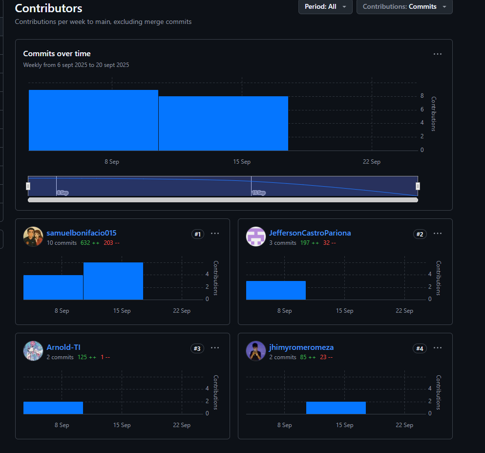

---

#### 5.2.1.5. Execution Evidence for Sprint Review.

En esta entrega, nos centramos en el desarrollo completo de la Landing Page para nuestra plataforma de alquiler en línea. Nuestro objetivo es desplegar una página web atractiva y efectiva que actúe como el punto de entrada para nuestros usuarios. 

Es por ello que se comparte las evidencias de ambos repositorios para corroborar el trabajo hecho por cada uno de los participantes.

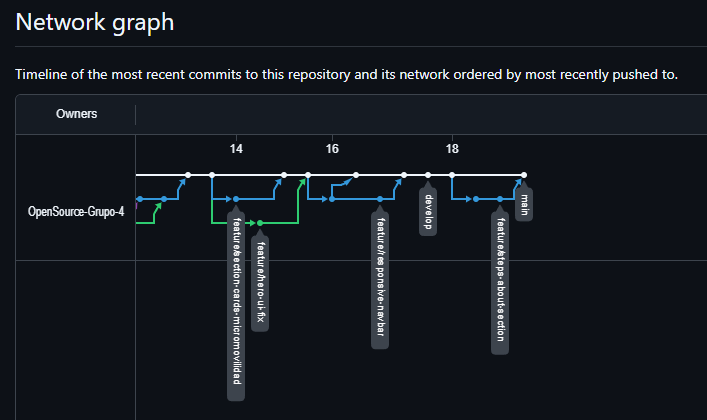

#### 5.2.1.6. Services Documentation Evidence for Sprint Review.

Para esta primera entrega no hubo implementación de APIs, pues solo se realizó la Landing Page.

#### 5.2.1.7. Software Deployment Evidence for Sprint Review.

El objetivo del primer Sprint fue el desarrollo e implementación de la Landing Page. Para eso, utilizamos GitHub y GitHub Pages. El proceso del desarrollo fue el siguiente:

1. Se creó una organización en GitHub y, dentro de ella, se crearon dos repositorios. Uno para el informe del trabajo y otro para la Landing Page 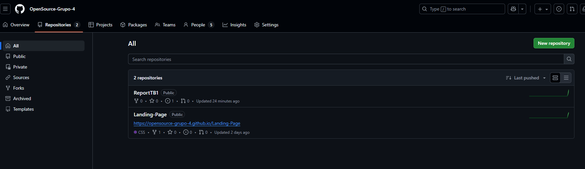
2. Luego, a través de los commits, el equipo fue editando los archivos index.html y styles.css, además de ir añadiendo imágenes a utilizar en el directorio images. 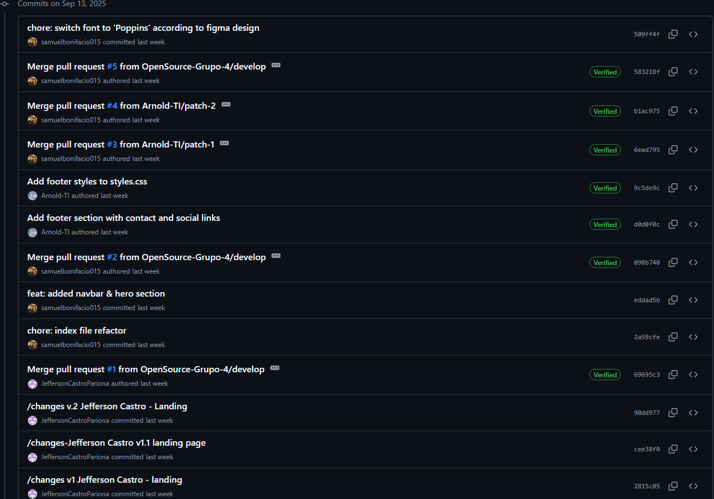
3. Finalmente, se implementó GitHub Pages en el repositorio de GitHub y se desplegó la Landing Page, la que se puede visitar en el siguiente link: https://deis-grupo-4.github.io/Landing-Page/

#### 5.2.1.8. Team Collaboration Insights during Sprint.

A continuación, se adjuntan las capturas de evidencia de los insights de los repositorios del informe y Landing Page para evidenciar la participación de todos los miembros:

- Insight Landing Page:
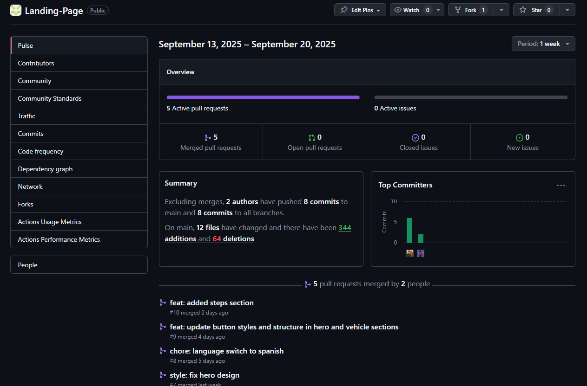

- Insight Report
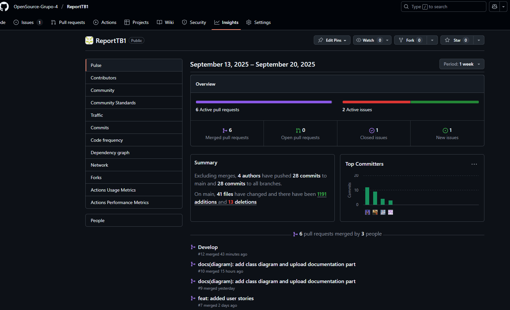

## 5.2.2. Sprint 2


### 5.2.2.1. Sprint Planning 2

<table>
  <tr>
    <th>Elemento</th>
    <th>Detalle</th>
  </tr>
  <tr>
    <td><strong>Sprint</strong></td>
    <td>Sprint 2 — Implementación de secciones informativas, comerciales y de contacto de la landing page de WeRide</td>
  </tr>
  <tr>
    <td><strong>Sprint Planning Background</strong></td>
    <td>Después de desarrollar la estructura inicial de la landing page durante el Sprint 1, el equipo WeTech continuará incorporando información relevante sobre el servicio. Se priorizará mostrar las ubicaciones disponibles, explicar el funcionamiento de WeRide, presentar los planes y tarifas, incluir la oferta corporativa B2B y facilitar los canales de contacto. También se incorporarán contenidos sobre beneficios, impacto y testimonios.</td>
  </tr>
  <tr>
    <td><strong>Fecha</strong></td>
    <td>2025-10-08</td>
  </tr>
  <tr>
    <td><strong>Hora</strong></td>
    <td>21:00 (GMT-5)</td>
  </tr>
  <tr>
    <td><strong>Lugar</strong></td>
    <td>Reunión virtual — Google Meet</td>
  </tr>
  <tr>
    <td><strong>Preparado por</strong></td>
    <td>WeTech</td>
  </tr>
  <tr>
    <td><strong>Asistentes</strong></td>
    <td>Samuel Bonifacio, Jefferson Castro, Diego Seminario, Jhimy Romero, Arnold Morales</td>
  </tr>
  <tr>
    <td><strong>Sprint n-1 Review</strong></td>
    <td>Se revisaron los entregables del Sprint 1 relacionados con la estructura principal de la landing page, navegación, diseño responsive, catálogo y comparación de vehículos, así como el acceso a la aplicación. Los resultados y criterios de aceptación deben contrastarse con las evidencias del repositorio.</td>
  </tr>
  <tr>
    <td><strong>Sprint n-1 Retrospective</strong></td>
    <td>Se identificó la necesidad de mantener una distribución clara de responsabilidades, mejorar la organización de los componentes y verificar los criterios de aceptación de cada funcionalidad antes de cerrar las tareas.</td>
  </tr>
  <tr>
    <td><strong>Sprint Goal (Statement)</strong></td>
    <td>
      <strong>Our focus is on</strong> completar las secciones informativas y comerciales de la landing page de WeRide, permitiendo consultar ubicaciones, funcionamiento del servicio, planes, beneficios y medios de contacto.<br>
      <strong>We believe it delivers</strong> información más completa para que los visitantes comprendan cómo funciona WeRide, comparen alternativas y evalúen el servicio antes de utilizar la aplicación.<br>
      <strong>This will be confirmed when</strong> las ocho User Stories seleccionadas cumplan sus criterios de aceptación y se compruebe que las secciones muestran información clara, mantienen una navegación funcional y permiten acceder a los canales de contacto correspondientes.
    </td>
  </tr>
  <tr>
    <td><strong>User Stories (SP)</strong></td>
    <td>
      - <strong>US-46 (3 SP)</strong><br>
      - <strong>US-47 (3 SP)</strong><br>
      - <strong>US-48 (3 SP)</strong><br>
      - <strong>US-55 (3 SP)</strong><br>
      - <strong>US-53 (2 SP)</strong><br>
      - <strong>US-50 (2 SP)</strong><br>
      - <strong>US-51 (2 SP)</strong><br>
      - <strong>US-52 (2 SP)</strong>
    </td>
  </tr>
  <tr>
    <td><strong>Sprint 2 Velocity (forecast)</strong></td>
    <td>20 puntos</td>
  </tr>
  <tr>
    <td><strong>Sum of Story Points (commit)</strong></td>
    <td>20 puntos</td>
  </tr>
</table>


<hr>


<h2>Objetivo del Sprint (versión SMART)</h2>

<p><strong>Objetivo:</strong> Completar durante el Sprint 2 ocho funcionalidades informativas y comerciales de la landing page de WeRide, con un compromiso total de 20 Story Points, para que los visitantes puedan conocer las ubicaciones, el funcionamiento del servicio, los planes y los medios de contacto.</p>

<ul>
  <li><strong>Específico:</strong> Implementar las secciones de ubicaciones, funcionamiento del servicio, planes y tarifas, plan corporativo B2B, contacto, beneficios, indicadores de impacto y testimonios.</li>
  <li><strong>Medible:</strong> Verificar el cumplimiento de los criterios de aceptación de las ocho User Stories seleccionadas.</li>
  <li><strong>Alcanzable:</strong> Se establece un compromiso de 20 Story Points, sujeto a la capacidad estimada del equipo.</li>
  <li><strong>Relevante:</strong> Permite comunicar la propuesta de valor de WeRide y facilitar la evaluación del servicio por usuarios particulares y empresas.</li>
  <li><strong>Tiempo-bound:</strong> Las funcionalidades deberán completarse al cierre del Sprint 2.</li>
</ul>


#### User Stories seleccionadas para el Sprint 2

| ID | User Story | Puntos |
|---|---|---:|
| US-46 | Como visitante, quiero consultar las zonas y puntos de referencia donde opera WeRide para evaluar si el servicio me resulta accesible. | 3 |
| US-47 | Como visitante, quiero conocer los pasos para registrarme, utilizar y devolver un vehículo para comprender el proceso de uso de WeRide. | 3 |
| US-48 | Como visitante, quiero comparar los planes, precios y beneficios disponibles para evaluar cuál se adapta a mis necesidades. | 3 |
| US-55 | Como representante de una empresa, quiero consultar las condiciones del Business Plan para evaluar su utilidad para mis colaboradores. | 3 |
| US-53 | Como visitante, quiero encontrar los datos de contacto de WeRide para realizar consultas generales sobre el servicio. | 2 |
| US-50 | Como visitante, quiero conocer las ventajas de la movilidad eléctrica que propone WeRide para evaluar su utilidad. | 2 |
| US-51 | Como visitante, quiero consultar indicadores de alcance de WeRide para conocer la dimensión del servicio. | 2 |
| US-52 | Como visitante, quiero leer experiencias de usuarios para conocer opiniones sobre el servicio antes de utilizarlo. | 2 |

**Total de puntos:** 20

---


---


### 5.2.2.2. Aspect Leaders and Collaborators

En esta sección se presenta la matriz de liderazgo y colaboración (Leadership-and-Collaboration Matrix, LACX) correspondiente al Sprint 2 de WeRide. Su propósito es identificar a los integrantes responsables de las funcionalidades seleccionadas y facilitar la coordinación del trabajo.

Los aspectos considerados incluyen la visualización de ubicaciones (US-46), información sobre el funcionamiento del servicio (US-47), planes y tarifas (US-48), plan corporativo B2B (US-55), contacto (US-53), beneficios (US-50), indicadores de impacto (US-51) y testimonios (US-52).

| Team Member (Apellido, Nombre) | GitHub Username | Ubicaciones | Funcionamiento del Servicio | Planes y Tarifas / B2B | Contacto y Beneficios | Impacto y Testimonios |
|---|---|---|---|---|---|---|
| Bonifacio, Samuel | samuelbonifacio015 | L | C | C | C | C |
| Castro, Jefferson | JeffersonCastroPariona | C | C | L | C | C |
| Seminario, Diego | DiegoSeminario | C | L | C | C | C |
| Romero, Jhimy | jhimyromeromeza | C | C | C | C | L |
| Morales, Arnold | Arnold-TI | C | C | C | L | C |

**L:** Leader (Líder)  
**C:** Collaborator (Colaborador)

Esta distribución permite identificar un líder principal por aspecto y mantener la participación del equipo durante el desarrollo del Sprint 2.

---


### 5.2.2.3. Sprint Backlog 2

| ID | Title/Section | Description | Estimation (Hours) | Assigned To | Status |
|---|---|---|---:|---|---|
| US-46 | Sección de Ubicaciones | Implementar la sección Locations con los nombres, direcciones y puntos de referencia donde opera WeRide. | 4 | Bonifacio Jaramillo, Samuel Jesus | To Do |
| US-46 | Tarjetas de Ubicaciones | Diseñar las tarjetas de ubicación y verificar que la información permanezca visible cuando una imagen no esté disponible. | 2 | Bonifacio Jaramillo, Samuel Jesus | To Do |
| US-47 | Sección How It Works | Implementar una sección que explique los pasos para registrarse, utilizar y devolver un vehículo. | 4 | Seminario Castillo, Diego Vicente | To Do |
| US-48 | Sección de Planes y Tarifas | Implementar la visualización de los planes disponibles, incluyendo precios, duración, beneficios y condiciones. | 4 | Castro Pariona, Jefferson Ernesto | To Do |
| US-55 | Plan Corporativo B2B | Incorporar el Business Plan con sus condiciones, beneficios y un medio de contacto para consultas empresariales. | 4 | Castro Pariona, Jefferson Ernesto | To Do |
| US-53 | Información de Contacto | Implementar la sección Contact Us con los medios de contacto y enlaces correspondientes. | 3 | Morales Sosa, Arnold Gabriel | To Do |
| US-50 | Beneficios del Servicio | Desarrollar una sección informativa sobre las ventajas de la movilidad eléctrica y la propuesta de WeRide. | 3 | Morales Sosa, Arnold Gabriel | To Do |
| US-51 | Indicadores de Impacto | Implementar la sección Our Impact con indicadores y etiquetas que distingan los datos reales de los demostrativos. | 3 | Romero Meza, Jhimy Pool | To Do |
| US-52 | Testimonios | Implementar la sección Testimonials, mostrando las experiencias de usuarios y señalando los testimonios demostrativos cuando corresponda. | 3 | Romero Meza, Jhimy Pool | To Do |
| US-48 | Verificación de Planes | Comprobar que los planes publicados muestren correctamente precios, duración y beneficios. | 2 | Castro Pariona, Jefferson Ernesto | To Do |
| US-47 | Verificación de Contenido | Comprobar que los pasos de funcionamiento del servicio se presenten en el orden correcto y sean comprensibles. | 2 | Seminario Castillo, Diego Vicente | To Do |

**Total de horas estimadas:** 34 horas.

**Total de Story Points comprometidos:** 20 SP.

---


### 5.2.2.4. Development Evidence for Sprint Review

Durante el Sprint 2 se implementaron los principales módulos de la aplicación web, incluyendo el componente de **garaje, mapa de viajes, historial de viajes, gestión de planes, integración de pagos y el archivo db.json.** Cada funcionalidad fue desarrollada y registrada en los siguientes commits y ramas, evidenciando la colaboración del equipo:

| Repository | Branch | Commit Id | Commit Message | Autor | Committed on (Date) |
|-------------|-----------------------------|-----------|-----------------------------------------------|--------------------------|----------------------|
| OpenSource-Grupo-4/Landing-Page | samuel-1 | caa30aa | feat: added garage component (pending features) | samuelbonifacio015 | 07/10/2025 |
| OpenSource-Grupo-4/Landing-Page | samuel-1 | 33a6fef | feat: added trip-map | samuelbonifacio015 | 07/10/2025 |
| OpenSource-Grupo-4/Landing-Page | samuel-1 | c885f8f | feat: added db.json | samuelbonifacio015 | 07/10/2025 |
| OpenSource-Grupo-4/Landing-Page | samuel-1 | 64615a8 | feat: plan component added | samuelbonifacio015 | 07/10/2025 |
| OpenSource-Grupo-4/Landing-Page | samuel-1 | f078e3d | feat: added trip-history component | samuelbonifacio015 | 07/10/2025 |
| OpenSource-Grupo-4/Landing-Page | jefferson | fbe7e9c | Implementation bounded-context booking | JeffersonCastroPariona | 06/10/2025 |
| OpenSource-Grupo-4/Landing-Page | diego | 38ba86c | us7,8 | DiegoSeminario | 07/10/2025 |
| OpenSource-Grupo-4/Landing-Page | feature/US-05-Map | 3d5995a | feat(Map): add map component whit marker and location user | jhimyromeromeza | 07/10/2025 |

Cada commit refleja el trabajo colaborativo y el cumplimiento de los objetivos del Sprint, asegurando la trazabilidad y transparencia en el desarrollo de **WeRide.**

**Reporte de commits:**

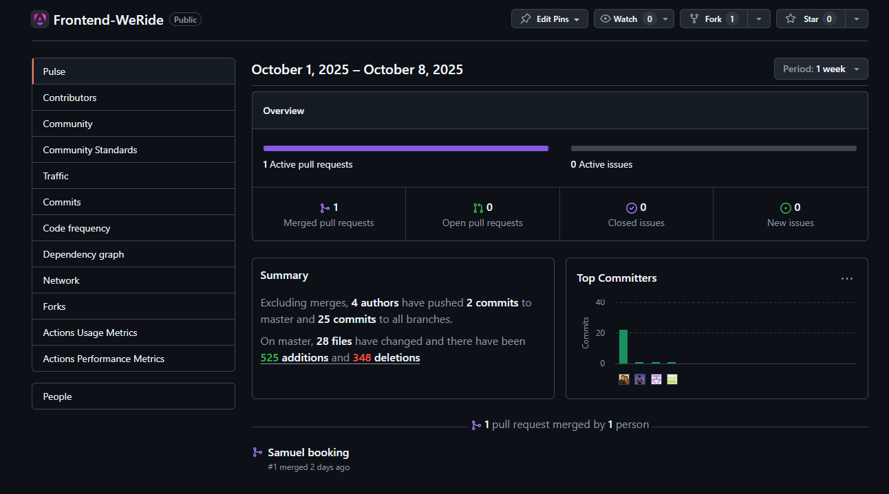

---

### 5.2.2.5. Execution Evidence for Sprint Review

En esta entrega, nos centramos en el desarrollo completo del desarrollo de la **Web Application** de WeRide.

Es por ello que se comparte las evidencias de ambos repositorios para corroborar el trabajo hecho por cada uno de los participantes.

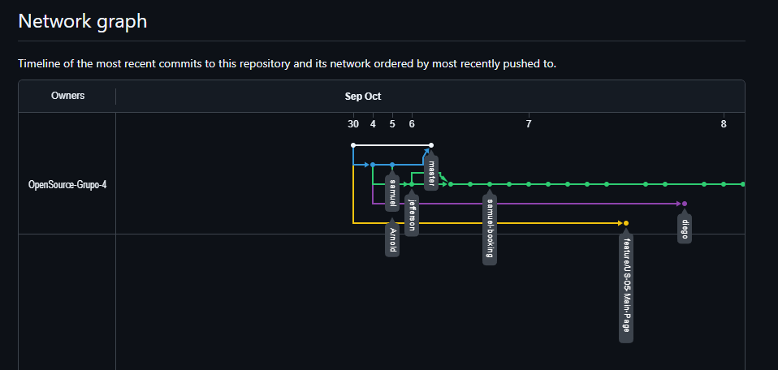

---

### 5.2.2.6. Services Documentation Evidence for Sprint Review

El db.json fue creado para simular una base de datos local y facilitar el desarrollo y pruebas de la aplicación web. Este archivo contiene datos estructurados en formato JSON, representando las entidades principales del sistema: **usuarios, vehículos, reservas y planes.**

***json server:***

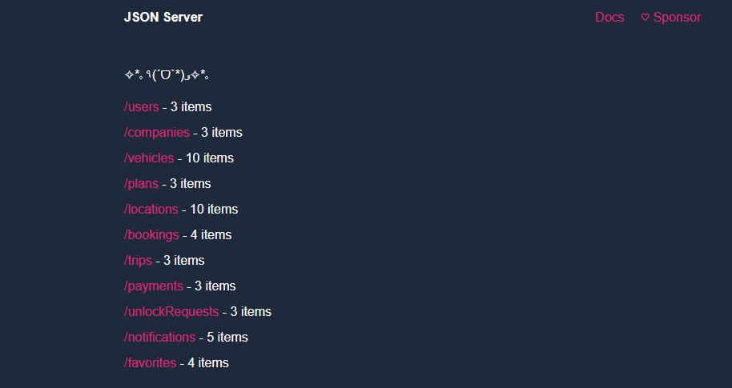
---

### 5.2.2.7. Software Deployment Evidence for Sprint Review

El objetivo del segundo Sprint fue el desarrollo e implementación de la Web Application. Para eso, utilizamos GitHub y GitHub Pages. El proceso del desarrollo fue el siguiente:

1. Se creó un repositorio para el desarrollo de la Web Application en GitHub. 
2. Se creó el entorno de desarrollo con Node.js y Angular usando WebStorm como IDE. 
3. Se desplegó el db.json con json-server para simular una base de datos local. 
4. Se desarrollaron los componentes usando el patrón de DDD (Domain-Driven Design) para estructurar el código. 
5. Se desplegó el frontend en github pages para pruebas y visualización.

---

### 5.2.2.8. Team Collaboration Insights during Sprint

A continuación, se adjuntan las capturas de evidencia de los insights del repositorio del desarrollo de la Web Application para evidenciar la participación de todos los miembros:

* Insight Web Application:
  

* Insight Report
  

## 5.2.3. Sprint 3

<h3>5.2.3.1. Sprint Planning 3</h3>

<table>
  <tr>
    <th>Elemento</th>
    <th>Detalle</th>
  </tr>

  <tr>
    <td><strong>Sprint</strong></td>
    <td>Sprint 3 — Primera versión del backend con Java (Spring Boot) y conexión a MySQL (WeRide)</td>
  </tr>

  <tr>
    <td><strong>Sprint Planning Background</strong></td>
    <td>Sprint orientado a entregar la capa mínima de backend que soporte autenticación, gestión de vehículos y reservas; establecer conexión estable con MySQL Workbench; y preparar los bounded contexts para futuras integraciones (auth, vehicle, booking). Se prioriza robustez, pruebas básicas y scripts de inicialización de esquema.</td>
  </tr>

  <tr>
    <td><strong>Fecha</strong></td>
    <td>2025-10-27</td>
  </tr>

  <tr>
    <td><strong>Hora</strong></td>
    <td>20:00 (GMT-5)</td>
  </tr>

  <tr>
    <td><strong>Lugar</strong></td>
    <td>Reunión virtual — Google Meet</td>
  </tr>

  <tr>
    <td><strong>Preparado por</strong></td>
    <td>WeTech</td>
  </tr>

  <tr>
    <td><strong>Asistentes</strong></td>
    <td>Samuel Bonifacio, Jefferson Castro, Diego Seminario, Arnold Morales</td>
  </tr>

  <tr>
    <td><strong>Sprint n-2 Review</strong></td>
    <td>Se asignaron los bounded contexts para el backend y se iniciaron las primeras contribuciones en el repositorio; frontend consumiendo <code>db.json</code> para pruebas.</td>
  </tr>

  <tr>
    <td><strong>Sprint n-2 Retrospective</strong></td>
    <td>Buena coordinación y claridad en las tareas; pendiente mejorar cobertura de pruebas unitarias y definir pipelines CI/CD para despliegues automáticos.</td>
  </tr>

  <tr>
    <td><strong>Sprint Goal (Statement)</strong></td>
    <td>
      <strong>Our focus is on</strong> entregar la primera versión operativa del backend (servicios REST) que permita autenticación, gestión de vehículos y reservas, conectada a MySQL Workbench.<br>
      <strong>We believe it delivers</strong> la capacidad de realizar pruebas end-to-end entre frontend y backend, garantizando persistencia y consistencia básica de datos.<br>
      <strong>This will be confirmed when</strong> los endpoints de autenticación, consulta de vehículos y creación de reservas responden correctamente en el entorno de pruebas y las operaciones CRUD se verifican contra la base de datos MySQL mediante consultas y pruebas automatizadas.
    </td>
  </tr>

  <tr>
    <td><strong>User Stories (seleccionadas)</strong></td>
    <td>Ver tabla abajo (IDs, descripción y puntos).</td>
  </tr>

  <tr>
    <td><strong>Sprint 3 Velocity (forecast)</strong></td>
    <td>20 puntos</td>
  </tr>

  <tr>
    <td><strong>Sum of Story Points (commit)</strong></td>
    <td>20 puntos</td>
  </tr>
</table>

<br>

<h4>Objetivo del Sprint (versión SMART)</h4>
<p><strong>Objetivo:</strong> Entregar la primera iteración del backend en Spring Boot con conexión a MySQL que permita registro/inicio de sesión, creación y consulta de perfiles, y persistencia de reservas/vehículos para pruebas end-to-end.</p>

<ul>
  <li><strong>Específico:</strong> Endpoints de auth (registro/login), persistencia de usuario/perfil, endpoints para vehículos y reservas; scripts de inicialización de esquema en MySQL.</li>
  <li><strong>Medible:</strong> Todos los endpoints listados en las user stories pasan sus criterios de aceptación y las operaciones CRUD quedan verificadas contra MySQL.</li>
  <li><strong>Alcanzable:</strong> Basado en la capacidad del equipo y velocity estimada (20 SP).</li>
  <li><strong>Relevante:</strong> Habilita integración real con frontend y pruebas de integración para pilotos.</li>
  <li><strong>Time-bound:</strong> Entrega al cierre de Sprint 3 (1 iteración).</li>
</ul>

<hr>

<h4>User Stories seleccionadas para el Sprint 3</h4>

<table>
  <tr>
    <th>ID</th>
    <th>User Story</th>
    <th>Puntos</th>
  </tr>
  <tr>
    <td>01</td>
    <td>Como usuario quiero poder iniciar sesión o registrarme en la app para usarla diariamente.</td>
    <td>5</td>
  </tr>
  <tr>
    <td>02</td>
    <td>Como usuario, quiero introducir mi número de celular para validar mi identidad y recibir notificaciones.</td>
    <td>4</td>
  </tr>
  <tr>
    <td>03</td>
    <td>Como usuario, quiero introducir un código de verificación para validar mi identidad en la aplicación.</td>
    <td>4</td>
  </tr>
  <tr>
    <td>04</td>
    <td>Como usuario quiero poder crear un perfil para colocar mis datos.</td>
    <td>5</td>
  </tr>
  <tr>
    <td>05</td>
    <td>Como usuario quiero poder ver una pantalla principal estética que me atraiga a usar el servicio.</td>
    <td>2</td>
  </tr>
  <tr>
    <td></td>
    <td><strong>Total de puntos comprometidos:</strong></td>
    <td><strong>20</strong></td>
  </tr>
</table>

<hr>

<h4>Criterios de aceptación (ejemplos rápidos)</h4>
<ul>
  <li><strong>US-01:</strong> Registro almacena usuario en MySQL, responde 201 Created y devuelve token JWT; login valida credenciales y retorna token.</li>
  <li><strong>US-02 / US-03:</strong> Número celular guardado y proceso de verificación simulado (código) implementado; endpoints de verificación devuelven estado validado.</li>
  <li><strong>US-04:</strong> Perfil editable con campos básicos (nombre, documento, foto URL) y persistencia verificada.</li>
  <li><strong>US-05:</strong> Endpoint que provee datos para la pantalla principal (promociones/estadísticas) y respuesta &lt; 500ms en entorno de pruebas.</li>
</ul>

<h4>Riesgos identificados y mitigaciones</h4>
<ul>
  <li><strong>Riesgo:</strong> Problemas de conexión o configuración con MySQL Workbench. <strong>Mitigación:</strong> scripts de bootstrap de DB y contenedores locales (Docker Compose) para entorno reproducible.</li>
  <li><strong>Riesgo:</strong> Falta de pruebas automatizadas. <strong>Mitigación:</strong> incluir pruebas unitarias básicas y pruebas de integración que validen CRUD contra una DB de prueba.</li>
  <li><strong>Riesgo:</strong> Dependencias inseguras en librerías. <strong>Mitigación:</strong> revisar versiones y políticas de seguridad (dependabot/scan).</li>
</ul>


### 5.2.3.2. Aspect Leaders and Collaborators

| Team Member (Apellido, Nombre) | GitHub Username | Deploy de Base de Datos | Historial de Viajes | Gestión de Perfiles | Reservas | Garage |
|--------------------------------|------------------|-------------------------|---------------------|---------------------|-------|----------------------|
| Bonifacio, Samuel | samuelbonifacio015 | L | L | L | L | L |
| Castro, Jefferson | JeffersonCastroPariona | L | C | L | L | C |
| Seminario, Diego | DiegoSeminario | L | C | L | C | L |
| Romero, Jhimy | jhimyromeromeza | L | C | C | C | C |
| Morales, Arnold | Arnold-TI | L | L| L | L | C |

**L:** Leader (Líder)  
**C:** Collaborator (Colaborador)

---

### 5.2.3.3. Sprint Backlog 3

| ID | Title/Section | Description | Estimation (Hours) | Assigned To | Status |
|----|----------------|--------------|--------------------|--------------|--------|
| US21 | Registro de Usuario | Como usuario, quiero registrar una cuenta desde la aplicación para acceder a los servicios de WeRide. | 3 | Castro Pariona, Jefferson Ernesto | Done |
| US22 | Visualización de Vehículos | Como usuario, quiero visualizar los vehículos disponibles para elegir uno según mis necesidades. | 4 | Seminario Castillo, Diego Vicente | Done |
| US23 | Reserva de Vehículo | Como usuario, quiero poder reservar un vehículo seleccionando fecha y hora de uso. | 4 | Romero Meza, Jhimy Pool | Done |
| US24 | Pago en Línea | Como usuario, quiero realizar el pago de mi reserva de manera segura mediante una interfaz simple y funcional. | 5 | Morales Sosa, Arnold Gabriel | Done |
| US25 | Archivo db.json | Como desarrollador, quiero crear un archivo db.json con los datos de usuarios, vehículos y reservas para pruebas locales. | 2 | Bonifacio Jaramillo, Samuel Jesús | Done |
| US26 | Pruebas e Integración | Como equipo, queremos realizar pruebas de funcionamiento e integración del flujo completo del sistema. | 2 | Todos | Done |

---

### 5.2.3.4. Development Evidence for Sprint Review

Durante el Sprint 3 se implementaron los principales módulos del backend, incluyendo el componente de **gestión de perfiles, reservas, historial de viajes y garage de autos.** A continuación se listan los commits más relevantes registrados en el repositorio del backend durante este Sprint (captura en el panel de commits):

| Repository | Branch | Commit Id | Commit Message | Autor | Committed on (Date) |
|------------|--------------------------|-----------|----------------------------------------------------------------------------------------------------------------------------------|-----------------------|----------------------|
| OpenSource-Grupo-4/Backend-WeRide | feat/travelHistory | f7222d1 | feat(travelHistory): Add news endpoints for create TravelHistory and find TravelHistory by userId | jhimyromeromeza | 09/11/2025 |
| OpenSource-Grupo-4/Backend-WeRide | feature/profile | 6e8bd4f | feat: Implement Profile Bounded Context | Arnold-TI | 08/11/2025 |
| OpenSource-Grupo-4/Backend-WeRide | main | 69c362f | feat: implement JWT auth | samuelbonifacio015 | 29/10/2025 |
| OpenSource-Grupo-4/Backend-WeRide | main | e733cf1 | feat: added rest interfaces for iam | samuelbonifacio015 | 29/10/2025 |
| OpenSource-Grupo-4/Backend-WeRide | main | 7c22d3e | feat: added iam infrastructure | samuelbonifacio015 | 29/10/2025 |
| OpenSource-Grupo-4/Backend-WeRide | feat/booking | e3c8283 | feat(booking): update classes logic validation | JeffersonCastroPariona | 29/10/2025 |
| OpenSource-Grupo-4/Backend-WeRide | feat/booking | a60ea90 | feat(booking): implement aggregate and commands queries services | JeffersonCastroPariona | 28/10/2025 |
| OpenSource-Grupo-4/Backend-WeRide | bc/garage | 5875d27 | bc/garage | DiegoSeminario | 11/11/2025 |

Cada commit refleja el trabajo colaborativo y el cumplimiento de los objetivos del Sprint, asegurando la trazabilidad y transparencia en el desarrollo de **WeRide.**

**Reporte de commits (captura):**


---

### 5.2.3.5. Execution Evidence for Sprint Review

En esta entrega, nos centramos en el desarrollo completo del desarrollo de los **Web Services** de WeRide.

Es por ello que se comparte las evidencias de ambos repositorios para corroborar el trabajo hecho por cada uno de los participantes.


---

### 5.2.3.6. Services Documentation Evidence for Sprint Review

Para el backend, hemos desarrollado nuestro API utilizando Java con el framework Spring Boot. Este backend se conecta a una base de datos MySQL Workbench para gestionar el inicio de sesión, gestión de perfiles, reservas, historial de viajes y garage de autos.

Para verificar que la optención de datos se realice correctamente, utilizamos Swagger UI, una herramienta que nos permite interactuar con nuestra API de manera visual y probar los diferentes endpoints que hemos creado.

*Schemas:*


*Swagger:*

##### Accounts

  


##### Authentication


##### SignUp:


##### SignIn:


##### Auth:


##### Reservations:


##### Profiles:


##### Bookings:


##### Vehicles:


##### Travel History:


##### Users:


--- 

### 5.2.3.7. Software Deployment Evidence for Sprint Review

El objetivo del tercer Sprint fue el desarrollo e implementación del Backend de la Web Application. Para eso, utilizamos GitHub. El proceso del desarrollo fue el siguiente:

1. Se creó un repositorio para el desarrollo del Backend en GitHub. 
2. Se creó el entorno de desarrollo con Java(Springboot) y MySQL Workbench usando IntelliJ IDEA como IDE. 
3. Se desarrollaron los bounded context usando el patrón de DDD (Domain-Driven Design) para estructurar el código. 
4. Se utilizó Swagger UI para documentar y probar los endpoints del API desarrollado.
5. Se desplegó el backend en un servidor local para pruebas y visualización.
   
---
   
### 5.2.3.8. Team Collaboration Insights during Sprint

A continuación, se adjuntan las capturas de evidencia de los insights del repositorio del desarrollo de los Web Services para evidenciar la participación de todos los miembros:

* Insight Web Service:
  

* Insight Report
  

## 5.2.4. Sprint 4
### 5.2.4.1.Sprint Planning 4.
Para el sprint 4, el equipo realizó el sprint planning meeting para la distribución de tareas y revisión de errores a corregir. El resumen se mostrará a continuación:

<table>
  <tr>
    <th>Elemento</th>
    <th>Detalle</th>
  </tr>

  <tr>
    <td><strong>Sprint</strong></td>
    <td>Sprint 4 — Integración final Frontend ↔ Backend, despliegue y mejora del informe / landing page (WeRide)</td>
  </tr>

  <tr>
    <td><strong>Sprint Planning Background</strong></td>
    <td>Sprint orientado a integrar los componentes desarrollados (frontend y backend), corregir errores críticos identificados en pruebas, completar secciones faltantes del informe y pulir la landing page para el despliegue final del piloto. Prioriza estabilidad, experiencias end-to-end y evidencia documental para entrega.</td>
  </tr>

  <tr>
    <td><strong>Fecha</strong></td>
    <td>2025-12-01</td>
  </tr>

  <tr>
    <td><strong>Hora</strong></td>
    <td>21:00 (GMT-5)</td>
  </tr>

  <tr>
    <td><strong>Lugar</strong></td>
    <td>Reunión virtual — Google Meet</td>
  </tr>

  <tr>
    <td><strong>Preparado por</strong></td>
    <td>Seminario Castillo, Diego Vicente (WeTech)</td>
  </tr>

  <tr>
    <td><strong>Asistentes (Planning Meeting)</strong></td>
    <td>Castro Pariona, Jefferson Ernesto · Bonifacio Jaramillo, Samuel Jesus · Seminario Castillo, Diego Vicente · Romero Meza, Jhimy Pool · Morales Sosa, Arnold Gabriel</td>
  </tr>

  <tr>
    <td><strong>Sprint n-3 Review (Resumen)</strong></td>
    <td>Se completó la primera versión del backend, se integró con frontend simulando <code>db.json</code> y se corrigieron la mayoría de errores reportados del frontend. Se desplegó la versión inicial en entorno de staging y se avanzó en el diseño final de la landing page.</td>
  </tr>

  <tr>
    <td><strong>Sprint n-3 Retrospective (Resumen)</strong></td>
    <td>Buena coordinación del equipo; mejora en procesos de revisión. Acciones de mejora: reforzar pruebas e2e, documentar criterios de aceptación y automatizar despliegues.</td>
  </tr>

  <tr>
    <td><strong>Sprint Goal (Statement)</strong></td>
    <td>
      <strong>Our focus is on</strong> entregar la versión integrada y estable de frontend y backend, corrigiendo errores críticos, completando las secciones faltantes del informe y refinando la landing page para el despliegue piloto.<br>
      <strong>We believe it delivers</strong> mayor confianza operativa y evidencia para presentación académica y pilotos corporativos, aumentando la probabilidad de adopción inicial.<br>
      <strong>This will be confirmed when</strong> la aplicación integrada realiza viajes simulados end-to-end, las APIs responden en staging, el informe está actualizado y validado por el equipo, y la landing page está publicada con métricas iniciales (visitas y conversiones de registro).
    </td>
  </tr>

  <tr>
    <td><strong>Sprint 4 Velocity</strong></td>
    <td>61 puntos</td>
  </tr>

  <tr>
    <td><strong>Sum of Story Points (commit)</strong></td>
    <td>61 puntos</td>
  </tr>

</table>


### 5.2.4.2. Aspect Leaders and Collaborators.

Durante este Sprint, el equipo se enfocó en el **diseño visual, maquetación y despliegue de la Landing Page** de **WeRide**, junto con la implementación inicial del soporte multilenguaje y la adaptación responsiva del sitio web.  
Para optimizar el trabajo colaborativo, se elaboró la **Matriz de Liderazgo y Colaboración (LACX)**, donde se asignan los roles de **Líder (L)** y **Colaborador (C)** en los principales aspectos del Sprint.

| **Team Member (Last Name, First Name)** | **GitHub Username**                                      | **Diseño visual y maquetación web (Frontend funcional)** | **Implementación técnica del cambio de idioma (Multilenguaje funcional)** | **Responsividad y pruebas en distintos dispositivos** | **Despliegue de la aplicación web** |
|-----------------------------------------|----------------------------------------------------------|----------------------------------------------------------|---------------------------------------------------------------------------|-------------------------------------------------------|-------------------------------------|
| **Bonifacio Jaramillo, Samuel Jesus**   | [@samuelbonifacio015](https://github.com/samuelbonifacio015) | L                                                        | C                                                                         | C                                                     | C                                   |
| **Romero Meza, Jhimy Pool**             | [@jhimyromeromeza](https://github.com/jhimyromeromeza)       | C                                                        | L                                                                         | C                                                     | C                                   |
| **Seminario Castillo ,Diego Vicente**   | [@DiegoSeminario](https://github.com/DiegoSeminario)     | C                                                        | C                                                                         | C                                                     | L                                   |
| **Morales Sosa, Arnold Gabriel**        | [@Arnold-TI](https://github.com/Arnold-TI)           | C                                                        | C                                                                         | C                                                     | L                                   |
| **Castro Pariona, Jefferson Ernesto**   | [@JeffersonCastroPariona](https://github.com/JeffersonCastroPariona)                              | C                                                        | L                                                                         | L                                                     |                                     |
### 5.2.4.3.Sprint Backlog 4.

### 5.2.4.3 Sprint Backlog — Sprint 4 (WeRide)

| ID   | Título (HU)                                | Descripción (resumen)                                                                 | Story Points | Est. (hrs) | Assigned To                                        | Status      |
|------|--------------------------------------------|----------------------------------------------------------------------------------------|:------------:|:----------:|----------------------------------------------------|-------------|
| US-01| Inicio de sesión y registro                 | Registro/login, persistencia en backend, token JWT                                    |      8       |    12      | Jefferson Castro (Frontend) / Backend support       | In Progress |
| US-02| Introducir número de celular + verificación | Guardar número, solicitar código y validar (flow SMS/sandbox)                         |      5       |     8      | Samuel Bonifacio (Backend/DevOps)                   | In Progress |
| US-04| Datos de usuario / Perfil                   | Crear/editar perfil (nombre, foto, correo) y persistencia                             |      3       |     6      | Jhimy Romero (Frontend) / Backend support           | To Do       |
| US-05| Página principal / Landing (pulido)         | Pulir UI/UX de la pantalla principal y landing (performance, CTA, tracking)           |      3       |     6      | Diego Seminario (Frontend)                          | In Progress |
| US-11| Seleccionar ubicación y ver vehículos       | Al seleccionar ubicación en mapa mostrar vehículos cercanos y detalles (realtime)     |      8       |    10      | Diego Seminario (Frontend) / Backend support        | In Progress |
| US-07| Gestión/Visualización en Garaje             | Vista Garaje con listados, detalles y filtros (tipo, batería, valoración)             |      5       |     8      | Jhimy Romero (Frontend) / Backend support          | To Do       |
| US-17| Crear una reserva                            | Reserva de vehículo: seleccionar, confirmar, bloquear vehículo y temporizador         |      8       |    10      | Jhimy Romero (Frontend) / Arnold Morales (Backend)  | To Do       |
| US-24| Pago en línea (sandbox)                      | Integración mock/sandbox Yape/Plin; registro de transacción en backend                |      8       |    12      | Arnold Morales (Backend) / Frontend support         | To Do       |
| US-19| Desbloqueo con QR / US-20 Desbloqueo app     | Flujo de desbloqueo (QR y botón app) + estado de desbloqueo en tiempo real            |      5       |     8      | Arnold Morales (Backend) / Jhimy (Frontend)        | To Do       |
| US-12| Visualización de viaje en mapa               | Mostrar trayecto en tiempo real con datos de vehículo (batería, tiempo restante)      |      3       |     6      | Jhimy Romero (Frontend) / Backend support          | To Do       |
| CI-1 | CI/CD pipeline & Deploy a staging            | Pipeline (build/test/deploy) automático a staging                                     |      3       |     8      | Samuel Bonifacio (DevOps)                           | To Do       |
| TST1 | Pruebas E2E (smoke)                          | Suite e2e mínima para flujo crítico: registro→login→reserva→pago                      |      2       |     6      | Equipo (coordinado)                                 | To Do       |
| US-25| Archivo db.json (verificar)                  | db.json ya creado; verificar migración / uso en staging                              |      0       |     3      | Samuel Bonifacio (DevOps)                           | Done        |

**Sum Story Points comprometidos (Sprint 4):** 61 SP  
**Nota:** US-25 aparece como *Done* (verificado) y no suma SP al comprometido arriba.


### 5.2.4.4.Development Evidence for Sprint Review.
| **Repository**  | **Branch**            | **Commit ID**                            | **Author**        | **Time ago** |
|-----------------|-----------------------|------------------------------------------|-------------------|--------------|
| Backend-WeRide | master                | d92fe801832a83b5b698f5b24639effd021daaf7 | samuelbonifacio015 | 1 days ago   |
| Backend-WeRide  | Arnold                | 6e8bd4fc9fa6ef5ad2faf2109d06f411ba538402 | Arnold-TI         | 1 days ago   |
| Backend-WeRide  | feature/garage        | 5875d271c3a5cbbdeb171e9f6cabbe8d3c95f24c | DiegoSeminario    | 1 days ago   |
| Backend-WeRide  | feature/travelhistory | f7222d1cf6576893ce94db44932de35a96058eae | jhimyromeromeza| 14 days ago  |
| Backend-WeRide | jefferson             | e3c8283af91b64fd807e18d1bfd90f27fa7fd04b | JeffersonCastroPariona   | 1 days ago   |
| Backend-WeRide  | samuel                | bfd7ddf55775bc30cdd1eb003c869e8ec897045b | samuelbonifacio   | 6 days ago   |
| Backend-WeRide  | develop               | 538a2e9a51d6fe0d2a8c95d429a24bbeb598237f | samuelbonifacio015| 1 days ago   |


<!-- ========================= -->
<!-- 5.2.4.5 Execution Evidence -->
<!-- ========================= -->
<h3 id="5-2-4-5">5.2.4.5. Execution Evidence for Sprint Review</h3>

En el Sprint 4 se completó la integración final entre Frontend y Backend, se corrigieron errores críticos identificados en pruebas de staging, se pulió la landing page y se realizó el despliegue del backend en Render con base de datos MySQL en Aiven. Las funcionalidades validadas end-to-end incluyen: registro/login con JWT, visualización de vehículos, flujo de reserva y ejecución de viajes simulados. Se generaron evidencias visuales (capturas) y un video de demostración que muestra la navegación y los flujos principales.</p>

<h4>Principales logros</h4>
<ul>
  <li>Integración Frontend ↔ Backend funcionando en entorno de staging y ambiente desplegado en Render.</li>
  <li>Corrección de errores críticos y mejoras de rendimiento en endpoints clave.</li>
  <li>Landing page actualizada y publicada con métricas iniciales de navegación.</li>
  <li>Validación de flujos: onboarding (registro/login), reserva, inicio/fin de viaje, historial de trips.</li>
</ul>

<h4>Capturas (incluir en informe)</h4>
<ul>
  <li><strong>Screenshot 1:</strong> Página de login/registro — </li>
  <li><strong>Screenshot 2:</strong> Vista de mapa con vehículos simulados — </li>
  <li><strong>Screenshot 3:</strong> Flujo de reserva (confirmación) — </li>
  <li><strong>Screenshot 4:</strong> Historial de viajes (trip history) —</li>
</ul>

<hr>

<!-- =================================== -->
<!-- 5.2.4.6 Services Documentation -->
<!-- =================================== -->
### 5.2.4.6. Services Documentation Evidence for Sprint Review

La documentación del RESTful API de WeRide se genera automáticamente con **OpenAPI (springdoc-openapi)** a partir de los controllers del backend y se publica mediante **Swagger UI**.

- **Swagger UI:** `https://backend-weride-2wpb.onrender.com/swagger-ui/index.html`
- **Especificación OpenAPI (JSON):** `https://backend-weride-2wpb.onrender.com/v3/api-docs`
- **Repositorio:** https://github.com/OpenSource-Grupo-4/Backend-WeRide

**Seguridad:** los endpoints de `/api/v1/authentication/**`, `/health` y Swagger son públicos. El resto requiere el header `Authorization: Bearer <token>` (JWT obtenido en `sign-in`).

#### Resumen de endpoints (base: `/api/v1`)

| Grupo | Endpoint | Método | Acción |
|---|---|---|---|
| Authentication | `/authentication/sign-up` | POST | Registrar una cuenta |
| Authentication | `/authentication/sign-in` | POST | Iniciar sesión y obtener JWT |
| Accounts | `/accounts/{accountId}` | GET | Consultar una cuenta |
| Profiles | `/profiles` | POST | Crear perfil |
| Profiles | `/profiles/me` | GET, PUT | Consultar / actualizar el perfil propio |
| Profiles | `/profiles/{id}` | GET | Consultar un perfil |
| Vehicles | `/vehicles` | POST, GET | Crear / listar vehículos |
| Vehicles | `/vehicles/{id}` | GET, PUT, DELETE | Consultar / actualizar / eliminar |
| Plans | `/plans` | POST, GET | Crear / listar planes |
| Plans | `/plans/{id}` | GET, PUT, DELETE | Consultar / actualizar / eliminar |
| Bookings | `/bookings` | POST, GET | Crear / listar reservas |
| Bookings | `/bookings/draft` | POST | Crear borrador de reserva |
| Bookings | `/bookings/drafts` | GET | Listar borradores |
| Bookings | `/bookings/draft/{draftId}` | DELETE | Eliminar borrador |
| Bookings | `/bookings/{id}` | GET, PATCH, PUT, DELETE | Consultar / actualizar / eliminar |
| Bookings | `/bookings/vehicle/{vehicleId}` | GET | Reservas por vehículo |
| Bookings | `/bookings/status/{status}` | GET | Reservas por estado |
| Bookings | `/bookings/user/{userId}` | GET | Reservas por usuario |
| Bookings | `/bookings/user/{userId}/pending` | GET | Reservas pendientes del usuario |
| Bookings | `/bookings/user/{userId}/completed` | GET | Reservas completadas del usuario |
| Trips | `/trips` | POST, GET | Crear / listar viajes |
| Trips | `/trips/{id}` | GET, PATCH, DELETE | Consultar / actualizar / eliminar |
| Travel History | `/travel-history` | POST, GET | Registrar / listar historial |
| Travel History | `/travel-history/me` | GET | Historial del usuario autenticado |
| Travel History | `/travel-history/{userId}` | GET | Historial por usuario |
| Travel History | `/travel-history/{id}` | PUT | Actualizar un registro |
| Notifications | `/notifications` | POST, GET | Crear / listar notificaciones |
| Notifications | `/notifications/{notificationId}` | GET, PATCH, DELETE | Consultar / actualizar / eliminar |
| Notifications | `/notifications/{notificationId}/read` | PATCH | Marcar como leída |
| Location | `/location` | POST, GET | Crear / listar ubicaciones |
| Location | `/location/{id}` | GET, PUT, PATCH, DELETE | Consultar / actualizar / eliminar |
| Unlock Requests | `/unlockRequests` | POST, GET | Crear / listar solicitudes de desbloqueo |
| Unlock Requests | `/unlockRequests/{id}` | GET, PATCH, DELETE | Consultar / actualizar / eliminar |
| Health | `/health` (sin prefijo `/api/v1`) | GET | Estado del servicio |

#### Ejemplos de request / response

**POST `/api/v1/authentication/sign-up`** (público)

```json
// Request
{ "username": "usuario1", "password": "Weride2026!" }
// Response 201 Created
{ "id": 1, "username": "usuario1" }
```
Respuesta `400 Bad Request` si el username/password están vacíos o la cuenta no puede crearse.

**POST `/api/v1/authentication/sign-in`** (público)

```json
// Request
{ "username": "usuario1", "password": "Weride2026!" }
// Response 200 OK
{ "id": 1, "token": "<JWT>", "profileId": 1 }
```
Respuesta `404 Not Found` si las credenciales no corresponden a una cuenta.

**POST `/api/v1/vehicles`** (requiere Bearer token)

```json
// Request
{ "brand": "Tesla", "model": "Model 3", "year": 2023, "type": "car",
  "pricePerMinute": 0.5, "status": "available" }
// Response 201 Created
{ "id": "1", "brand": "Tesla", "model": "Model 3", "year": 2023, "type": "car",
  "status": "available", "pricePerMinute": 0.5, "...": "demás campos del VehicleResource" }
```

**GET `/api/v1/vehicles`** → `200 OK` con un arreglo de `VehicleResource`.
**GET `/api/v1/vehicles/{id}`** → `200 OK` o `404 Not Found`.
**PUT `/api/v1/vehicles/{id}`** → `200 OK` con el vehículo actualizado, o `404`.
**DELETE `/api/v1/vehicles/{id}`** → `204 No Content`, o `404`.

> Para el resto de grupos (Plans, Bookings, Trips, etc.) los esquemas completos de request/response están disponibles en Swagger UI.

#### Despliegue del servicio

El backend (Spring Boot, empaquetado con el `Dockerfile` del repositorio) se despliega como **Web Service en Render** (plan Free, runtime Docker) y utiliza una base de datos **MySQL 8 administrada en Aiven**. La configuración sensible (URL, usuario y contraseña de la base de datos, `JWT_SECRET`) se inyecta mediante variables de entorno de Render y no se almacena en el repositorio. Al iniciar, Hibernate crea el esquema (`ddl-auto=update`) y se cargan datos demo (vehículos y planes).

- **URL pública del API:** https://backend-weride-2wpb.onrender.com
- **Swagger UI:** https://backend-weride-2wpb.onrender.com/swagger-ui/index.html

> Nota: al usar el plan gratuito de Render, el servicio entra en reposo tras un periodo de inactividad; la primera petición puede tardar cerca de un minuto en responder.

#### Evidencia

**Figura 5.X.** Swagger UI del API de WeRide desplegado en Render, con los grupos de endpoints documentados.


**Figura 5.X+1.** Ejecución de `POST /api/v1/authentication/sign-up` en el servicio desplegado (respuesta 201 Created).


**Figura 5.X+2.** Ejecución de `POST /api/v1/authentication/sign-in` (respuesta 200 OK con JWT).


**Figura 5.X+3.** Servicio `backend-weride` en estado *Live* en el dashboard de Render.


<!-- ============================== -->
<!-- 5.2.4.7 Software Deployment Evidence -->
<!-- ============================== -->
<h3 id="5-2-4-7">5.2.4.7. Software Deployment Evidence for Sprint Review</h3>

<p>El backend de WeRide (Spring Boot, empaquetado con el <code>Dockerfile</code> del repositorio) se desplegó como <strong>Web Service en Render</strong> (plan Free, runtime Docker), conectado a una base de datos <strong>MySQL 8 administrada en Aiven</strong>. El despliegue se realiza directamente desde el repositorio de código en GitHub (rama <code>master</code>), por lo que cada cambio puede volver a desplegarse desde el sistema de control de versiones.</p>

<h4>Resumen del proceso de despliegue</h4>
<ol>
  <li>Creación de la base de datos MySQL 8 en Aiven y obtención de sus datos de conexión (host, puerto, usuario, contraseña, base <code>defaultdb</code>, SSL requerido).</li>
  <li>Creación de un Web Service en Render conectado al repositorio de GitHub, con runtime Docker y plan Free.</li>
  <li>Configuración de variables de entorno en Render: <code>SPRING_DATASOURCE_URL</code>, <code>SPRING_DATASOURCE_USERNAME</code>, <code>SPRING_DATASOURCE_PASSWORD</code>, <code>JWT_SECRET</code>, <code>PORT</code> y <code>JAVA_TOOL_OPTIONS</code> (límite de memoria de la JVM). Ningún secreto se almacena en el repositorio.</li>
  <li>Build de la imagen con el Dockerfile (Maven + JDK) y arranque del servicio. Hibernate crea el esquema en MySQL (<code>ddl-auto=update</code>) y se cargan datos demo (vehículos y planes).</li>
  <li>Verificación: el servicio queda en estado <em>Live</em>, Swagger UI responde y los endpoints de autenticación (<code>sign-up</code> / <code>sign-in</code>) devuelven 201 y 200 respectivamente.</li>
</ol>

<h4>Configuración utilizada</h4>
<table border="1" cellpadding="6" cellspacing="0">
  <thead><tr><th>Componente</th><th>Servicio</th><th>Detalle</th></tr></thead>
  <tbody>
    <tr><td>Backend</td><td>Render (Web Service, Docker, Free)</td><td>https://backend-weride-2wpb.onrender.com</td></tr>
    <tr><td>Base de datos</td><td>Aiven for MySQL 8</td><td>Conexión con SSL requerido, base <code>defaultdb</code></td></tr>
    <tr><td>Documentación</td><td>Swagger UI (springdoc-openapi)</td><td>https://backend-weride-2wpb.onrender.com/swagger-ui/index.html</td></tr>
  </tbody>
</table>

<p><em>Nota:</em> al usar el plan gratuito de Render, el servicio entra en reposo tras un periodo de inactividad y la primera petición puede tardar cerca de un minuto.</p>

<p>Las evidencias (Swagger UI, ejecución de sign-up/sign-in y estado Live del servicio) se encuentran en la sección 5.2.4.6.</p>

<!-- ================================== -->
<!-- 5.2.4.8 Team Collaboration Insights -->
<!-- ================================== -->
<h3 id="5-2-4-8">5.2.4.8. Team Collaboration Insights during Sprint</h3>

El equipo ejecutó actividades coordinadas para entregar la integración y despliegue final. Se trabajó con GitHub (issues, PRs, branches), reuniones diarias de seguimiento (standups), revisión de código y pruebas colaborativas en staging y producción. A continuación se presentan los principales insights y métricas a documentar en el informe.</p>

<h4>Prácticas y procesos aplicados</h4>
<ul>
  <li><strong>Branching:</strong> flujo git feature/ → PR → review → main → deploy (Jenkins).</li>
  <li><strong>Code Review:</strong> todas las PRs requerían al menos 1 revisor y checklist de QA (tests, lint, documentación de endpoints).</li>
  <li><strong>Gestión de tareas:</strong> backlog y tablero Kanban (GitHub Projects / Trello) con estados: To Do / In Progress / Code Review / QA / Done.</li>
  <li><strong>Comunicación:</strong> reuniones de planificación y retro en Google Meet; coordinación diaria en canal de Discord/Slack.</li>
  <li><strong>Testing colaborativo:</strong> sesiones de QA donde distintos miembros ejecutaron pruebas end-to-end y reportaron issues en GitHub Issues.</li>
</ul>


<h4>Evidencias</h4>
<ul>
  <li>Captura: gráfico de contributions por miembro (GitHub Insights / Contributors).</li>
  
  
  
</ul>

## 5.2.5. Acuerdo de Servicio - SaaS (Terms and Conditions)

El siguiente acuerdo de servicio rige el uso de la plataforma **WeRide** por parte de los usuarios registrados (conductores/arrendatarios de vehículos de micromovilidad eléctrica).

**1. Aceptación de los Términos.** Al registrarse y utilizar la plataforma WeRide (landing page, aplicación web y servicios backend asociados), el usuario acepta íntegramente los presentes Términos y Condiciones. El uso continuado del servicio implica la aceptación de cualquier actualización posterior de este acuerdo.

**2. Descripción del Servicio.** WeRide es una plataforma SaaS que conecta a usuarios con vehículos de micromovilidad eléctrica (bicicletas y scooters) disponibles para alquiler de corto plazo, permitiendo la búsqueda, reserva, desbloqueo y pago del servicio a través de la aplicación web.

**3. Registro de Usuario.** El usuario debe proporcionar información veraz y actualizada durante el proceso de registro (nombre, correo electrónico, método de pago). El usuario es responsable de mantener la confidencialidad de sus credenciales de acceso.

**4. Uso del Servicio.** El usuario se compromete a utilizar los vehículos de forma responsable, respetando las normas de tránsito vigentes y las condiciones de uso indicadas en la aplicación. Queda prohibido el uso del vehículo para fines distintos al traslado personal o su cesión a terceros no registrados.

**5. Tarifas y Pagos.** Las tarifas aplicables (por tiempo de uso, plan o membresía) se muestran en la aplicación antes de confirmar cada reserva. Los cobros se procesan a través del método de pago registrado por el usuario al momento de finalizar cada viaje.

**6. Responsabilidad y Seguridad.** WeRide no se hace responsable por daños derivados del uso indebido del vehículo o el incumplimiento de las normas de tránsito por parte del usuario. El usuario es responsable de reportar cualquier desperfecto del vehículo antes de iniciar su uso.

**7. Privacidad de Datos.** El tratamiento de los datos personales del usuario se rige conforme a la Ley N° 29733 - Ley de Protección de Datos Personales del Perú. WeRide no comparte la información personal de sus usuarios con terceros sin su consentimiento, salvo requerimiento legal.

**8. Cancelaciones y Reembolsos.** [Pendiente: política de cancelación a definir por el equipo]

**9. Modificaciones del Servicio.** WeRide se reserva el derecho de modificar, suspender o descontinuar funcionalidades del servicio, notificando a los usuarios con antelación razonable cuando el cambio afecte sus condiciones de uso.

**10. Legislación Aplicable.** Este acuerdo se rige por las leyes de la República del Perú. Cualquier controversia derivada de su interpretación o cumplimiento será resuelta conforme a la legislación peruana vigente.

## 5.3 Validation Interviews

### 5.3.1 Diseño de Entrevistas

**Segmento 1: Universitarios y Jóvenes Profesionales (B2C)**

**Preguntas principales (Landing Page):**

- "¿Qué entiendes que ofrece WeRide al ver la landing page?"
  
- "¿Cuál es el elemento que más te llama la atención o te genera confianza? (ej. precios, testimonios, método de pago)"
  
- "¿Qué información te falta para sentirte seguro al registrarte?"
  
- "¿Qué cambiarías en el diseño o en el copy para que la propuesta sea más clara?"

- "¿El llamado a la acción (CTA) es claro y te invita a registrarte o saber más?"
  
- "¿Las imágenes y gráficos reflejan la experiencia real del servicio?"

- "¿Confías en las formas de pago mostradas en la landing? ¿Por qué sí/no?"
  
- "¿La landing carga rápido y se ve bien en tu dispositivo móvil?"
  
**Preguntas principales (Frontend Web Application):**

- "Si elegiste 'Continuar como invitado', ¿te quedó claro qué funcionalidades tendrías disponibles sin registrarte?"

- "Al llegar a WeRide por primera vez, ¿qué impresión te causó la página de inicio? ¿Te resultó clara la propuesta de valor?"

- "Después de acceder, ¿te resultó intuitivo entender cómo navegar por la aplicación? ¿Qué fue lo primero que intentaste hacer?"

- "Si tuvieras que buscar el historial de tus viajes anteriores, ¿dónde buscarías primero? ¿Te parece lógica esa ubicación?"
  
- "Al buscar un vehículo, ¿la información mostrada (imagen, batería, marca, disponibilidad, precio) fue suficiente para decidir?"

- "Si todos los vehículos cercanos estuvieran ocupados, ¿qué esperarías que la app te ofreciera? (notificaciones, reserva anticipada, alternativas)"
  
- "Describe el proceso de crear una reserva: ¿hubo pasos poco claros o que te generaron dudas?"
  
- "¿Qué te pareció el proceso de pago y los formularios asociados (tarjeta, selección de plan)?"
  
- "¿Hubo algún momento en que te sentiste perdido/a o no supiste qué hacer a continuación?"

**Segmento 2: Empresas y Planes Corporativos (B2B)**

**Preguntas principales (Landing Page):**
- “Al ver la landing de WeRide, ¿qué entendiste que ofrece la plataforma específicamente para empresas?”

- “¿La propuesta de valor empresarial te pareció clara o orientada más al usuario final?”

- “¿Qué elemento visual o textual te transmitió mayor confianza para un uso corporativo?”

- “¿Qué información clave te faltó para evaluar si esto es viable para tu empresa? (precios, soporte, infraestructura, contratos, SLA, mantenimiento…)”

- “¿El CTA te orientó a una solución empresarial (‘solicitar demo’, ‘agendar llamada’, etc.) o lo sentiste más de consumo público?”

- “¿Consideras que la landing diferencia bien entre los servicios B2C y B2B?”

- “¿El diseño te transmite profesionalismo suficiente para un proveedor corporativo?”

**Preguntas principales (Frontend Web Application):**
- “¿Los empleados deberían poder reservar vehículos? ¿O prefieres uso inmediato sin reserva?”

- “En una operación real, ¿cuánto antes se planifican los desplazamientos?”

- “¿Se necesitarían restricciones personalizadas (por sede, por tipo de vehículo, por horas)?”

- “Si todos los vehículos estuvieran ocupados, ¿qué solución esperas? (lista de espera, reserva prioritaria por cargo/área, flota adicional, alertas)”

- “¿Qué tipo de procesos necesitan aprobación previa?”

- “¿Qué modelo se adapta mejor a tu empresa: pago por uso, suscripción mensual, leasing de flota, tarifa fija por empleado?”

- “¿La interfaz te transmite suficiente profesionalismo para un uso corporativo?”
  
---
### 5.3.2 Registro de Entrevistas

### 5.3.2 Registro de Entrevistas

**Segmento 1: Universitarios y Jóvenes Profesionales (B2C)**

#### Entrevista 1

<div style="text-align: center; margin-bottom: 40px;">

</div>

| Campo | Valor |
|-------|-------|
| **Nombre** | Williams Avendaño |
| **Edad** | 20 años |
| **Distrito** | Surco |
| **Institución** | Estudiante ESAN |
| **Video** | [https://www.youtube.com/watch?v=vxBR4mxMcmQ](https://www.youtube.com/watch?v=vxBR4mxMcmQ) |
| **Timing** | 00:00:00 – 00:10:44 |
| **Duración** | 10:44 |
| **Resumen** | Williams comenta que usa apps como Beat y scooters públicos para moverse. Le interesa WeRide porque ahorra tiempo y es más económico. Sugiere más información sobre cobertura. Valora que la app sea fácil de usar y que permita reservar vehículos. |
| **Características Objetivas** | iPhone 12, laptop ASUS; apps: Google Maps, Beat, Yape, WhatsApp. |
| **Características Subjetivas** | Organizado, práctico; prefiere marcas confiables (Apple, Nike); influenciado por amigos y TikTok. |

---

#### Entrevista 2

<div style="text-align: center; margin-bottom: 40px;">

</div>

| Campo | Valor |
|-------|-------|
| **Nombre** | Patrick Cárdenas |
| **Edad** | 19 años |
| **Distrito** | Ate |
| **Institución** | Estudiante PUCP |
| **Video** | [https://www.youtube.com/watch?v=vxBR4mxMcmQ](https://www.youtube.com/watch?v=vxBR4mxMcmQ) |
| **Timing** | 00:10:45 – 00:19:15 |
| **Duración** | 8:30 |
| **Resumen** | Patrick se mueve entre casa, universidad y prácticas. Usa buses y motos por apps. Sugiere agregar un mapa de disponibilidad en tiempo real. La landing y la app le parecen claras y profesionales. |
| **Características Objetivas** | Samsung A52, laptop Lenovo; apps: Moovit, Google Maps, Uber Moto, Plin. |
| **Características Subjetivas** | Extrovertido, sociable; busca rapidez. Prefiere Samsung/Xiaomi; influido por YouTube. |

---

#### Entrevista 3

<div style="text-align: center; margin-bottom: 40px;">

</div>

| Campo | Valor |
|-------|-------|
| **Nombre** | Patrick Correa |
| **Edad** | 20 años |
| **Distrito** | San Miguel |
| **Institución** | Estudiante Universidad de Lima |
| **Video** | [https://www.youtube.com/watch?v=vxBR4mxMcmQ](https://www.youtube.com/watch?v=vxBR4mxMcmQ) |
| **Timing** | 00:19:16 – 00:47:42 |
| **Duración** | 28:22 |
| **Resumen** | Correa usa transporte público y bicicleta. Percibe WeRide como útil si opera cerca de su universidad. Entendió bien la landing, pero pide más información sobre seguridad. La app le parece intuitiva e incluso sugiere incluir tutoriales para nuevos usuarios. |
| **Características Objetivas** | iPhone XR, iPad 8th gen; apps: Google Maps, Cabify, Duolingo, Instagram. |
| **Características Subjetivas** | Tranquilo, analítico; prefiere diseños minimalistas; influido por TikTokers y creadores estudiantiles. |


**Segmento 2: Empresas y Planes Corporativos (B2B)**

#### Entrevista 1

<div style="text-align: center; margin-bottom: 40px;">

</div>

| Campo | Valor |
|-------|-------|
| **Nombre** | Ricardo Del Aguila |
| **Edad** | 27 años |
| **Distrito** | San Miguel |
| **Cargo** | Jefe de inmobiliaria Grupo Horc |
| **Video** | [https://www.youtube.com/watch?v=0qsQ9NOwHMc](https://www.youtube.com/watch?v=0qsQ9NOwHMc) |
| **Timing** | 00:00:00 – 00:13:14 |
| **Duración** | 13:14 |
| **Resumen** | Ricardo entiende que WeRide ofrece movilidad interna eficiente y controlable para empresas. La landing le pareció más dirigida al usuario final, pero identifica potencial corporativo. Señala que necesita información sobre SLA, costos y soporte técnico. Destaca que la interfaz del panel corporativo inspira confianza. Sugiere agregar casos de éxito y comparativas de ahorro. |
| **Características Objetivas** | Laptop Dell Latitude corporativa, iPhone 14 Pro; usa Slack, Microsoft Teams, Trello, Google Workspace; maneja dashboards a diario. |
| **Características Subjetivas** | Perfil analítico, orientado a procesos. Prefiere soluciones confiables y con respaldo técnico. Le influyen benchmarks y referencias de otras empresas del sector. |

---

#### Entrevista 2

<div style="text-align: center; margin-bottom: 40px;">

</div>

| Campo | Valor |
|-------|-------|
| **Nombre** | Matias Flores Flores |
| **Edad** | 26 años |
| **Distrito** | San Isidro |
| **Cargo** | Jefe de Recursos Humanos – empresa de servicios |
| **Video** | [https://www.youtube.com/watch?v=vxBR4mxMcmQ](https://www.youtube.com/watch?v=vxBR4mxMcmQ) |
| **Timing** | 00:13:15 – 00:22:35 |
| **Duración** | 9:20 |
| **Resumen** | Matias percibe que WeRide ofrece una alternativa sostenible de movilidad para colaboradores, reduciendo tiempos muertos. Considera que la landing transmite profesionalismo, pero falta segmentación clara B2B/B2C. Requiere información sobre modelos de pago por empleado y contratos mensuales. En el frontend destaca la necesidad de restricciones por sede y roles. También menciona que valoraría flujos de aprobación por jefatura. |
| **Características Objetivas** | iPhone 13, laptop MacBook Air M1; apps: Teams, Outlook, BambooHR, Zoom; gestión constante de personal. |
| **Características Subjetivas** | Empático, orientado a bienestar laboral. Prefiere marcas con enfoque moderno y sostenible (Apple, Notion). Influenciado por tendencias de HR Tech y recomendaciones en LinkedIn. |

---

#### Entrevista 3

<div style="text-align: center; margin-bottom: 40px;">

</div>

| Campo | Valor |
|-------|-------|
| **Nombre** | Angie Santos |
| **Edad** | 46 años |
| **Distrito** | Santiago de Surco |
| **Cargo** | Jefa de TI – empresa corporativa multisede |
| **Video** | [https://www.youtube.com/watch?v=vxBR4mxMcmQ](https://www.youtube.com/watch?v=vxBR4mxMcmQ) |
| **Timing** | 00:22:36 – 00:29:05 |
| **Duración** | 7:31 |
| **Resumen** | Angie entendió que WeRide puede integrarse como una solución tecnológica para movilidad interna, con trazabilidad y control. La landing le pareció visualmente sólida, pero requiere información técnica: API, integraciones, seguridad, infraestructura y tiempos de mantenimiento. En la app considera importante la disponibilidad en tiempo real y alertas automáticas. Prefiere modelos de suscripción con leasing de flota. |
| **Características Objetivas** | Laptop ThinkPad serie T, Pixel 7 Pro; apps: Azure AD, Jira, Confluence, Power BI, Google Admin; revisa métricas y KPIs a diario. |
| **Características Subjetivas** | Perfil estratégico y exigente en temas de ciberseguridad. Prefiere soluciones escalables y con soporte 24/7. Influenciada por estándares internacionales y casos de integración tecnológica. |


### 5.3.3 Evaluaciones según heuristicas

### Auditoria del Grupo 4:

**UX Heuristics & Principles Evaluation**

**Usability – Inclusive Design – Information Architecture**

**CARRERA:** Ingeniería de Software

**CURSO:** Desarrollo de Aplicaciones Open Source

**SECCIÓN:** 7380  

**PROFESORES:** Todos

**AUDITOR:** Apaza Bocanegra, Elizabeth Noelia

**CLIENTE(S):**
- Bonifacio Jaramillo, Samuel Jesus
- Castro Pariona, Jefferson Ernesto
- Morales Sosa, Arnold Gabriel
- Romero Meza, Jhimy Pool
- Seminario Castillo, Diego Vicente

**SITE o APP A EVALUAR:** WeRide

## TAREAS A EVALUAR:

El alcance de esta evaluación incluye la revisión de la usabilidad de las siguientes tareas:

1. Falta de Login en la Landing Page.
2. Funciones Inaccesibles en el login.
3. Interfaz demasiado limpia y sin distribucion clara, imagenes demasiado grandes.
4. Cards demasiado amplias, no funciona el boton de filtrado ni el de favoritos.
5. No hay datos para Bicicletas electricas.
6. No permite Cancelar Reservas.
7. No permite Guardar nuevas reservas desde Booking.
8. La seccion de viaje en ver detalles esta inactiva.
9. El boton Pagar de la seccion planes esta inactivo.
10. Botones de la barra principal como setings, user y demas estan inactivos.
11. No hay opciones de traduccion dificultan comprension de recibos.
12. Reservar vehiculo inactivo.
13. Boton de reservar en cards tambien Inactivo.
14. No permite usar el boton edit booking.

## ESCALA DE SEVERIDAD:

Los errores serán puntuados tomando en cuenta la siguiente escala de severidad

| Nivel | Descripción                                                                                                                                                                                    |
| :---: | :--------------------------------------------------------------------------------------------------------------------------------------------------------------------------------------------- |
| 1     | Problema superficial: puede ser fácilmente superador por el usuario ó ocurre con muy poco frecuencia. No necesita ser arreglado a no ser que exista disponibilidad de tiempo.                  |
| 2     | Problema menor: puede ocurrir un poco más frecuentemente o es un poco más difícil de superar para el usuario. Se le debería asignar una prioridad baja resolverlo de cara al siguiente reléase |
| 3     | Problema mayor: ocurre frecuentemente o los usuarios no son capaces de resolverlos. Es importante que sean corregidos y se les debe asignar una prioridad alta.                                |
| 4     | Problema muy grave: un error de gran impacto que impide al usuario continuar con el uso de la herramienta. Es imperativo que sea corregido antes del lanzamiento.                              |

## TABLA RESUMEN:

| \#    | Problema                                                    | Escala de severidad | Heurística/Principio violada(o)                 |
| :---: | :---------------------------------------------------------- | :-----------------: | :---------------------------------------------- |
| 1	    | Falta de Login en la Landing Page	                          | 2	                  | Usability: Libertad y control del usuario       |
| 2	    | Funciones inaccesibles en el Login	                        | 3	                  | Usability: Visibilidad del estado del sistema   | 
| 3	    | Interfaz sin distribución clara; imágenes demasiado grandes	| 1	                  | Usability: Diseño estético y minimalista        |
| 4	    | Cards muy amplias; filtrado y favoritos inactivos	          | 3	                  | Usability: Libertad y control del usuario       |
| 5	    | No hay datos para Bicicletas Eléctricas	                    | 2	                  | Usability: Consistencia y estándares            |
| 6	    | No permite cancelar reservas	                              | 4	                  | Usability: Libertad y control del usuario       |
| 7	    | No se guardan nuevas reservas desde Booking	                | 4	                  | Usability: Prevención y recuperación de errores |
| 8	    | Sección “Viaje” en Ver Detalles inactiva	                  | 2	                  | Usability: Visibilidad del estado del sistema   |
| 9	    | Botón “Pagar” inactivo en la sección Planes	                | 3	                  | Usability: Libertad y control del usuario       |
| 10	  | Botones del menú superior (Settings, User, etc.) inactivos	| 2	                  | Usability: Visibilidad del estado del sistema   |
| 11	  | No hay traducción; dificulta comprensión de recibos	        | 1	                  | Usability: Consistencia y estándares            |
| 12	  | Función “Reservar vehículo” inactiva	                      | 4	                  | Usability: Prevención de errores                |
| 13	  | Botón reservar en las cards inactivo	                      | 3	                  | Usability: Libertad y control del usuario       |
| 14	  | Botón “Edit Booking” no funciona	                          | 3	                  | Usability: Flexibilidad y eficiencia de uso     |

## DESCRIPCIÓN DE PROBLEMAS:

## OBSERVACIÓN 1: Falta de Login en la Landing Page

- **Severidad:** 2. Heurística violada: Usabilidad – Libertad y control del usuario
- **Problema:** La Landing Page no ofrece un acceso visible hacia la pantalla de Login. El usuario no tiene una ruta clara para ingresar al sistema, generando confusión y aumentando la tasa de abandono.
- **Recomendación:** Agregar un botón visible (“Iniciar Sesión”, “Ir al Panel”), ubicado en el header o hero principal.

<p align="center">
        
</p>

## OBSERVACIÓN 2: Funciones inaccesibles en el Login

- **Severidad:** 3. Heurística violada: Usabilidad – Visibilidad del estado del sistema
- **Problema:** Algunas funciones de la pantalla de Login no responden o no muestran retroalimentación, como recuperación de contraseña o creación de cuenta. El usuario queda sin información sobre fallas.
- **Recomendación:** Habilitar todos los botones y agregar mensajes de feedback claros (error, éxito, pasos a seguir).

<p align="center">
        
</p>


## OBSERVACIÓN 3: Interfaz demasiado limpia, sin distribución clara e imágenes muy grandes

- **Severidad:** 1. Heurística violada: Usabilidad – Diseño estético y minimalista
- **Problema:** La interfaz presenta espacios vacíos extensos y elementos demasiado grandes, lo que dificulta encontrar las funciones principales.
- **Recomendación:** Redistribuir el layout usando jerarquía visual, reducir el tamaño de imágenes y reforzar la navegación.

<p align="center">
        
</p>

## OBSERVACIÓN 4: Cards demasiado amplias; botones de filtrado y favoritos no funcionan

- **Severidad:** 3. Heurística violada: Usabilidad – Libertad y control del usuario
- **Problema:** Las cards ocupan demasiado espacio y los botones clave no funcionan, afectando directamente el flujo de selección de vehículos.
- **Recomendación:** Optimizar dimensiones, activar funcionalidad de filtros, favoritos y feedback visual.

<p align="center">
        
</p>

## OBSERVACIÓN 5: No hay datos para Bicicletas eléctricas

- **Severidad:** 2. Heurística violada: Usabilidad – Consistencia y estándares
- **Problema:** La sección aparece vacía, lo que genera una experiencia inconsistente frente a otras categorías que sí muestran información.
- **Recomendación:** Cargar datos por defecto, mostrar placeholders o indicar que “Pronto habrá disponibilidad”.

<p align="center">
        
</p>

## OBSERVACIÓN 6: No permite Cancelar Reservas

- **Severidad:** 4. Heurística violada: Usabilidad – Libertad y control del usuario
- **Problema:** Los usuarios no pueden cancelar sus reservas, bloqueando su flujo y generando frustración.
- **Recomendación:** Incorporar botón “Cancelar reserva” con confirmación de acción.

<p align="center">
        
</p>

## OBSERVACIÓN 7: No permite guardar nuevas reservas desde Booking

- **Severidad: 4**. Heurística violada: Usabilidad – Prevención y recuperación de errores
- **Problema:** El flujo de Booking falla al guardar una nueva reserva, interrumpiendo una función crítica.
- **Recomendación:** Corregir el flujo técnico y añadir mensajes que indiquen causa del error y pasos sugeridos.

<p align="center">
        
</p>

## OBSERVACIÓN 8: La sección “Viaje” en Ver Detalles está inactiva

- **Severidad:** 2. Heurística violada: Usabilidad – Visibilidad del estado del sistema
- **Problema:** El panel “Viaje” no despliega información ni responde a la interacción. El usuario no entiende si es temporal, un error o falta de permisos.
- **Recomendación:** Activar el componente o mostrar un mensaje informativo (“Función en desarrollo”, “No hay información disponible”).

<p align="center">
        
</p>

## OBSERVACIÓN 9: El botón “Pagar” de la sección Planes está inactivo

- **Severidad:** 3. Heurística violada: Usabilidad – Libertad y control del usuario
- **Problema:** El usuario no puede completar el pago de un plan, bloqueando una acción central del modelo de negocio.
- **Recomendación:** Activar el botón, conectar el flujo a la pasarela de pago y agregar validaciones previas.

<p align="center">
        
</p>

## OBSERVACIÓN 10: Botones como Settings y User en la barra principal están inactivos

- **Severidad:** 2. Heurística violada: Usabilidad – Visibilidad del estado del sistema
- **Problema:** Los accesos principales no ejecutan acción alguna, lo que genera percepción de sistema incompleto o fallido.
- **Recomendación:** Implementar navegación interna o, al menos, mensajes temporales de “módulo en construcción”.

<p align="center">
        
</p>

## OBSERVACIÓN 11: No hay opciones de traducción y dificulta la comprensión de recibos

- **Severidad:** 1. Heurística violada: Usabilidad – Consistencia y estándares
- **Problema:** El contenido de recibos y pantallas clave está solo en un idioma, dificultando la comprensión para usuarios que no lo manejan.
- **Recomendación:** Integrar sistema de internacionalización (i18n) y traducciones completas.

<p align="center">
        
</p>

## OBSERVACIÓN 12: Reservar vehículo está inactivo

- **Severidad:** 4. Heurística violada: Usabilidad – Prevención de errores
- **Problema:** Al intentar reservar un vehículo, el botón o acción no funciona. Esto afecta directamente la funcionalidad principal del sistema.
- **Recomendación:** Habilitar el botón, validar datos y mostrar confirmación de reserva exitosa.

<p align="center">
        
</p>

## OBSERVACIÓN 13: Botón de reservar dentro de las cards también está inactivo

- **Severidad:** 3. Heurística violada: Usabilidad – Libertad y control del usuario
- **Problema:** El usuario no puede reservar desde la vista de cards, obligándolo a pasos adicionales o impidiendo continuar.
- **Recomendación:** Activar interacción, añadir feedback visual y redirigir al flujo de Booking.

<p align="center">
        
</p>

## OBSERVACIÓN 14: No permite usar el botón “Edit Booking”

- **Severidad:** 3. Heurística violada: Usabilidad – Flexibilidad y eficiencia de uso
- **Problema:** El botón para editar una reserva no responde, y el usuario no puede modificar fechas, horarios o vehículo seleccionado.
- **Recomendación:** Implementar formulario editable, mensajes de validación y confirmación de cambios.

<p align="center">
        
</p>

---

## 5.4. Video About The Product


<a href="https://www.youtube.com/watch?v=UVP-NVpaT6Y" target="_blank" rel="noopener">Ver Video del Producto</a>

# Capítulo VI: Product Verification & Validation

La verificación y validación del producto **WeRide** tiene como finalidad comprobar que los componentes implementados cumplen con los requisitos funcionales definidos para la gestión de cuentas de usuario y la administración de planes. Para ello, se establece una estrategia de pruebas organizada en cuatro niveles: pruebas unitarias, pruebas de integración, pruebas basadas en comportamiento (BDD) y pruebas de sistema.

En esta etapa, el alcance de las pruebas comprende varios bounded contexts del backend como: **IAM**, **Plans**, **Booking**, **Trip**, **Notifications**, **Profile**, **Location** y **Travel History**. El bounded context IAM gestiona el registro de cuentas y la autenticación de usuarios mediante credenciales, mientras que Plans permite crear, actualizar y eliminar planes disponibles en la plataforma. Booking se encarga de gestionar las reservas de vehículos, incluyendo su creación, modificación, cancelación y almacenamiento de borradores. Trip administra la información de los viajes realizados, como rutas, fechas, distancias, duración e incidencias. Notifications gestiona la creación, consulta, actualización y lectura de las notificaciones generadas por el sistema. Profile permite administrar la información personal de los usuarios, vinculándola con sus respectivas cuentas. Location gestiona las ubicaciones disponibles, incluyendo sus direcciones, coordenadas, capacidad y horarios de atención. Travel History permite consultar y administrar los registros de viajes anteriores de cada usuario. Garage se encarga de administrar la flota de vehículos, sus características, disponibilidad, ubicación y estado de mantenimiento y UnlockRequest gestiona las solicitudes de desbloqueo de vehículos, registrando sus horarios, métodos, intentos y posibles errores.

Las pruebas unitarias se implementan utilizando JUnit 5 y Mockito, lo que permite verificar la lógica de los servicios de aplicación de manera aislada. Las dependencias se inician usando la anotación @Mock y se inyectan en la clase evaluada con @InjectMocks. Los tests se implementaron siguiendo el patrón Arrange–Act–Assert (AAA). Se utilizó Spring Boot Test y MockMvc para simular solicitudes HTTP a la aplicación.

## 6.1. Testing Suites & Validation

La verificación y validación de WeRide tiene como finalidad comprobar que los componentes implementados cumplen con los requisitos funcionales definidos para la gestión de cuentas de usuario y la administración de planes. Para ello, se establece una estrategia de pruebas organizada en cuatro niveles: pruebas unitarias, pruebas de integración, pruebas basadas en comportamiento (BDD) y pruebas de sistema.

En esta etapa, el alcance de las pruebas comprenden los bounded contexts **IAM**, **Plans**, **Booking**, **Trip**, **Notifications**, **Profile**, **Location** y **Travel History**. Las pruebas unitarias se implementan utilizando JUnit 5 y Mockito, lo que permite verificar la lógica de los servicios de aplicación de manera aislada. Para las pruebas de integración y de sistema, se considera la interacción entre los componentes de la aplicación, los endpoints REST y la persistencia de datos en la base de datos. Los escenarios BDD permiten especificar el comportamiento esperado de las funcionalidades mediante criterios comprensibles para los desarrolladores y los responsables del producto. La ejecución y los resultados de cada prueba se registran para demostrar el cumplimiento de los criterios de aceptación correspondientes.


### 6.1.1. Core Entities Unit Tests.

Las pruebas unitarias tienen como objetivo verificar el comportamiento de los servicios de aplicación de los bounded contexts mencionados, de manera independiente de la base de datos y de otros componentes externos. En el backend de WeRide se utilizan mocks que permiten controlar las respuestas de las dependencias para después comprobar los resultados de cada operación.

Se utiliza el patrón Arrange–Act–Assert (AAA) que organiza cada prueba en tres etapas: preparación de los datos y dependencias, ejecución del método evaluado y validación del resultado obtenido.

#### **A. Pruebas unitarias del bounded context IAM**

El servicio `AccountCommandServiceImpl` gestiona el registro y el inicio de sesión. Las pruebas verifican el tratamiento de usuarios inexistentes, credenciales incorrectas, autenticación exitosa y nombres de usuario duplicados.

**Tabla 6.1. Casos de prueba unitarios del bounded context IAM**

| ID | Clase de prueba | Escenario | Resultado esperado |
|---|---|---|---|
| IAM-UT-01 | `AccountCommandServiceImplTest` | Inicio de sesión con un usuario inexistente. | Se lanza una excepción con el mensaje "User not found" y no se genera un token. |
| IAM-UT-02 | `AccountCommandServiceImplTest` | Inicio de sesión con contraseña incorrecta. | Se lanza una excepción con el mensaje "Invalid credentials" y no se genera un token. |
| IAM-UT-03 | `AccountCommandServiceImplTest` | Inicio de sesión con credenciales correctas. | Se devuelve la cuenta junto con el token generado. |
| IAM-UT-04 | `AccountCommandServiceImplTest` | Registro con un nombre de usuario ya existente. | Se lanza una excepción con el mensaje "User already exists"; no se guarda una nueva cuenta ni se crea un perfil. |
| IAM-UT-05 | `AccountCommandServiceImplTest` | Registro exitoso. | Se registra una cuenta nueva y se crea el perfil asociado. El servicio devuelve la cuenta creada y actualizada con su identificador de perfil. |

*Fuente: Elaboración propia.*

Las dependencias `AccountRepository`, `HashingService`, `TokenService` y `ProfileContextFacade` se simulan mediante Mockito. La prueba de registro duplicado también comprueba que no se invoquen las operaciones de guardado ni la fachada de Profile.


#### **B. Pruebas unitarias del bounded context Plans**

El servicio `PlanCommandServiceImpl` administra la creación, actualización y eliminación de planes mediante `PlanRepository`.

**Tabla 6.2. Casos de prueba unitarios del bounded context Plans**

| ID | Clase de prueba | Escenario | Resultado esperado |
|---|---|---|---|
| PLN-UT-01 | `PlanCommandServiceImplTest` | Crear un plan con datos válidos. | Se guarda el plan y se devuelve el objeto creado. |
| PLN-UT-02 | `PlanCommandServiceImplTest` | Eliminar un plan existente. | Se elimina el plan y el servicio devuelve 'true'. |
| PLN-UT-03 | `PlanCommandServiceImplTest` | Eliminar un plan inexistente. | El servicio devuelve 'false' y no ejecuta "deleteById". |
| PLN-UT-04 | `PlanCommandServiceImplTest` | Actualizar un plan existente. | Se modifican los atributos, se guarda el plan y se devuelve el resultado actualizado. |
| PLN-UT-05 | `PlanCommandServiceImplTest` | Actualizar un plan inexistente. | Se devuelve "Optional.empty()" y no se guarda ningún cambio. |

*Fuente: Elaboración propia.*


#### **C. Pruebas unitarias del bounded context Booking**

Las pruebas de Booking cubren la gestión de borradores, sus validaciones y las consultas de reservas. Se simulan los repositorios y el servicio de validación para verificar el comportamiento de cada componente de aplicación.

**Tabla 6.3. Casos de prueba unitarios del bounded context Booking**

| ID | Clase de prueba | Escenario | Resultado esperado |
|---|---|---|---|
| BKG-UT-01 | `BookingCommandServiceImplTest` | Guardar un borrador cuando el vehículo no existe. | Se devuelve "success = false", con el mensaje "Vehicle not found", y no se guarda la reserva. |
| BKG-UT-02 | `BookingCommandServiceImplTest` | Guardar un borrador cuando el vehículo y las ubicaciones existen. | Se guarda el borrador y se devuelve "success = true" con el mensaje correspondiente. |
| BKG-UT-03 | `BookingDraftServiceImplTest` | Guardar un borrador cuando el servicio de validación rechaza los datos. | Se devuelve un resultado negativo, el identificador es "null" y no se invoca el repositorio para guardar. |
| BKG-UT-04 | `BookingDraftServiceImplTest` | Guardar un borrador cuando la validación es satisfactoria. | Se crea y guarda un agregado Booking con estado "draft", estado de pago "pending" y un identificador generado. |
| BKG-UT-05 | `BookingQueryServiceImplTest` | Buscar reservas sin "customerId". | Se devuelve una página vacía y no se consulta el repositorio. |
| BKG-UT-06 | `BookingQueryServiceImplTest` | Buscar por usuario y estado. | Se invoca "findByUserIdAndStatus" con el usuario y estado recibidos. |
| BKG-UT-07 | `BookingQueryServiceImplTest` | Buscar únicamente por usuario. | Se invoca "findByUserId" con el usuario autenticado/solicitado. |
| BKG-UT-08 | `BookingQueryServiceImplTest` | Buscar por usuario y vehículo. | Se invoca "findByUserIdAndVehicleId" con ambos identificadores. |
| BKG-UT-09 | `BookingQueryServiceImplTest` | Buscar por usuario y rango de fechas. | Se convierten las fechas a límites de inicio y fin del día y se invoca el método de consulta correspondiente. |
| BKG-UT-10 | `BookingQueryServiceImplTest` | Obtener reservas pendientes y confirmadas. | Se combinan los resultados de ambos estados y se calcula el total de elementos. |
| BKG-UT-11 | `BookingQueryServiceImplTest` | Consultar reservas pendientes con paginación dividida. | Se realizan dos consultas, una por estado, utilizando la mitad del tamaño de página solicitado para cada consulta. |

En `BookingCommandServiceImplTest`, el escenario exitoso también verifica que el costo se derive en el servidor de acuerdo con la tarifa por minuto y la duración de la reserva.

*Fuente: Elaboración propia.*


#### **D. Pruebas unitarias del bounded context Trip**

Las pruebas de Trip comprueban que las operaciones de eliminación concuerden con la propiedad del viaje y que las acciones de un viaje ajeno no modifiquen los datos.

**Tabla 6.4. Casos de prueba unitarios del bounded context Trip**

| ID | Clase de prueba | Escenario | Resultado esperado |
|---|---|---|---|
| TRP-UT-01 | `TripCommandServiceImplTest` | Intentar eliminar un viaje perteneciente a otro usuario. | Se devuelve 'false' y no se elimina el viaje. |
| TRP-UT-02 | `TripCommandServiceImplTest` | Eliminar un viaje perteneciente al usuario actual. | Se devuelve 'true' y se invoca la eliminación del viaje correspondiente. |

La dependencia `NotificationContextFacade` se mantiene como mock porque forma parte del constructor del servicio y se utiliza en la creación de viajes, pero no interviene en los dos escenarios de eliminación.

*Fuente: Elaboración propia.*


#### **D. Pruebas unitarias del bounded context Notifications**

Las pruebas del servicio de notificaciones verifican la autorización al marcar una notificación como leída.

**Tabla 6.5. Casos de prueba unitarios del bounded context Notifications**

| ID | Clase de prueba | Escenario | Resultado esperado |
|---|---|---|---|
| NOT-UT-01 | `NotificationCommandServiceImplTest` | Marcar como leída una notificación que pertenece a otro usuario. | Se lanza una excepción y no se modifica ni guarda la notificación. |
| NOT-UT-02 | `NotificationCommandServiceImplTest` | Marcar como leída una notificación del usuario actual. | Se invoca 'markAsRead()' y se guarda la notificación. |

*Fuente: Elaboración propia.*


#### **E. Pruebas unitarias de controladores REST**

Además de los servicios de aplicación, se realizan pruebas unitarias de controladores para verificar la construcción de comandos y consultas, el uso del usuario autenticado, las respuestas HTTP y el tratamiento de resultados inexistentes. Los servicios y proveedores externos se simulan mediante Mockito.

**Tabla 6.6. Casos de prueba unitarios de controladores REST**

| ID | Clase de prueba | Escenario | Resultado esperado |
|---|---|---|---|
| PRF-UT-01 | `ProfileControllerTest` | Consultar un perfil que pertenece a otro usuario. | Se devuelve "404 Not Found". |
| PRF-UT-02 | `ProfileControllerTest` | Crear un perfil con un recurso que contiene datos enviados por el cliente. | Se devuelve "201 Created" y el comando utiliza el ID obtenido de "AuthenticatedAccountProvider", no un ID controlado por el recurso. |
| BKC-UT-01 | `BookingControllerTest` | Consultar reservas por usuario enviando un ID de ruta diferente al autenticado. | La consulta utiliza el ID del usuario autenticado. |
| BKC-UT-02 | `BookingControllerTest` | Consultar reservas pendientes. | La consulta utiliza el ID del usuario autenticado. |
| BKC-UT-03 | `BookingControllerTest` | Consultar reservas completadas. | La consulta utiliza el ID del usuario autenticado. |
| BKC-UT-04 | `BookingControllerTest` | Consultar borradores usando un parámetro de cliente diferente. | La consulta utiliza el ID del usuario autenticado. |
| BKC-UT-05 | `BookingControllerTest` | Eliminar un borrador. | El comando contiene el ID autenticado y el ID del borrador; se devuelve "200 OK" cuando la operación es exitosa. |
| BKC-UT-06 | `BookingControllerTest` | Consultar una reserva que pertenece a otro usuario. | Se devuelve "404 Not Found". |
| BKC-UT-07 | `BookingControllerTest` | Consultar una reserva propia. | Se devuelve "200 OK" con el recurso correspondiente. |
| BKC-UT-08 | `BookingControllerTest` | Buscar reservas con filtros de vehículo, estado y fechas. | El "customerId" del comando corresponde al usuario autenticado y se conservan los filtros recibidos. |
| BKC-UT-09 | `BookingControllerTest` | Consultar reservas por vehículo. | La consulta se limita al usuario autenticado y al vehículo indicado. |
| BKC-UT-10 | `BookingControllerTest` | Consultar reservas por estado. | La consulta se limita al usuario autenticado y al estado indicado. |
| LOC-UT-01 | `LocationControllerTest` | Obtener una lista con ubicaciones. | Se devuelve "200 OK" con una lista de recursos "LocationResource". |
| LOC-UT-02 | `LocationControllerTest` | El servicio devuelve "Optional.empty()". | Se devuelve "404 Not Found", conforme a la implementación actual del controlador. |
| NOTC-UT-01 | `NotificationsControllerTest` | Consultar notificaciones enviando un "userId" distinto al autenticado. | La consulta se construye con el ID del usuario autenticado y se devuelve "200 OK". |
| NOTC-UT-02 | `NotificationsControllerTest` | Consultar una notificación de otro usuario. | Se devuelve "404 Not Found". |
| NOTC-UT-03 | `NotificationsControllerTest` | Marcar una notificación como leída. | Se envía un comando con el ID de la notificación y el ID del usuario autenticado; se devuelve "200 OK". |
| PLC-UT-01 | `PlanControllerTest` | Consultar planes cuando el servicio devuelve una lista con resultados. | Se devuelve "200 OK" con los recursos de planes. |
| PLC-UT-02 | `PlanControllerTest` | Consultar planes cuando el servicio devuelve una lista vacía dentro de un "Optional" presente. | Se devuelve "200 OK" con una lista vacía. |
| PLC-UT-03 | `PlanControllerTest` | Consultar planes cuando el servicio devuelve "Optional.empty()". | Se devuelve "404 Not Found", conforme a la implementación actual. |
| THC-UT-01 | `TravelHistoryControllerTest` | Consultar todos los historiales como administrador. | Se devuelve "200 OK" con la lista de recursos. |
| THC-UT-02 | `TravelHistoryControllerTest` | Consultar todos los historiales como usuario no administrador. | Se devuelve "403 Forbidden" y no se invoca el servicio de consulta. |
| THC-UT-03 | `TravelHistoryControllerTest` | Consultar el historial propio. | Se devuelve "200 OK" y la consulta utiliza el ID del usuario autenticado. |
| THC-UT-04 | `TravelHistoryControllerTest` | Consultar el historial de otro usuario. | Se devuelve "404 Not Found" y no se invoca el servicio de consulta. |
| TRPC-UT-01 | `TripControllerTest` | Obtener todos los viajes del usuario autenticado. | Se consulta el servicio utilizando el ID autenticado. |
| TRPC-UT-02 | `TripControllerTest` | Obtener viajes cuando el servicio devuelve recursos. | Se devuelve "200 OK" con una lista de "TripResource". |
| TRPC-UT-03 | `TripControllerTest` | Eliminar un viaje. | Se utiliza el ID autenticado y se devuelve "204 No Content" si la eliminación es exitosa. |
| TRPC-UT-04 | `TripControllerTest` | Crear un viaje cuyo recurso contiene un ID de usuario diferente. | Se devuelve "201 Created" y el comando utiliza el ID autenticado. |

*Fuente: Elaboración propia.*


### 6.1.2. Core Integration Tests.

Las pruebas de integración permiten comprobar que los distintos componentes del backend de WeRide trabajan correctamente cuando interactúan entre sí. A diferencia de las pruebas unitarias, que aíslan una clase o método mediante dependencias simuladas, estas pruebas ejecutan el contexto real de Spring Boot y verifican el recorrido de las solicitudes HTTP a través de los controladores REST, los servicios de aplicación, los mecanismos de autenticación y autorización, y los repositorios de persistencia.

Para su implementación se utiliza Spring Boot Test mediante @SpringBootTest y @AutoConfigureMockMvc, lo que permite enviar solicitudes HTTP a los endpoints sin iniciar un servidor externo. Las peticiones se realizan con MockMvc y se autentican mediante tokens JWT obtenidos a través de los endpoints de registro e inicio de sesión. Asimismo, se utiliza H2 como base de datos en memoria con el perfil test, de modo que las operaciones de persistencia se ejecutan en un entorno aislado de la base de datos utilizada por la aplicación. Las clases de prueba emplean @Transactional para evitar que los datos creados durante una prueba permanezcan en la base de datos después de su ejecución.

**Tabla 6.3. Matriz de casos de prueba de integración para la API RESTful**

| ID del caso | Bounded Context | Clase de prueba | Endpoint y método HTTP | Escenario de integración | Resultado esperado y verificación |
| --- | --- | --- | --- | --- | --- |
| **IAM-IT-01** | IAM | `AuthenticationIntegrationTest` | `POST /api/v1/authentication/sign-up` | Registrar un usuario nuevo mediante una solicitud JSON. | HTTP "201 Created". Se comprueba que la cuenta quede persistida, tenga un identificador y tenga asociado el identificador de su perfil. |
| **IAM-IT-02** | IAM | `AuthenticationIntegrationTest` | `POST /api/v1/authentication/sign-in` | Iniciar sesión con las credenciales del usuario registrado. | HTTP "200 OK". La respuesta contiene un token JWT no vacío. |
| **PLN-IT-01** | Plan | `PlanIntegrationTest` | `POST /api/v1/plans` | Crear un plan enviando un token JWT y un payload JSON con sus atributos. | HTTP "201 Created". La respuesta contiene el nombre "Premium QA" y se comprueba que el plan quede guardado mediante "PlanRepository". |
| **PLN-IT-02** | Plan | `PlanIntegrationTest` | `GET /api/v1/plans` | Consultar los planes después de crear el plan de prueba. | HTTP "200 OK". La respuesta contiene una colección que incluye el plan "Premium QA". |
| **BKG-IT-01** | Booking | `BookingIntegrationTest` | `POST /api/v1/bookings/draft` y `DELETE /api/v1/bookings/draft/{draftId}` | Crear un borrador con un vehículo y dos ubicaciones existentes; posteriormente, eliminarlo con el mismo usuario autenticado. | La creación devuelve HTTP "200 OK" y estado "draft". Se verifica que el "userId" provenga del usuario autenticado y que el borrador se persista. La eliminación devuelve HTTP "200 OK" y el registro deja de existir en "BookingRepository". |
| **BKG-IT-02** | Booking | `BookingIntegrationTest` | `POST /api/v1/bookings` | Crear una reserva confirmada con un vehículo y ubicaciones previamente registrados. | La implementación actual devuelve HTTP "200 OK". La respuesta presenta estado "confirmed"; además, se comprueba en la base de datos que la reserva pertenece al usuario autenticado, mantiene el pago en estado "pending" y tiene calculado el costo final. |
| **BKG-IT-03** | Booking | `BookingIntegrationTest` | `POST /api/v1/bookings/draft` | Intentar guardar un borrador cuya fecha de inicio se encuentra en el pasado. | HTTP "400 Bad Request". Se verifica que el sistema rechace la solicitud por incumplir la validación de fecha. |
| **PRF-IT-01** | Profile | `ProfileIntegrationTest` | `GET /api/v1/profiles/me` | Consultar el perfil correspondiente a la cuenta autenticada después del registro. | HTTP "200 OK". La respuesta contiene el "userId" de la cuenta autenticada y se verifica que el perfil asociado exista en "ProfileRepository". |
| **PRF-IT-02** | Profile | `ProfileIntegrationTest` | `PUT /api/v1/profiles/me` | Actualizar los nombres y el correo electrónico del perfil del usuario autenticado. | HTTP "200 OK". La respuesta devuelve los datos actualizados y se comprueba que los cambios queden persistidos en "ProfileRepository". |
| **PRF-IT-03** | Profile | `ProfileIntegrationTest` | `GET /api/v1/profiles/{id}` | Intentar consultar el perfil de otra cuenta utilizando un token JWT diferente al del propietario. | HTTP "404 Not Found". Se comprueba que el usuario autenticado no pueda consultar el perfil de otro usuario. |
| **TRP-IT-01** | Trip | `TripIntegrationTest` | `POST /api/v1/trips`, `GET /api/v1/trips`, `GET /api/v1/trips/{id}` y `DELETE /api/v1/trips/{id}` | Crear un viaje, consultarlo en el listado del usuario, recuperarlo por identificador y eliminarlo. El payload incluye un "userId" distinto para verificar que el controlador utilice la identidad autenticada. | La creación devuelve HTTP "201 Created", las consultas devuelven HTTP "200 OK", la eliminación devuelve HTTP "204 No Content". Se verifica que el viaje se asocie al usuario del JWT y que el registro se elimine de "TripRepository". |
| **TRP-IT-02** | Trip | `TripIntegrationTest` | `GET /api/v1/trips/{id}` | Intentar consultar el viaje de otro usuario utilizando un token JWT diferente al del propietario. | HTTP "404 Not Found". El endpoint no expone el viaje que pertenece a otra cuenta. |
| **NTF-IT-01** | Notifications | `NotificationIntegrationTest` | `POST /api/v1/notifications`, `GET /api/v1/notifications` y `PATCH /api/v1/notifications/{notificationId}/read` | Crear una notificación, consultar el listado y marcarla como leída. En la consulta se envía un "userId" distinto para verificar que el controlador utilice la identidad autenticada. | La creación devuelve HTTP "201 Created", la consulta y la actualización devuelven HTTP "200 OK". Se comprueba que la notificación se persista asociada al usuario autenticado y que, al marcarla como leída, "isRead" sea 'true' y "readAt" tenga un valor. |
| **NTF-IT-02** | Notifications | `NotificationIntegrationTest` | `GET /api/v1/notifications/{notificationId}` y `DELETE /api/v1/notifications/{notificationId}` | Intentar consultar y eliminar una notificación propiedad de otro usuario. | Ambas solicitudes devuelven HTTP "404 Not Found". Se verifica que la notificación original continúe persistida y no sea eliminada por el usuario no propietario. |
| **TH-IT-01** | Travel History | `TravelHistoryIntegrationTest` | `POST /api/v1/travel-history`, `GET /api/v1/travel-history/me` y `PUT /api/v1/travel-history/{id}` | Crear un registro del historial, consultarlo mediante el endpoint del usuario autenticado y actualizar su ubicación y vehículo. | La creación devuelve HTTP "201 Created", la consulta y actualización devuelven HTTP "200 OK". Se comprueba que el registro se persista y que los nuevos valores queden guardados en "TravelHistoryRepository". |
| **TH-IT-02** | Travel History | `TravelHistoryIntegrationTest` | `GET /api/v1/travel-history/{userId}` y `PUT /api/v1/travel-history/{id}` | Intentar consultar y modificar el historial de otro usuario. | Ambas solicitudes devuelven HTTP "404 Not Found". Se comprueba que el registro original conserve el propietario y los datos previos a la solicitud no autorizada. |

*Fuente: Elaboración propia.*

#### Organización de las clases de integración

Las pruebas se encuentran distribuidas en los directorios de sus respectivos bounded contexts dentro del repositorio **Backend-WeRide**. Esta organización facilita identificar qué parte del sistema se está integrando y mantiene separadas las pruebas de cada contexto.

| Bounded Context | Clase de prueba | Ubicación dentro del repositorio |
| --- | --- | --- |
| IAM | `AuthenticationIntegrationTest.java` | `src/test/java/org/example/backendweride/platform/iam/infrastructure/auth/` |
| Plan | `PlanIntegrationTest.java` | `src/test/java/org/example/backendweride/platform/plan/interfaces/` |
| Booking | `BookingIntegrationTest.java` | `src/test/java/org/example/backendweride/platform/booking/interfaces/` |
| Profile | `ProfileIntegrationTest.java` | `src/test/java/org/example/backendweride/platform/profile/interfaces/` |
| Trip | `TripIntegrationTest.java` | `src/test/java/org/example/backendweride/platform/trip/interfaces/` |
| Notifications | `NotificationIntegrationTest.java` | `src/test/java/org/example/backendweride/platform/notifications/interfaces/` |
| Travel History | `TravelHistoryIntegrationTest.java` | `src/test/java/org/example/backendweride/platform/travelhistory/interfaces/` |

Las clases utilizan dependencias reales de Spring y repositorios JPA, mientras que las demás clases utilizan el perfil "test" mediante "@ActiveProfiles("test")". Los métodos auxiliares de registro e inicio de sesión permiten obtener JWT para ejecutar los endpoints protegidos. En los escenarios que requieren entidades relacionadas y los datos de preparación se insertan previamente en la base H2 de pruebas.

#### Ejecución de las pruebas


### 6.1.3. Core Behavior-Driven Development

Las pruebas basadas en comportamiento (BDD) validan la API de WeRide desde la perspectiva del usuario y de las reglas de negocio. Los escenarios se escriben en lenguaje **Gherkin** con la sintaxis `Given-When-Then` (Dado - Cuando - Entonces) y se ejecutan con **Karate 1.5.2** (`karate-junit5`), un framework que permite probar APIs REST directamente desde los archivos `.feature`, sin necesidad de escribir *step definitions* en Java.

Las pruebas se ejecutan contra una instancia real del backend levantada con **Docker Compose** (contenedores `backend-weride` y `mysql-db`), por lo que validan el flujo completo: controlador REST, seguridad con JWT, lógica de aplicación y persistencia en MySQL. La URL base se define en `karate-config.js` (por defecto `http://localhost:8080`) y puede cambiarse para apuntar al despliegue en Render.

**Estructura de archivos (repositorio Backend-WeRide):**

| Archivo | Ubicación | Función |
| --- | --- | --- |
| `KarateTestRunner.java` | `src/test/java/karate/` | Punto de entrada JUnit 5. Ejecuta los features `auth` y `vehicles`. |
| `auth.feature` | `src/test/java/karate/` | Escenarios de registro e inicio de sesión (bounded context IAM). |
| `vehicles.feature` | `src/test/java/karate/` | Escenarios de gestión de vehículos (flota). |
| `karate-config.js` | `src/test/resources/` | Define `baseUrl` para todos los escenarios. |

**Ejecutor de pruebas:**

```java
package karate;

import com.intuit.karate.junit5.Karate;

class KarateTestRunner {

    @Karate.Test
    Karate testAuth() {
        return Karate.run("auth").relativeTo(getClass());
    }

    @Karate.Test
    Karate testVehicles() {
        return Karate.run("vehicles").relativeTo(getClass());
    }
}
```

#### **A. Archivo de especificación (`auth.feature`) — IAM**

Cada escenario genera un nombre de usuario único en el `Background`, de modo que las pruebas pueden ejecutarse repetidamente sin colisiones con datos previos.

```gherkin
Feature: Authentication - Sign Up & Sign In
  As a WeRide user
  I want to create an account and sign in
  So that I can access the booking and vehicle features of the platform

  Background:
    * url baseUrl
    * def randomUsername = 'ku' + java.util.UUID.randomUUID().toString().substring(0, 8)

  Scenario: Sign up with valid credentials creates a new account
    Given path '/api/v1/authentication/sign-up'
    And request { username: '#(randomUsername)', password: 'Weride2026!' }
    When method post
    Then status 201
    And match response.username == randomUsername
    And match response.id == '#number'

  Scenario: Sign up with a blank username is rejected
    Given path '/api/v1/authentication/sign-up'
    And request { username: '', password: 'Weride2026!' }
    When method post
    Then status 400

  Scenario: Sign in with valid credentials returns a JWT token
    Given path '/api/v1/authentication/sign-up'
    And request { username: '#(randomUsername)', password: 'Weride2026!' }
    When method post
    Then status 201

    Given path '/api/v1/authentication/sign-in'
    And request { username: '#(randomUsername)', password: 'Weride2026!' }
    When method post
    Then status 200
    And match response.token == '#string'
    And match response.id == '#number'

  Scenario: Sign in with a wrong password is rejected
    Given path '/api/v1/authentication/sign-up'
    And request { username: '#(randomUsername)', password: 'Weride2026!' }
    When method post
    Then status 201

    Given path '/api/v1/authentication/sign-in'
    And request { username: '#(randomUsername)', password: 'WrongPassword!' }
    When method post
    Then status 401
```

#### **B. Archivo de especificación (`vehicles.feature`) — Gestión de vehículos**

Los endpoints de vehículos requieren autenticación. Por ello, el `Background` registra un usuario nuevo, inicia sesión y configura el encabezado `Authorization: Bearer <token>` para todas las peticiones del escenario.

```gherkin
Feature: Vehicle Fleet Management (Garage)
  As an authenticated WeRide user
  I want to manage vehicles in the fleet
  So that users can browse and book available vehicles

  Background:
    * url baseUrl
    * def randomUser = 'ku' + java.util.UUID.randomUUID().toString().substring(0, 8)
    Given path '/api/v1/authentication/sign-up'
    And request { username: '#(randomUser)', password: 'Weride2026!' }
    When method post
    Then status 201

    Given path '/api/v1/authentication/sign-in'
    And request { username: '#(randomUser)', password: 'Weride2026!' }
    When method post
    Then status 200
    * def authHeader = 'Bearer ' + response.token
    * configure headers = { Authorization: '#(authHeader)' }

  Scenario: Create a vehicle and then retrieve it by id
    # POST /api/v1/vehicles -> 201, luego GET /api/v1/vehicles/{id} -> 200
    ...

  Scenario: List all vehicles returns an array
    Given path '/api/v1/vehicles'
    When method get
    Then status 200
    And match response == '#array'

  Scenario: Requesting a non-existent vehicle returns 404
    Given path '/api/v1/vehicles', '999999999'
    When method get
    Then status 404

  Scenario: Create and delete a vehicle (lifecycle)
    # POST -> 201, GET -> 200, DELETE -> 204, GET -> 404
    ...
```

*(En el repositorio los escenarios incluyen el cuerpo JSON completo del vehículo; aquí se resumen por extensión.)*

**Tabla 6.5. Casos de prueba BDD ejecutados con Karate**

| ID | Feature | Escenario | Resultado esperado | Resultado obtenido |
| --- | --- | --- | --- | --- |
| BDD-01 | auth | Registro con credenciales válidas | `201 Created` con `id` numérico y `username` igual al enviado | Aprobado |
| BDD-02 | auth | Registro con nombre de usuario vacío | `400 Bad Request` | Aprobado |
| BDD-03 | auth | Inicio de sesión con credenciales válidas | `200 OK` con `token` (JWT) e `id` | Aprobado |
| BDD-04 | auth | Inicio de sesión con contraseña incorrecta | `401 Unauthorized` | Aprobado |
| BDD-05 | vehicles | Crear un vehículo y consultarlo por id | `201 Created`; luego `200 OK` con la misma placa | Aprobado |
| BDD-06 | vehicles | Listar vehículos | `200 OK` con un arreglo JSON | Aprobado |
| BDD-07 | vehicles | Consultar un vehículo inexistente | `404 Not Found` | Aprobado |
| BDD-08 | vehicles | Crear y eliminar un vehículo | `201`, `200`, `204` y luego `404` | Aprobado |

*Fuente: Elaboración propia.*

**Resultado de la ejecución:** 8 escenarios ejecutados, 8 aprobados, 0 fallidos (4 de `auth.feature` y 4 de `vehicles.feature`). Karate genera además un reporte HTML en `target/karate-reports/karate-summary.html`.


*Figura 6.1. Ejecución de las pruebas Karate en IntelliJ IDEA (8 de 8 aprobadas).*


*Figura 6.2. Reporte HTML generado por Karate.*

### 6.1.4. Core System Tests.
Las pruebas de sistema (*End-to-End* / E2E) evalúan la aplicación completa de manera integral, simulando la interacción real de los usuarios en la interfaz Web (Vue.js) y en la aplicación Móvil. Estas pruebas verifican la comunicación entre el frontend, las APIs RESTful del backend y la base de datos en escenarios de uso reales.

Se utiliza **Playwright** para la automatización web y **Appium** para la automatización de la interfaz móvil.

**Tabla 6.4\. Matriz de Pruebas de Sistema (End-to-End)**

| ID Caso de prueba | Plataforma               | Flujo de Usuario Evaluado (Happy/Unhappy Path)                                                | Resultado esperado                                                                                              |
| ----------------- | ------------------------ | --------------------------------------------------------------------------------------------- | --------------------------------------------------------------------------------------------------------------- |
| **SYS-E2E-01**    | Web Browser (Vue.js)     | Flujo completo de registro de usuario, inicio de sesión y redirección al Dashboard principal. | El usuario completa el formulario, recibe la confirmación de cuenta y visualiza correctamente su panel privado. |
| **SYS-E2E-02**    | Web Browser (Vue.js)     | Selección de un plan de suscripción y procesamiento de la suscripción.                        | La interfaz actualiza el estado del plan del usuario y muestra el comprobante digital correspondiente.          |
| **SYS-E2E-03**    | Mobile App (Android/iOS) | Autenticación desde la aplicación móvil con credenciales inválidas.                           | La app muestra un mensaje de error accesible indicando "Invalid credentials" sin cerrar la aplicación.          |

*Fuente: Elaboración propia.*


---

## 6.2. Static Code Analysis

### 6.2.1. Static Code Analysis Tools

Para el análisis estático del backend de WeRide se evaluaron tres alternativas y se eligió SonarQube, porque cubre en una sola herramienta las convenciones de código, la calidad y la seguridad del backend en Java, y porque se integra con Maven y con la tubería de integración continua descrita en el Capítulo VII.

**Tabla 6.3. Comparación de herramientas de análisis estático**

| Criterio | SonarQube Community Build | ESLint | Checkmarx |
| --- | --- | --- | --- |
| Lenguajes | Java, Kotlin, JavaScript/TypeScript, entre otros | JavaScript / TypeScript (y Angular con el plugin `angular-eslint`) | Múltiples lenguajes |
| Enfoque principal | Calidad (bugs, code smells), seguridad (vulnerabilidades y hotspots), duplicación | Estilo y errores de código JavaScript | Seguridad (SAST) |
| Cubre el backend Java | Sí | No | Sí |
| Cubre el frontend Angular/TypeScript | Sí (parcial) | Sí (especializado) | Sí |
| Costo | Gratuito (edición Community) | Gratuito (código abierto) | Licencia comercial |
| Integración con Maven / CI | Plugin `sonar-maven-plugin` y servidor propio | Se ejecuta con npm | Servicio o agente propio |
| Uso en este proyecto | **Sí (backend)** | Recomendado para el frontend | No (costo y licencia) |

*Fuente: elaboración propia a partir de la documentación oficial de cada herramienta.*

#### 6.2.1.1. Coding standard & Code conventions

El equipo adoptó las siguientes convenciones para el código del backend:

- **Estructura por bounded context y capas.** Cada contexto (por ejemplo `iam`, `plans`, `vehicles`) se organiza en capas `domain`, `application`, `infrastructure` e `interfaces`, siguiendo el diseño guiado por el dominio del Capítulo IV.
- **Nombres.** Clases e interfaces en `PascalCase`; métodos y atributos en `camelCase`; constantes en `UPPER_SNAKE_CASE`; paquetes en minúsculas.
- **Endpoints REST.** Rutas bajo `/api/v1/` y nombres en plural y `camelCase` (por ejemplo `/api/v1/vehicles`, `/api/v1/unlockRequests`).
- **Separación de modelos.** Los controladores reciben y devuelven recursos (`Resource`) y no exponen directamente las entidades del dominio.
- **Validaciones.** Las restricciones de entrada se declaran con anotaciones de Bean Validation (por ejemplo `@Size(max = 20)` en el nombre de usuario).
- **Flujo de trabajo en Git.** Ramas por funcionalidad (por ejemplo `feature/karate-bdd-tests`) y cambios integrados mediante Pull Request.

Como regla de verificación automática se usó el perfil de calidad por defecto de SonarQube para Java (*Sonar way*), que revisa en cada análisis el cumplimiento de buenas prácticas y convenciones del lenguaje.

#### 6.2.1.2. Code Quality & Code Security

Se ejecutó SonarQube Community Build v26.11 (instancia local con Docker) sobre el repositorio `Backend-WeRide`, mediante el plugin `sonar-maven-plugin` desde un contenedor Maven. El comando empleado fue:

```bash
mvn -B clean verify org.sonarsource.scanner.maven:sonar-maven-plugin:sonar -DskipTests \
  -Dsonar.projectKey=backend-weride \
  -Dsonar.host.url=http://host.docker.internal:9000 \
  -Dsonar.token=<token>
```

El token de acceso no se incluye en el repositorio ni en este informe.

**Tabla 6.4. Resultados del análisis estático de `Backend-WeRide` (11/11/2026)**

| Métrica | Resultado | Calificación |
| --- | --- | --- |
| Líneas de código | 5.8 k | — |
| Issues aceptados | 1 | — |
| Seguridad (issues abiertos) | 0 (1 aceptado, ver abajo) | A |
| Fiabilidad (bugs) | 0 | A |
| Mantenibilidad (code smells) | 0 | A |
| Security Hotspots | 0 | A |
| Duplicación | 1.4 % (sobre 7.7 k líneas) | — |
| Cobertura de pruebas unitarias | 0.0 % (sobre 1.8 k líneas) | — |
| Quality Gate | Passed | — |

*Fuente: SonarQube Community Build v26.11, proyecto `backend-weride`.*


*Figura 6.3. Resumen del análisis estático del backend en SonarQube.*

**Issue de seguridad detectado.** En el primer análisis, SonarQube reportó un issue de severidad alta en `WebSecurityConfig.java` (línea 94): *"Make sure disabling Spring Security's CSRF protection is safe here"* (CWE, categoría Spring).


*Figura 6.4. Issue de seguridad aceptado en SonarQube, con el comentario de justificación.*

**Análisis y decisión.** La protección CSRF protege a las aplicaciones que autentican con cookies de sesión, porque el navegador las envía de forma automática. El backend de WeRide es una API REST sin estado que autentica cada petición con un token JWT enviado en la cabecera `Authorization: Bearer`, sin cookies de sesión. Como el navegador no adjunta esa cabecera por sí solo, el ataque CSRF no aplica a este diseño, y deshabilitar la protección es la configuración recomendada para APIs de este tipo. Por ello el equipo evaluó el issue como un **riesgo aceptado** y lo marcó como *Accepted* en SonarQube con ese comentario. Tras ello, el resumen muestra 0 issues de seguridad abiertos (calificación A) y 1 issue aceptado.

**Cobertura.** El 0.0 % refleja que el análisis se ejecutó con `-DskipTests` y sin el agente JaCoCo, por lo que no se generó reporte de cobertura. Las pruebas del backend se verifican de forma externa con la suite BDD de Karate (sección 6.1.3), cuyos 8 escenarios pasan. Instrumentar la cobertura con JaCoCo queda como mejora para el siguiente avance.

**Conclusiones del análisis.**
- No se detectaron bugs ni code smells, y la duplicación es baja (1.4 %).
- El único hallazgo de seguridad corresponde a una decisión de diseño justificada (API sin estado con JWT).
- La principal oportunidad de mejora es medir la cobertura de pruebas unitarias.


# Capítulo VII: DevOps Practices

## 7.1. Continuous Integration

La integración continua es fundamental para asegurar la calidad y coherencia del código a lo largo del ciclo de vida del proyecto, ya que el proyecto está dividido en repositorios diferentes, el implementar integración continua nos permite automatizar las validaciones de cada cambio realizado, antes de ser fusionado con las ramas principales.
El objetivo principal de nuestra estrategia de integración continua es el detectar errores con anticipación, evitar conflictos al momento de integrar y validar que las modificaciones realizadas no alteren la lógica de aplicación existente.

### 7.1.1. Tools and Practices

Para implementar este entorno, se utilizaron herramientas y prácticas especializadas que permiten también un flujo de trabajo colaborativo.

**Tools:**

  - Sistema de Control de Versiones:

    Git y GitHub: Utilizamos Git como sistema de control de versiones y GitHub como plataforma para el alojamiento de nuestros repositorios (Landing Page, Frontend-WeRide, Backend-WeRide). GitHub facilita la revisión de código mediante pull requests y      gestión de incidencias.

  - Automatización de Pipelines:

    Jenkins: Es el servidor de automatización que usamos para los pipelines de CI/CD, como se trabaja en el curso. El pipeline se define como código en un `Jenkinsfile` en la raíz del repositorio (ver sección 7.1).

  - IDE y Linters:

    WebStorm: Utilizado para el desarrollo frontend (Angular 20, TypeScript, HTML, CSS con Angular Material). La calidad del código frontend se refuerza con las pruebas unitarias de Karma y Jasmine configuradas en el proyecto.

  - Frameworks de Pruebas Automatizadas:

    JUnit 5 y Mockito: Utilizados para la ejecución automática de pruebas unitarias y de integración en el backend, como Bounded Contexts de IAM y Plans durante el pipeline de CI.

**Practices:**

  - GitFlow Workflow: La estructura de ramas del proyecto está de acuerdo con el modelo GitFlow. El código principal está en la rama main, mientras que el código en desarrollo se centra en la rama develop, y para cada nueva tarea, creamos ramas con el      prefijo feature/nombre.
    
  - Conventional Commits: Todos los mensajes de los commits siguen la especificación de Conventional Commits. Utilizando prefijos como feat, fix, chore y test dependiendo de la modificación. Esto crea un historial de cambios legible para cualquiera.

  - Code Review y Pull Requests: Como se especifica en el curso, ningún código se integra directamente a develop o main. Todo código nuevo debe enviarse a través de un Pull Request. Y como práctica obligatoria, se requiere la revisión y aprobación de       un encargado miembro del equipo antes de realizar el merge.

  - Ejecución de Pruebas en cada Pull Request: Como parte del pipeline de CI en Jenkins, cada vez que se abre o actualiza un Pull Request, se dispara el pipeline que construye el proyecto y ejecuta todo el paquete de pruebas unitarias y de             integración. Si alguna prueba falla, el pipeline se marca en rojo y el merge queda bloqueado hasta que el encargado corrija el error.
    

### 7.1.2. Build & Test Suite Pipeline Components

El pipeline del repositorio **Backend-WeRide** se compone de las siguientes etapas:
 
| Etapa | Descripción | Herramienta | Resultado |
| --- | --- | --- | --- |
| **Checkout** | Descarga el código de la rama que disparó el pipeline. | Jenkins + Git | Código fuente en el workspace |
| **Build** | Compila el proyecto y empaqueta la aplicación sin ejecutar pruebas. | Maven | Archivo `.jar` |
| **Unit & Integration Tests** | Ejecuta las pruebas unitarias y de integración (capítulo VI, secciones 6.1.1 y 6.1.2). | JUnit 5, Mockito, Spring Boot Test | Reportes JUnit publicados en Jenkins |
| **Start API (test)** | Levanta la aplicación con el perfil de pruebas para que Karate pueda consumirla. | Java | API disponible en `localhost:8080` |
| **Karate (BDD / Acceptance)** | Ejecuta los escenarios Given-When-Then sobre la API (sección 6.1.3). | Karate | Reporte HTML `karate-summary.html` archivado |
| **Reports & Cleanup** | Publica los resultados y detiene la aplicación de pruebas. | Jenkins | Resultado visible en el panel del build |
 
**Jenkinsfile** (en la raíz del repositorio Backend-WeRide):
 
```groovy
pipeline {
  agent any
 
  tools {
    maven 'Maven3'
    jdk 'JDK17'
  }
 
  stages {
    stage('Checkout') {
      steps { checkout scm }
    }
 
    stage('Build') {
      steps { sh 'mvn -B clean package -DskipTests' }
    }
 
    stage('Unit & Integration Tests') {
      steps { sh 'mvn -B test' }
      post {
        always { junit 'target/surefire-reports/*.xml' }
      }
    }
 
    stage('Start API (test)') {
      steps {
        sh '''
          nohup java -jar target/*.jar --spring.profiles.active=test > api.log 2>&1 &
          echo $! > api.pid
          for i in $(seq 1 30); do
            curl -s -o /dev/null http://localhost:8080/swagger-ui/index.html && break
            sleep 2
          done
        '''
      }
    }
 
    stage('Karate (BDD / Acceptance)') {
      steps { sh 'mvn -B -f karate-tests/pom.xml test' }
      post {
        always {
          archiveArtifacts artifacts: 'karate-tests/target/karate-reports/**', allowEmptyArchive: true
        }
      }
    }
  }
 
  post {
    always {
      sh 'if [ -f api.pid ]; then kill $(cat api.pid) || true; fi'
    }
    failure {
      echo 'El pipeline falló: revisar los reportes de pruebas y el log api.log.'
    }
  }
}
```
 
**Configuración de Jenkins utilizada:**
 
1. Se levantó Jenkins con Docker en el puerto 8081, para no chocar con el backend que usa el 8080: `docker run -d -p 8081:8080 -p 50000:50000 -v jenkins_home:/var/jenkins_home jenkins/jenkins:lts-jdk17`.
2. Se instalaron los plugins **Pipeline**, **Git**, **GitHub** y **JUnit**.
3. En *Manage Jenkins → Tools* se configuraron **JDK17** y **Maven3** (instalación automática), con los mismos nombres usados en el `Jenkinsfile`.
4. Se creó un proyecto **Multibranch Pipeline** apuntando al repositorio Backend-WeRide.
5. Se configuró el disparo automático con un webhook de GitHub o, si Jenkins no es accesible desde internet, con sondeo del repositorio (*Poll SCM*, `H/5 * * * *`).
6. Se hizo push del `Jenkinsfile` a `develop` y se verificó la primera ejecución.

## 7.2. Continuous Delivery

La entrega continua busca que cada versión que supera las validaciones de calidad quede preparada para su publicación, manteniendo un proceso repetible y reduciendo los errores causados por compilaciones o configuraciones manuales. En WeRide, este proceso se apoya en GitHub para el control de versiones, Maven para compilar, Docker para construir una imagen reproducible y la configuración de despliegue descrita en la sección 7.3.

### 7.2.1. Tools and Practices

**Herramientas:**

| Herramienta | Función en la entrega de WeRide |
| --- | --- |
| **Git y GitHub** | Mantienen el historial de cambios y permiten identificar el commit que corresponde a cada versión candidata. |
| **Maven** | Compila el backend Java y genera el archivo JAR de la aplicación. El proyecto utiliza "pom.xml" para declarar dependencias, plugins y versión de Java. |
| **JUnit 5 y Spring Boot Test** | Permiten ejecutar las pruebas unitarias y de integración antes de considerar una versión lista para entregar. Mockito se usa en las pruebas unitarias que necesitan colaboradores simulados. |
| **Karate** | Ejecuta los escenarios BDD de los archivos "auth.feature" y "vehicles.feature" desde el repositorio donde se mantiene esa suite. Antes de ejecutar dichos escenarios, debe estar disponible un backend accesible mediante "baseUrl". |
| **Docker** | Empaqueta el backend y su entorno de ejecución en una imagen construida a partir del "Dockerfile" del repositorio. |
| **Render** | Aloja la versión del backend preparada para su publicación, según el flujo de despliegue descrito en la sección 7.3. |

**Prácticas:**

- **Entrega basada en una versión identificable:** los cambios se conservan en Git y pueden asociarse con un commit revisable antes de publicar la aplicación.
- **Validación antes de entregar:** se deben ejecutar las pruebas unitarias y de integración descritas en el capítulo VI. Los escenarios Karate se ejecutan contra una instancia levantada del backend y su resultado se revisa antes de aceptar la versión candidata.
- **Empaquetado reproducible:** el "Dockerfile" utiliza una etapa de construcción con Maven y Java 24 y una etapa de ejecución con Java 24. Esto evita depender de que el servidor de despliegue tenga instalado localmente el entorno de desarrollo.
- **Separación entre código y configuración:** la URL de base de datos, las credenciales y el secreto de JWT deben configurarse mediante variables de entorno del entorno de ejecución; no deben incorporarse como valores sensibles en el artefacto.
- **Criterio de promoción:** una versión se considera candidata a entrega cuando la compilación termina correctamente, las pruebas requeridas han sido revisadas y la configuración necesaria para ejecutarla está disponible. Un resultado fallido debe corregirse antes de continuar.

### 7.2.2. Continuous Delivery Pipeline Components

| Etapa | Descripción | Herramienta | Resultado esperado |
| --- | --- | --- | --- |
| **Selección de versión** | Se identifica el commit que se desea entregar y se verifica que pertenezca a la rama correspondiente al flujo de trabajo del equipo. | Git y GitHub | Código fuente identificable y revisable. |
| **Build y pruebas** | Se compila el backend y se ejecutan las pruebas unitarias y de integración. La suite BDD se ejecuta contra una instancia disponible de la API. | Maven, JUnit 5, Spring Boot Test y Karate | Compilación correcta y resultados de pruebas revisados. |
| **Empaquetado** | El "Dockerfile" construye el JAR y lo incorpora a una imagen de contenedor basada en Java 24. | Maven y Docker | Imagen del backend preparada para su ejecución. |
| **Configuración del entorno** | Se comprueba la disponibilidad de las variables de entorno requeridas, entre ellas la conexión a MySQL y la configuración segura del token JWT. | Configuración del entorno de hospedaje | Artefacto listo para iniciarse en el entorno de destino. |
| **Preparación para publicación** | Se identifica la versión que puede promoverse al entorno desplegado y se conserva el resultado de las validaciones realizadas. | GitHub y la plataforma de despliegue | Versión candidata lista para el proceso de despliegue descrito en 7.3. |
| **Verificación de entrega** | Una vez iniciada la versión, se comprueba que la API responda a la verificación de salud y que sus endpoints principales estén disponibles. | Endpoint "/health" y Swagger UI | Evidencia de que la versión se inició y responde. |

El Dockerfile actual ejecuta "mvn clean package -DskipTests" durante la construcción de la imagen. Por eso, la calidad de la entrega depende de que la etapa de integración continua ejecute y valide las pruebas por separado antes de permitir que la versión continúe al empaquetado/publicación. La construcción de la imagen por sí sola no demuestra que las pruebas hayan pasado.

---

## 7.3. Continuous Deployment

El despliegue continuo automatiza la publicación del backend de WeRide en un entorno accesible desde internet, de manera que cada versión aprobada pueda ser consumida por el frontend y verificada por el equipo y los evaluadores sin intervención manual.

### 7.3.1. Tools and Practices

**Tools:**

| Herramienta | Uso en el proyecto |
| --- | --- |
| **Docker** | Empaqueta el backend en una imagen mediante un `Dockerfile` multi-etapa: una etapa de compilación con Maven y JDK 24, y una etapa de ejecución con `eclipse-temurin:24-jdk-alpine`. |
| **Render (Web Service)** | Plataforma de despliegue del backend. Construye la imagen Docker desde el repositorio de GitHub y la ejecuta como servicio web con URL pública HTTPS. |
| **Aiven for MySQL** | Base de datos MySQL 8.4 administrada en la nube, usada por el backend desplegado. |
| **GitHub** | Repositorio de código fuente que Render observa para construir y desplegar. |
| **springdoc-openapi (Swagger UI)** | Documentación interactiva de la API, publicada junto con el servicio. |

**Practices:**

- **Despliegue desde el repositorio:** Render está conectado al repositorio de GitHub del backend; cada cambio en la rama configurada puede disparar una nueva construcción y despliegue.
- **Configuración por variables de entorno:** las credenciales y parámetros sensibles no se escriben en el código. La conexión a la base de datos (`SPRING_DATASOURCE_URL`, `SPRING_DATASOURCE_USERNAME`, `SPRING_DATASOURCE_PASSWORD`) y el secreto de firma de tokens (`JWT_SECRET`) se definen como variables de entorno en Render y sustituyen a los valores de `application.properties`.
- **Ajuste de memoria para el plan gratuito:** el servicio corre con 512 MB de RAM, por lo que se configura `JAVA_TOOL_OPTIONS=-Xmx350m -XX:+UseSerialGC` para limitar el consumo de la JVM.
- **Verificación posterior al despliegue:** tras cada despliegue se comprueba la disponibilidad del servicio con el endpoint público `/health` y se valida la documentación en Swagger UI.
- **Entorno local equivalente:** el mismo `Dockerfile` y un `docker-compose.yml` (backend + MySQL) permiten reproducir localmente el entorno de ejecución, de modo que las pruebas de la sección 6.1.3 se ejecutan contra el mismo tipo de contenedor que se despliega.

### 7.3.2. Production Deployment Pipeline Components

| Etapa | Descripción | Herramienta | Resultado |
| --- | --- | --- | --- |
| **Trigger** | Un cambio llega a la rama del repositorio conectada a Render. | GitHub | Render detecta el cambio. |
| **Build de imagen** | Render ejecuta el `Dockerfile`: compila el proyecto con Maven y genera el `.jar`. | Docker + Maven | Imagen del backend lista. |
| **Inyección de configuración** | Se aplican las variables de entorno del servicio (base de datos, `JWT_SECRET`, `PORT=8080`, opciones de JVM). | Render | Contenedor configurado para producción. |
| **Despliegue** | Render inicia el contenedor y lo expone con una URL pública HTTPS. | Render | Servicio en línea. |
| **Conexión a la base de datos** | El backend se conecta a MySQL en Aiven y Hibernate actualiza el esquema (`ddl-auto=update`). | Aiven for MySQL | Tablas disponibles en la base de datos de producción. |
| **Verificación** | Se consulta `/health` y la documentación Swagger UI del servicio. | Navegador / Swagger UI | Servicio verificado. |

**Entorno de producción:**

| Elemento | Valor |
| --- | --- |
| API desplegada | https://backend-weride-2wpb.onrender.com |
| Documentación (Swagger UI) | https://backend-weride-2wpb.onrender.com/swagger-ui/index.html |
| Proveedor de la aplicación | Render, Web Service con runtime Docker, plan gratuito (512 MB RAM) |
| Base de datos | Aiven for MySQL 8.4 |

*Nota:* en el plan gratuito de Render el servicio entra en reposo tras un periodo de inactividad, por lo que la primera petición posterior puede tardar alrededor de un minuto mientras el contenedor vuelve a iniciar.


*Figura 7.1. Servicio del backend en ejecución en Render.*


*Figura 7.2. Documentación Swagger UI del servicio desplegado.*


## 7.4. Continuous Monitoring

El monitoreo continuo permite observar la disponibilidad del backend después de su despliegue, detectar fallos que afecten a los usuarios y facilitar el diagnóstico cuando una versión presenta problemas. En WeRide, el punto de comprobación implementado en el código es el endpoint público "GET /health", definido en "HealthController". Este endpoint devuelve una respuesta JSON con el estado "UP" y el nombre del servicio "Backend-WeRide".

La verificación de salud es una comprobación de disponibilidad básica: confirma que la aplicación responde a esa ruta, pero no realiza por sí sola una consulta a la base de datos ni verifica todos los servicios dependientes. Por ello, se complementa con la revisión del estado del despliegue, los registros de ejecución y la conexión a MySQL en el entorno hospedado.

### 7.4.1. Tools and Practices

**Herramientas:**

| Herramienta o mecanismo | Uso en el monitoreo |
| --- | --- |
| **Endpoint `GET /health`** | Comprueba que el backend responda y devuelva "status: UP" y "service: Backend-WeRide". Está implementado en "HealthController.java". |
| **Render** | Permite revisar el estado del servicio desplegado y consultar los registros disponibles para investigar reinicios, errores de inicio o problemas de ejecución. |
| **Swagger UI** | Sirve como comprobación complementaria de que la documentación de la API está accesible después del despliegue. No sustituye las pruebas automatizadas ni la comprobación de salud. |
| **Registros de la aplicación** | Ayudan a localizar excepciones, errores al procesar solicitudes y fallos de conexión con los servicios dependientes. |
| **MySQL administrado** | La disponibilidad de la base de datos y los errores de conexión deben verificarse desde el proveedor de base de datos y contrastarse con los registros del backend. |

**Prácticas de monitoreo:**

- **Comprobación después de cada despliegue:** consultar "GET /health" y verificar que la respuesta contenga "status" igual a "UP". Si no responde, revisar el estado y los registros del servicio antes de considerar exitosa la publicación.
- **Verificación de endpoints:** revisar Swagger UI y ejecutar una comprobación funcional de los endpoints principales cuando se publique una nueva versión.
- **Revisión de errores:** inspeccionar los registros del backend cuando se produzcan respuestas HTTP inesperadas, excepciones o fallos de arranque.
- **Seguimiento de la base de datos:** diferenciar los errores de conexión detectados por el backend con el estado del servicio MySQL y sus registros. El endpoint "/health" no comprueba directamente la base de datos.
- **Trazabilidad de cambios:** relacionar los incidentes observados con la versión o commit recientemente desplegado, para facilitar la investigación y decidir si es necesario corregir o revertir el cambio.

### 7.4.2. Monitoring Indicators

| Indicador | Fuente | Qué permite detectar | Acción ante una anomalía |
| --- | --- | --- | --- |
| **Disponibilidad del backend** | `GET /health` | La API no responde o no devuelve el estado esperado. | Revisar el estado del servicio en Render y los registros de inicio. |
| **Estado del despliegue** | Panel del proveedor de hospedaje | Una construcción fallida, un inicio incompleto o reinicios del contenedor. | Examinar el error de construcción o las últimas entradas del registro y corregir la versión. |
| **Errores de API** | Registros del backend y pruebas funcionales | Excepciones o respuestas HTTP no esperadas. | Reproducir la solicitud, identificar el endpoint afectado y corregir la causa. |
| **Conectividad con MySQL** | Registros del backend y estado del proveedor de base de datos | Errores de conexión, credenciales incorrectas o indisponibilidad de la base de datos. | Revisar variables de entorno, conectividad y estado de MySQL. |
| **Accesibilidad de la API documentada** | Swagger UI | Que el servicio esté iniciado, pero la documentación no pueda consultarse. | Verificar la ruta publicada y los registros del backend. |

"GET /health" representa una comprobación de liveness sencilla, no debe presentarse como una supervisión completa de la salud de las dependencias. Como mejora, el monitoreo puede automatizar comprobaciones periódicas de disponibilidad y alertas ante fallos repetidos, así como también incorporar una verificación separada de conectividad con la base de datos.


# Capítulo VIII: Experiment-Driven Development

El desarrollo guiado por experimentos busca que las decisiones sobre WeRide se tomen con evidencia y no con opiniones. En este capítulo se planifican y diseñan los experimentos que permitirán validar las hipótesis de negocio, usuario, valor y funcionalidad definidas en el capítulo I, se establecen las métricas y los planes de medición, y se traduce lo que se necesita construir para ejecutarlos en historias de usuario y un Product Backlog To-Be.

Este capítulo parte de insumos ya existentes en el informe: las entrevistas y el needfinding del capítulo II, el Lean UX Canvas y las hipótesis del capítulo I, las historias de usuario y el Product Backlog del capítulo III, y las observaciones de la evaluación de la plataforma del capítulo V.

## 8.1. Experiment Planning

### 8.1.1. As-Is Summary

**Situación del usuario (sin WeRide).** El needfinding del capítulo II muestra dos segmentos con problemas distintos:

| Segmento | Perfil | Frustraciones principales (As-Is) |
| --- | --- | --- |
| B2C — Universitarios y jóvenes profesionales | Camila Torres, joven universitaria | Tráfico que la retrasa, transporte incómodo e inseguro, falta de efectivo para pagar y poca disponibilidad de opciones rápidas cerca de su ubicación. |
| B2B — Empresas y planes corporativos | Luis Salazar, gerente de operaciones | Congestión vehicular que afecta la puntualidad y la productividad, costos elevados por taxis y estacionamientos, y dificultad para implementar una solución escalable para todos los empleados. |

**Contexto de mercado (capítulo I).** El transporte genera más del 30 % de las emisiones urbanas, los usuarios pagan entre 30 % y 40 % más por trayectos cortos al no haber alternativas, y la falta de monitoreo IoT incrementa los costos operativos entre 25 % y 50 %. Los hallazgos de las entrevistas indican preferencia por pagos locales (Yape/Plin) y sensibilidad al precio; para que el modelo sea rentable, el informe fija como objetivo una utilización mínima de 4 a 5 viajes por vehículo al día.

**Situación del producto (hoy).** WeRide cuenta con un backend desplegado (API REST documentada con Swagger), una landing page y una aplicación web con garaje de vehículos, reservas, planes y perfil. La evaluación del capítulo V registró 14 observaciones sobre la plataforma, entre ellas botones inactivos (reservar, pagar, editar reserva), ausencia de datos para bicicletas eléctricas y falta de opciones de traducción. La telemetría IoT se simula, tal como se planteó en el plan de MVP, por lo que los experimentos de campo se diseñan con datos de simulación y pilotos acotados.

**Lo que aún no se sabe.** No se ha medido el comportamiento real de uso: no hay datos de conversión, abandono, tiempos de desbloqueo ni disposición de pago observada, solo declarada en entrevistas.

### 8.1.2. Raw Material: Assumptions, Knowledge Gaps, Ideas, Claims

**Tabla 8.1. Material base para la experimentación**

| ID | Tipo | Enunciado | Origen |
| --- | --- | --- | --- |
| A-01 | Assumption (usuario) | Los usuarios urbanos adoptarán WeRide si es más rápido y económico que sus opciones actuales. | Cap. I, Lean UX |
| A-02 | Assumption (usuario) | Los usuarios valoran ver en tiempo real la ubicación y el estado de los vehículos y un desbloqueo sencillo. | Cap. I, Lean UX |
| A-03 | Assumption (negocio) | Un modelo mixto (tarifa por uso, suscripción y planes B2B) es viable en Lima. | Cap. I, Lean UX |
| A-04 | Assumption (valor) | Mostrar batería y estado del vehículo aumenta la confianza y reduce cancelaciones. | Cap. I, Lean UX |
| A-05 | Assumption (negocio) | Las empresas valoran un plan corporativo con panel de uso y reportes. | Cap. II (segmento B2B), US-40 a US-42 |
| KG-01 | Knowledge gap | ¿Qué porcentaje de visitantes de la landing llega a abrir la aplicación? | Sin datos de tráfico |
| KG-02 | Knowledge gap | ¿Cuánto tarda un usuario nuevo en encontrar, reservar y desbloquear un vehículo, y dónde se atasca? | Sin pruebas con usuarios |
| KG-03 | Knowledge gap | ¿Qué tan rápido responde el desbloqueo en condiciones reales? | Sin medición |
| KG-04 | Knowledge gap | ¿Qué plan (por uso, diario, mensual, corporativo) prefieren los usuarios al ver precios concretos? | Solo disposición declarada |
| KG-05 | Knowledge gap | ¿Cuántas empresas aceptarían un piloto y qué indicadores querrían ver? | Sin contacto comercial |
| I-01 | Idea | Indicador visible de batería y estado en cada tarjeta del garaje. | Cap. III, US-07 y US-30 |
| I-02 | Idea | Desbloqueo con QR como método principal y desde la app como alternativa. | Cap. III, US-19 y US-20 |
| I-03 | Idea | Panel corporativo con uso de vehículos y reportes de movilidad. | Cap. III, US-40 y US-42 |
| C-01 | Claim | "WeRide reduce el tiempo de traslado de trayectos cortos." | Propuesta de valor |
| C-02 | Claim | "WeRide ofrece una alternativa económica y sostenible frente a taxis y transporte público." | Propuesta de valor |

*Fuente: Elaboración propia a partir de los capítulos I, II y III.*

### 8.1.3. Experiment-Ready Questions

Cada pregunta transforma un vacío de conocimiento en algo que puede responderse con datos.

**Tabla 8.2. Preguntas listas para experimentar**

| ID | Pregunta | Relacionada con |
| --- | --- | --- |
| Q-01 | ¿Qué porcentaje de visitantes únicos de la landing hace clic en "Go to App" o en la descarga? | KG-01, A-01 |
| Q-02 | ¿Cuánto tiempo y cuántos pasos necesita un usuario nuevo para encontrar, reservar y desbloquear un vehículo? | KG-02, A-02 |
| Q-03 | ¿Qué tasa de tareas completadas sin ayuda logra un usuario nuevo en ese flujo? | KG-02 |
| Q-04 | ¿Cuál es el tiempo de respuesta del desbloqueo (solicitud a estado "desbloqueado") y qué porcentaje cumple 5 segundos o menos? | KG-03 |
| Q-05 | ¿Mostrar la batería y el estado en las tarjetas del garaje reduce el abandono de reservas respecto a no mostrarlo? | A-04, I-01 |
| Q-06 | ¿Qué plan eligen los visitantes cuando ven precios reales de cada opción? | KG-04, A-03 |
| Q-07 | ¿Cuántas empresas solicitan información o aceptan un piloto del plan corporativo? | KG-05, A-05 |
| Q-08 | ¿Los colaboradores de una empresa piloto usan el servicio de forma recurrente durante cuatro semanas? | A-05, A-01 |
| Q-09 | ¿Qué nivel de satisfacción (NPS) reportan los usuarios tras sus primeros viajes? | A-01, C-02 |
| Q-10 | ¿La disponibilidad de la flota piloto alcanza o supera el 85 %? | A-03 |

*Fuente: Elaboración propia.*

### 8.1.4. Question Backlog

Las preguntas se priorizan por **impacto** en la decisión de producto y por **incertidumbre** (qué tan poco se sabe). El orden refleja qué conviene aprender primero.

**Tabla 8.3. Question Backlog priorizado**

| Prioridad | Pregunta | Impacto | Incertidumbre | Esfuerzo | Experimento |
| ---: | --- | --- | --- | --- | --- |
| 1 | Q-02, Q-03 (flujo de reserva y desbloqueo) | Alto | Alta | Bajo | EXP-01 |
| 2 | Q-04 (tiempo de desbloqueo) | Alto | Media | Bajo | EXP-04 |
| 3 | Q-05 (indicador de batería) | Alto | Alta | Medio | EXP-03 |
| 4 | Q-01, Q-06 (landing y planes) | Medio | Alta | Bajo | EXP-02 |
| 5 | Q-07 (interés corporativo) | Alto | Alta | Medio | EXP-02 y EXP-05 |
| 6 | Q-08, Q-09, Q-10 (uso recurrente, NPS, disponibilidad) | Alto | Alta | Alto | EXP-05 |

*Fuente: Elaboración propia.*

### 8.1.5. Experiment Cards

**Tabla 8.4. Experiment Card EXP-01 — Test de usabilidad del flujo de reserva**

| Campo | Contenido |
| --- | --- |
| Nombre | Usabilidad del flujo encontrar, reservar y desbloquear |
| Pregunta | Q-02, Q-03 |
| Hipótesis | H-02 |
| Método | Test de usabilidad moderado con tareas y "think aloud", más cuestionario SUS |
| Qué se hará | 5 participantes del segmento B2C realizan 3 tareas en la aplicación web: ubicar un vehículo cercano, reservarlo y desbloquearlo. Se registra tiempo, errores y comentarios. |
| Métrica de éxito | Tiempo medio de la tarea completa menor a 60 s, tasa de tareas completadas sin ayuda de 80 % o más, SUS de 68 o más |
| Decisión si se cumple | Mantener el flujo y pasar a optimizar detalles |
| Decisión si no se cumple | Rediseñar los pasos con mayor fricción antes del piloto |

**Tabla 8.5. Experiment Card EXP-02 — Landing page y puerta falsa del plan corporativo**

| Campo | Contenido |
| --- | --- |
| Nombre | Interés en la landing: acceso a la app, planes y plan corporativo |
| Pregunta | Q-01, Q-06, Q-07 |
| Hipótesis | H-03, H-04 |
| Método | Medición de clics y experimento de puerta falsa (*fake door*): botón "Solicitar demo corporativa" que registra el interés sin construir aún el servicio completo |
| Qué se hará | Instrumentar los llamados a la acción de la landing (Go to App, descarga, planes, plan corporativo) y publicar un formulario de interés corporativo. Se difunde en canales de la universidad y contactos de empresas. |
| Métrica de éxito | 10 % o más de visitantes únicos hace clic en "Go to App", y al menos 3 empresas dejan una solicitud de demo |
| Decisión si se cumple | Priorizar el desarrollo del plan corporativo (US-39 a US-42) |
| Decisión si no se cumple | Revisar el mensaje de la landing y el segmento B2B antes de invertir en el panel corporativo |

**Tabla 8.6. Experiment Card EXP-03 — Indicador de batería y estado (A/B)**

| Campo | Contenido |
| --- | --- |
| Nombre | Efecto del indicador de batería y estado en el abandono de reservas |
| Pregunta | Q-05 |
| Hipótesis | H-05 |
| Método | Prueba A/B: variante A (control) sin indicador y variante B con batería y estado visibles en la tarjeta del vehículo |
| Qué se hará | Asignar a cada sesión una variante de forma aleatoria y medir cuántas reservas iniciadas se completan |
| Métrica de éxito | La tasa de abandono baja de 30 % (valor supuesto, a calibrar con los primeros datos) a 15 % o menos |
| Tamaño de muestra | 121 sesiones por variante (ver 8.2.5) |
| Decisión si se cumple | Mantener el indicador como funcionalidad estándar |
| Decisión si no se cumple | Retirar el indicador de las tarjetas y mostrarlo solo en el detalle |

**Tabla 8.7. Experiment Card EXP-04 — Tiempo de desbloqueo**

| Campo | Contenido |
| --- | --- |
| Nombre | Medición del tiempo de respuesta del desbloqueo |
| Pregunta | Q-04 |
| Hipótesis | H-06 |
| Método | Experimento técnico: medir el tiempo del flujo de desbloqueo contra la API desplegada, con el vehículo simulado |
| Qué se hará | Ejecutar 35 desbloqueos contra el backend desplegado, midiendo desde el cliente de prueba el tiempo total del flujo: creación de la solicitud de desbloqueo y actualización a estado desbloqueado. El vehículo se simula, por lo que se mide la latencia del software y no la del hardware IoT. |
| Métrica de éxito | 95 % de los desbloqueos responden en 5 s o menos |
| Decisión si se cumple | Dar por válida la arquitectura de desbloqueo para el piloto |
| Decisión si no se cumple | Optimizar la ruta de solicitud (consultas, notificación) y repetir |

**Tabla 8.8. Experiment Card EXP-05 — Piloto B2B con panel corporativo**

| Campo | Contenido |
| --- | --- |
| Nombre | Piloto cerrado con una empresa |
| Pregunta | Q-07, Q-08, Q-09, Q-10 |
| Hipótesis | H-01, H-04, H-07 |
| Método | Piloto cerrado de cuatro semanas con acompañamiento manual (concierge): el equipo prepara los reportes del panel y recoge retroalimentación |
| Qué se hará | Una empresa o grupo de 5 a 10 colaboradores usa el servicio; se mide uso semanal, utilización por vehículo, disponibilidad de la flota y NPS; al final se entrevista al administrador sobre disposición a pagar |
| Métrica de éxito | NPS de 40 o más, uso recurrente de al menos 3 de cada 5 colaboradores cada semana, disponibilidad de flota de 85 % o más, y la empresa acepta continuar con un plan de pago |
| Decisión si se cumple | Convertir el piloto en caso de éxito y escalar a más empresas |
| Decisión si no se cumple | Analizar causas (uso, precio, flota) y ajustar el plan corporativo |

*Fuente: Elaboración propia.*

## 8.2. Experiment Design

### 8.2.1. Hypotheses

Las hipótesis retoman las del capítulo I con el formato "Creemos que… Sabremos que es verdad cuando…".

**Tabla 8.9. Hipótesis de los experimentos**

| ID | Tipo | Creemos que… | Sabremos que es verdad cuando… | Experimento |
| --- | --- | --- | --- | --- |
| H-01 | Negocio | WeRide logrará una operación sostenible si la telemetría reduce el tiempo de inactividad y los costos de mantenimiento. | Al menos una empresa acepta el piloto y la disponibilidad de flota es de 85 % o más. | EXP-05 |
| H-02 | Usuario | Los usuarios nuevos pueden encontrar y desbloquear un vehículo en menos de 60 segundos viendo su estado en tiempo real. | Tiempo medio menor a 60 s y 80 % o más de tareas completadas sin ayuda. | EXP-01 |
| H-03 | Usuario | Los visitantes de la landing se interesan en la propuesta si entienden el servicio y los planes. | 10 % o más de visitantes únicos hace clic en "Go to App". | EXP-02 |
| H-04 | Negocio | Las empresas valoran un plan corporativo con panel de uso y reportes. | Al menos 3 solicitudes de demo y una empresa dispuesta a pagar el plan tras el piloto. | EXP-02, EXP-05 |
| H-05 | Funcionalidad | Mostrar batería y estado del vehículo reduce el abandono de reservas. | La tasa de abandono baja de 30 % a 15 % o menos entre variantes. | EXP-03 |
| H-06 | Funcionalidad | El desbloqueo digital responde con rapidez suficiente para no generar fricción. | 95 % de los desbloqueos responde en 5 s o menos. | EXP-04 |
| H-07 | Valor | Un uso simple y confiable genera satisfacción y uso recurrente. | NPS de 40 o más y uso semanal recurrente de los colaboradores. | EXP-05 |

*Fuente: Elaboración propia a partir del capítulo I.*

### 8.2.2. Domain Business Metrics

Las métricas de negocio se organizan con el marco AARRR (adquisición, activación, retención, ingresos, recomendación) y se complementan con métricas operativas propias de una flota compartida.

**Tabla 8.10. Métricas de negocio del dominio**

| Categoría | Métrica | Definición | Objetivo |
| --- | --- | --- | --- |
| Adquisición | Tasa de clic a la app | Visitantes únicos que hacen clic en "Go to App" entre visitantes únicos de la landing | 10 % o más |
| Activación | Tasa de reserva completada | Usuarios nuevos que completan su primera reserva entre usuarios registrados | 10 % o más (vista a reserva, cap. I) |
| Activación | Tiempo a primer desbloqueo | Tiempo desde la apertura de la app hasta el primer desbloqueo | Menos de 60 s |
| Retención | Uso semanal recurrente | Usuarios con al menos un viaje cada semana entre usuarios activos | Positivo tras 4 semanas |
| Ingresos | Utilización por vehículo | Viajes por vehículo por día | 4 a 5 viajes al día; mejora de 20 % en las semanas iniciales |
| Recomendación | NPS | Porcentaje de promotores menos porcentaje de detractores | 40 o más en el piloto |
| Operación | Disponibilidad de flota | Vehículos disponibles entre vehículos totales de la zona | 85 % o más |
| Operación | Incidentes por vehículo | Fallas o reportes de problema por vehículo | Reducción de 30 % o más |

*Fuente: Elaboración propia a partir de las métricas de éxito del capítulo I.*

### 8.2.3. Measures

Una medida es la forma concreta y repetible de calcular cada métrica.

**Tabla 8.11. Medidas operativas**

| Medida | Cómo se calcula | Fuente de datos | Frecuencia |
| --- | --- | --- | --- |
| Visitantes únicos de la landing | Conteo de sesiones únicas | Analítica web | Diaria |
| Clics en llamados a la acción | Conteo del evento `cta_click` por botón | Analítica web | Diaria |
| Reservas iniciadas y completadas | Registros de reservas y su estado (borrador, pendiente, completada) | Base de datos del backend (recurso de reservas) | Diaria |
| Tiempo de la tarea de reserva | Marca de tiempo final menos inicial por participante | Registro del test de usabilidad | Por sesión |
| Tiempo de desbloqueo | Tiempo total, medido con cronómetro en el cliente de prueba, de crear la solicitud de desbloqueo y actualizar su estado | Script de medición contra la API (recurso de solicitudes de desbloqueo) | Por evento |
| Viajes por vehículo | Conteo de viajes por vehículo y por día | Recurso de viajes y del historial | Diaria |
| Disponibilidad de flota | Vehículos con estado disponible entre total, medido cada hora | Recurso de vehículos | Horaria |
| NPS | Encuesta de una pregunta (0 a 10) al finalizar el viaje | Formulario dentro de la app | Por viaje |
| Solicitudes de demo corporativa | Conteo de envíos del formulario de interés | Formulario de la landing | Diaria |

*Fuente: Elaboración propia.*

### 8.2.4. Conditions

Las condiciones fijan en qué contexto se ejecuta cada experimento para que los resultados sean comparables.

**Tabla 8.12. Condiciones de los experimentos**

| Experimento | Participantes | Entorno | Duración | Control / variante | Criterio de parada |
| --- | --- | --- | --- | --- | --- |
| EXP-01 | 5 usuarios del segmento B2C (jóvenes universitarios) | Aplicación web desplegada, vehículos de prueba cargados | 1 semana | Sin grupo de control (estudio cualitativo) | 5 participantes completos |
| EXP-02 | Visitantes de la landing por difusión en la universidad y contactos de empresas | Landing pública con analítica | 2 semanas | Sin control; se compara contra el umbral | Fin del periodo o 100 visitantes únicos |
| EXP-03 | Usuarios de la aplicación web | Garaje de vehículos con asignación aleatoria de variante | Hasta alcanzar la muestra o 4 semanas | A: sin indicador; B: con batería y estado | 121 sesiones por variante |
| EXP-04 | Sistema (sin participantes) | Backend desplegado en Render y vehículo simulado | 1 día | Sin control; se compara contra el umbral de 5 s | 35 desbloqueos medidos |
| EXP-05 | 5 a 10 colaboradores de una empresa | Aplicación web, flota simulada o piloto acotado | 4 semanas | Sin control; se compara con las metas | Fin de la cuarta semana |

*Fuente: Elaboración propia.*

### 8.2.5. Scale Calculations and Decisions

Siguiendo los lineamientos del curso, el tamaño de muestra se calcula con un nivel de significancia de α = 5 % (95 % de confianza), una potencia estadística de 80 % (probabilidad de error tipo II de 20 %) y un **efecto mínimo detectable (MDE)** definido para cada experimento. Los participantes y las sesiones se toman de los segmentos objetivo (universitarios y jóvenes profesionales en B2C, y empresas en B2B) para que los hallazgos sean representativos del grupo de interés.

**Tabla 8.12-A. Parámetros estadísticos por experimento**

| Experimento | α | Potencia | MDE | Tamaño de muestra |
| --- | --- | --- | --- | --- |
| EXP-01 (usabilidad) | 5 % | No aplica (estudio cualitativo) | Detectar problemas que afecten al menos al 31 % de los usuarios | 5 participantes |
| EXP-02 (landing) | 5 % | No aplica (estimación) | Margen de error de ±5 puntos porcentuales | 139 visitantes únicos |
| EXP-03 (A/B) | 5 % | 80 % | 15 puntos porcentuales (de 30 % a 15 %) | 121 sesiones por variante |
| EXP-04 (desbloqueo) | 5 % | No aplica (estimación) | Margen de error de ±1 s en el tiempo medio | 35 mediciones |
| EXP-05 (piloto) | 5 % | No aplica (piloto cerrado) | NPS de 40 o más | 5 a 10 colaboradores |

**Estimación de una proporción (EXP-02, conversión).** Para estimar una conversión esperada de 10 % con un margen de error de ±5 puntos:

n = Z² · p · (1 − p) / e² = 1,96² · 0,10 · 0,90 / 0,05² ≈ **139 visitantes únicos**

**Comparación de dos proporciones (EXP-03, A/B).** Con una tasa de abandono supuesta de 30 % en el control y una meta de 15 % en la variante B, con 95 % de confianza y 80 % de potencia:

n por variante = (Zα/2 · √(2 · p̄ · q̄) + Zβ · √(p₁q₁ + p₂q₂))² / (p₁ − p₂)² ≈ **121 sesiones por variante** (MDE de 15 puntos porcentuales)

El 30 % es un supuesto que se calibrará con los primeros datos reales. Si la meta fuera una reducción menor (de 20 % a 14 %), la muestra necesaria subiría a unas 615 sesiones por variante, lo que excede el tráfico esperado del piloto.

**Usabilidad (EXP-01).** La probabilidad de encontrar un problema de usabilidad con n participantes es 1 − (1 − 0,31)ⁿ. Con 5 participantes se detecta cerca del 84 % de los problemas; con 8, cerca del 95 %.

**Tiempo medio de desbloqueo (EXP-04).** Para estimar el tiempo medio con un margen de ±1 s, suponiendo una desviación estándar de 3 s: n = (1,96 · 3 / 1)² ≈ **35 mediciones**.

**Tabla 8.13. Decisiones de escala**

| Situación | Decisión |
| --- | --- |
| El tráfico no alcanza la muestra calculada en EXP-02 o EXP-03 | Extender la duración hasta 4 semanas; si aun así no se alcanza, tratar el resultado como **indicativo** y confirmarlo en el piloto de EXP-05 |
| EXP-01 muestra problemas graves con los primeros 3 participantes | Corregir antes de continuar con los 2 restantes (se detecta cerca del 67 % de los problemas con 3 participantes) |
| Los resultados cumplen las metas de forma clara | Pasar a la siguiente fase del backlog y ampliar el alcance del piloto |

*Fuente: Elaboración propia.*

### 8.2.6. Methods Selection

**Tabla 8.14. Selección de métodos**

| Pregunta | Tipo de dato | Método elegido | Por qué |
| --- | --- | --- | --- |
| Q-02, Q-03 | Cualitativo y cuantitativo | Test de usabilidad moderado y SUS | Permite ver dónde se atasca el usuario con pocos participantes |
| Q-01, Q-06 | Cuantitativo | Analítica de clics en la landing | Es barato y mide comportamiento real |
| Q-07 | Cuantitativo | Puerta falsa (*fake door*) | Mide interés antes de construir el servicio completo |
| Q-05 | Cuantitativo | Prueba A/B | Aísla el efecto de una sola funcionalidad |
| Q-04 | Cuantitativo | Medición técnica contra la API | El tiempo de respuesta es objetivo y se mide automáticamente |
| Q-08, Q-09, Q-10 | Mixto | Piloto cerrado con acompañamiento y encuesta NPS | Reproduce el uso real en un grupo acotado |

*Fuente: Elaboración propia.*

### 8.2.7. Data Analytics: Goals, KPIs and Metrics Selection

Se aplica el enfoque Goal–Question–Metric: de cada objetivo se derivan preguntas y de estas, los indicadores.

**Tabla 8.15. Objetivos, KPIs y métricas**

| Objetivo | KPI | Métricas que lo componen | Meta | Experimento |
| --- | --- | --- | --- | --- |
| Atraer usuarios a la plataforma | Tasa de clic a la app | Visitantes únicos, clics en "Go to App" | 10 % o más | EXP-02 |
| Lograr que el primer uso sea fácil | Éxito del primer uso | Tiempo a primer desbloqueo, tareas completadas sin ayuda, SUS | Menos de 60 s, 80 % o más, SUS de 68 o más | EXP-01 |
| Reducir la fricción en la reserva | Tasa de abandono de reserva | Reservas iniciadas, reservas completadas | 15 % o menos | EXP-03 |
| Garantizar un desbloqueo confiable | Desbloqueos rápidos | Tiempo de desbloqueo (percentil 95) | 5 s o menos | EXP-04 |
| Validar el modelo B2B | Interés y retención corporativa | Solicitudes de demo, uso semanal recurrente, aceptación del plan | 3 solicitudes, 3 de 5 colaboradores activos, 1 empresa dispuesta a pagar | EXP-02, EXP-05 |
| Asegurar calidad del servicio | Satisfacción y disponibilidad | NPS, disponibilidad de flota, incidentes por vehículo | NPS de 40 o más, disponibilidad de 85 % o más | EXP-05 |

*Fuente: Elaboración propia.*

### 8.2.8. Web and Mobile Tracking Plan

El plan de seguimiento define qué eventos se registran en la landing, la aplicación web y la aplicación móvil. Los eventos usan nombres en minúsculas con guion bajo y propiedades comunes (`user_id` anónimo, `platform`, `variant`, `timestamp`). Las métricas de reservas, viajes, desbloqueos y vehículos se obtienen además directamente de la base de datos del backend, lo que evita depender solo de la analítica del cliente.

**Herramientas propuestas:** una herramienta de analítica web para la landing y la aplicación web (por ejemplo Google Analytics 4), una herramienta de analítica móvil para la aplicación (por ejemplo Firebase Analytics) y consultas sobre la base de datos del backend para las métricas operativas.

**Tabla 8.16. Plan de seguimiento de eventos**

| Evento | Cuándo se dispara | Propiedades | Plataforma | Métrica que alimenta |
| --- | --- | --- | --- | --- |
| `landing_view` | Se carga la landing | `source`, `device` | Web | Visitantes únicos |
| `cta_click` | Clic en Go to App, descarga, planes o plan corporativo | `cta_id`, `section` | Web | Tasa de clic a la app |
| `demo_request_submit` | Se envía el formulario de interés corporativo | `company_size` | Web | Solicitudes de demo |
| `signup_complete` | Registro exitoso | `method` | Web y móvil | Activación |
| `vehicle_list_view` | Se abre el garaje o el mapa | `variant`, `filters_used` | Web y móvil | Embudo de reserva |
| `vehicle_card_view` | Se visualiza una tarjeta de vehículo | `vehicle_id`, `variant`, `battery_shown` | Web y móvil | Efecto del indicador (EXP-03) |
| `booking_start` | Se inicia una reserva | `vehicle_id`, `variant` | Web y móvil | Reservas iniciadas |
| `booking_complete` | Se confirma la reserva | `vehicle_id`, `variant` | Web y móvil | Tasa de abandono |
| `booking_cancel` | Se cancela una reserva | `vehicle_id`, `reason` | Web y móvil | Cancelaciones |
| `unlock_request` | El usuario solicita desbloquear | `vehicle_id`, `method` (QR o app) | Web y móvil | Tiempo de desbloqueo |
| `unlock_result` | Llega el estado del desbloqueo | `vehicle_id`, `status`, `duration_ms` | Backend | Tiempo de desbloqueo (percentil 95) |
| `trip_end` | Finaliza un viaje | `trip_id`, `duration`, `distance` | Web y móvil | Viajes por vehículo |
| `nps_submit` | El usuario responde la encuesta | `score` | Web y móvil | NPS |
| `plan_select` | Se elige un plan | `plan_id` | Web y móvil | Preferencia de planes |

**Reglas de privacidad:** los identificadores de usuario se anonimizan, no se registran datos de pago y la analítica se activa solo con el consentimiento del usuario.

*Fuente: Elaboración propia.*

## 8.3. Experimentation

### 8.3.1. To-Be User Stories

Para poder ejecutar los experimentos se necesitan capacidades que hoy no existen en el producto: instrumentación, variantes, encuestas y formularios. Estas historias complementan las 56 definidas en el capítulo III (se numeran a partir de US-57).

**Tabla 8.17. Historias de usuario To-Be**

| ID | Título | Historia | Criterios de aceptación | Experimento |
| --- | --- | --- | --- | --- |
| US-57 | Analítica de la landing | Como equipo de producto, quiero registrar visitas y clics en los llamados a la acción de la landing para medir el interés de los visitantes. | Dado que un visitante abre la landing, cuando hace clic en un botón de acción, entonces se registra el evento `cta_click` con el identificador del botón. | EXP-02 |
| US-58 | Formulario de interés corporativo | Como representante de una empresa, quiero solicitar una demo del plan corporativo para conocer su funcionamiento. | Dado que el visitante completa el formulario con datos válidos, cuando lo envía, entonces se registra la solicitud y se muestra una confirmación. | EXP-02 |
| US-59 | Analítica del flujo de reserva | Como equipo de producto, quiero registrar los eventos del flujo de reserva y desbloqueo para medir tiempos y abandono. | Dado que un usuario inicia una reserva, cuando avanza o abandona, entonces se registran `booking_start`, `booking_complete` o `booking_cancel` con el vehículo y la variante. | EXP-01, EXP-03 |
| US-60 | Variantes de experimento | Como equipo de producto, quiero asignar variantes de forma aleatoria a cada sesión para ejecutar pruebas A/B. | Dado que una sesión nueva entra al garaje, cuando se carga la pantalla, entonces se le asigna la variante A o B de forma estable durante toda la sesión. | EXP-03 |
| US-61 | Indicador de batería y estado | Como usuario, quiero ver la batería y el estado del vehículo en la tarjeta para decidir si lo reservo. | Dado que la sesión está en la variante B, cuando se muestra una tarjeta, entonces aparecen la batería y el estado del vehículo. | EXP-03 |
| US-62 | Medición del tiempo de desbloqueo | Como equipo técnico, quiero registrar el tiempo entre la solicitud y el resultado del desbloqueo para verificar el objetivo de 5 segundos. | Dado que un usuario solicita un desbloqueo, cuando el sistema responde, entonces se guarda la duración en milisegundos y el estado. | EXP-04 |
| US-63 | Encuesta NPS tras el viaje | Como usuario, quiero responder una pregunta breve de satisfacción al terminar mi viaje para dar mi opinión. | Dado que el viaje finalizó, cuando se muestra la encuesta, entonces el usuario puede puntuar de 0 a 10 y el resultado se guarda. | EXP-05 |
| US-64 | Panel de métricas del experimento | Como equipo de producto, quiero consultar en un solo lugar los KPIs de cada experimento para tomar decisiones. | Dado que existen datos registrados, cuando se abre el panel, entonces se muestran los KPIs de la Tabla 8.15 con su meta y su valor actual. | Todos |

*Fuente: Elaboración propia.*

### 8.3.2. To-Be Product Backlog

**Tabla 8.18. Product Backlog To-Be**

| Orden | ID | Título | Experimento | Story Points |
| ---: | --- | --- | --- | ---: |
| 1 | US-59 | Analítica del flujo de reserva | EXP-01, EXP-03 | 5 |
| 2 | US-62 | Medición del tiempo de desbloqueo | EXP-04 | 3 |
| 3 | US-57 | Analítica de la landing | EXP-02 | 3 |
| 4 | US-58 | Formulario de interés corporativo | EXP-02 | 3 |
| 5 | US-60 | Variantes de experimento | EXP-03 | 5 |
| 6 | US-61 | Indicador de batería y estado | EXP-03 | 3 |
| 7 | US-63 | Encuesta NPS tras el viaje | EXP-05 | 3 |
| 8 | US-64 | Panel de métricas del experimento | Todos | 5 |

El orden sigue la prioridad del Question Backlog (Tabla 8.3): primero lo necesario para EXP-01 y EXP-04, luego la landing y el A/B, y al final el piloto y el panel. Los puntos de historia son una estimación inicial del equipo y se ajustarán en la planificación del sprint.

*Fuente: Elaboración propia.*

## 8.4. Experiment Aftermath & Analysis

### 8.4.1. Analysis and Interpretation of Results

**Estado de los experimentos.** Se ejecutó el experimento EXP-04. Los demás experimentos están diseñados (sección 8.1.5) y se ejecutarán cuando se construyan las capacidades de medición de las historias US-57 a US-64; los resultados que no se han obtenido no se reportan.

**Tabla 8.20. Estado de ejecución de los experimentos**

| Experimento | Estado | Resultado |
| --- | --- | --- |
| EXP-01 Usabilidad del flujo de reserva | Planificado | Pendiente |
| EXP-02 Landing y puerta falsa | Planificado | Pendiente (requiere US-57 y US-58) |
| EXP-03 Indicador de batería (A/B) | Planificado | Pendiente (requiere US-60 y US-61) |
| EXP-04 Tiempo de desbloqueo | **Ejecutado** | Hipótesis H-06 confirmada para la parte de software |
| EXP-05 Piloto B2B | Planificado | Pendiente |

**Resultados de EXP-04.** Se ejecutó un script de medición contra el backend desplegado en Render (https://backend-weride-2wpb.onrender.com). Después de despertar el servicio y de tres pasadas de calentamiento que no se cuentan, se midieron 35 flujos de desbloqueo. Cada flujo consiste en crear una solicitud de desbloqueo (`POST /api/v1/unlockRequests`) y actualizar su estado a desbloqueado (`PATCH /api/v1/unlockRequests/{id}`), y el tiempo se mide desde el cliente de prueba.

**Tabla 8.21. Resultados de EXP-04 (n = 35)**

| Estadístico | Valor |
| --- | --- |
| Media | 1 675,3 ms |
| Desviación estándar | 293,2 ms |
| Mínimo | 1 431,6 ms |
| Máximo | 2 623,3 ms |
| Percentil 95 | 2 354,1 ms |
| Intervalo de confianza del 95 % para la media | 1 578 ms a 1 773 ms |
| Mediciones dentro de 5 s | 35 de 35 (100 %) |


*Figura 8.1. Salida del script de medición de EXP-04.*

**Interpretación.** La hipótesis H-06 planteaba que al menos el 95 % de los desbloqueos respondería en 5 segundos o menos. Se obtuvo el 100 %, con un tiempo medio de 1,68 s y un percentil 95 de 2,35 s, es decir, menos de la mitad del límite. Como la desviación estándar observada (0,29 s) fue mucho menor que la supuesta para el cálculo de la muestra (3 s), las 35 mediciones resultan más que suficientes para el margen de error planteado. La variación entre mediciones es baja; el valor máximo (2,62 s) es un caso aislado.

**Limitaciones.** Los vehículos están simulados, por lo que el resultado mide la latencia del software (red desde el cliente, API y base de datos) y no el tiempo de respuesta del hardware IoT real. Además, la medición incluye el tiempo de red entre el cliente de prueba y el servicio en la nube, y se hizo con el plan gratuito de Render, de modo que en otro plan o ubicación los tiempos podrían variar.

**Conclusión.** La hipótesis H-06 se confirma para la parte de software: el servicio no es un obstáculo para cumplir el objetivo de 5 segundos. Queda por validar la latencia con hardware real.

### 8.4.2. Re-scored and Re-prioritized Question Backlog

A partir de lo aprendido en EXP-04 se actualiza el Question Backlog de la Tabla 8.3: la pregunta Q-04 se responde para el software y se agrega una nueva pregunta sobre el hardware. Las demás conservan su prioridad, y el orden se ajusta para empezar por las que más impacto tienen y no tienen respuesta aún.

**Tabla 8.22. Question Backlog repuntuado y repriorizado**

| Prioridad | Pregunta | Estado | Cambio respecto a la versión anterior |
| ---: | --- | --- | --- |
| 1 | Q-02, Q-03 (flujo de reserva y desbloqueo) | Abierta | Sube a primera prioridad: ahora se sabe que el servicio responde rápido, así que el riesgo restante está en la usabilidad |
| 2 | Q-05 (indicador de batería) | Abierta | Sin cambio de contenido; pasa de la posición 3 a la 2 |
| 3 | Q-01, Q-06 (landing y planes) | Abierta | Sube de la posición 4 a la 3 |
| 4 | Q-07 (interés corporativo) | Abierta | Sube de la posición 5 a la 4 |
| 5 | Q-08, Q-09, Q-10 (uso recurrente, NPS, disponibilidad) | Abierta | Sube de la posición 6 a la 5 |
| 6 | **Q-11 (nueva):** ¿Cuál es la latencia del desbloqueo con hardware IoT real? | Nueva | Surge de la limitación de EXP-04 |
| — | Q-04 (tiempo de desbloqueo del software) | **Respondida** | Hipótesis H-06 confirmada con 35 de 35 mediciones dentro de 5 s |

*Fuente: Elaboración propia.*

## 8.5. Continuous Learning

### 8.5.1. Shareback Session Artifacts: Learning Workflow

El aprendizaje de cada experimento se comparte con el equipo en una sesión breve de revisión (*shareback session*) al cerrar cada experimento, con el siguiente flujo:

1. **Planificar:** se confirma la pregunta, la hipótesis, la métrica y la muestra de la Experiment Card.
2. **Ejecutar:** se corre el experimento en las condiciones definidas y se registran los datos con el plan de seguimiento.
3. **Analizar:** se comparan los resultados con la meta de la hipótesis.
4. **Compartir:** en la sesión de revisión se presenta una **Learning Card** con el resultado y la decisión.
5. **Decidir:** se elige entre persistir (mantener), pivotar (cambiar el enfoque) o detener, y se actualizan el Product Backlog y el Question Backlog.

**Tabla 8.19. Plantilla de Learning Card**

| Campo | Contenido |
| --- | --- |
| Experimento | ID y nombre |
| Hipótesis | Enunciado de la hipótesis probada |
| Resultado | Valor obtenido de la métrica frente a la meta |
| ¿Se confirmó la hipótesis? | Sí, no o parcialmente |
| Aprendizaje clave | Qué se descubrió |
| Decisión | Persistir, pivotar o detener |
| Acciones | Historias o tareas que se agregan o se cambian en el backlog |

**Tabla 8.23. Learning Card de EXP-04**

| Campo | Contenido |
| --- | --- |
| Experimento | EXP-04 — Tiempo de respuesta del flujo de desbloqueo |
| Hipótesis | H-06: el desbloqueo digital responde con rapidez suficiente para no generar fricción (95 % de los desbloqueos en 5 s o menos) |
| Resultado | 35 de 35 mediciones dentro de 5 s; media de 1,68 s; percentil 95 de 2,35 s |
| ¿Se confirmó la hipótesis? | Sí, para la parte de software |
| Aprendizaje clave | La API y la base de datos no limitan el tiempo de desbloqueo. El riesgo restante está en la latencia del hardware IoT, que aún está simulado. |
| Decisión | Persistir con la arquitectura actual del flujo de desbloqueo |
| Acciones | Agregar la pregunta Q-11 al Question Backlog; incorporar la medición de la latencia (US-62) en el sistema para repetir el experimento con hardware real |

Los resultados de cada experimento se registran en una Learning Card una vez ejecutado, y no se reportan resultados de experimentos que aún no se hayan realizado.

## Conclusiones
- El proyecto de micromovilidad eléctrica compartida responde a necesidades reales de movilidad en áreas urbanas peruanas: congestión, tiempos de traslado elevados, y demanda por alternativas más económicas y sostenibles. La combinación de scooters, bicicletas y motos eléctricas gestionadas desde una única plataforma web representa una propuesta con alto potencial de adopción, especialmente en segmentos juveniles y corporativos.
- La identificación de dos segmentos prioritarios —jóvenes universitarios y empresas con planes de suscripción— es coherente con los hallazgos cualitativos. Los primeros buscan conveniencia, bajo costo y métodos de pago locales (Yape/Plin); las empresas buscan soluciones de movilidad para colaboradores y valoran la previsibilidad de costos y la imagen de sostenibilidad. Esta segmentación favorece estrategias de adquisición y retención diferenciadas.
- La propuesta de combinar pago por uso (desbloqueo + tarifa por minuto) con pases diarios, mensuales y corporativos ofrece una mezcla adecuada para equilibrar ingresos inmediatos y recurrentes. Los precios sugeridos y el descuento universitario crean incentivos para adopción temprana y fidelización. No obstante, la rentabilidad dependerá de la tasa de utilización por vehículo (objetivo mínimo: 4–5 viajes/día) y de una gestión eficiente de costos operativos (mantenimiento, recarga, logística).
- Las funciones críticas —búsqueda en tiempo real (GPS/IoT), mapa interactivo, reservas con temporizador y desbloqueo digital (QR/PIN/IoT)— están correctamente priorizadas. Estas funcionalidades garantizan una experiencia simple y confiable desde la web, mientras que el desbloqueo digital y la gestión remota son componentes esenciales para control y seguridad de la flota.

  

<ul>
  <li>Alexander, I., & Beus-Dukic, L. (2009). <em>Discovering Requirements: How to Specify Products and Services</em>. Wiley.</li>
  <li>Cohn, M. (2004). <em>User Stories Applied: For Agile Software Development</em>. Addison-Wesley.</li>
  <li>Gamma, E., Helm, R., Johnson, R., & Vlissides, J. (1994). <em>Design Patterns: Elements of Reusable Object-Oriented Software</em>. Addison-Wesley.</li>
  <li>Kruchten, P. (2003). <em>The Rational Unified Process: An Introduction</em>. Addison-Wesley.</li>
  <li>Newman, S. (2015). <em>Building Microservices: Designing Fine-Grained Systems</em>. O’Reilly Media.</li>
  <li>Sommerville, I. (2016). <em>Software Engineering</em> (10th ed.). Pearson.</li>
  <li>W3C. (2024). <em>HTML &amp; CSS Standards</em>. Recuperado de: <a href="https://www.w3.org/" target="_blank" rel="noopener">https://www.w3.org/</a></li>
  <li>Mozilla Developer Network (MDN). (2024). <em>JavaScript Guide</em>. Recuperado de: <a href="https://developer.mozilla.org/es/docs/Web/JavaScript/Guide" target="_blank" rel="noopener">https://developer.mozilla.org/es/docs/Web/JavaScript/Guide</a></li>
  <li>GitHub Docs. (2024). <em>GitHub Pages Documentation</em>. Recuperado de: <a href="https://docs.github.com/en/pages" target="_blank" rel="noopener">https://docs.github.com/en/pages</a></li>
  <li>Stripe Docs. (2024). <em>Stripe Payments Integration Guide</em>. Recuperado de: <a href="https://stripe.com/docs" target="_blank" rel="noopener">https://stripe.com/docs</a></li>
  <li>Figma. (2024). <em>Figma Design Documentation</em>. Recuperado de: <a href="https://help.figma.com/" target="_blank" rel="noopener">https://help.figma.com/</a></li>
  <li>Google Maps Platform. (2024). <em>Maps JavaScript API Documentation</em>. Recuperado de: <a href="https://developers.google.com/maps/documentation/javascript" target="_blank" rel="noopener">https://developers.google.com/maps/documentation/javascript</a></li>
  <li>Node.js Foundation. (2024). <em>Node.js Documentation</em>. Recuperado de: <a href="https://nodejs.org/en/docs/" target="_blank" rel="noopener">https://nodejs.org/en/docs/</a></li>
  <li>Vue.js. (2024). <em>Vue.js Guide</em>. Recuperado de: <a href="https://vuejs.org/guide/introduction.html" target="_blank" rel="noopener">https://vuejs.org/guide/introduction.html</a></li>
</ul>

## Anexos.

<a href="https://www.youtube.com/watch?v=UVP-NVpaT6Y" target="_blank" rel="noopener">About The Product</a>

<a href="https://github.com/OpenSource-Grupo-4" target="_blank" rel="noopener">Organización</a>

<a href="https://github.com/OpenSource-Grupo-4/ReportTB1" target="_blank" rel="noopener">Reporte del Proyecto</a>

<a href="https://github.com/OpenSource-Grupo-4/Frontend-WeRide" target="_blank" rel="noopener">Repositorio de Frontend Web Application</a>

<a href="https://frontend-we-ride-lake.vercel.app" target="_blank" rel="noopener">Deploy de Frontend Web Application</a>

<a href="https://github.com/OpenSource-Grupo-4/Backend-WeRide" target="_blank" rel="noopener">Repositorio de Backend Web Services</a>

<a href="https://backend-weride-2wpb.onrender.com/swagger-ui/index.html" target="_blank" rel="noopener">Deploy de Backend Web Services</a>

<a href="https://github.com/OpenSource-Grupo-4/Landing-Page" target="_blank" rel="noopener">Repositorio de Landing Page</a>

<a href="https://opensource-grupo-4.github.io/Landing-Page" target="_blank" rel="noopener">Deploy de Landing Page</a>

<a href="https://www.canva.com/design/DAGzltc5qz0/jV9yXK8Nme4XSOk6AUhFgg/edit" target="_blank" rel="noopener">Presentación de Canvas</a>

<a href="https://www.figma.com/design/6R0aWHPQEpwX8DyWLrCHmd/Open-Source-2025-2?t=moMeoEwSHQRhgL2O-0" target="_blank" rel="noopener">Figma</a>
