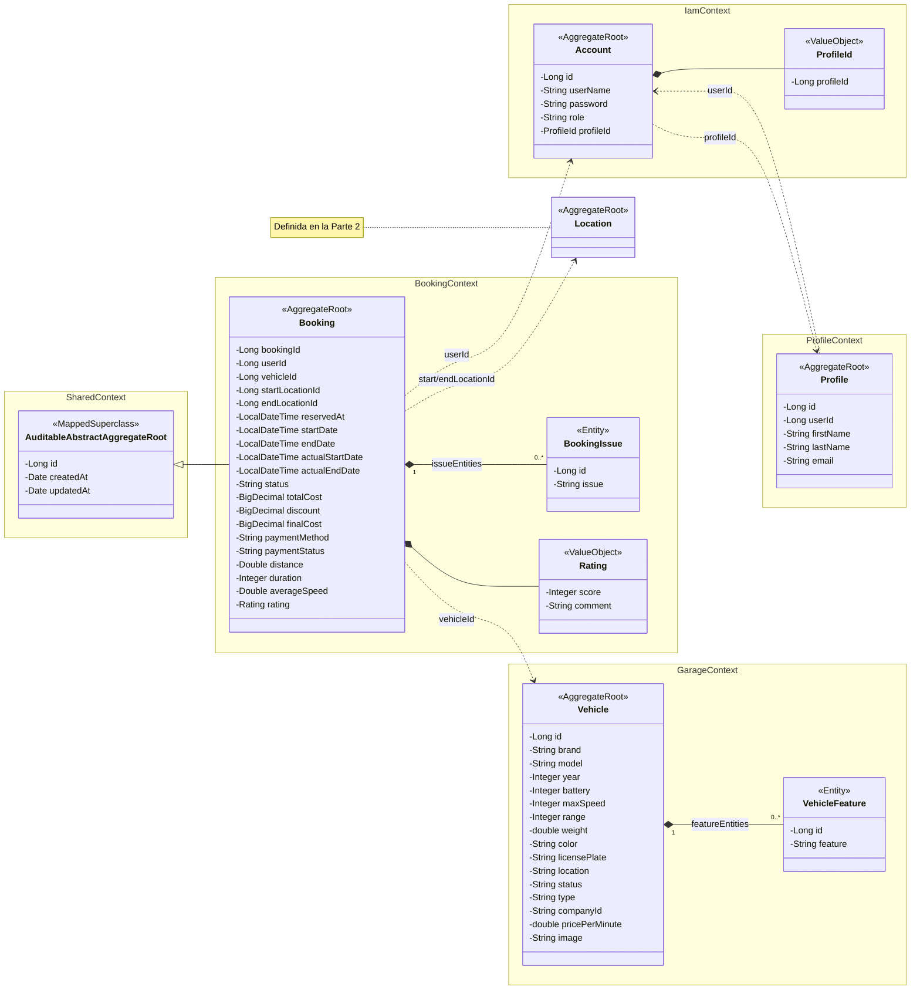
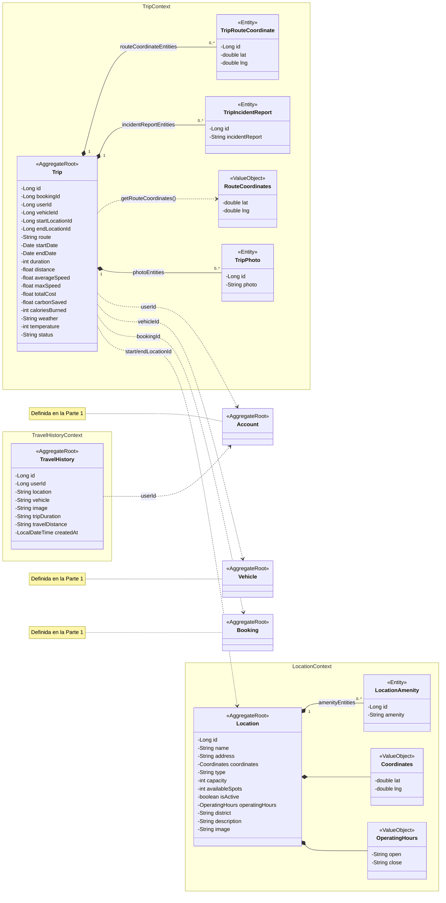
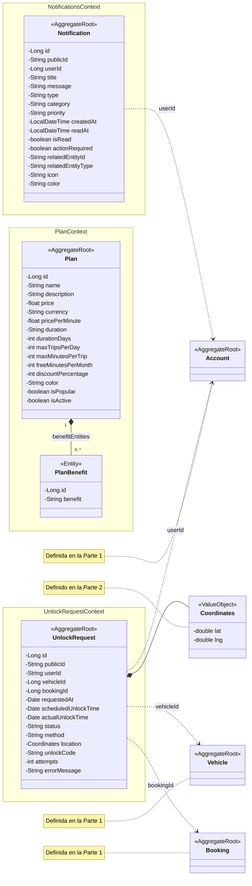

# Class Diagram - código fuente Mermaid (3 partes)

## Parte 1: núcleo (IAM, Profile, Booking, Garage y Shared)

## Parte 2: operación (Trip, TravelHistory y Location)

## Parte 3: soporte (Notifications, Plan y UnlockRequest)

