# Capítulo IV: Product Design

## 4.1. Style Guidelines

### 4.1.1.General Style Guidelines.

<h3>Branding</h3>

El logo de WR sintetiza de manera elegante y minimalista la propuesta de valor de la marca en el mundo de la micromovilidad eléctrica. El diseño en tipografía negra sobre fondo blanco comunica sobriedad, confianza y profesionalismo, asegurando legibilidad en cualquier soporte digital o físico.

En la parte superior, el scooter eléctrico estilizado simboliza movimiento, innovación y sostenibilidad, elementos centrales de la experiencia que WR ofrece. Su posición por encima de las iniciales representa la prioridad de la movilidad sobre cualquier otra función, transmitiendo dinamismo y acción inmediata.

La composición general mantiene un equilibrio entre modernidad y simplicidad, ideal para una plataforma tecnológica que busca conectar a las personas con alternativas de transporte accesibles, rápidas y ecológicas. La elección de una paleta monocromática resalta la seriedad de la propuesta, mientras que el ícono del scooter añade cercanía y un toque aspiracional.

Con este logo, WR se presenta como una marca confiable, eficiente y enfocada en transformar el desplazamiento urbano, adaptándose a las necesidades de estudiantes, profesionales y empresas.

***Variantes de logo***

***Logo original***


***Logo con iniciales light color***


***Colores invertidos***


<h3>Typography</h3>

La tipografía de nuestra app de micromovilidad eléctrica refleja dinamismo, innovación y accesibilidad, alineándose con los valores de sostenibilidad y movilidad inteligente que representamos. Hemos elegido una fuente sans-serif moderna, limpia y ligera, que transmite agilidad y simplicidad, elementos esenciales de nuestro servicio.

La fuente principal será "Kay Pho Du", que por su diseño esbelto y geométrico comunica tecnología y orden sin perder cercanía. Su alta legibilidad permite que los usuarios puedan consultar información rápida mientras se desplazan.

Para lograr una jerarquía visual clara, los títulos y subtítulos tendrán un tamaño más prominente que el cuerpo del texto. Los títulos (H1, H2) enfatizan energía y movimiento, mientras que los textos secundarios mantienen un tono amigable y sencillo.

El cuerpo del texto usará un tamaño base adaptable, que garantice lectura sin esfuerzo tanto en pantallas pequeñas (smartphones) como en tablets. Se mantendrá un interlineado aireado y márgenes equilibrados para no saturar la interfaz.

El lenguaje será directo y motivador, usando un tono casual que inspire confianza y fomente la adopción de alternativas de transporte sostenible.

<h3>Colors</h3>

La paleta de colores de nuestra app de micromovilidad eléctrica fue diseñada para reforzar el impacto visual del logo y proyectar dinamismo, sostenibilidad y confianza. El blanco se mantiene como base, representando simplicidad, limpieza y espacios abiertos, facilitando que los elementos clave destaquen sin saturar la vista.

El negro profundo del logo se utiliza en tipografía principal y elementos estructurales, comunicando seriedad y profesionalismo. Para transmitir energía y movimiento, incorporamos un verde lima brillante (#18FA3A) como color de acento, ideal para botones de acción (reservar, iniciar viaje) y mensajes de confirmación. Este tono evoca sostenibilidad y vitalidad, conectando con la misión de promover transporte limpio.

Un gris color (#EEEEEE) complementa la paleta y refuerza la percepción tecnológica de la plataforma, utilizado en íconos interactivos y estados activos. Además, tonos gris claro (#EAEAEA) y gris oscuro (#4F4F4F) equilibran la interfaz, mejorando la legibilidad y jerarquizando la información.

En conjunto, esta paleta crea una identidad moderna, ágil y ecológica, que motiva a los usuarios a adoptar la movilidad eléctrica como su primera opción dentro y fuera del campus.

---

#### Paleta de colores - WeRide

| **Color**        | **Uso**                                                                 | **Código Hex** |
|------------------|-------------------------------------------------------------------------|---------------|
| Blanco           | Fondo principal de la interfaz, espacios vacíos, sensación de limpieza y orden. | `#FFFFFF`     |
| Negro profundo   | Logo, textos principales, íconos y elementos estructurales.              | `#000000`     |
| Verde energía    | Botones de acción (reservar, iniciar viaje), confirmaciones y mensajes de éxito. | `#18FA3A`     |
| Gris claro       | Fondos secundarios, separadores, tarjetas de información.                | `#D9D9D9`     |
| Gris medio       | Texto secundario, íconos inactivos, descripciones y estados deshabilitados. | `#A6A6A6`     |

### 4.1.2. Web Style Guidelines.
Las guías de estilo web para WeRide garantizan una experiencia coherente y responsive en todos los dispositivos. La web está diseñada bajo los principios del Mobile-First y Responsive Design, asegurando que la interfaz se adapte fluidamente desde smartphones hasta pantallas de escritorio.
Layout:
Se utiliza un sistema de cuadrícula flexible (Grid System) de 12 columnas para organizar el contenido de manera estructurada y visualmente equilibrada. Los espaciados siguen una escala base de 8px para mantener la consistencia.
Navegación:
El menú de navegación principal es fijo en la parte superior (sticky header), con enlaces claros y accesibles. Se emplea el color verde energía (#18FA3A) para los estados activos y hover, reforzando la identidad de marca.
Componentes principales:
Botones:
Primarios: Fondo verde energía (#18FA3A), texto en negro (#000000).
Secundarios: Borde gris medio (#A6A6A6), texto gris oscuro (#4F4F4F).
Tarjetas:
Fondos gris claro (#D9D9D9) con sombras sutiles para profundidad, bordes redondeados de 8px.
Formularios:
Campos con borde gris medio (#A6A6A6) y focus en verde energía (#18FA3A).
Animaciones:
Transiciones suaves (300ms) en hover y cambios de estado para una experiencia fluida y moderna.

## 4.2. Information Architecture.

### 4.2.1. Organization Systems.

Para la **landing page** de WeRide, se ha optado por una estructura jerárquica para ambos segmentos de usuarios, ya que se cuenta con una barra de navegación superior que dirige a diferentes secciones, cada una encapsulando información relevante y relacionada.

Para el proceso de inicio de sesión o creación de cuenta, se utiliza una organización lineal, permitiendo que el usuario avance paso a paso a medida que completa los datos requeridos hasta finalizar el registro o acceso.

Dentro de la aplicación principal, se mantiene una organización jerárquica para separar y encapsular las distintas funcionalidades, independientemente del tipo de usuario. Esto asegura que, aunque los usuarios tengan diferentes necesidades y accesos, ****la estructura de la aplicación sea coherente y fácil de navegar.****

##### Usuario individual:
Para los **usuarios individuales** de WeRide, la funcionalidad principal es la gestión y uso de vehículos de micromovilidad (scooters, bicicletas y motos eléctricas). Por ello, la organización jerárquica permite agrupar subfuncionalidades como ***la reserva de vehículos, visualización del mapa, filtrado por tipo de vehículo, consulta de historial de viajes y notificaciones***, todas relacionadas con la experiencia de movilidad personal.

#### Empresa o Administrador:
En el caso de **empresas o administradores**, también se emplea una organización jerárquica para gestionar múltiples usuarios, vehículos y reportes. Además, se puede acceder a funcionalidades específicas como ***la supervisión del estado de la flota, generación de informes de uso, administración de usuarios corporativos y gestión de promociones***.


### 4.2.2. Labeling Systems.
Las etiquetas emplean un lenguaje claro y conciso, alineado con el tono casual y motivador de la marca:
**Inicio:** Vista principal con mapa y scooters disponibles.
**Reservar:** Flujo de reserva paso a paso.
**Mis Viajes:** Historial de viajes y reservas activas.
**Perfil:** Gestión de cuenta, método de pago y preferencias.
**Ayuda:** Centro de soporte con preguntas frecuentes y contacto.

---

### 4.2.3. SEO Tags and Meta Tags

**Titulo:**
```html
<title>WeRide</title>
```

**Codificación de carácteres:**
```html
<meta charset="utf-8">
```

**Descripción:**
```html
<meta name="description" content="WeRide is a web application focused on providing sustainable and smart urban mobility through electric scooters, bikes, and motorcycles.">
```

**Autor y Derechos de Autor:**
```html
<meta name="author" content="CultiConection">
<meta name="copyright" content="Copyright WeTech team" />
```

---

### 4.2.4.Searching Systems.

El sistema integral de micromovilidad eléctrica compartida incorporará un **módulo de búsqueda y localización en tiempo real**, que permitirá a los usuarios identificar la ubicación disponible de los vehículos más cercanos (scooters, bicicletas y motos eléctricas). Este sistema se sustenta en las siguientes características:  
Geolocalización en tiempo real:  
 Cada vehículo estará equipado con dispositivos GPS e IoT que transmitirán su ubicación de manera constante hacia la plataforma central.


**Mapa interactivo en la aplicación móvil**:  
 La app mostrará en un mapa la ubicación exacta de los vehículos disponibles, diferenciados por tipo (scooter, bicicleta o moto eléctrica).


**Filtros de búsqueda avanzada**
 Los usuarios podrán buscar vehículos según:


- Tipo de unidad preferida.


- Nivel de batería disponible.


- Distancia a pie desde su ubicación actual.


**Reserva inmediata**:
 Una vez identificado el vehículo, el usuario podrá seleccionarlo en la aplicación, reservarlo y dirigirse a recogerlo.


**Optimización para empresas**:
 En el caso de suscripciones corporativas, los sistemas de búsqueda también permitirán a los empleados visualizar vehículos disponibles en zonas cercanas a sus oficinas o campus, garantizando disponibilidad en horas de mayor demanda.


Con este enfoque, el sistema de búsqueda se convierte en un **componente esencial para la experiencia del usuario**, asegurando eficiencia en la localización y optimizando el uso de la flota.  

### 4.2.5.Navigation Systems.  

El sistema integral de micromovilidad eléctrica compartida contará con un módulo de navegación inteligente que facilitará al usuario el uso de los vehículos y la planificación de sus desplazamientos. Dicho módulo se estructura en las siguientes funciones:  
Guía hacia el vehículo seleccionado:  
 Una vez realizada la reserva, la aplicación mostrará la ruta a pie más rápida desde la ubicación del usuario hasta el vehículo disponible, mediante mapas integrados en tiempo real.  


**Navegación durante el viaje:**   
 El sistema proporcionará indicaciones de ruta para que el usuario se desplace de manera eficiente hacia su destino, evitando zonas de alto tráfico cuando sea posible. Para ello, se integrarán APIs de mapas inteligentes como Google Maps o Mapbox, adaptadas a la movilidad ligera.  


**Seguridad en la navegación:**  


- Alertas en la aplicación respecto a calles restringidas o zonas con tráfico intenso.  


- Recomendación de rutas seguras y sostenibles para bicicletas, scooters y motos eléctricas.  


- Opciones de personalización (ruta más rápida, más segura o más ecológica).  


**Gestión de estaciones y puntos de aparcamiento:**  
 La navegación también incluirá la localización de zonas de parqueo autorizadas, estaciones de carga o puntos estratégicos de la empresa asociados a la suscripción corporativa.  


**Soporte para empresas:**  
 En el caso de planes empresariales, el sistema de navegación permitirá sugerir rutas entre las sedes de trabajo, facilitando la movilidad de los colaboradores.  


En conjunto, este módulo no solo ofrece orientación geográfica en tiempo real, sino que también optimiza la experiencia de uso, mejorando la seguridad del viaje y reduciendo la incertidumbre del usuario en entornos urbanos congestionados.  

## 4.3. Landing Page UI Desing.  
### 4.3.1. Landing Page Wireframe.  
  
- Navbar  
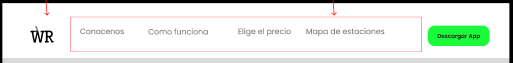
- Hero  
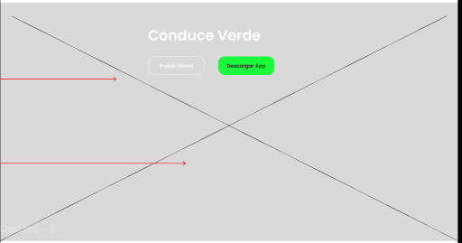
- Disposable Vehicles Section.  
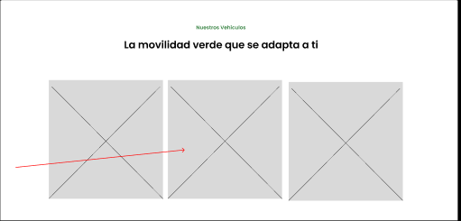
- Application user manual section.  
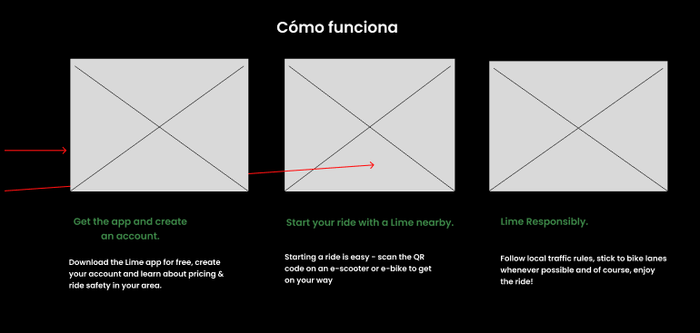
- Rates Section.  
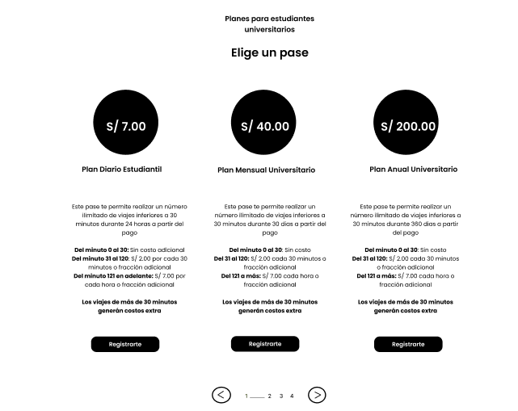
- Locations section.  
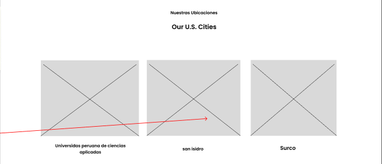
- Who we are section.  
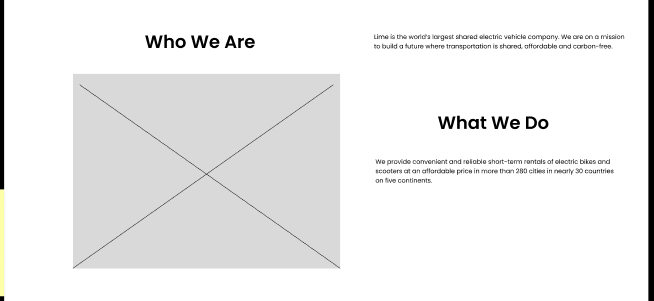
- About section.  
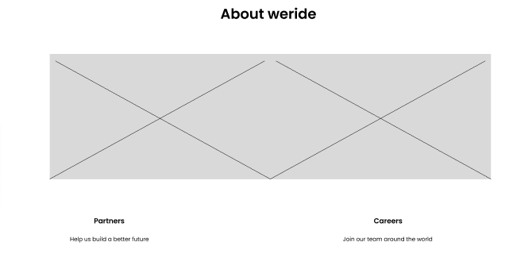
- Application download section.  
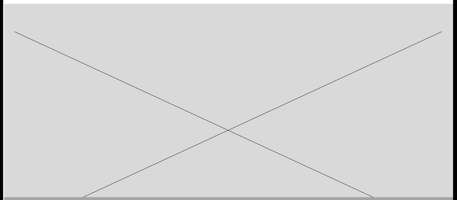
- Footer Section.  
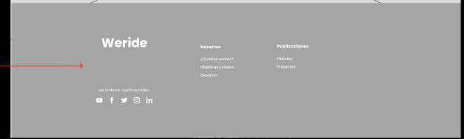
  
### 4.3.2. Landing Page Mock-up. 
   
- Navbar  

- Hero  
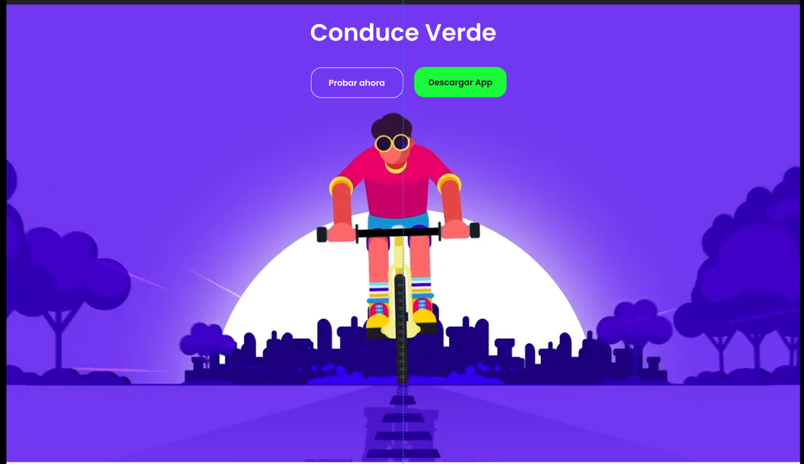
- Disposable Vehicles Section.  
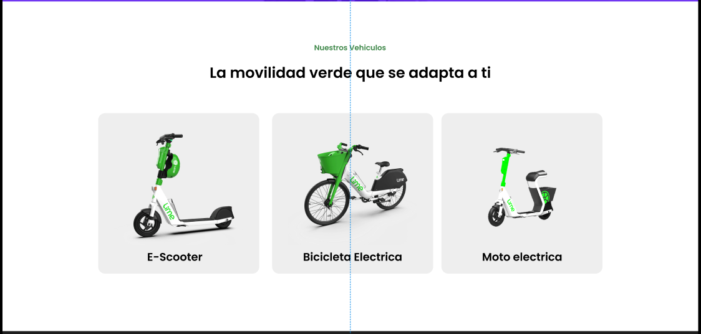
- Application user manual section.  
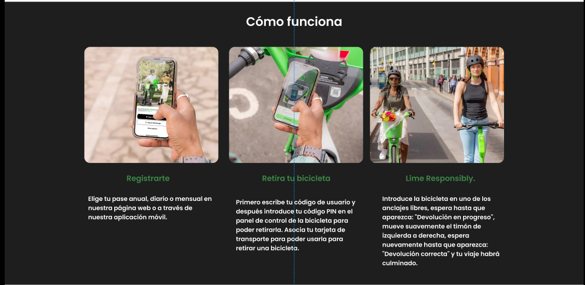
- Rates Section.  
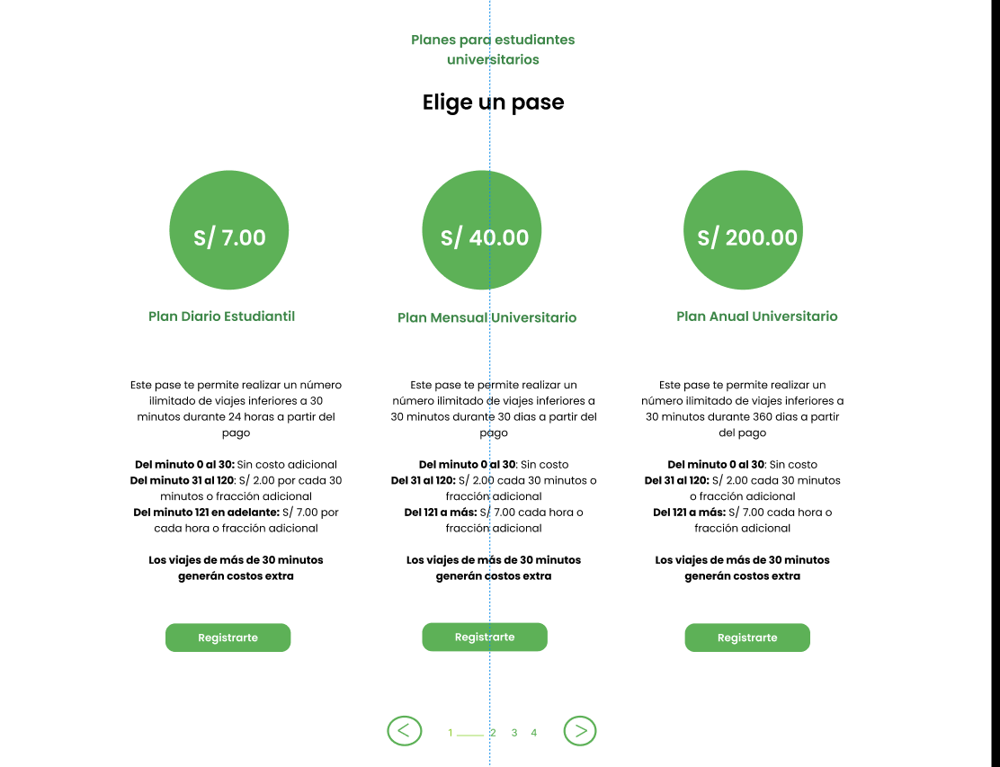
- Locations section.  
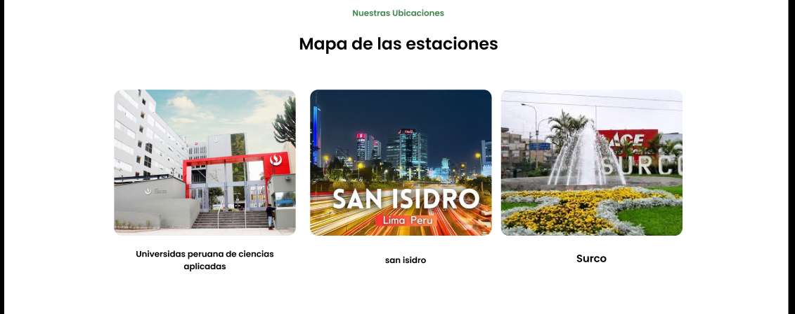
- Who we are section.  
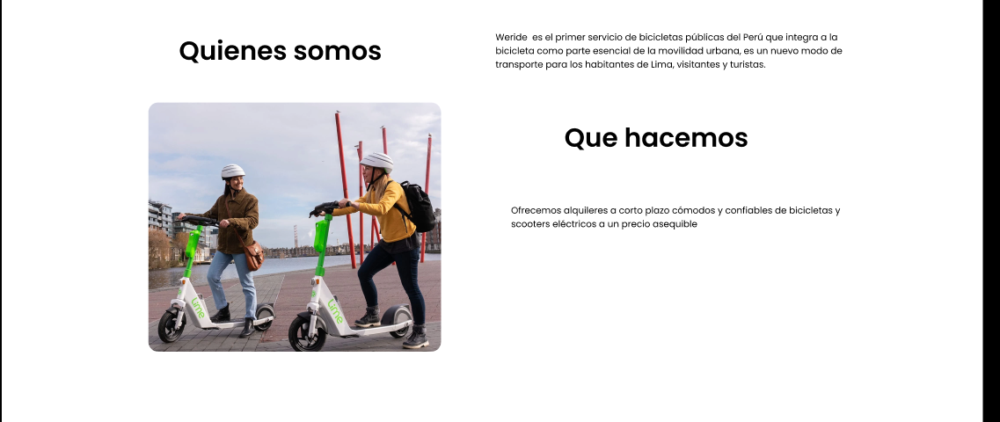
- About section.  
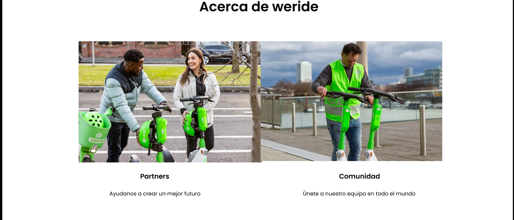
- Application download section.  
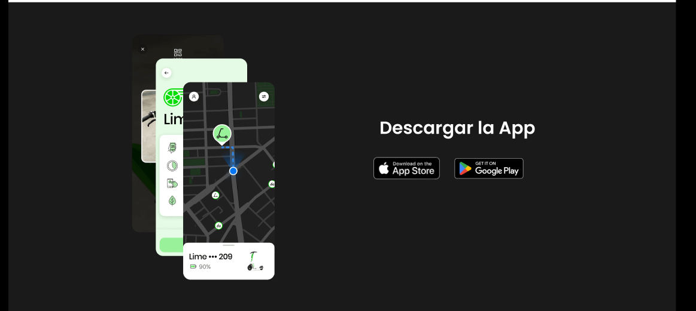
- Footer Section.  
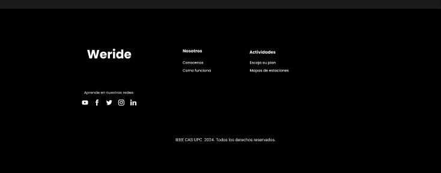

## 4.4.Web Applications UX/UI Design.

### 4.4.1.Web Applications Wireframes. 

Wireframes are simplified, low-fidelity visual guides that outline the structure, layout, and key elements of a web application’s interface. They focus on placement of content, navigation, and functionality rather than visual design details like colors or images. Wireframes help designers and developers plan page layouts, organize information, and ensure usability before moving on to higher-fidelity mock-ups or prototypes.

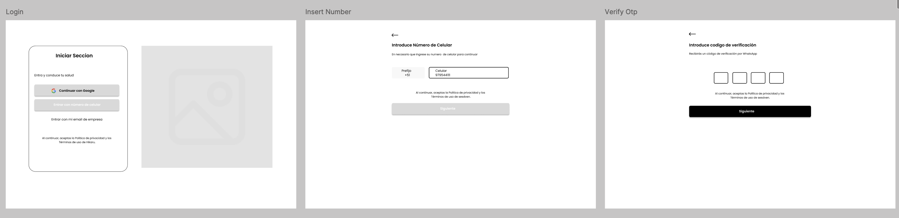

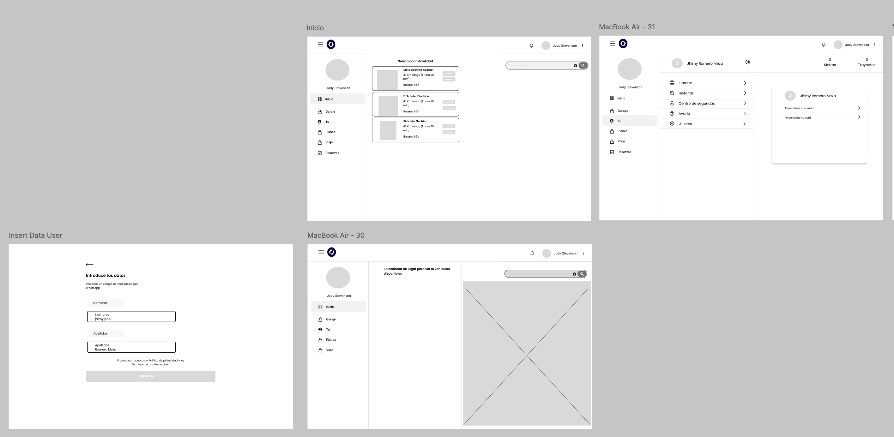

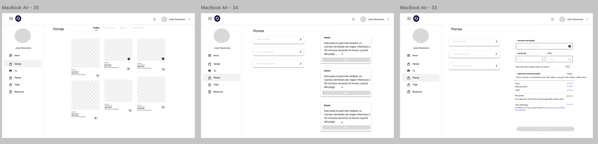

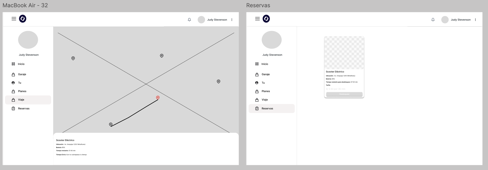

### 4.4.2.Web Applications Wireflow Diagrams.

Wireflow diagrams combine wireframes and user flow concepts to show both the layout of web pages and the paths users take through an application. They illustrate screen designs along with navigation steps, interactions, and decision points, providing a comprehensive view of how users move between pages and perform tasks. Wireflows help designers and developers plan user experience, identify potential issues, and communicate both the interface and workflow in a single visual representation.

#### Elementos clave del diseño
**Arquitectura de la información**
El contenido y las funciones están organizadas para facilitar el acceso a herramientas como el historial de servicios, monitoreo de consumo energético, o gestión de citas.
Los wireframes incluyen pantallas clave como:
Panel de control del propietario.
Dashboard del proveedor técnico.
Formulario para solicitar mantenimientos preventivos.
Historial de dispositivos y consumo energético.
Se ha priorizado una navegación simple y accesible, permitiendo que usuarios con diversas habilidades puedan moverse con facilidad por la plataforma.
Estructura de la interfaz
Los elementos interactivos (botones, menús, tarjetas de información) están ubicados estratégicamente para que el usuario pueda realizar tareas con pocos clics.
Las pantallas permiten acceso directo a secciones importantes como:
Subir o editar dispositivos eléctricos.
Contactar proveedores certificados.
Visualizar métricas de rendimiento o consumo.
Se incluye también una sección de perfil adaptable y configurable, especialmente útil para personas que requieren adaptaciones visuales, físicas o cognitivas.


### 4.4.3. Web Applications Mock-ups.  

Mock-ups are static or semi-interactive visual representations of a web application’s interface. They show the layout, design elements, content placement, and functionality of pages without fully implementing the system. Mock-ups help stakeholders, designers, and developers visualize the look and feel of the application, gather feedback, and validate design decisions before actual development begins. They are an essential step in the UI/UX design process to ensure usability, consistency, and alignment with user needs.

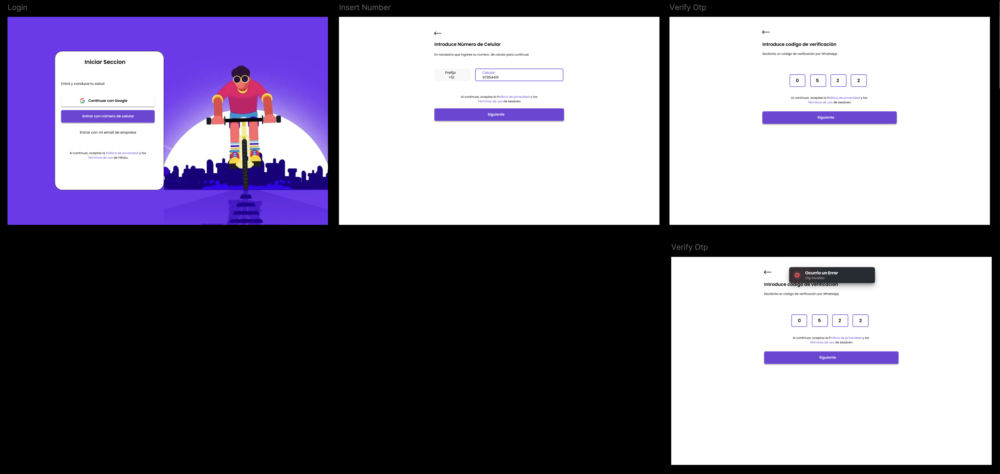

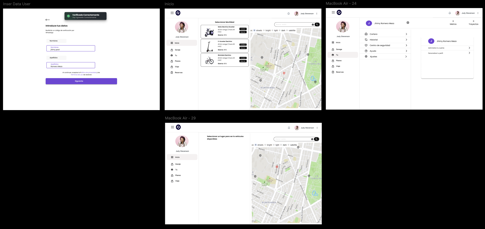

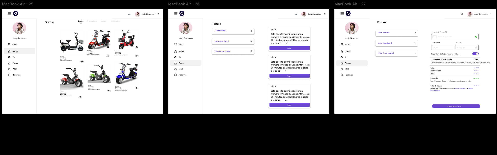

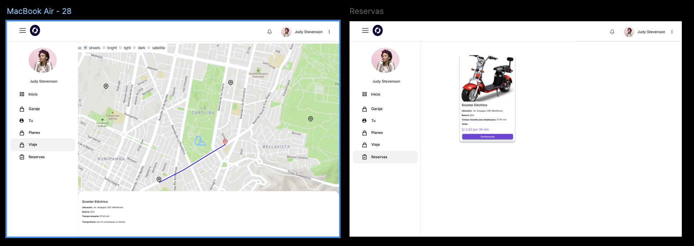

### 4.4.4. Web Applications User Flow Diagrams. 

User Flow Diagrams are visual representations that show the steps a user takes to complete specific tasks within a web application. They map the navigation paths between screens or pages, highlighting decision points, actions, and outcomes. These diagrams help designers and developers understand how users interact with the system, identify potential usability issues, and ensure smooth navigation and task completion. They are essential for planning intuitive interfaces, improving user experience, and guiding development teams in implementing consistent workflows.


.png)

## 4.5. Web Applications Prototyping.

Web Applications Prototyping es una metodología esencial en el desarrollo de aplicaciones web, que implica la creación de bocetos visuales o modelos preliminares de una aplicación antes de su implementación completa. 

### 4.6. Domain-Driven Software Architecture
 
La arquitectura de WeRide se describe con el modelo C4 en tres niveles: contexto, contenedores y componentes. Los diagramas se elaboraron con Structurizr (Structurizr DSL) y reflejan la solución implementada.
 
#### Decisiones y estilos arquitectónicos
 
- **Cliente-servidor y Single Page Application:** la Web Application, desarrollada con Angular y TypeScript, se ejecuta en el navegador y consume la API por HTTP.
- **RESTful API:** el backend, desarrollado con Java 17 y Spring Boot, expone sus recursos mediante servicios REST documentados con OpenAPI (Swagger UI) y protegidos con autenticación basada en JWT.
- **Domain-Driven Design:** el backend se organiza en bounded contexts (IAM, Profile, Booking, Garage, TravelHistory, Location, Notifications, Plan, Trip y UnlockRequest) y un contexto Shared con la clase base de auditoría. La Web Application organiza sus componentes con el mismo criterio.
- **Arquitectura en capas por contexto:** cada bounded context separa las capas de interfaces (controladores REST), application (servicios), domain (aggregates, entities y value objects) e infrastructure (repositorios).
- **CQRS:** los servicios de la capa application se separan en servicios de comandos (que modifican el estado) y servicios de consultas (que lo leen).
- **Monolito modular:** el backend se despliega como una única aplicación, cuyos módulos son los bounded contexts. Estos se comunican entre sí solo por identificadores, sin referencias directas entre objetos.
- **Persistencia relacional:** MySQL, accedida mediante Spring Data JPA.
- **Despliegue:** el backend se ejecuta en una máquina virtual de Microsoft Azure, como servicio de systemd detrás de un reverse proxy nginx; el backend cuenta además con Dockerfile y docker-compose.

### 4.6.1 Design-Level Event Storming.

#### Bounded Contexts

| Bounded Context | Responsabilidad | Aggregate principal |
|---|---|---|
| IAM | Cuentas, roles, registro e inicio de sesión con JWT | Account |
| Profile | Datos personales del usuario | Profile |
| Booking | Reservas, costos, pago e incidencias | Booking |
| Garage | Catálogo de vehículos y sus características | Vehicle |
| TravelHistory | Historial resumido de viajes | TravelHistory |
| Location | Estaciones de alquiler, horarios y servicios | Location |
| Notifications | Avisos dirigidos al usuario | Notification |
| Plan | Planes de suscripción y sus beneficios | Plan |
| Trip | Viajes con ruta, métricas e incidentes | Trip |
| UnlockRequest | Solicitudes de desbloqueo de vehículos | UnlockRequest |
| Shared | Clase base de auditoría y configuración común | AuditableAbstractAggregateRoot |

---


#### 4.6.2. Software Architecture Context Diagram
 
El diagrama de contexto muestra WeRide como un único sistema, junto con las personas que lo usan y los sistemas externos con los que se comunica. Los usuarios corresponden a los dos segmentos objetivo: usuarios finales (universitarios y jóvenes profesionales, B2C) y clientes corporativos (B2B). Los sistemas externos son la pasarela de pago y el servicio de verificación por SMS, ambos en entorno sandbox.
 
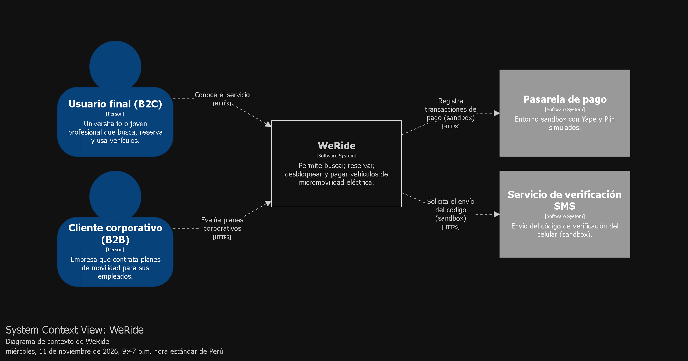
 
*Figura X. Diagrama de contexto de WeRide, elaborado en Structurizr.*
 
#### 4.6.3. Software Architecture Container Diagrams
 
El diagrama de contenedores muestra las unidades ejecutables y de almacenamiento de WeRide: la Landing Page (HTML, CSS y JavaScript), la Web Application (Angular), el reverse proxy (nginx), la RESTful API (Spring Boot) y la base de datos (MySQL). Las personas acceden a la Landing Page y a la Web Application desde el navegador; la Web Application consume la API a través del reverse proxy, y la API persiste en MySQL.
 
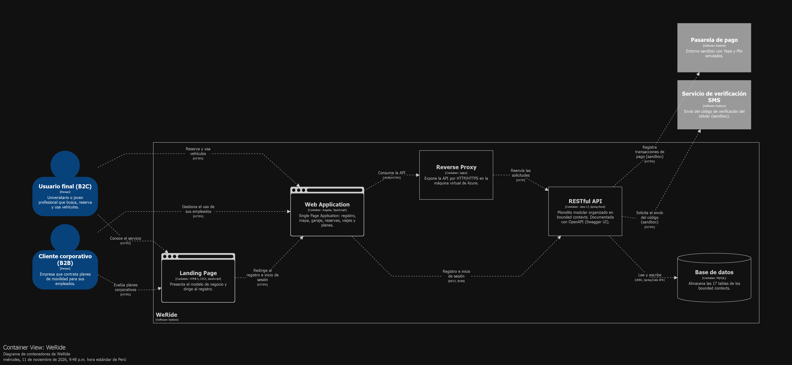
 
*Figura X. Diagrama de contenedores de WeRide, elaborado en Structurizr.*
 
#### 4.6.4. Software Architecture Components Diagrams
 
El diagrama de componentes detalla la RESTful API. Cada componente corresponde a un bounded context. Las flechas entre componentes representan referencias por identificador (por ejemplo, una reserva referencia al vehículo por su id) y todos los componentes persisten en la base de datos mediante Spring Data JPA. Los demás contextos referencian al usuario por el id de su cuenta (IAM).
 
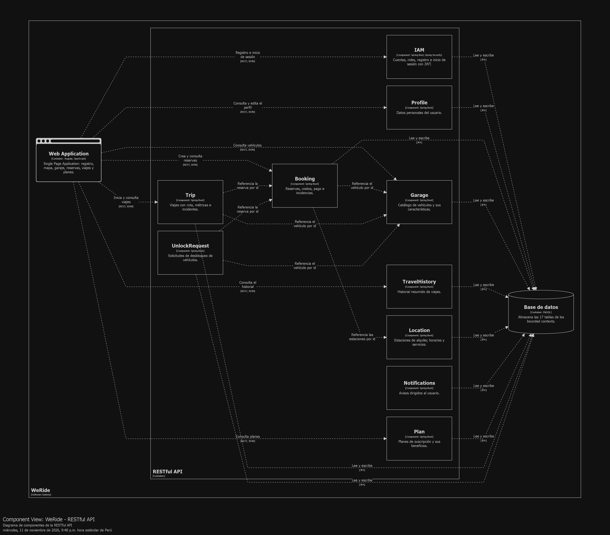
 
*Figura X. Diagrama de componentes de la RESTful API, elaborado en Structurizr.*


## 4.7.Software Object-Oriented Design.

El diagrama de clases nos ayuda a definir la funcionalidad de el producto de **WeRide** mediante los atributos y funcionalidades de las clases de nuestras entidades relacionadas al funcionamiento del producto, desde interfaces, clases y atributos.

### 4.7.1.Class Diagram.

El Class Diagram representa el modelo de dominio del backend de WeRide, organizado en los bounded contexts IAM, Profile, Booking, Garage, TravelHistory, Location, Notifications, Plan, Trip y UnlockRequest, además del contexto Shared que contiene la clase base de auditoría. Cada clase se identifica con su estereotipo de Domain-Driven Design (Aggregate Root, Entity o Value Object). Por legibilidad, el diagrama se presenta en tres partes.
 
Las composiciones (rombo relleno) indican entidades y value objects que pertenecen a un aggregate. Las flechas punteadas indican referencias entre aggregates por id, sin referencia directa entre objetos. Las clases sin atributos y con una nota son referencias a aggregates definidos en otra parte.
 
#### Parte 1: núcleo del negocio
 
Incluye la gestión de cuentas y perfiles (IAM y Profile), las reservas (Booking), los vehículos (Garage) y la clase base de auditoría (Shared).
 
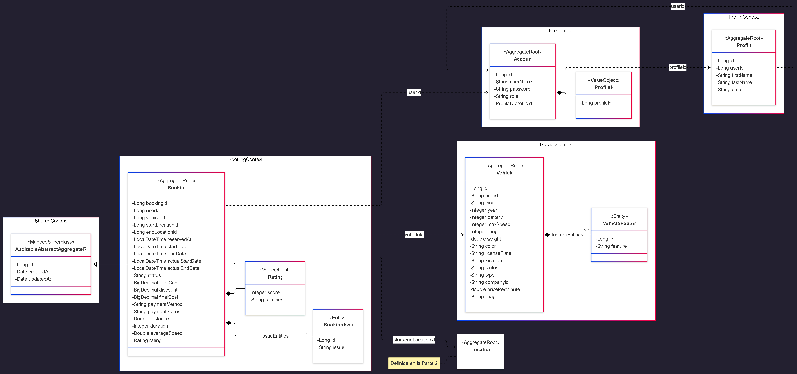
 
*Figura 1. Class Diagram de WeRide, parte 1.*
 
#### Parte 2: operación
 
Incluye los viajes realizados (Trip), su resumen histórico (TravelHistory) y las ubicaciones o estaciones de alquiler (Location).
 

 
*Figura 2. Class Diagram de WeRide, parte 2.*
 
#### Parte 3: soporte
 
Incluye las notificaciones (Notifications), los planes de suscripción (Plan) y las solicitudes de desbloqueo de vehículos (UnlockRequest).
 
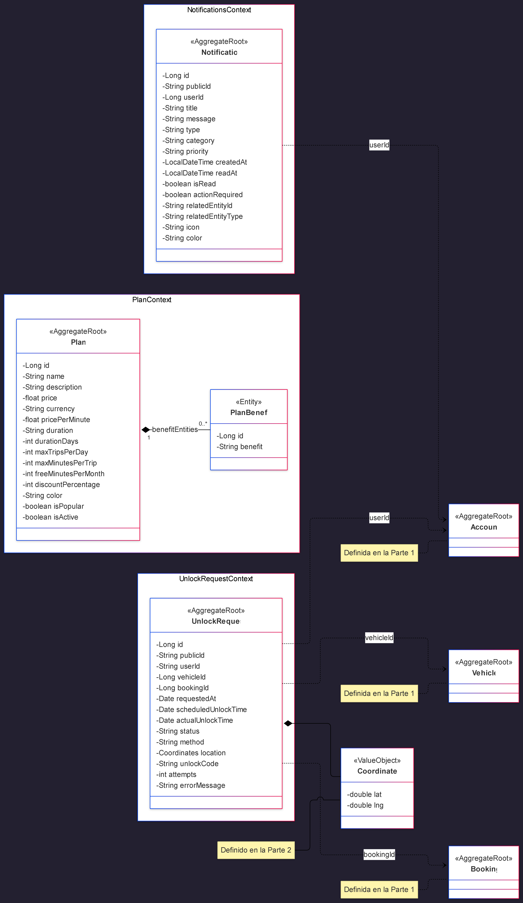
 
*Figura 3. Class Diagram de WeRide, parte 3.*

 
### 4.7.2. Class Dictionary
 
| Class | Bounded Context | Type | Description |
|---|---|---|---|
| AuditableAbstractAggregateRoot | Shared | Mapped Superclass | Clase base con `id`, `createdAt` y `updatedAt`; hereda de ella `Booking` |
| Account | IAM | Aggregate Root | Cuenta de acceso con usuario, contraseña y rol (`ROLE_CLIENT` por defecto) |
| ProfileId | IAM | Value Object | Identificador del perfil asociado a la cuenta |
| Profile | Profile | Aggregate Root | Datos personales: nombre, apellido y correo |
| Booking | Booking | Aggregate Root | Reserva de un vehículo, con costos, pago y métricas del recorrido |
| BookingIssue | Booking | Entity | Incidencia reportada en una reserva |
| Rating | Booking | Value Object | Puntaje y comentario del usuario sobre el viaje |
| Vehicle | Garage | Aggregate Root | Bicicleta o scooter eléctrico con especificaciones y precio por minuto |
| VehicleFeature | Garage | Entity | Característica de un vehículo |
| TravelHistory | TravelHistory | Aggregate Root | Registro resumido de un viaje realizado por un usuario |
| Location | Location | Aggregate Root | Estación o punto de alquiler con ubicación, capacidad y horario |
| LocationAmenity | Location | Entity | Servicio disponible en una ubicación |
| Coordinates | Location | Value Object | Latitud y longitud |
| OperatingHours | Location | Value Object | Hora de apertura y de cierre de una ubicación |
| RouteCoordinates | Trip | Value Object | Latitud y longitud de un punto de la ruta, devuelto por `Trip.getRouteCoordinates()` |
| Notification | Notifications | Aggregate Root | Aviso dirigido a un usuario, con prioridad y acción asociada |
| Plan | Plan | Aggregate Root | Plan de suscripción con precio, límites de uso y descuento |
| PlanBenefit | Plan | Entity | Beneficio incluido en un plan |
| Trip | Trip | Aggregate Root | Viaje realizado, con ruta, métricas, clima y costo |
| TripRouteCoordinate | Trip | Entity | Punto de la ruta de un viaje |
| TripIncidentReport | Trip | Entity | Incidente reportado durante un viaje |
| TripPhoto | Trip | Entity | Foto asociada a un viaje |
| UnlockRequest | UnlockRequest | Aggregate Root | Solicitud de desbloqueo de un vehículo, con método, código e intentos |


## 4.8.Database Design.

El diagrama de base de datos nos ayudara a la correcta definicion de entidades dentro de la base de datos funcional de **WeRide**, definiendo que entidades se vinculan mediante las id's principales para la correcta organizacion y manejo de informacion.

### 4.8.1. Relational/Non-Relational Database Diagram

La persistencia de WeRide utiliza MySQL como base de datos relacional, gestionada mediante Spring Data JPA e Hibernate. El esquema se deriva de las entidades JPA de los bounded contexts del backend (IAM, Profile, Booking, Garage, TravelHistory, Location, Notifications, Plan, Trip y UnlockRequest) y está compuesto por 17 tablas.

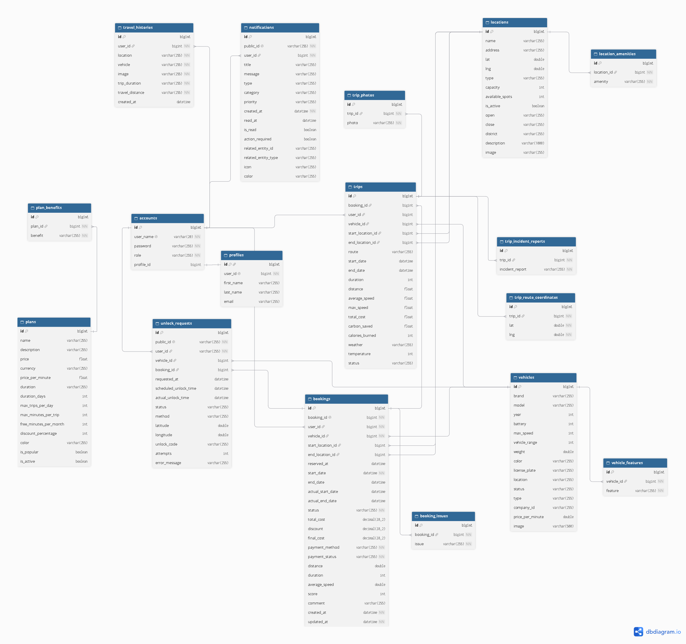

*Database Diagram de WeRide, elaborado en dbdiagram.io.*

**Tablas por bounded context**

| Bounded Context | Tablas |
|---|---|
| IAM | `accounts` |
| Profile | `profiles` |
| Booking | `bookings`, `booking_issues` |
| Garage | `vehicles`, `vehicle_features` |
| TravelHistory | `travel_histories` |
| Location | `locations`, `location_amenities` |
| Notifications | `notifications` |
| Plan | `plans`, `plan_benefits` |
| Trip | `trips`, `trip_route_coordinates`, `trip_incident_reports`, `trip_photos` |
| UnlockRequest | `unlock_requests` |

**Cómo leer el diagrama**

- Las líneas negras son foreign keys reales. Solo existen entre un aggregate y sus entidades hijas (por ejemplo, `booking_issues.booking_id` hacia `bookings.id`).
- Las líneas grises son referencias lógicas entre bounded contexts (por ejemplo, `bookings.user_id` hacia `accounts.id`). No tienen constraint en la base de datos: cada aggregate referencia a los demás solo por id, lo que mantiene los contextos desacoplados según los principios de Domain-Driven Design.
- Los value objects `Rating`, `Coordinates` y `OperatingHours` se guardan como columnas dentro de la tabla de su aggregate (`bookings`, `locations` y `unlock_requests`).
- Los nombres de tablas y columnas siguen la convención en inglés, en snake_case, que Spring Data JPA genera a partir de las entidades.

**Decisiones de diseño y limitaciones**

- Las tablas `plans` y `plan_benefits` no se relacionan con otras tablas, porque el modelo actual no incluye la suscripción de una cuenta a un plan. Se considera trabajo futuro.
- `travel_histories` guarda el nombre del vehículo como texto y no su id, por lo que no puede enlazarse con `vehicles`.
- Las referencias lógicas no garantizan integridad referencial en la base de datos; esa responsabilidad recae en la capa de aplicación.


